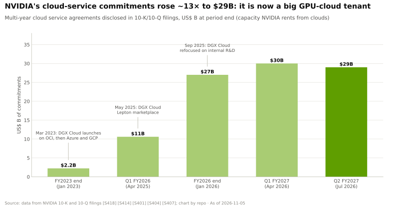
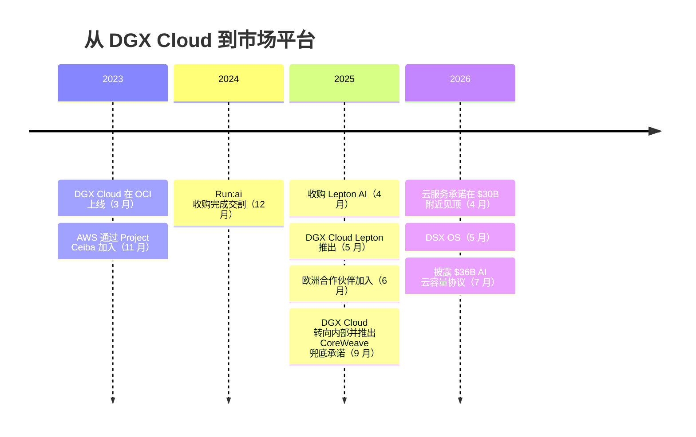
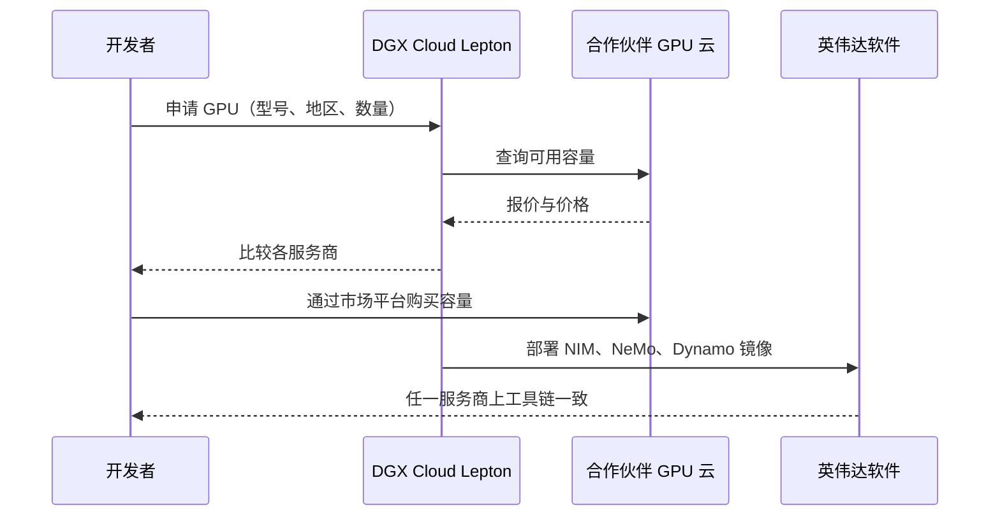

# DGX Cloud 与 DGX Cloud Lepton

> [!NOTE]
> 本页为英文原文的简体中文参考译文，仅供参考；如有出入，以[英文原文](../../../layers/12-orchestration-and-cloud-services/dgx-cloud-and-lepton.md "English original")为准。

第 12 层 · 编排与云服务 · 约 8 分钟阅读 · 最后核实：2026-11-05

## ⚡ 要点速览

- **[DGX Cloud](../../glossary.md#dgx-cloud)（2023 年 3 月）是英伟达开在别人云里的云：** 由英伟达运营的集群先托管于 Oracle Cloud，随后是 Azure 和 Google Cloud，每个 8-GPU 实例起价 $36,999/月（约合每 [GPU 小时](../../glossary.md#gpu-hour) $6.34）[[S12007]](../../../sources/bibliography.md#s12007)；AWS 于 2023 年 11 月加入 [[S5525]](../../../sources/bibliography.md#s5525)。
- **其机制是回租。** 英伟达从购买其 GPU 的云厂商那里租回容量，再搭配自有软件转售。其[多年期云服务协议](../../glossary.md#cloud-service-agreement)增长约 13 倍，从 $2.23B（2023 年 1 月）增至 $29B（2026 年 7 月）[[S418]](../../../sources/bibliography.md#s418)[[S407]](../../../sources/bibliography.md#s407)。
- 🟡 **2025 年的战略转向：** 据报道，随着英伟达不再试图与 AWS 和 Azure 竞争，DGX Cloud 的大部分容量被转用于英伟达自身的研究 [[S90068]](../../../sources/bibliography.md#s90068)；另据报道，一笔约 $1.5B、从 Lambda 租回约 18,000 颗 GPU 的交易也指向同一方向 [[S483]](../../../sources/bibliography.md#s483)。
- **[DGX Cloud Lepton](../../glossary.md#dgx-cloud-lepton)（2025 年 5 月）是一个市场平台，而不是一朵云。** 它在不持有硬件的情况下把开发者导流至合作伙伴的容量（CoreWeave、Crusoe、Lambda、Nebius、Nscale 等）[[S598]](../../../sources/bibliography.md#s598)[[S12009]](../../../sources/bibliography.md#s12009)，其基础是对 Lepton AI 的收购（2025 年 4 月；据报道金额为数亿美元）[[S478]](../../../sources/bibliography.md#s478)[[S479]](../../../sources/bibliography.md#s479)。
- **英伟达还是最后的买家：** 在 2032-04-13 之前承接 CoreWeave 最多 $6.3B 的未售出容量 [[S90067]](../../../sources/bibliography.md#s90067)，这包含在 2026 年 7 月披露的 $36B AI 云容量协议之内 [[S407]](../../../sources/bibliography.md#s407)[[S430]](../../../sources/bibliography.md#s430)。
- **为何不做完整的公有云：** 在英伟达 Q2 FY2027 约 $89B 的数据中心收入中，超大规模客户贡献约 $48.7B [[S90011]](../../../sources/bibliography.md#s90011)[[S90013]](../../../sources/bibliography.md#s90013)。与它们竞争会引发渠道冲突，并加速它们的自研芯片。
- **弱点：** 英伟达如今在硬件公司的资产负债表上背负着云服务式的承诺（合计约 $65B）[[S407]](../../../sources/bibliography.md#s407)；一旦需求走弱，这些承诺就会从支撑变成成本。

## DGX Cloud 1.0：百货商场里的品牌专柜

设计师品牌可以在百货商场里开设自营专柜：用自己的员工、自己的定价、自己的客户，占用的是商场的场地。DGX Cloud 的运作方式如出一辙。[超大规模云厂商](../../glossary.md#hyperscaler)购买并托管 GPU；英伟达租回这些容量，加上 Base Command、AI Enterprise 和自己的工程师，再以自己的定价出售使用权 [[S12007]](../../../sources/bibliography.md#s12007)。

> [!TIP]
> **算例 —— DGX Cloud 的收费水平。** $36,999/月 ÷（8 颗 GPU × 约 730 小时）= **约 $6.34/GPU 小时** [[S12007]](../../../sources/bibliography.md#s12007)，含英伟达的软件与支持服务。AWS 自有的 H100 实例在 2023 年 7 月推出时的目录价为 $12.29/GPU 小时 [[S391]](../../../sources/bibliography.md#s391)，而[新兴云服务商（neocloud）](../../glossary.md#neocloud)的 H100 在 2023 年高峰期约为 $8 [[S393]](../../../sources/bibliography.md#s393)。**结论：** DGX Cloud 定位为高溢价、软件丰富的服务，而非折扣渠道，并且与托管方自己的实例形成竞争。

## 2025 年的战略转向：从云卖家变为云租户

据 2025 年 9 月的报道，DGX Cloud 的大部分容量被用于英伟达自身的研究，英伟达也将不再试图与 AWS 和 Azure 竞争 [[S90068]](../../../sources/bibliography.md#s90068)。但承诺规模并未缩减：从 2025 年 4 月的 $10.6B 增至 2026 年 7 月的 $29B [[S414]](../../../sources/bibliography.md#s414)[[S407]](../../../sources/bibliography.md#s407)。英伟达仍在大规模租用容量，如今主要用于自身的研究和软件开发 [[S90068]](../../../sources/bibliography.md#s90068)。

> [!TIP]
> **算例 —— $29B 能租多少颗 GPU。** 假设约 $2.50/GPU 小时（介于 2026 年 3 月约 $2.35 的 H100 一年期指数 [[S12516]](../../../sources/bibliography.md#s12516)与 Blackwell 目录价 [[S395]](../../../sources/bibliography.md#s395)之间），$29B 可购买约 116 亿个 GPU 小时。按这些承诺六年的期限 [[S401]](../../../sources/bibliography.md#s401)计算，相当于约 220,000 颗 GPU 全时运行（🔴 本资料库估计）。**结论：** 英伟达本身就是较大的 GPU 云租户之一。

## DGX Cloud Lepton：调度需求，而非拥有供给

Lepton 更像网约车应用，而不是出租车公司。开发者可以在各合作伙伴云之间搜索 GPU，向某家服务商购买容量或接入自有集群，并且无论选择哪家服务商，都能使用英伟达的软件栈 [[S12009]](../../../sources/bibliography.md#s12009)[[S12529]](../../../sources/bibliography.md#s12529)。首批合作伙伴包括 CoreWeave、Crusoe、Firmus、富士康、GMI Cloud、Lambda、Nebius、Nscale、软银（SoftBank）和 Yotta [[S12009]](../../../sources/bibliography.md#s12009)；Mistral AI、Fluidstack、Scaleway、Together AI 等于 2025 年 6 月加入，据报道 AWS 和 Azure 也将跟进 🟡 [[S12008]](../../../sources/bibliography.md#s12008)。

> [!TIP]
> **算例 —— 新兴云服务商为何加入。** 一家拥有 2,000 颗 GPU 的新兴云服务商若将利用率从 60% 提升到 70%，每年可多卖出 2,000 × 8,760 × 10% ≈ **175 万**个 GPU 小时；按约 $2.35 [[S12516]](../../../sources/bibliography.md#s12516)计算，即在已有容量上多获得约 $41M 收入（估计）。**结论：** Lepton 对合作伙伴的价值在于需求聚合；对英伟达的价值则在于，无论硬件归谁，开发者都留在它的软件栈上。

🔧 技术细节：英伟达的三类云承诺

| 工具 | 英伟达为何付费 | 规模 | 来源 |
|---|---|---|---|
| 多年期云服务协议 | 自用容量（DGX Cloud、研究） | $29B（2026 年 7 月） | [[S407]](../../../sources/bibliography.md#s407) |
| AI 云容量协议 | 合作伙伴未售出的容量 | $36B（2026 年 7 月） | [[S407]](../../../sources/bibliography.md#s407)[[S430]](../../../sources/bibliography.md#s430) |
| CoreWeave 兜底承诺（属上述之一） | CoreWeave 截至 2032-04-13 的未售出容量 | 最多 $6.3B | [[S90067]](../../../sources/bibliography.md#s90067) |

这些是采购承诺，而非收入。围绕它们的[循环融资](../../glossary.md#circular-financing)争议，详见[价值链与企业发展视角](value-chain-and-corp-dev.md)。

## 英伟达为何避免与超大规模云厂商正面竞争

1. **客户集中：** 超大规模云厂商约占 Q2 FY2027 数据中心收入的 55%（约 $89B 中的 $48.7B）[[S90011]](../../../sources/bibliography.md#s90011)[[S90013]](../../../sources/bibliography.md#s90013)。自建一朵与之竞争的云，将使最大客户的订单面临风险。
2. **它们的替代方案是真实存在的：** 每家超大规模云厂商都有自研加速器（TPU、Trainium、Maia、MTIA）；渠道冲突只会加速其采用。
3. **经济模式不同：** 英伟达在出货时即赚取约 75% 的毛利率 [[S3]](../../../sources/bibliography.md#s3)；云厂商则要在数年间逐步赚回，并承担利用率与融资风险。

> [!TIP]
> **算例 —— 出售与出租一颗 GB300 GPU 的对比。** 英伟达的收入在出货时即确认（在 ODM 层面，机架售价约合每 GPU $55K [[S332]](../../../sources/bibliography.md#s332)）。一家云厂商若以假设的 $3.00/小时、60% 利用率出租同一颗 GPU，六年可收入约 $95K（3.00 × 8,760 × 0.6 × 6），且尚未扣除电力、设施、人员和利息（🔴 假设）。**结论：** 云厂商多出来的收入是以六年的风险换来的；英伟达宁愿为每一朵云供货，也不愿自己成为一朵云。

> [!NOTE]
> **🐂 看多观点：** Lepton 加上兜底承诺，让英伟达以很少的资本开支就能影响需求的落点，同时超大规模云厂商仍是它的客户。

> [!WARNING]
> **🐻 看空观点：** 约 $65B 的承诺 [[S407]](../../../sources/bibliography.md#s407)使英伟达实际上成了云风险的承担者；一旦进入下行周期，它将为那些早已确认为收入的闲置 GPU 买单。

## 🎯 企业发展视角

1. **市场平台还是所有者：** Lepton 表明英伟达更愿意掌控需求路由和软件，而非数据中心。哪些 GPU 云中介或聚合平台仍是独立的潜在标的？
2. **像审视承租人资产负债表那样解读这些承诺：** $29B 的服务协议加上 $36B 的容量协议 [[S407]](../../../sources/bibliography.md#s407)，理应受到与租赁负债同等的审视。
3. **合作伙伴杠杆是一把双刃剑：** 新兴云服务商从 Lepton 获得需求，但也加深了对英伟达供货分配与定价的依赖。
4. **高通的问题（仅基于公开信息）：** 一个硬件中立、类似 Lepton 的市场平台，是否有助于非英伟达推理机架触达开发者？又该由谁来运营？

## 📚 来源（Sources）

<!-- Auto-generated from the [S…] citations on this page by `make build`. Edit sources/registry/*.csv, not this list. -->

- [**S3**](../../../sources/bibliography.md#s3) StorageNewsletter, *NVIDIA Q2 Fiscal 2027 results coverage: revenue $96.2B*, 2026-08-27. [Link](https://www.storagenewsletter.com/2026/08/27/nvidia-fiscal-2q27-financial-results/)
- [**S332**](../../../sources/bibliography.md#s332) Tiger Brokers (iTiger), *Morgan Stanley's BOM analysis of NVIDIA's Rubin: GPU share declines; PCB, MLCC and ABF substrate values soar*, 2026-05-20. [Link](https://www.itiger.com/news/1188068712)
- [**S391**](../../../sources/bibliography.md#s391) AWS, *Amazon EC2 P5 instances (NVIDIA H100) - product and on-demand pricing*, 2023-07-26. [Link](https://aws.amazon.com/ec2/instance-types/p5/)
- [**S393**](../../../sources/bibliography.md#s393) Latent Space (Eugene Cheah), *$2 H100s: how the GPU bubble burst*, 2024-10. [Link](https://www.latent.space/p/gpu-bubble)
- [**S395**](../../../sources/bibliography.md#s395) Lambda, *Lambda GPU cloud pricing*, 2025. [Link](https://lambda.ai/pricing)
- [**S401**](../../../sources/bibliography.md#s401) NVIDIA Corporation via SEC EDGAR, *NVIDIA Corporation Form 10-K for fiscal year ended January 25, 2026*, 2026-02-25. [Link](https://www.sec.gov/Archives/edgar/data/1045810/000104581026000021/nvda-20260125.htm)
- [**S407**](../../../sources/bibliography.md#s407) NVIDIA Corporation via SEC EDGAR, *NVIDIA Corporation Form 10-Q for quarter ended July 26, 2026*, 2026-08-28. [Link](https://www.sec.gov/Archives/edgar/data/1045810/000104581026000075/nvda-20260726.htm)
- [**S414**](../../../sources/bibliography.md#s414) NVIDIA Corporation via SEC EDGAR, *NVIDIA Corporation Form 10-Q for quarter ended April 27, 2025*, 2025-05-28. [Link](https://www.sec.gov/Archives/edgar/data/1045810/000104581025000116/nvda-20250427.htm)
- [**S418**](../../../sources/bibliography.md#s418) NVIDIA Corporation via SEC EDGAR, *NVIDIA Corporation Form 10-K for fiscal year ended January 29, 2023*, 2023-02-24. [Link](https://www.sec.gov/Archives/edgar/data/1045810/000104581023000017/nvda-20230129.htm)
- [**S430**](../../../sources/bibliography.md#s430) FourWeekMBA, *Nvidia's 10-Q Lists $530B in Commitments and Guarantees*, 2026-08. [Link](https://fourweekmba.com/ai-nvidia-10-q-lists-530b-in-commitments-and-guarantees/)
- [**S478**](../../../sources/bibliography.md#s478) NVIDIA, *NVIDIA Blog and Newsroom acquisition announcements (Cumulus, SwiftStack, DeepMap, Bright Computing, Excelero, Shoreline, Brev.dev, OctoAI, VinBrain, Gretel, Lepton AI, CentML, SchedMD)*, 2025-12. [Link](https://blogs.nvidia.com/)
- [**S479**](../../../sources/bibliography.md#s479) Various (press), *Reporting on NVIDIA tuck-in acquisition prices (Run:ai, Deci, Shoreline, OctoAI, Gretel, Lepton, CentML) — The Information, Calcalist, Reuters, CNBC*, 2025-06. [Link](https://www.reuters.com/technology/)
- [**S483**](../../../sources/bibliography.md#s483) Various (Bloomberg, The Information, Reuters), *Reporting on NVIDIA commitments to xAI (up to $2B in ~$20B raise), Poolside (up to $1B), Lambda (~$1.5B GPU lease-back) and Wayve ($500M LOI)*, 2025-10. [Link](https://www.bloomberg.com/technology)
- [**S598**](../../../sources/bibliography.md#s598) NVIDIA Newsroom, *NVIDIA Announces DGX Cloud Lepton to Connect Developers to NVIDIA's Global Compute Ecosystem*, 2025-05-18. [Link](https://nvidianews.nvidia.com/news/nvidia-announces-dgx-cloud-lepton-to-connect-developers-to-nvidias-global-compute-ecosystem)
- [**S5525**](../../../sources/bibliography.md#s5525) NVIDIA Blog, *Embracing transformation: AWS and NVIDIA forge ahead in generative AI and cloud innovation*, 2023-11-28. [Link](https://blogs.nvidia.com/blog/aws-nvidia)
- [**S12007**](../../../sources/bibliography.md#s12007) NVIDIA Newsroom, *NVIDIA Launches DGX Cloud, Giving Every Enterprise Instant Access to AI Supercomputer From a Browser*, 2023-03-21. [Link](https://nvidianews.nvidia.com/news/nvidia-launches-dgx-cloud-giving-every-enterprise-instant-access-to-ai-supercomputer-from-a-browser)
- [**S12008**](../../../sources/bibliography.md#s12008) NVIDIA Newsroom, *NVIDIA DGX Cloud Lepton Connects Europe's Developers to Global NVIDIA Compute Ecosystem*, 2025-06-11. [Link](https://nvidianews.nvidia.com/news/nvidia-dgx-cloud-lepton-connects-europes-developers-to-global-nvidia-compute-ecosystem)
- [**S12009**](../../../sources/bibliography.md#s12009) DatacenterDynamics, *Nvidia launches Lepton AI platform connecting GPU cloud providers' resources*, 2025-05. [Link](https://www.datacenterdynamics.com/en/news/nvidia-launches-lepton-ai-platform-connecting-gpu-cloud-providers-resources/)
- [**S12516**](../../../sources/bibliography.md#s12516) SemiAnalysis, *The Great GPU Shortage - Rental Capacity - Launching our H100 1 Year Rental Price Index*, 2026-03. [Link](https://newsletter.semianalysis.com/p/the-great-gpu-shortage-rental-capacity)
- [**S12529**](../../../sources/bibliography.md#s12529) NVIDIA Technical Blog, *Introducing NVIDIA DGX Cloud Lepton: a unified AI platform built for developers*, 2025-05. [Link](https://developer.nvidia.com/blog/introducing-nvidia-dgx-cloud-lepton-a-unified-ai-platform-built-for-developers)
- [**S90011**](../../../sources/bibliography.md#s90011) Nasdaq (Zacks), *NVIDIA Q2 earnings beat on Blackwell Ultra and Data Center strength*, 2026-08-27. [Link](https://www.nasdaq.com/articles/nvidia-q2-earnings-beat-blackwell-ultra-data-center-strength)
- [**S90013**](../../../sources/bibliography.md#s90013) Quartr, *NVIDIA (NVDA) Q2 2027 earnings summary*, 2026-08-26. [Link](https://quartr.com/events/nvidia-corporation-nvda-q2-2027_33dRoFp6)
- [**S90067**](../../../sources/bibliography.md#s90067) DatacenterDynamics, *Nvidia to purchase unsold compute capacity from CoreWeave for $6.3bn*, 2025-09-16. [Link](https://www.datacenterdynamics.com/en/news/nvidia-to-purchase-unsold-compute-capacity-from-coreweave-for-63bn/)
- [**S90068**](../../../sources/bibliography.md#s90068) Tom's Hardware, *Nvidia steps back from DGX Cloud — stops trying to compete with AWS and Azure*, 2025-09. [Link](https://www.tomshardware.com/tech-industry/nvidia-steps-back-from-dgx-cloud)
