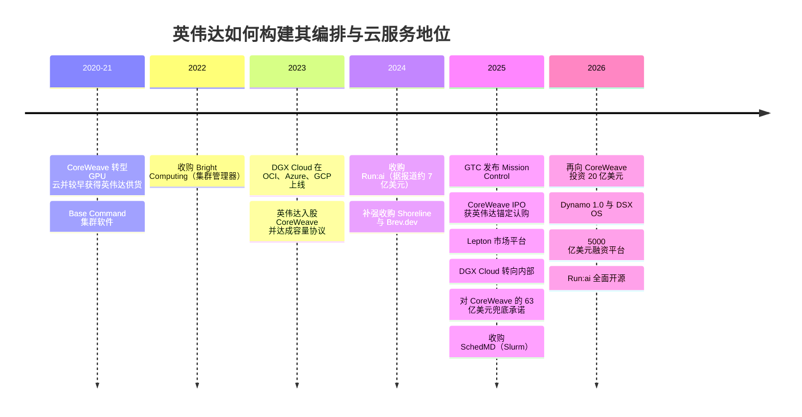
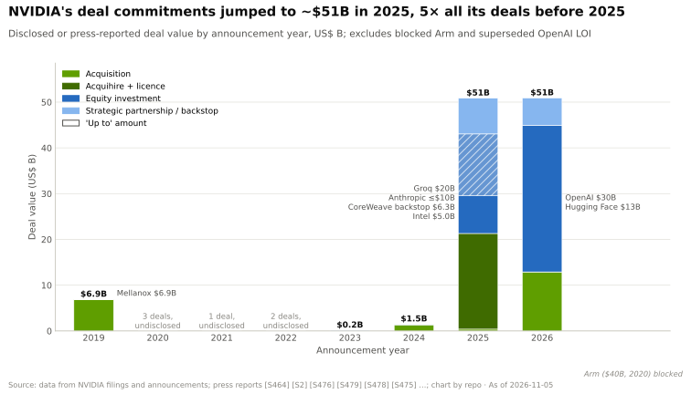
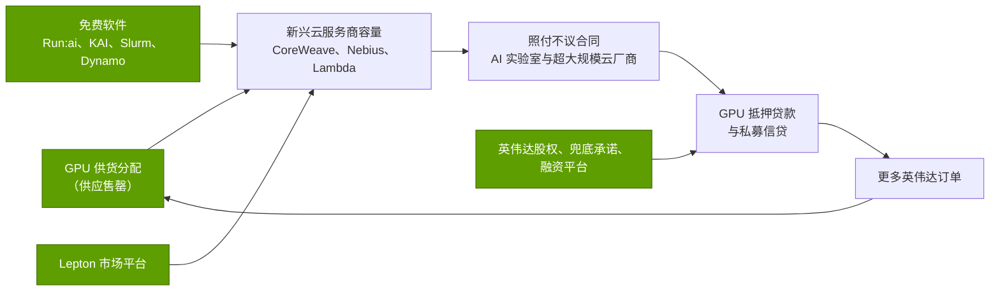

# 编排与云服务：发展历程与英伟达的构建方式

> [!NOTE]
> 本页为英文原文的简体中文参考译文，仅供参考；如有出入，以[英文原文](../../../layers/12-orchestration-and-cloud-services/history-and-how-built.md "English original")为准。

第 12 层 · 编排与云服务 · 约 11 分钟阅读 · 最后核实：2026-11-05

## ⚡ 要点速览

- **英伟达曾尝试成为一朵云，随后选择成为各家云的“造王者”。** [DGX Cloud](../../glossary.md#dgx-cloud) 于 2023 年 3 月推出，部署在甲骨文、微软和谷歌的数据中心内，价格为每 8-GPU 实例每月 $36,999。到 2025 年，它主要服务于英伟达自身的研究 🟡 [[S12007]](../../../sources/bibliography.md#s12007)[[S90068]](../../../sources/bibliography.md#s90068)。
- **软件通过收购获得：** Bright Computing（2022 年）、[Run:ai](../../glossary.md#run-ai)（据报道约 $700M，2024 年）、Shoreline 与 Brev.dev（2024 年）、Lepton（2025 年），以及 [Slurm](../../glossary.md#slurm) 的开发商 SchedMD（2025 年 12 月）[[S478]](../../../sources/bibliography.md#s478)[[S476]](../../../sources/bibliography.md#s476)[[S479]](../../../sources/bibliography.md#s479)[[S12000]](../../../sources/bibliography.md#s12000)。
- **随后它把软件免费放了出去：** KAI Scheduler 于 2025 年开源，完整的 Run:ai 平台于 2026 年 10 月开源，均纳入 [DSX OS](../../glossary.md#dsx-os) 产品组合 [[S12509]](../../../sources/bibliography.md#s12509)[[S12510]](../../../sources/bibliography.md#s12510)[[S12514]](../../../sources/bibliography.md#s12514)。
- **CoreWeave 是范本：** 约 $100M 的入股（2023 年）、约 $250M 的 IPO 锚定认购（2025 年 3 月）、至 2032 年 4 月的 $6.3B [容量兜底承诺](../../glossary.md#capacity-backstop)，以及再追加 $2B 股权（2026 年 1 月）[[S481]](../../../sources/bibliography.md#s481)[[S473]](../../../sources/bibliography.md#s473)[[S90067]](../../../sources/bibliography.md#s90067)[[S472]](../../../sources/bibliography.md#s472)。
- **[Q4 · 优势来源]** 供货分配能力、生态与股权，而不仅仅是软件。软件是免费的；稀缺的 GPU 以及为其买方提供的廉价资本则不是。
- **[Q6 · 复制成本]** 软件复制成本很低（估计 $1–2B，2–3 年）。而这一地位需要一款售罄的产品，外加数百亿美元的资产负债表支持 🔴。

## 从卖设备到塑造云

英伟达最早的编排软件用于运行客户自有的 DGX SuperPOD；Bright Computing 的集群管理器后来成为 Base Command Manager，如今已纳入 [Mission Control](../../glossary.md#mission-control) [[S478]](../../../sources/bibliography.md#s478)[[S12004]](../../../sources/bibliography.md#s12004)。更难的问题在于：谁来把 GPU 租给那些无力自购 SuperPOD 的买方？英伟达尝试了三种答案：自建云、市场平台，以及为其他云提供融资。

| 日期 | 决策 | 意义 | 来源 |
|---|---|---|---|
| 2022-01 | 收购 Bright Computing | 集群部署；后来的 Base Command Manager | [[S478]](../../../sources/bibliography.md#s478) |
| 2023-03 | DGX Cloud 部署于 OCI、Azure、Google Cloud | 借助租来的超大规模云厂商容量直接销售云算力时长 | [[S12007]](../../../sources/bibliography.md#s12007) |
| 2023-04 | 入股 CoreWeave 并达成容量协议 | 在超大规模云厂商之外扶植一朵纯英伟达云 | [[S481]](../../../sources/bibliography.md#s481)[[S90067]](../../../sources/bibliography.md#s90067) |
| 2024-04 → 12 | 收购 Run:ai（据报道约 $700M） | Kubernetes 上的 GPU 资源池化与 GPU 切分 | [[S476]](../../../sources/bibliography.md#s476) |
| 2025-03 | 推出 Mission Control；锚定认购 CoreWeave IPO（约 $250M） | 为 AI 工厂提供统一运维栈；为其最大的新兴云服务商引入公开市场资本 | [[S12005]](../../../sources/bibliography.md#s12005)[[S473]](../../../sources/bibliography.md#s473) |
| 2025-05 | DGX Cloud Lepton 市场平台 | 把开发者导流至合作伙伴 GPU，而非与之竞争 | [[S598]](../../../sources/bibliography.md#s598)[[S12009]](../../../sources/bibliography.md#s12009) |
| 2025-09 | DGX Cloud 转向内部；$6.3B CoreWeave 兜底承诺 | 退出与云厂商的正面竞争；降低合作伙伴容量风险 | [[S90068]](../../../sources/bibliography.md#s90068)[[S90067]](../../../sources/bibliography.md#s90067) |
| 2025-12 | 收购 SchedMD（Slurm） | 掌握训练作业的默认队列；承诺保持中立 | [[S12000]](../../../sources/bibliography.md#s12000) |
| 2026-08 | 与六家资产管理公司搭建融资平台 | 目标为英伟达买方引入超过 $500B 的第三方资本 | [[S12528]](../../../sources/bibliography.md#s12528) |
| 2026-10 | 完整开源 Run:ai 平台 | 使编排商品化；Crusoe 与 Nebius 已采用 | [[S12510]](../../../sources/bibliography.md#s12510)[[S12512]](../../../sources/bibliography.md#s12512) |

> [!TIP]
> **算例 —— 英伟达为何不再正面销售 DGX Cloud。** 每 8-GPU 实例每月 $36,999 的发布价约合每 [GPU 小时](../../glossary.md#gpu-hour) $6.33 [[S12007]](../../../sources/bibliography.md#s12007)。英伟达从甲骨文、微软和谷歌租来这些容量，再转售与它们竞争。在英伟达 Q2 FY2027 $89.0B 的数据中心收入中，[超大规模云厂商](../../glossary.md#hyperscaler)购买了约 $48.7B 🟡 [[S406]](../../../sources/bibliography.md#s406)[[S405]](../../../sources/bibliography.md#s405)。与贡献一半以上核心收入的买方竞争是一笔糟糕的交易，于是 DGX Cloud 成了内部资源，Lepton 则成了流量路由器 🟡 [[S90068]](../../../sources/bibliography.md#s90068)。

## 与 CoreWeave 的关系（2020 → 2026）

CoreWeave 从加密货币挖矿转型为 GPU 云，并较早获得了英伟达新一代产品。到 2024 年底，它拥有超过 250,000 颗 GPU、超过 360 MW 的在运行功率和约 1.3 GW 的签约功率，微软贡献了其 2024 年收入的 62% [[S12011]](../../../sources/bibliography.md#s12011)[[S386]](../../../sources/bibliography.md#s386)。英伟达支持了它的每一轮融资，到 2026 年 6 月，CoreWeave 的收入积压达到 $104.2B [[S12500]](../../../sources/bibliography.md#s12500)。如今，在英伟达的交易金额中，占大头的是资本承诺而非软件：

> [!TIP]
> **算例 —— 兜底承诺对提供方与接受方的成本对比。** $6.3B 的兜底承诺要求英伟达在 2032-04-13 之前购买 CoreWeave 未售出的容量 [[S90067]](../../../sources/bibliography.md#s90067)。在约 6.5 年间，即每年不超过 $1B，约为单季度营业利润（Q2 FY2027 为 $63.7B）的 10% [[S405]](../../../sources/bibliography.md#s405)。CoreWeave 的贷款方可将这部分容量视为部分预售，从而以更低利率放贷。对提供方而言代价低廉，对接受方而言价值可观：这种不对称性正是护城河。

## [Q4 · 优势来源] 供货分配、生态与股权

**[Q4 · 优势来源]** 三个杠杆相互强化；位于其上的软件则是免费的。

1. **供货分配。** 当需求超过供给时，谁先拿到 GPU 谁就赢得客户；英伟达对 FY2028 的展望是受供应约束，新的 H100 容量已被预订至 2026 年 9 月 🟡 [[S90012]](../../../sources/bibliography.md#s90012)[[S12516]](../../../sources/bibliography.md#s12516)。
2. **生态。** Lepton、[Dynamo](../../glossary.md#dynamo) 和开源的 Run:ai 让一家新成立的[新兴云服务商（neocloud）](../../glossary.md#neocloud)从第一天起就具备可信度；Dynamo 1.0 的采用者包括 CoreWeave、Nebius 和 Together AI [[S12009]](../../../sources/bibliography.md#s12009)[[S90066]](../../../sources/bibliography.md#s90066)[[S12510]](../../../sources/bibliography.md#s12510)。
3. **股权与信贷。** 英伟达的支持降低了其买方的资本成本：其 10-Q 列示了 $36B 的 AI 云容量协议和 $29B 的云服务协议 [[S407]](../../../sources/bibliography.md#s407)。

> [!TIP]
> **算例 —— 为什么在 2023 年，提前获得供货胜过任何软件功能。** 2023 年，一颗 H100 的租金约为每 GPU 小时 $8，购置成本约 $25–30K [[S393]](../../../sources/bibliography.md#s393)[[S356]](../../../sources/bibliography.md#s356)。全天候出租时，仅 GPU 本身约 4–5 个月即可回本。比对手早一个季度拿到 H100 的云厂商，靠租金就能收回大部分购置成本，这也是新兴云服务商围绕英伟达的供货队列来组织自身业务的原因。

## [Q6 · 复制成本] 时间、资金与人才

| 组成部分 | 英伟达投入或承诺的金额 | 复制所需时间（估计） | 谁能做到 |
|---|---|---|---|
| 编排软件 | Run:ai 约 $0.7B、Shoreline 约 $0.1B、Lepton“数亿美元”（据报道）；Bright、Brev.dev、SchedMD 未披露 [[S479]](../../../sources/bibliography.md#s479)[[S478]](../../../sources/bibliography.md#s478) | 2–3 年，数百名工程师 | 任何人；Kueue、Ray、SkyPilot 均免费 [[S12533]](../../../sources/bibliography.md#s12533)[[S12535]](../../../sources/bibliography.md#s12535)[[S12534]](../../../sources/bibliography.md#s12534) |
| 新兴云服务商融资支持 | CoreWeave 约 $2.35B 股权 + $6.3B 兜底承诺；Lambda 回租约 $1.5B；$36B AI 云协议 [[S472]](../../../sources/bibliography.md#s472)[[S90067]](../../../sources/bibliography.md#s90067)[[S483]](../../../sources/bibliography.md#s483)[[S407]](../../../sources/bibliography.md#s407) | 3–5 年 | 现金充裕的公司；谷歌已为 Fluidstack 提供兜底承诺 [[S12525]](../../../sources/bibliography.md#s12525) |
| 供货分配能力 | 需要一款毛利率约 75% 且供不应求的产品 [[S405]](../../../sources/bibliography.md#s405) | 只要需求持续超过供给 | 单靠花钱谁也做不到 |
| 开发者吸引力 | CUDA 与软件库，15 年以上（[第 09 层](../09-cuda-and-system-software/index.md)） | 十年 | 超大规模云厂商，部分可以 |

**[Q6 · 复制成本]** 估计（本资料库，🔴）：**软件 $1–2B，2–3 年，约 300–1,000 名工程师**。而这一**地位**需要 $40B 以上的资产负债表支持和一款售罄的产品：至少 5 年，且只有同时具备两者的公司才能做到。超大规模云厂商无需复制，因为它们掌握着客户和容量；商用芯片挑战者则必须复制。

> [!TIP]
> **算例 —— 挑战者要付出的代价。** 英伟达对一家 CoreWeave 规模合作伙伴的支持约为 $8.7B（$2.35B 股权 + $6.3B 兜底承诺），约占其 Q1 FY2027 $48.6B 自由现金流的 18% [[S472]](../../../sources/bibliography.md#s472)[[S90067]](../../../sources/bibliography.md#s90067)[[S403]](../../../sources/bibliography.md#s403)。没有这般现金实力的挑战者只能用另一种“货币”支付：AMD 向 OpenAI 授予了最多 1.6 亿股 AMD 股票的认股权证，按部署进度和股价门槛分批归属 🟡 [[S13506]](../../../sources/bibliography.md#s13506)。

## 反事实推演 —— 如果英伟达没有……

- 🔴 **……退出 DGX Cloud，而是成为完整的公有云？** 一座 1 GW 的 AI 工厂全口径成本约 $50–60B，其中约 $35B 为英伟达产品 [[S398]](../../../sources/bibliography.md#s398)。英伟达将不得不自行为这笔资本开支融资，稀释其约 75% 的毛利率，并与购买其约 55% 数据中心产出的买方竞争 [[S405]](../../../sources/bibliography.md#s405)[[S406]](../../../sources/bibliography.md#s406)。可能的结果：超大规模云厂商更快采用 [ASIC](../../glossary.md#asic)。
- 🔴 **……没有扶持新兴云服务商？** 非超大规模的 ACIE 板块（Q2 FY2027 约 $40.3B）将会更小，超大规模云厂商的议价能力则会更强 [[S406]](../../../sources/bibliography.md#s406)。CoreWeave 的债务成本会更高，增长也会更慢。
- 🔴 **……让某家超大规模云厂商买下 SchedMD 或 Run:ai？** 训练作业的默认队列将偏向该所有者的芯片 [[S12000]](../../../sources/bibliography.md#s12000)[[S476]](../../../sources/bibliography.md#s476)。

🔧 技术细节：为什么开源 Run:ai 不会损害英伟达

Run:ai 对 GPU 进行池化：通过 GPU 切分、配额和抢占来提升利用率（英伟达宣称最高可达 5 倍，为厂商数据）[[S12004]](../../../sources/bibliography.md#s12004)。更高的利用率使英伟达 GPU 每有效小时的成本更低，从而卖出更多 GPU。对软件收费会拖慢采用速度，并招来开源替代品。以 Apache 2.0 许可发布，并通过 Mission Control 和 AI Enterprise 提供付费支持，可使英伟达的代码保持参考实现的地位 [[S12510]](../../../sources/bibliography.md#s12510)[[S12511]](../../../sources/bibliography.md#s12511)。经济学家称之为“将互补品商品化”。

## 🎯 企业发展视角

1. 英伟达在第 12 层软件上或许花费了 $1–2B，随后将其中大部分开源。这对 GPU 编排初创公司的独立价值意味着什么？
2. 兜底承诺的不对称性只对拥有售罄产品、现金充裕的供应商有效。挑战者能否通过合作伙伴（超大规模云厂商、私募信贷）借用这一工具？
3. 各新兴云服务商获得每一代 GPU 的先后顺序，能否预测其后来的增长与估值？
4. 如果 2027–2028 年供给追上需求，哪个杠杆（供货分配、生态、股权）会最先减弱？

## 📚 来源（Sources）

<!-- Auto-generated from the [S…] citations on this page by `make build`. Edit sources/registry/*.csv, not this list. -->

- [**S356**](../../../sources/bibliography.md#s356) Tom's Hardware, *Nvidia makes nearly 1,000% profit on H100 GPUs: report*, 2023-08. [Link](https://www.tomshardware.com/news/nvidia-makes-1000-profit-on-h100-gpus-report)
- [**S386**](../../../sources/bibliography.md#s386) CoreWeave via SEC EDGAR, *CoreWeave Form S-1 registration statement (2025) - technology equipment useful life*, 2025-03-03. [Link](https://www.sec.gov/cgi-bin/browse-edgar?action=getcompany&company=coreweave&type=S-1&dateb=&owner=include&count=40)
- [**S393**](../../../sources/bibliography.md#s393) Latent Space (Eugene Cheah), *$2 H100s: how the GPU bubble burst*, 2024-10. [Link](https://www.latent.space/p/gpu-bubble)
- [**S398**](../../../sources/bibliography.md#s398) NVIDIA Investor Relations, *NVIDIA Q2 FY2026 earnings call (2025-08-27): AI factory economics commentary*, 2025-08-27. [Link](https://investor.nvidia.com/events-and-presentations/events-and-presentations/default.aspx)
- [**S403**](../../../sources/bibliography.md#s403) NVIDIA Corporation via SEC EDGAR, *NVIDIA Announces Financial Results for First Quarter Fiscal 2027 (Form 8-K exhibit 99.1)*, 2026-05-20. [Link](https://www.sec.gov/Archives/edgar/data/0001045810/000104581026000051/q1fy27pr.htm)
- [**S405**](../../../sources/bibliography.md#s405) NVIDIA Corporation via SEC EDGAR, *NVIDIA Announces Financial Results for Second Quarter Fiscal 2027 (Form 8-K exhibit 99.1)*, 2026-08-26. [Link](https://www.sec.gov/Archives/edgar/data/0001045810/000104581026000073/q2fy27pr.htm)
- [**S406**](../../../sources/bibliography.md#s406) NVIDIA Corporation (Colette Kress), *CFO Commentary on Second Quarter Fiscal 2027 Results*, 2026-08-26. [Link](https://s201.q4cdn.com/141608511/files/doc_financials/2027/Q227/Q2FY27-CFO-Commentary.pdf)
- [**S407**](../../../sources/bibliography.md#s407) NVIDIA Corporation via SEC EDGAR, *NVIDIA Corporation Form 10-Q for quarter ended July 26, 2026*, 2026-08-28. [Link](https://www.sec.gov/Archives/edgar/data/1045810/000104581026000075/nvda-20260726.htm)
- [**S472**](../../../sources/bibliography.md#s472) CoreWeave Newsroom, *CoreWeave and NVIDIA expand partnership; NVIDIA invests $2B in CoreWeave Class A stock*, 2026-01-26. [Link](https://www.coreweave.com/news)
- [**S473**](../../../sources/bibliography.md#s473) U.S. Securities and Exchange Commission (EDGAR), *CoreWeave Inc. Form 8-K / S-1 filings (EDGAR index): NVIDIA capacity agreement and IPO participation*, 2025-09-15. [Link](https://www.sec.gov/cgi-bin/browse-edgar?action=getcompany&CIK=0001769628&type=8-K&dateb=&owner=include&count=40)
- [**S476**](../../../sources/bibliography.md#s476) NVIDIA Blog, *NVIDIA to Acquire GPU Orchestration Software Provider Run:ai*, 2024-04-24. [Link](https://blogs.nvidia.com/blog/runai/)
- [**S478**](../../../sources/bibliography.md#s478) NVIDIA, *NVIDIA Blog and Newsroom acquisition announcements (Cumulus, SwiftStack, DeepMap, Bright Computing, Excelero, Shoreline, Brev.dev, OctoAI, VinBrain, Gretel, Lepton AI, CentML, SchedMD)*, 2025-12. [Link](https://blogs.nvidia.com/)
- [**S479**](../../../sources/bibliography.md#s479) Various (press), *Reporting on NVIDIA tuck-in acquisition prices (Run:ai, Deci, Shoreline, OctoAI, Gretel, Lepton, CentML) — The Information, Calcalist, Reuters, CNBC*, 2025-06. [Link](https://www.reuters.com/technology/)
- [**S481**](../../../sources/bibliography.md#s481) Various (company announcements; Reuters, Bloomberg, TechCrunch), *Reporting on NVIDIA participation in AI-lab and neocloud funding rounds 2023–2025 (Inflection, Cohere, Hugging Face, Databricks, Mistral, xAI, Perplexity, Crusoe, Lambda, Nebius, Nscale, Together AI, Poolside, Reflection AI, Thinking Machines, Cursor)*, 2025-11. [Link](https://techcrunch.com/)
- [**S483**](../../../sources/bibliography.md#s483) Various (Bloomberg, The Information, Reuters), *Reporting on NVIDIA commitments to xAI (up to $2B in ~$20B raise), Poolside (up to $1B), Lambda (~$1.5B GPU lease-back) and Wayve ($500M LOI)*, 2025-10. [Link](https://www.bloomberg.com/technology)
- [**S598**](../../../sources/bibliography.md#s598) NVIDIA Newsroom, *NVIDIA Announces DGX Cloud Lepton to Connect Developers to NVIDIA's Global Compute Ecosystem*, 2025-05-18. [Link](https://nvidianews.nvidia.com/news/nvidia-announces-dgx-cloud-lepton-to-connect-developers-to-nvidias-global-compute-ecosystem)
- [**S12000**](../../../sources/bibliography.md#s12000) NVIDIA Blog, *NVIDIA Acquires Open-Source Workload Management Provider SchedMD*, 2025-12-15. [Link](https://blogs.nvidia.com/blog/nvidia-acquires-schedmd)
- [**S12004**](../../../sources/bibliography.md#s12004) NVIDIA, *NVIDIA Mission Control (product page)*, 2025. [Link](https://www.nvidia.com/en-us/data-center/mission-control/)
- [**S12005**](../../../sources/bibliography.md#s12005) NVIDIA Blog, *New NVIDIA Software for Blackwell Infrastructure Runs AI Factories at Light Speed*, 2025-03-18. [Link](https://blogs.nvidia.com/?p=78497)
- [**S12007**](../../../sources/bibliography.md#s12007) NVIDIA Newsroom, *NVIDIA Launches DGX Cloud, Giving Every Enterprise Instant Access to AI Supercomputer From a Browser*, 2023-03-21. [Link](https://nvidianews.nvidia.com/news/nvidia-launches-dgx-cloud-giving-every-enterprise-instant-access-to-ai-supercomputer-from-a-browser)
- [**S12009**](../../../sources/bibliography.md#s12009) DatacenterDynamics, *Nvidia launches Lepton AI platform connecting GPU cloud providers' resources*, 2025-05. [Link](https://www.datacenterdynamics.com/en/news/nvidia-launches-lepton-ai-platform-connecting-gpu-cloud-providers-resources/)
- [**S12011**](../../../sources/bibliography.md#s12011) DatacenterDynamics, *CoreWeave files for IPO on Nasdaq stock market*, 2025-03. [Link](https://www.datacenterdynamics.com/en/news/coreweave-files-for-ipo-on-nasdaq-stock-market/)
- [**S12500**](../../../sources/bibliography.md#s12500) CoreWeave (press release via Seeking Alpha), *CoreWeave Reports Strong Second Quarter 2026 Results*, 2026-08. [Link](https://seekingalpha.com/pr/20615715)
- [**S12509**](../../../sources/bibliography.md#s12509) NVIDIA Technical Blog, *NVIDIA open sources Run:ai Scheduler to foster community collaboration (KAI Scheduler)*, 2025-04. [Link](https://developer.nvidia.com/blog/nvidia-open-sources-runai-scheduler-to-foster-community-collaboration/)
- [**S12510**](../../../sources/bibliography.md#s12510) NVIDIA Technical Blog, *NVIDIA Run:ai is now open source as part of NVIDIA DSX AI Factory platform*, 2026-10. [Link](https://developer.nvidia.com/blog/nvidia-runai-is-now-open-source-as-part-of-nvidia-dsx-ai-factory-platform/)
- [**S12511**](../../../sources/bibliography.md#s12511) TechRepublic, *Nvidia Run:ai is now open source: what's free and paid*, 2026-10-15. [Link](https://www.techrepublic.com/article/news-nvidia-runai-open-source-free-paid/)
- [**S12512**](../../../sources/bibliography.md#s12512) Techstrong.ai, *NVIDIA hands Run:ai to the open source community*, 2026-10. [Link](https://techstrong.ai/articles/nvidia-hands-runai-to-the-open-source-community/)
- [**S12514**](../../../sources/bibliography.md#s12514) NVIDIA, *NVIDIA DSX OS (product page)*, 2026. [Link](https://www.nvidia.com/en-us/data-center/products/dsx/os/)
- [**S12516**](../../../sources/bibliography.md#s12516) SemiAnalysis, *The Great GPU Shortage - Rental Capacity - Launching our H100 1 Year Rental Price Index*, 2026-03. [Link](https://newsletter.semianalysis.com/p/the-great-gpu-shortage-rental-capacity)
- [**S12525**](../../../sources/bibliography.md#s12525) The Energy Mag, *Fluidstack seeks $700M at $7B valuation; TeraWulf and Cipher leases backstopped by Google*, 2025-12-07. [Link](https://theenergymag.com/news/2025-12-07/fluidstack-ai-terawulf-cipher)
- [**S12528**](../../../sources/bibliography.md#s12528) NVIDIA Newsroom, *NVIDIA Partners With Apollo, BlackRock, Blackstone, Brookfield, Goldman Sachs and KKR to Establish AI Compute Infrastructure Financing Platforms to Mobilize Over $500 Billion of Third-Party Capital*, 2026-08-10. [Link](https://nvidianews.nvidia.com/news/nvidia-partners-with-apollo-blackrock-blackstone-brookfield-goldman-sachs-and-kkr-to-establish-ai-compute-infrastructure-financing-platforms-to-mobilize-over-500-billion-of-third-party-capital)
- [**S12533**](../../../sources/bibliography.md#s12533) Kubernetes SIGs on GitHub, *Kueue (README)*, 2026. [Link](https://github.com/kubernetes-sigs/kueue)
- [**S12534**](../../../sources/bibliography.md#s12534) SkyPilot project on GitHub, *SkyPilot (README)*, 2026-10. [Link](https://github.com/skypilot-org/skypilot)
- [**S12535**](../../../sources/bibliography.md#s12535) Ray project on GitHub (Anyscale), *Ray (README)*, 2026. [Link](https://github.com/ray-project/ray)
- [**S13506**](../../../sources/bibliography.md#s13506) Tom's Hardware, *OpenAI signs 6 GW AMD GPU deal*, 2025-10-06. [Link](https://www.tomshardware.com/pc-components/gpus/openai-signs-6gw-amd-gpu-deal)
- [**S90012**](../../../sources/bibliography.md#s90012) Tomasz Tunguz (Tomasz Tunguz), *Nvidia Q2 FY27 earnings*, 2026-08. [Link](https://www.tomtunguz.com/nvidia-q2-fy27-earnings/index.md)
- [**S90066**](../../../sources/bibliography.md#s90066) HPCwire (NVIDIA press release), *NVIDIA enters production with Dynamo, the broadly adopted inference operating system for AI factories*, 2026-03-17. [Link](https://www.hpcwire.com/aiwire/tag/dynamo-1-0/)
- [**S90067**](../../../sources/bibliography.md#s90067) DatacenterDynamics, *Nvidia to purchase unsold compute capacity from CoreWeave for $6.3bn*, 2025-09-16. [Link](https://www.datacenterdynamics.com/en/news/nvidia-to-purchase-unsold-compute-capacity-from-coreweave-for-63bn/)
- [**S90068**](../../../sources/bibliography.md#s90068) Tom's Hardware, *Nvidia steps back from DGX Cloud — stops trying to compete with AWS and Azure*, 2025-09. [Link](https://www.tomshardware.com/tech-industry/nvidia-steps-back-from-dgx-cloud)
