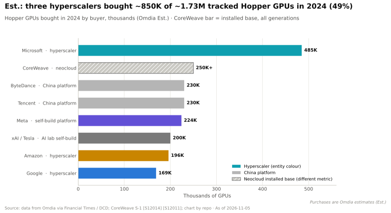
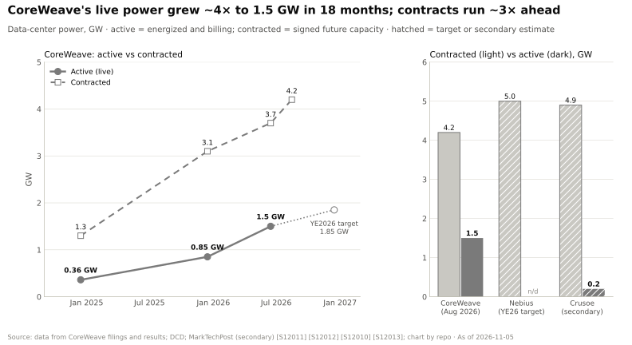
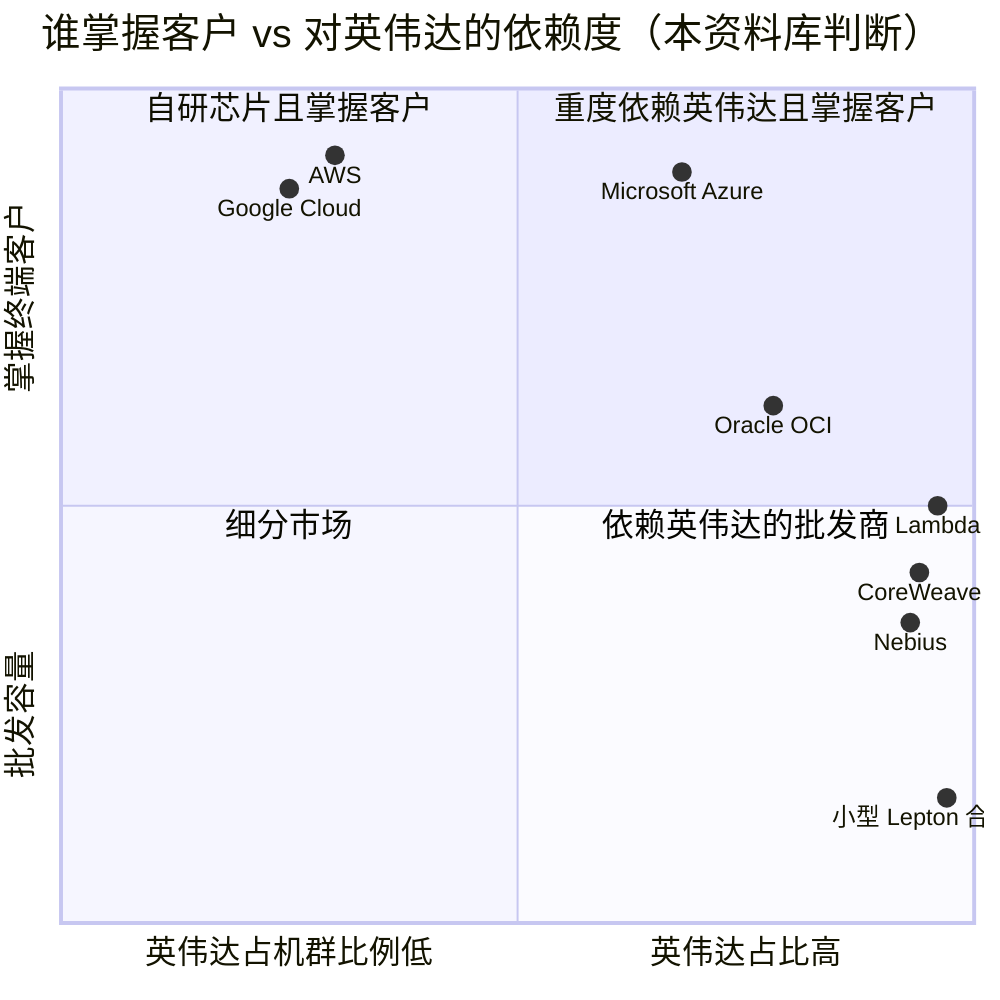
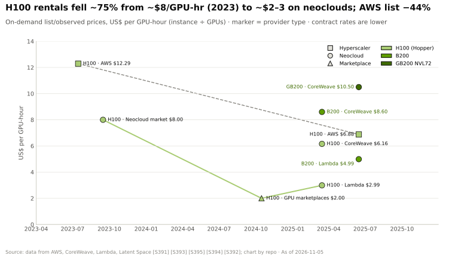

# 超大规模云厂商与新兴云服务商：谁在出租英伟达的 GPU

> [!NOTE]
> 本页为英文原文的简体中文参考译文，仅供参考；如有出入，以[英文原文](../../../layers/12-orchestration-and-cloud-services/hyperscalers-vs-neoclouds.md "English original")为准。

第 12 层 · 编排与云服务 · 约 8 分钟阅读 · 最后核实：2026-11-05

## ⚡ 要点速览

- **[超大规模云厂商](../../glossary.md#hyperscaler)既是英伟达最大的客户，也是最有实力的对手。** 在 Q2 FY2027 数据中心收入中，超大规模云厂商约贡献 $48.7B [[S90011]](../../../sources/bibliography.md#s90011)；2024 年，微软、亚马逊和谷歌在约 173 万颗可追踪的 Hopper GPU 中买下了约 85 万颗（Omdia 估计）[[S12014]](../../../sources/bibliography.md#s12014)。每家也都在自研加速器：TPU、Trainium、Maia、MTIA [[S90026]](../../../sources/bibliography.md#s90026)[[S90035]](../../../sources/bibliography.md#s90035)[[S90044]](../../../sources/bibliography.md#s90044)[[S160]](../../../sources/bibliography.md#s160)。
- **[新兴云服务商（neocloud）](../../glossary.md#neocloud)以英伟达为先。** 截至 2026 年 8 月，CoreWeave 在运行功率约 1.5 GW，[签约功率](../../glossary.md#contracted-power) 4.2 GW [[S12010]](../../../sources/bibliography.md#s12010)；Nebius 的目标是到 2026 年底签约约 5 GW [[S12010]](../../../sources/bibliography.md#s12010)。Synergy 估计 2025 年新兴云服务商收入超过 $25B，到 2030 年将达到约 $180B（二手引用）[[S12022]](../../../sources/bibliography.md#s12022)。
- **甲骨文是准新兴云服务商：** 其 Zettascale10 集群目标最多容纳 800,000 颗英伟达 GPU [[S6008]](../../../sources/bibliography.md#s6008)，但它同时也订购了 50,000 颗 AMD MI450 [[S90022]](../../../sources/bibliography.md#s90022)。
- **英伟达用资本引导需求：** 对 CoreWeave 的 $2B 入股（2026 年 1 月）[[S472]](../../../sources/bibliography.md#s472)，对 Nebius、Crusoe、Lambda、Together AI 和 Nscale 的持股 [[S481]](../../../sources/bibliography.md#s481)，$6.3B 的 CoreWeave 兜底承诺 [[S90067]](../../../sources/bibliography.md#s90067)，以及 Lepton 的需求路由 [[S598]](../../../sources/bibliography.md#s598)。
- **客户结构正在变化，但并不均衡：** [主权 AI](../../glossary.md#sovereign-ai) 在 FY2026 超过约 $30B；Q1 FY2027 中 [ACIE](../../glossary.md#acie)（约 $37B）与超大规模云厂商大致持平；Q2 FY2027 区域性新兴云服务商环比增长 35% [[S90071]](../../../sources/bibliography.md#s90071)。然而在 Q2，超大规模云厂商占数据中心收入的比例却从约 51% 升至约 55% [[S403]](../../../sources/bibliography.md#s403)[[S90011]](../../../sources/bibliography.md#s90011)。
- **弱点：** 新兴云服务商最大的租户正是超大规模云厂商和 AI 实验室（微软签下了超过 $60B 的新兴云服务商合同 [[S12526]](../../../sources/bibliography.md#s12526)；Meta 与 CoreWeave 签约 $14.2B [[S12527]](../../../sources/bibliography.md#s12527)），因此许多所谓“多元化”的需求其实是超大规模云厂商的溢出需求。

## 既是伙伴又是对手：与超大规模云厂商的关系

超大规模云厂商就像一家连锁超市，既售卖知名品牌，也卖自有品牌。它今天需要知名品牌来填满货架，明天则要靠自有品牌来保护利润率。谷歌向 Anthropic（最多 100 万颗 TPU）[[S90026]](../../../sources/bibliography.md#s90026)和 Meta [[S90025]](../../../sources/bibliography.md#s90025)出租 TPU 容量；AWS 用约 500,000 颗 Trainium2 芯片搭建了 Project Rainier [[S90034]](../../../sources/bibliography.md#s90034)；微软在 Maia 200 上运行 Copilot [[S90044]](../../../sources/bibliography.md#s90044)。

| 维度 | 超大规模云厂商 | 新兴云服务商 | 主权 / 企业 | 英伟达（DGX Cloud、Lepton） |
|---|---|---|---|---|
| 机群中英伟达的占比 | 🟨 占多数，但随自研芯片而下降 | 🟩 接近 100% | 🟩 以英伟达为主 | 🟩 100% |
| 是否掌握终端客户 | 🟩 是 | 🟨 往往是超大规模云厂商或 AI 实验室 | 🟩 是 | 🟥 很少 |
| 自研加速器 | 🟦 TPU、Trainium、Maia、MTIA | 🟥 无 | 🟥 无 | 🟦 销售 GPU |
| 资本成本 | 🟩 投资级 | 🟥 高；依赖债务融资 | 🟨 国家背书 | 🟩 现金充裕 |
| 与英伟达的股权关系 | 🟥 无 | 🟩 常见 | 🟨 部分有 | 不适用 |

> [!TIP]
> **算例 —— Q1 → Q2 FY2027 的客户结构。** Q1：在 $75.2B 数据中心收入中，超大规模云厂商约 $38B（约 51%），ACIE 约 $37B [[S403]](../../../sources/bibliography.md#s403)。Q2：在约 $89.0B 中，超大规模云厂商约 $48.7B（约 55%），ACIE 约 $40.3B [[S90011]](../../../sources/bibliography.md#s90011)[[S90013]](../../../sources/bibliography.md#s90013)[[S406]](../../../sources/bibliography.md#s406)。超大规模云厂商环比增长约 28%，ACIE 约 9%。**结论：** 多元化是真实的（主权客户、新兴云服务商），但超大规模云厂商一个季度的追赶就逆转了占比的变化。

## 新兴云服务商：借助外部资产负债表的纯 GPU 云

新兴云服务商购买英伟达系统（常以举债方式），并以多年期合同出租：CoreWeave（客户包括微软、OpenAI、Meta）、Lambda、Nebius、Crusoe、Together AI、Nscale 和 Fluidstack。它们的优势在于速度：由于不运行其他任何业务，英伟达的新一代产品能很快进入它们的机架。

> [!TIP]
> **算例 —— 1.5 GW 相当于多少颗 GPU？** 2024 年底，CoreWeave 以超过 360 MW 的功率运行超过 250,000 颗 GPU，全口径约每 GPU 1.4 kW [[S12011]](../../../sources/bibliography.md#s12011)。一颗 GB300 的机架 IT 功耗约 1.83 kW（132 kW ÷ 72）[[S337]](../../../sources/bibliography.md#s337)，计入散热开销后约 2.1 kW。因此，视产品组合不同，1.5 GW 约合 **70 万至 100 万颗 GPU**（🔴 本资料库估计）。**结论：** 如今单家新兴云服务商运营的机群规模，已相当于微软 2024 年一到两年的 Hopper 采购量 [[S12014]](../../../sources/bibliography.md#s12014)。

🔧 技术细节：供应紧张时英伟达如何分配

英伟达不公布其供货分配规则。可观察到的杠杆包括：股权（以每股 $87.20 向 CoreWeave 投资 $2B [[S472]](../../../sources/bibliography.md#s472)）、容量担保（兜底承诺 [[S90067]](../../../sources/bibliography.md#s90067)）、需求路由（Lepton [[S598]](../../../sources/bibliography.md#s598)）以及优先获得参考设计。供应依然紧张，首席财务官称 FY2028 将“受供应约束” [[S90012]](../../../sources/bibliography.md#s90012)，因此供货分配是一种战略工具，而不仅仅是接单。关于股权、兜底承诺与[循环融资](../../glossary.md#circular-financing)的问题，详见[价值链与企业发展视角](value-chain-and-corp-dev.md)。

## 租来的一个 GPU 小时能买到什么：逐代对比

**[Q3 · 代际进步]**（云端视角）。2023 年短缺之后，每 [GPU 小时](../../glossary.md#gpu-hour)的目录价快速下跌：H100 从新兴云服务商的约 $8 和 AWS 的 $12.29，降至 2025 年的约 $2–3 [[S393]](../../../sources/bibliography.md#s393)[[S391]](../../../sources/bibliography.md#s391)[[S395]](../../../sources/bibliography.md#s395)。按单位算力计，每一代 Blackwell 都更便宜。

> [!TIP]
> **算例 —— 同一服务商的 B200 与 H100。** CoreWeave 的 H100 目录价为 $6.16/GPU 小时，B200 为 $8.60 [[S394]](../../../sources/bibliography.md#s394)：多花 40% 的钱，换来 2.27 倍的稠密 [FP8](../../glossary.md#fp8) 算力（4.5 对 1.98 [PFLOPS](../../glossary.md#flops)）[[S33003]](../../../sources/bibliography.md#s33003)[[S33002]](../../../sources/bibliography.md#s33002)，因此每 FP8 PFLOPS 小时便宜 1.6 倍。若使用 H100 不支持的 [FP4](../../glossary.md#fp4)，则便宜 3.3 倍。**结论：** 只有当租户的软件采用新的数值格式时，大部分代际收益才能真正惠及租户。旧 GPU 也并非单纯贬值：由于推理需求超过供给，H100 一年期合同价从 $1.70（2025 年 10 月）反弹约 38% 至 $2.35（2026 年 3 月）[[S12516]](../../../sources/bibliography.md#s12516)。

> [!NOTE]
> **🐂 看多观点：** 更多类型的买方（主权客户、新兴云服务商、企业）稀释了四大超大规模云厂商的议价能力，使英伟达的定价得以维持。

> [!WARNING]
> **🐻 看空观点：** 新兴云服务商高杠杆、由英伟达提供融资，且依赖超大规模云厂商的溢出需求。如果超大规模云厂商转向自研芯片，新兴云服务商的需求会首先走弱，而英伟达的持股与兜底承诺正处在这条路径上。

## 🎯 企业发展视角

1. **客户质量与客户数量同样重要。** 应追踪新兴云服务商的积压订单中有多少最终来自微软、OpenAI 和 Meta [[S12526]](../../../sources/bibliography.md#s12526)[[S12527]](../../../sources/bibliography.md#s12527)。
2. **甲骨文的双源采购（英伟达加 AMD MI450）[[S6008]](../../../sources/bibliography.md#s6008)[[S90022]](../../../sources/bibliography.md#s90022)是一个范本**，一旦 AMD 机架开始出货，其他准新兴云服务商可能会效仿。
3. **新兴云服务商的股权是对利用率和融资利差的看涨期权**，而非对技术的押注；私营公司（Crusoe、Lambda、Nscale）在高估值下承担着这一风险。
4. **高通的问题（仅基于公开信息）：** HUMAIN 计划部署的 200 MW AI200/AI250 [[S90030]](../../../sources/bibliography.md#s90030)是一个主权型锚定客户；哪些新兴云服务商或主权买方足够重视第二推理供应源，从而愿意双源采购？

## 📚 来源（Sources）

<!-- Auto-generated from the [S…] citations on this page by `make build`. Edit sources/registry/*.csv, not this list. -->

- [**S160**](../../../sources/bibliography.md#s160) Meta AI Blog, *Our next-generation Meta Training and Inference Accelerator*, 2024-04-10. [Link](https://ai.meta.com/blog/next-generation-meta-training-inference-accelerator-AI-MTIA/)
- [**S337**](../../../sources/bibliography.md#s337) Spheron, *NVIDIA GB300 (rental and specifications)*, 2026. [Link](https://spheron.network/gpu-rental/gb300/)
- [**S391**](../../../sources/bibliography.md#s391) AWS, *Amazon EC2 P5 instances (NVIDIA H100) - product and on-demand pricing*, 2023-07-26. [Link](https://aws.amazon.com/ec2/instance-types/p5/)
- [**S393**](../../../sources/bibliography.md#s393) Latent Space (Eugene Cheah), *$2 H100s: how the GPU bubble burst*, 2024-10. [Link](https://www.latent.space/p/gpu-bubble)
- [**S394**](../../../sources/bibliography.md#s394) CoreWeave, *CoreWeave GPU cloud pricing*, 2025. [Link](https://www.coreweave.com/pricing)
- [**S395**](../../../sources/bibliography.md#s395) Lambda, *Lambda GPU cloud pricing*, 2025. [Link](https://lambda.ai/pricing)
- [**S403**](../../../sources/bibliography.md#s403) NVIDIA Corporation via SEC EDGAR, *NVIDIA Announces Financial Results for First Quarter Fiscal 2027 (Form 8-K exhibit 99.1)*, 2026-05-20. [Link](https://www.sec.gov/Archives/edgar/data/0001045810/000104581026000051/q1fy27pr.htm)
- [**S406**](../../../sources/bibliography.md#s406) NVIDIA Corporation (Colette Kress), *CFO Commentary on Second Quarter Fiscal 2027 Results*, 2026-08-26. [Link](https://s201.q4cdn.com/141608511/files/doc_financials/2027/Q227/Q2FY27-CFO-Commentary.pdf)
- [**S472**](../../../sources/bibliography.md#s472) CoreWeave Newsroom, *CoreWeave and NVIDIA expand partnership; NVIDIA invests $2B in CoreWeave Class A stock*, 2026-01-26. [Link](https://www.coreweave.com/news)
- [**S481**](../../../sources/bibliography.md#s481) Various (company announcements; Reuters, Bloomberg, TechCrunch), *Reporting on NVIDIA participation in AI-lab and neocloud funding rounds 2023–2025 (Inflection, Cohere, Hugging Face, Databricks, Mistral, xAI, Perplexity, Crusoe, Lambda, Nebius, Nscale, Together AI, Poolside, Reflection AI, Thinking Machines, Cursor)*, 2025-11. [Link](https://techcrunch.com/)
- [**S598**](../../../sources/bibliography.md#s598) NVIDIA Newsroom, *NVIDIA Announces DGX Cloud Lepton to Connect Developers to NVIDIA's Global Compute Ecosystem*, 2025-05-18. [Link](https://nvidianews.nvidia.com/news/nvidia-announces-dgx-cloud-lepton-to-connect-developers-to-nvidias-global-compute-ecosystem)
- [**S6008**](../../../sources/bibliography.md#s6008) Oracle, *Oracle Unveils Next-Generation Oracle Cloud Infrastructure Zettascale10 Cluster for AI*, 2025-10-14. [Link](https://www.oracle.com/news/announcement/ai-world-oracle-unveils-next-generation-oci-zettascale10-cluster-for-ai-2025-10-14/)
- [**S12010**](../../../sources/bibliography.md#s12010) DatacenterDynamics, *Neocloud results Q2 2026: CoreWeave, Nebius, Cerebras*, 2026-08. [Link](https://www.datacenterdynamics.com/en/news/neocloud-results-q2-2026-coreweave-nebius-cerebras/)
- [**S12011**](../../../sources/bibliography.md#s12011) DatacenterDynamics, *CoreWeave files for IPO on Nasdaq stock market*, 2025-03. [Link](https://www.datacenterdynamics.com/en/news/coreweave-files-for-ipo-on-nasdaq-stock-market/)
- [**S12014**](../../../sources/bibliography.md#s12014) DatacenterDynamics, *Microsoft bought twice as many Nvidia Hopper GPUs as other big tech companies - report*, 2024-12. [Link](https://www.datacenterdynamics.com/en/news/microsoft-bought-twice-as-many-nvidia-hopper-gpus-as-other-big-tech-companies-report)
- [**S12022**](../../../sources/bibliography.md#s12022) Trending Topics, *Neoclouds challenge the hyperscalers in big bets on AI infrastructure*, 2026. [Link](https://www.trendingtopics.eu/neoclouds-challenge-the-hyperscalers-in-big-bets-on-ai-infrastructure/)
- [**S12516**](../../../sources/bibliography.md#s12516) SemiAnalysis, *The Great GPU Shortage - Rental Capacity - Launching our H100 1 Year Rental Price Index*, 2026-03. [Link](https://newsletter.semianalysis.com/p/the-great-gpu-shortage-rental-capacity)
- [**S12526**](../../../sources/bibliography.md#s12526) Introl, *Microsoft's $60B neocloud bet: buying time in the AI capacity crisis*, 2025-12. [Link](https://introl.com/blog/microsoft-60-billion-neocloud-spending-2025)
- [**S12527**](../../../sources/bibliography.md#s12527) TechRepublic, *Meta inks $14.2B AI infrastructure deal with CoreWeave*, 2025-09-30. [Link](https://www.techrepublic.com/article/news-coreweave-meta-deal/)
- [**S33002**](../../../sources/bibliography.md#s33002) NVIDIA, *NVIDIA H100 Tensor Core GPU (product page and datasheet)*, 2022-03-22. [Link](https://www.nvidia.com/en-us/data-center/h100/)
- [**S33003**](../../../sources/bibliography.md#s33003) Lenovo Press, *ThinkSystem NVIDIA B200 180GB 1000W GPU product guide*, 2025. [Link](https://lenovopress.lenovo.com/lp2226-thinksystem-nvidia-b200-180gb-1000w-gpu)
- [**S90011**](../../../sources/bibliography.md#s90011) Nasdaq (Zacks), *NVIDIA Q2 earnings beat on Blackwell Ultra and Data Center strength*, 2026-08-27. [Link](https://www.nasdaq.com/articles/nvidia-q2-earnings-beat-blackwell-ultra-data-center-strength)
- [**S90012**](../../../sources/bibliography.md#s90012) Tomasz Tunguz (Tomasz Tunguz), *Nvidia Q2 FY27 earnings*, 2026-08. [Link](https://www.tomtunguz.com/nvidia-q2-fy27-earnings/index.md)
- [**S90013**](../../../sources/bibliography.md#s90013) Quartr, *NVIDIA (NVDA) Q2 2027 earnings summary*, 2026-08-26. [Link](https://quartr.com/events/nvidia-corporation-nvda-q2-2027_33dRoFp6)
- [**S90022**](../../../sources/bibliography.md#s90022) Tom's Hardware, *AMD and Oracle partner to deploy 50,000 MI450 Instinct GPUs*, 2025-10. [Link](https://www.tomshardware.com/tech-industry/artificial-intelligence/amd-and-oracle-partner-to-deploy-50-000-mi450-instinct-gpus-in-new-ai-superclusters-deployment-of-expansion-set-for-2026-powered-by-amds-helios-rack)
- [**S90025**](../../../sources/bibliography.md#s90025) SiliconANGLE, *Google and Meta reportedly strike new multibillion-dollar AI chip deal*, 2026-02-26. [Link](https://siliconangle.com/2026/02/26/google-meta-reportedly-strike-new-multibillion-dollar-ai-chip-deal/)
- [**S90026**](../../../sources/bibliography.md#s90026) Maginative, *Anthropic secures 1M Google TPUs while keeping Amazon as primary training partner*, 2025-10. [Link](https://www.maginative.com/anthropic-secures-1m-google-tpus-while-keeping-amazon-as-primary-training-partner)
- [**S90030**](../../../sources/bibliography.md#s90030) Morningstar, *Qualcomm: Humain deal provides some AI upside*, 2025-10. [Link](https://www.morningstar.com/stocks/qualcomm-humain-deal-provides-some-ai-upside)
- [**S90034**](../../../sources/bibliography.md#s90034) NAND Research, *AWS releases Trainium3, teases Trainium4*, 2025-12. [Link](https://nand-research.com/research-note-aws-releases-trainium3-teases-trainium4/4/)
- [**S90035**](../../../sources/bibliography.md#s90035) Business Today ME, *Trainium3 UltraServers now available*, 2025-12. [Link](https://businesstoday.me/tech-news/trainium3-ultraservers-now-available-enabling-customers-to-train-and-deploy-ai-models-fasterat-lower-cost/)
- [**S90044**](../../../sources/bibliography.md#s90044) eWeek, *Microsoft introduces Maia 200, its most powerful AI chip yet*, 2026-01-27. [Link](https://www.eweek.com/news/microsoft-maia-200-ai-chip/)
- [**S90067**](../../../sources/bibliography.md#s90067) DatacenterDynamics, *Nvidia to purchase unsold compute capacity from CoreWeave for $6.3bn*, 2025-09-16. [Link](https://www.datacenterdynamics.com/en/news/nvidia-to-purchase-unsold-compute-capacity-from-coreweave-for-63bn/)
- [**S90071**](../../../sources/bibliography.md#s90071) Crypto Briefing, *Nvidia CFO emphasizes neutral partnership with AI customers as company diversifies beyond hyperscalers*, 2026. [Link](https://cryptobriefing.com/nvidia-cfo-neutral-ai-partnership/)
