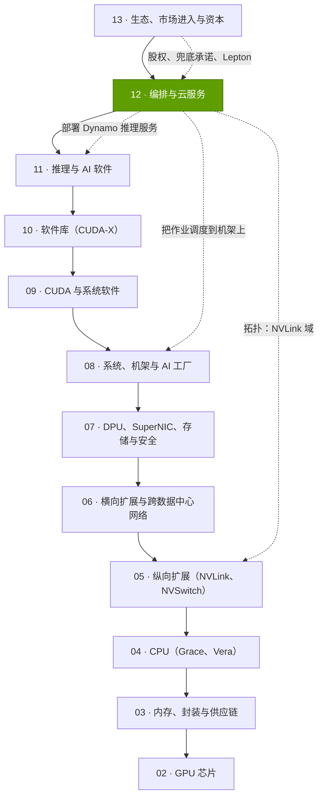
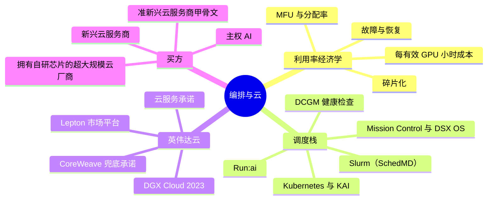

# 第 12 层 —— 编排与云服务

> [!NOTE]
> 本页为英文原文的简体中文参考译文，仅供参考；如有出入，以[英文原文](../../../layers/12-orchestration-and-cloud-services/index.md "English original")为准。

第 12 层（共 12 层）· 调度器、AI 工厂运营软件，以及出租英伟达系统的 GPU 云 · 约 6 分钟阅读 · 最后核实：2026-11-05

## ⚡ 要点速览

- **本层把机架变成有效且有人付费的 [GPU 小时](../../glossary.md#gpu-hour)。** 折旧约占一颗 GPU 年度成本的 81–88% [[S389]](../../../sources/bibliography.md#s389)[[S382]](../../../sources/bibliography.md#s382)，因此一颗 GB300 [NVL72](../../glossary.md#nvl72) GPU 无论忙闲，每个已安装小时的成本约为 $1.50（估计）[[S332]](../../../sources/bibliography.md#s332)[[S324]](../../../sources/bibliography.md#s324)：**利用率 30% 时每有效小时 $5.00，90% 时为 $1.67**。
- **损失规模大且可量化。** 阿里巴巴借助碎片感知调度器，将其 155,410 颗 GPU 机群的[分配率](../../glossary.md#allocation-ratio)从 68% 提升至 93% [[S12015]](../../../sources/bibliography.md#s12015)；Meta 的 Llama 3 训练在 54 天内记录了 419 次意外中断，[模型算力利用率（MFU）](../../glossary.md#mfu)为 38–41% [[S34006]](../../../sources/bibliography.md#s34006)。
- **英伟达买下了控制平面：** Bright Computing（2022 年）、Run:ai（约 $700M，2024 年）、[Slurm](../../glossary.md#slurm) 的开发商 SchedMD（2025 年 12 月）[[S478]](../../../sources/bibliography.md#s478)[[S476]](../../../sources/bibliography.md#s476)[[S12000]](../../../sources/bibliography.md#s12000)，并将其打包为 [Mission Control](../../glossary.md#mission-control) [[S12005]](../../../sources/bibliography.md#s12005) 及模块化的 [DSX OS](../../glossary.md#dsx-os)（2026 年）[[S12513]](../../../sources/bibliography.md#s12513)。它先开源了 [KAI Scheduler](../../glossary.md#kai-scheduler)，随后又开源了 Run:ai 本身 [[S12003]](../../../sources/bibliography.md#s12003)[[S12510]](../../../sources/bibliography.md#s12510)。
- 🟡 **英伟达自有云转向内部：** [DGX Cloud](../../glossary.md#dgx-cloud)（2023 年）已调整为主要服务内部研究 [[S90068]](../../../sources/bibliography.md#s90068)，而 [DGX Cloud Lepton](../../glossary.md#dgx-cloud-lepton) 则把开发者导流至合作伙伴云 [[S598]](../../../sources/bibliography.md#s598)。英伟达仍持有 $29B 的云服务协议，外加 $36B 的 AI 云容量协议（2026 年 7 月）[[S407]](../../../sources/bibliography.md#s407)。
- **买方正在多元化，但并不均衡：** Q2 FY2027 数据中心收入中，超大规模云厂商约占 55% [[S90011]](../../../sources/bibliography.md#s90011)[[S90013]](../../../sources/bibliography.md#s90013)；Q1 中 [ACIE](../../glossary.md#acie) 与超大规模云厂商大致持平，Q2 区域性[新兴云服务商（neocloud）](../../glossary.md#neocloud)环比增长 35% [[S90071]](../../../sources/bibliography.md#s90071)。仅 CoreWeave 一家就运营约 1.5 GW [[S12010]](../../../sources/bibliography.md#s12010)。
- **弱点与最强挑战者：** [超大规模云厂商](../../glossary.md#hyperscaler)掌握客户、云控制平面以及自研芯片（TPU、Trainium、Maia）[[S90026]](../../../sources/bibliography.md#s90026)[[S90035]](../../../sources/bibliography.md#s90035)[[S90044]](../../../sources/bibliography.md#s90044)。编排软件免费或开源，英伟达只能间接从中获益，而其兜底承诺又将自身与新兴云服务商的利用率绑在一起。

> [!TIP]
> **算例 —— 为什么十个百分点的利用率是董事会层面的数字。** 一个 100,000 颗 GPU 的 GB300 机群，无论忙闲，每年成本约为 $1.50 × 8,760 h × 100,000 ≈ **$1.3B**（估计，出自[利用率问题](the-utilization-problem.md)）。将利用率从 60% 提升到 70%，可多产生 8,760 万个有效 GPU 小时，按成本计约值 $131M，按租赁价格计则更多。**结论：** 相对于其释放的算力，调度与恢复软件的成本很低。

## 本层在技术栈中的位置

## 本层导图

## 八个问题一览

| # | 问题 | 简答 | 详见 |
|---|---|---|---|
| Q1 | 职能是什么，薄弱时会出什么问题？ | 把已安装的 GPU 变成有效且有人付费的小时；若薄弱 → 集群闲置、碎片化、频繁故障，利用率 30% 时每有效小时成本约为 90% 时的 3 倍 | [利用率问题](the-utilization-problem.md) |
| Q2 | 关键指标？ | 分配率、有效训练时间（goodput）、MFU 或每 GPU 小时 token 数、平均恢复时间、每有效 GPU 小时美元成本 | [利用率问题](the-utilization-problem.md) |
| Q3 | 代际进步？ | 控制平面从集群工具（2022 年）演进为 AI 工厂操作系统（2026 年）；从 H100 到 Blackwell，租用一个 PFLOPS 小时的价格在 FP8 下便宜 1.4–1.6 倍，在 FP4 下便宜 2.7–3.3 倍 | [调度栈](run-ai-mission-control-base-command.md)、[超大规模云厂商与新兴云服务商](hyperscalers-vs-neoclouds.md) |
| Q4 | 优势来源？ | 调度器、遥测与硬件的一体化，加上资本与供货分配能力，而非授权收入 | [发展历程与构建方式](history-and-how-built.md) |
| Q5 | 最强挑战者？ | 超大规模云厂商：它们掌握客户、控制平面以及自研加速器 | [竞争格局](competition.md) |
| Q6 | 复制成本？ | 调度器很便宜（开源）；但英伟达集供货分配、资本与软件覆盖面于一身的组合难以复制 | [发展历程与构建方式](history-and-how-built.md) |
| Q7 | 路线图？ | DSX OS、开源 Run:ai、针对 Vera Rubin 调优的 Slurm、Lepton 扩张；关注新兴云服务商融资与超大规模云厂商自研芯片 | [路线图](roadmap.md) |
| Q8 | 价值池与并购？ | 租赁利润归云厂商；英伟达通过股权、兜底承诺和市场平台参与；补强型收购：Run:ai、SchedMD、Lepton | [价值链与企业发展视角](value-chain-and-corp-dev.md) |

## 本层页面

| 页面 | 你将了解 |
|---|---|
| [利用率问题](the-utilization-problem.md) | 每有效 GPU 小时成本、五大浪费来源、关键指标、由谁承担闲置风险 |
| [Run:ai、Mission Control 与 Base Command](run-ai-mission-control-base-command.md) | Slurm、Kubernetes、KAI、GPU 切分、成组调度与拓扑感知调度、故障恢复 |
| [DGX Cloud 与 Lepton](dgx-cloud-and-lepton.md) | DGX Cloud 的回租模式、2025 年的战略转向、Lepton、兜底承诺，以及英伟达为何避免与云厂商正面竞争 |
| [超大规模云厂商与新兴云服务商](hyperscalers-vs-neoclouds.md) | 既是伙伴又是对手的超大规模云厂商、新兴云服务商容量、供货分配、客户结构、各代产品租赁价格 |
| [竞争格局](competition.md) | 正面对比与能力热力图 |
| [发展历程与英伟达的构建方式](history-and-how-built.md) | 时间线、关键交易、复制成本、反事实推演 |
| [路线图](roadmap.md) | 编排与云服务路线图（附置信度标签） |
| [价值链与企业发展视角](value-chain-and-corp-dev.md) | 谁拿走了云支出、循环融资、私营公司、并购 |

🔧 技术细节：如何解读 GPU 云或调度器相关说法

- **说的是哪种利用率？** 在同一集群上，分配率、SM 活跃度与 MFU 可相差 2–3 倍；参见[利用率问题](the-utilization-problem.md)。
- **在运行功率与签约功率：** 签约的吉瓦数是已签署的未来容量，而非今天正在运行的 GPU [[S12010]](../../../sources/bibliography.md#s12010)。
- **目录价与合同价：** 按需目录价高估了大租户实际支付的价格；一年期合同价格指数是更好的参考 [[S12516]](../../../sources/bibliography.md#s12516)。
- **厂商宣称的倍数：** “利用率最高提升 5 倍”（Run:ai）[[S12004]](../../../sources/bibliography.md#s12004)与“恢复速度最高快 10 倍”（Mission Control）[[S12005]](../../../sources/bibliography.md#s12005)均为厂商给出的最佳情形，且未公布基准。

## 🎯 企业发展视角

1. **软件是利用率杠杆，而非收入来源：** 英伟达以约 $700M 收购 Run:ai [[S479]](../../../sources/bibliography.md#s479)，随后将其开源 [[S12510]](../../../sources/bibliography.md#s12510)；价值在于释放的 GPU 小时和成为默认选项的地位。
2. **英伟达如今是云交易对手方：** 约 $65B 的云承诺（2026 年 7 月）[[S407]](../../../sources/bibliography.md#s407)使新兴云服务商的利用率成为英伟达自身的风险；对新兴云服务商合作伙伴的尽职调查应据此进行。
3. **对超大规模云厂商的依赖是结构性问题：** 最大的买方正在自研芯片和控制平面；英伟达的应对是把需求分散到主权客户与新兴云服务商 [[S90071]](../../../sources/bibliography.md#s90071)。
4. **高通的问题（仅基于公开信息）：** 对于 AI200/AI250 等推理机架 [[S90028]](../../../sources/bibliography.md#s90028)，规模化路径应经由超大规模云厂商、新兴云服务商还是主权买方？哪些调度器必须率先支持它们？

## 📚 来源（Sources）

<!-- Auto-generated from the [S…] citations on this page by `make build`. Edit sources/registry/*.csv, not this list. -->

- [**S324**](../../../sources/bibliography.md#s324) fal.ai, *NVIDIA GB200 price in 2026: what a GPU, a tray and an NVL72 rack cost*, 2026. [Link](https://fal.ai/learn/serverless/nvidia-gb200-price)
- [**S332**](../../../sources/bibliography.md#s332) Tiger Brokers (iTiger), *Morgan Stanley's BOM analysis of NVIDIA's Rubin: GPU share declines; PCB, MLCC and ABF substrate values soar*, 2026-05-20. [Link](https://www.itiger.com/news/1188068712)
- [**S382**](../../../sources/bibliography.md#s382) Microsoft via SEC EDGAR, *Microsoft Corporation Form 10-K filings (FY2021, FY2023) - property and equipment useful lives*, 2023-07-27. [Link](https://www.sec.gov/cgi-bin/browse-edgar?action=getcompany&CIK=0000789019&type=10-K&dateb=&owner=include&count=40)
- [**S389**](../../../sources/bibliography.md#s389) U.S. Energy Information Administration, *EIA Electric Power Monthly, Table 5.6.A: average price of electricity to ultimate customers by end-use sector*, 2025. [Link](https://www.eia.gov/electricity/monthly/epm_table_grapher.php?t=epmt_5_6_a)
- [**S407**](../../../sources/bibliography.md#s407) NVIDIA Corporation via SEC EDGAR, *NVIDIA Corporation Form 10-Q for quarter ended July 26, 2026*, 2026-08-28. [Link](https://www.sec.gov/Archives/edgar/data/1045810/000104581026000075/nvda-20260726.htm)
- [**S476**](../../../sources/bibliography.md#s476) NVIDIA Blog, *NVIDIA to Acquire GPU Orchestration Software Provider Run:ai*, 2024-04-24. [Link](https://blogs.nvidia.com/blog/runai/)
- [**S478**](../../../sources/bibliography.md#s478) NVIDIA, *NVIDIA Blog and Newsroom acquisition announcements (Cumulus, SwiftStack, DeepMap, Bright Computing, Excelero, Shoreline, Brev.dev, OctoAI, VinBrain, Gretel, Lepton AI, CentML, SchedMD)*, 2025-12. [Link](https://blogs.nvidia.com/)
- [**S479**](../../../sources/bibliography.md#s479) Various (press), *Reporting on NVIDIA tuck-in acquisition prices (Run:ai, Deci, Shoreline, OctoAI, Gretel, Lepton, CentML) — The Information, Calcalist, Reuters, CNBC*, 2025-06. [Link](https://www.reuters.com/technology/)
- [**S598**](../../../sources/bibliography.md#s598) NVIDIA Newsroom, *NVIDIA Announces DGX Cloud Lepton to Connect Developers to NVIDIA's Global Compute Ecosystem*, 2025-05-18. [Link](https://nvidianews.nvidia.com/news/nvidia-announces-dgx-cloud-lepton-to-connect-developers-to-nvidias-global-compute-ecosystem)
- [**S12000**](../../../sources/bibliography.md#s12000) NVIDIA Blog, *NVIDIA Acquires Open-Source Workload Management Provider SchedMD*, 2025-12-15. [Link](https://blogs.nvidia.com/blog/nvidia-acquires-schedmd)
- [**S12003**](../../../sources/bibliography.md#s12003) The New Stack, *NVIDIA open sources KAI Scheduler to help AI teams optimize GPU utilization*, 2025-04. [Link](https://thenewstack.io/nvidia-open-sources-kai-scheduler-to-help-ai-teams-optimize-gpu-utilization/)
- [**S12004**](../../../sources/bibliography.md#s12004) NVIDIA, *NVIDIA Mission Control (product page)*, 2025. [Link](https://www.nvidia.com/en-us/data-center/mission-control/)
- [**S12005**](../../../sources/bibliography.md#s12005) NVIDIA Blog, *New NVIDIA Software for Blackwell Infrastructure Runs AI Factories at Light Speed*, 2025-03-18. [Link](https://blogs.nvidia.com/?p=78497)
- [**S12010**](../../../sources/bibliography.md#s12010) DatacenterDynamics, *Neocloud results Q2 2026: CoreWeave, Nebius, Cerebras*, 2026-08. [Link](https://www.datacenterdynamics.com/en/news/neocloud-results-q2-2026-coreweave-nebius-cerebras/)
- [**S12015**](../../../sources/bibliography.md#s12015) USENIX OSDI '26 (Li et al. (Alibaba / HKUST)), *Heterogeneity at Hyperscale: Characterization and Scheduling of Large Production AI Clusters at Alibaba*, 2026-07. [Link](https://www.usenix.org/conference/osdi26/presentation/li-suyi)
- [**S12510**](../../../sources/bibliography.md#s12510) NVIDIA Technical Blog, *NVIDIA Run:ai is now open source as part of NVIDIA DSX AI Factory platform*, 2026-10. [Link](https://developer.nvidia.com/blog/nvidia-runai-is-now-open-source-as-part-of-nvidia-dsx-ai-factory-platform/)
- [**S12513**](../../../sources/bibliography.md#s12513) NVIDIA Newsroom, *NVIDIA DSX Gives Infrastructure Builders the Playbook for AI Factories*, 2026-05-31. [Link](https://nvidianews.nvidia.com/news/dsx-infrastructure-ai-factory)
- [**S12516**](../../../sources/bibliography.md#s12516) SemiAnalysis, *The Great GPU Shortage - Rental Capacity - Launching our H100 1 Year Rental Price Index*, 2026-03. [Link](https://newsletter.semianalysis.com/p/the-great-gpu-shortage-rental-capacity)
- [**S34006**](../../../sources/bibliography.md#s34006) arXiv:2407.21783 (Llama Team (AI @ Meta)), *The Llama 3 Herd of Models*, 2024-07-31. [Link](https://arxiv.org/abs/2407.21783)
- [**S90011**](../../../sources/bibliography.md#s90011) Nasdaq (Zacks), *NVIDIA Q2 earnings beat on Blackwell Ultra and Data Center strength*, 2026-08-27. [Link](https://www.nasdaq.com/articles/nvidia-q2-earnings-beat-blackwell-ultra-data-center-strength)
- [**S90013**](../../../sources/bibliography.md#s90013) Quartr, *NVIDIA (NVDA) Q2 2027 earnings summary*, 2026-08-26. [Link](https://quartr.com/events/nvidia-corporation-nvda-q2-2027_33dRoFp6)
- [**S90026**](../../../sources/bibliography.md#s90026) Maginative, *Anthropic secures 1M Google TPUs while keeping Amazon as primary training partner*, 2025-10. [Link](https://www.maginative.com/anthropic-secures-1m-google-tpus-while-keeping-amazon-as-primary-training-partner)
- [**S90028**](../../../sources/bibliography.md#s90028) TechRepublic, *Qualcomm unveils AI chips to rival Nvidia, AMD*, 2025-10-27. [Link](https://techrepublic.com/article/news-qualcomm-unveils-ai-chips-to-rival-nvidia-amd)
- [**S90035**](../../../sources/bibliography.md#s90035) Business Today ME, *Trainium3 UltraServers now available*, 2025-12. [Link](https://businesstoday.me/tech-news/trainium3-ultraservers-now-available-enabling-customers-to-train-and-deploy-ai-models-fasterat-lower-cost/)
- [**S90044**](../../../sources/bibliography.md#s90044) eWeek, *Microsoft introduces Maia 200, its most powerful AI chip yet*, 2026-01-27. [Link](https://www.eweek.com/news/microsoft-maia-200-ai-chip/)
- [**S90068**](../../../sources/bibliography.md#s90068) Tom's Hardware, *Nvidia steps back from DGX Cloud — stops trying to compete with AWS and Azure*, 2025-09. [Link](https://www.tomshardware.com/tech-industry/nvidia-steps-back-from-dgx-cloud)
- [**S90071**](../../../sources/bibliography.md#s90071) Crypto Briefing, *Nvidia CFO emphasizes neutral partnership with AI customers as company diversifies beyond hyperscalers*, 2026. [Link](https://cryptobriefing.com/nvidia-cfo-neutral-ai-partnership/)
