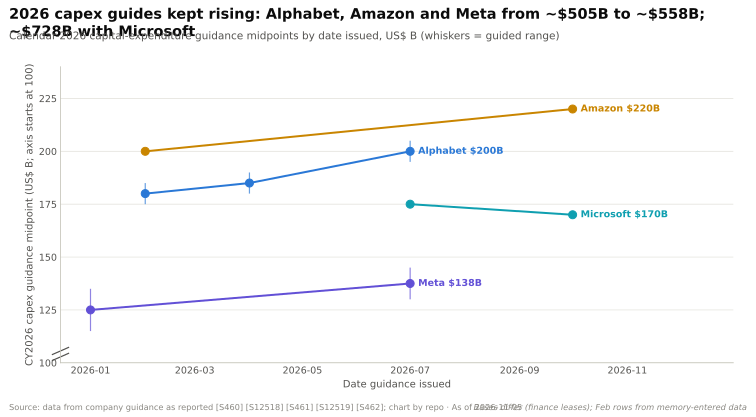
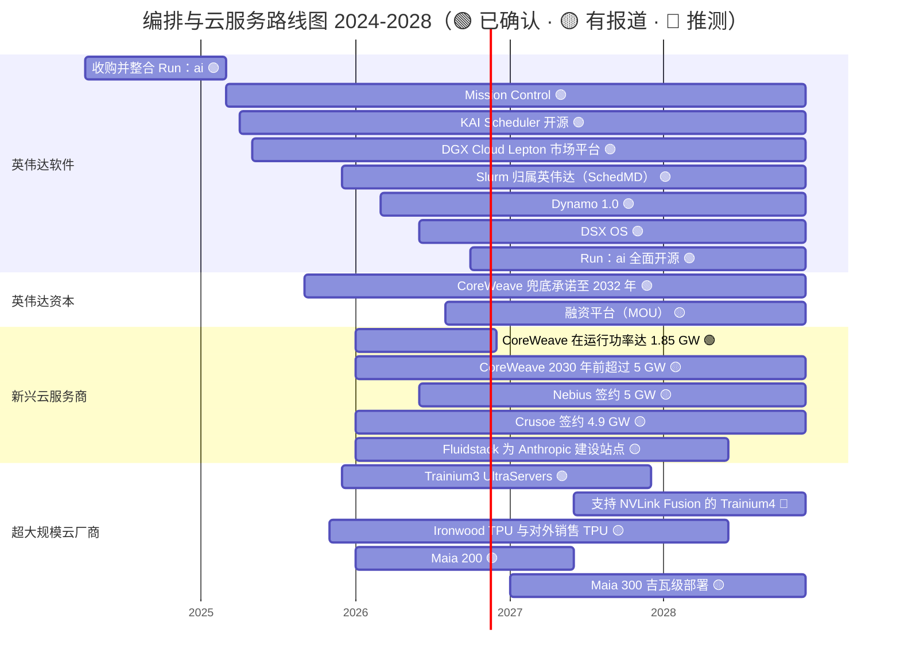
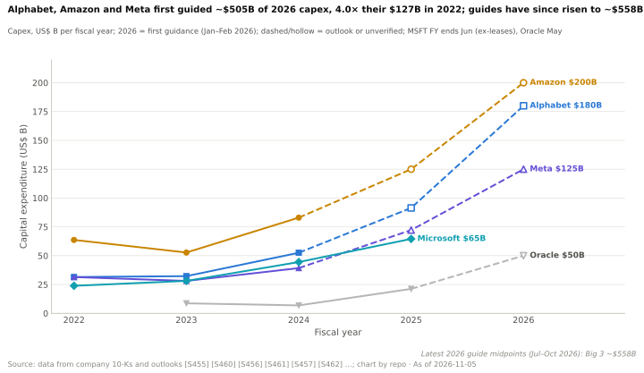
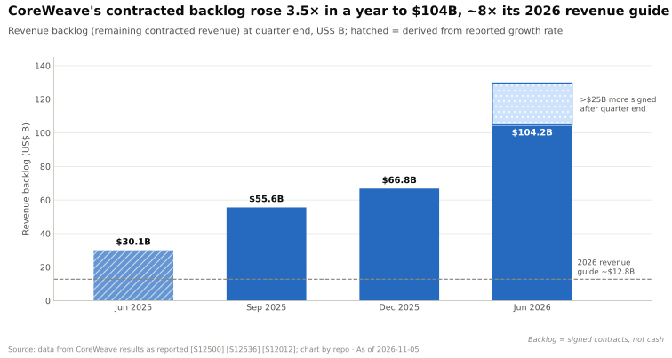

# 编排与云服务：路线图

> [!NOTE]
> 本页为英文原文的简体中文参考译文，仅供参考；如有出入，以[英文原文](../../../layers/12-orchestration-and-cloud-services/roadmap.md "English original")为准。

第 12 层 · 编排与云服务 · 约 11 分钟阅读 · 最后核实：2026-11-05

## ⚡ 要点速览

- **英伟达的软件路线图如今默认开放：** Mission Control（2025 年）、[DSX OS](../../glossary.md#dsx-os)（2026 年 GTC 台北）、[Dynamo](../../glossary.md#dynamo) 1.0（2026 年 3 月），以及采用 Apache 许可的 Run:ai（2026 年 10 月）[[S12005]](../../../sources/bibliography.md#s12005)[[S12513]](../../../sources/bibliography.md#s12513)[[S90066]](../../../sources/bibliography.md#s90066)[[S12510]](../../../sources/bibliography.md#s12510)。
- **需求路线图由[超大规模云厂商](../../glossary.md#hyperscaler)的资本开支决定。** Alphabet、亚马逊和 Meta 将 2026 年指引从约 $505B 上调至约 $558B（取中值）；微软另有约 $170–175B 🟡 [[S460]](../../../sources/bibliography.md#s460)[[S461]](../../../sources/bibliography.md#s461)[[S462]](../../../sources/bibliography.md#s462)[[S12518]](../../../sources/bibliography.md#s12518)[[S12519]](../../../sources/bibliography.md#s12519)。
- **[新兴云服务商（neocloud）](../../glossary.md#neocloud)在收入之前先行建设：** CoreWeave 的目标是到 2026 年底在运行功率超过 1.85 GW，而签约功率约 4.2 GW。Nebius 预计到 2026 年底签约约 5 GW，其中已接入 0.8–1 GW [[S12500]](../../../sources/bibliography.md#s12500)[[S12010]](../../../sources/bibliography.md#s12010)[[S12503]](../../../sources/bibliography.md#s12503)。
- **积压订单是桥梁：** CoreWeave 的[收入积压（revenue backlog）](../../glossary.md#revenue-backlog)一年内增长 3.5 倍至 $104.2B，约为其 2026 年收入指引的 8 倍 [[S12500]](../../../sources/bibliography.md#s12500)。
- **资本是下一个产品：** 英伟达 2026 年 8 月与 Apollo、贝莱德（BlackRock）、黑石（Blackstone）、Brookfield、高盛（Goldman Sachs）和 KKR 搭建的融资平台，目标是调动超过 $500B 的第三方资本，但目前仅为谅解备忘录（MOU），尚待签订最终协议 🟡 [[S12528]](../../../sources/bibliography.md#s12528)。
- **[Q7 · 路线图与变数]** 有三件事会改变格局：超大规模云厂商暂停资本开支、GPU 租赁价格再次崩跌，或高杠杆新兴云服务商出现信贷压力。利息支出已约占 CoreWeave Q3 2026 收入指引的 26% [[S12502]](../../../sources/bibliography.md#s12502)。

## 2024–2028 年路线图

条形表示可用期或建设窗口；无明确终点的项目延伸至图表边缘。Trainium4 的时间未披露 🔴。各行来源见下表；未列入下表的条形：Run:ai [[S476]](../../../sources/bibliography.md#s476)、SchedMD/Slurm [[S12000]](../../../sources/bibliography.md#s12000)、Trainium3 UltraServers [[S90035]](../../../sources/bibliography.md#s90035)。

| 项目 | 时间窗口 | 状态 | 置信度 | 来源 |
|---|---|---|---|---|
| 英伟达 Mission Control（AI 工厂运维） | 2025 → | 已发货；v2.5 新增 Run:ai 管理的 Kubernetes 恢复功能 | 🟢 | [[S12005]](../../../sources/bibliography.md#s12005)[[S12006]](../../../sources/bibliography.md#s12006) |
| DGX Cloud Lepton | 2025 → | 市场平台；2026 年 1 月移除“抢先体验”字样 | 🟢 / 🟡 | [[S598]](../../../sources/bibliography.md#s598)[[S12529]](../../../sources/bibliography.md#s12529) |
| DSX OS（KAI、Run:ai、NVCF、Grove、Dynamo……） | 2026 → | 在 GTC 台北发布 | 🟢 | [[S12513]](../../../sources/bibliography.md#s12513)[[S12514]](../../../sources/bibliography.md#s12514) |
| Run:ai 完整平台开源 | 2026-10 → | 已发布；8 家合作伙伴正在集成 | 🟢 | [[S12510]](../../../sources/bibliography.md#s12510)[[S12512]](../../../sources/bibliography.md#s12512) |
| AI 算力融资平台（目标超过 $500B） | 2026-08 → | 谅解备忘录，尚待签订最终协议 | 🟡 | [[S12528]](../../../sources/bibliography.md#s12528) |
| CoreWeave 在运行功率超过 1.85 GW；2030 年前超过 5 GW | 2026 / 2030 | 指引 / 规划 | 🟢 / 🟡 | [[S12500]](../../../sources/bibliography.md#s12500)[[S472]](../../../sources/bibliography.md#s472) |
| Nebius 到 2026 年底签约约 5 GW，已接入 0.8–1 GW | 2026 → 2029 | 指引 | 🟡 | [[S12503]](../../../sources/bibliography.md#s12503) |
| Crusoe 签约约 4.9 GW，已通电约 0.2 GW | 2026 → | 二手数据 | 🟡 | [[S12013]](../../../sources/bibliography.md#s12013) |
| Anthropic 与 Fluidstack 合作投资 $50B 建设美国数据中心 | 2026 → | 已宣布 | 🟢 | [[S12524]](../../../sources/bibliography.md#s12524) |
| Trainium4（支持 NVLink Fusion） | AWS 未给出时间（2025-12 宣布；图中暂按 2027–28 年标示） | 已宣布 | 🟢 产品 / 🔴 时间 | [[S90034]](../../../sources/bibliography.md#s90034) |
| Maia 300；自 2027 年起吉瓦级 Maia 部署 | 2027 → | 已宣布 / 有报道 | 🟡 | [[S90046]](../../../sources/bibliography.md#s90046)[[S90045]](../../../sources/bibliography.md#s90045) |

> [!TIP]
> **算例 —— 超大规模云厂商的资本开支有多少能流向英伟达。** 英伟达首席执行官称，一座 1 GW 的 AI 工厂全口径成本约 $50–60B，其中英伟达产品约 $35B（58–70%）[[S398]](../../../sources/bibliography.md#s398)。将这一比例应用于四大厂商 2026 年约 $728B 的指引（本资料库对最新中值的加总 🟡）[[S12518]](../../../sources/bibliography.md#s12518)[[S12519]](../../../sources/bibliography.md#s12519)，可得英伟达可触及支出的上限约为 $420–510B。作为对比，按英伟达 Q3 FY2027 $108B 的指引计算，年化约为 $432B [[S3]](../../../sources/bibliography.md#s3)。这只是上限：超大规模云厂商的资本开支还要用于购买土地、建筑、CPU，以及其自研的 TPU、Trainium 和 Maia 🔴。

## 容量与积压订单的演进

这些 2 月份的指引（三大厂商约 $505B）此后均已上调；Alphabet 在 7 月上调至 $195–205B，并预计 2027 年资本开支将再度增长 🟡 [[S12518]](../../../sources/bibliography.md#s12518)。

> [!TIP]
> **算例 —— 把积压订单换算成电力与资本开支。** CoreWeave 2026 年收入指引为 $12.4–13.2B，年初在运行功率约 0.85 GW，年底超过 1.85 GW [[S12500]](../../../sources/bibliography.md#s12500)[[S12012]](../../../sources/bibliography.md#s12012)。按约 1.35 GW 的平均值计算，每在运行 GW·年约产生 $9–10B 收入（本资料库测算 🔴）。按此速度消化 $104B 的积压订单，需要约 11 GW·年的在运行容量：相当于约 2.2 GW 运行五年，高于 2026 年底 1.85 GW 的目标。按每 GW 全口径约 $50–60B 计算，每增加 1 GW 的成本就超过 CoreWeave 2026 年 $35–39B 的全部资本开支预算 [[S398]](../../../sources/bibliography.md#s398)[[S12500]](../../../sources/bibliography.md#s12500)。积压订单转化为收入的速度，取决于融资能跟上多快。

🔧 技术细节：如何解读新兴云服务商的容量披露

**在运行**（或已接入）功率是指已通电并开始计费的容量。**签约**功率是与房东或电力公司签订、将于未来交付的容量。积压订单则是已签约但尚未确认的客户收入。三者推进速度不同：CoreWeave 在 2025 年底签约约 3.1 GW、在运行超过 850 MW，到 2026 年 6 月签约约 3.7 GW、在运行约 1.5 GW [[S12012]](../../../sources/bibliography.md#s12012)[[S12501]](../../../sources/bibliography.md#s12501)。签约与在运行之间不断扩大的差距，就是仍需融资的建设量。应关注积压订单与签约 GW 之比：该比值下降意味着容量建设正跑在客户前面。参见[签约功率与在运行功率](../../glossary.md#contracted-power)。

## [Q7 · 路线图与变数]

**[Q7 · 路线图与变数]** 英伟达自身的第 12 层路线图（开放软件、市场平台、融资工具）风险较低；风险在于其买方。值得关注的信号：

- **资本开支暂停。** 由于第三方容量交付延迟，微软已将其 2026 日历年数字从约 $175B 下调至约 $170B 🟡 [[S12518]](../../../sources/bibliography.md#s12518)[[S12519]](../../../sources/bibliography.md#s12519)。若四大厂商中有两家下调 2027 年指引，首先受冲击的将是新兴云服务商的租赁业务，因为超大规模云厂商把它们当作溢出容量 [[S12526]](../../../sources/bibliography.md#s12526)。
- **GPU 租赁价格崩跌。** H100 租金从约 $8（2023 年）跌至交易平台上的不足 $2（2024 年底），随后到 2026 年 3 月反弹 38% 至 $2.35 [[S393]](../../../sources/bibliography.md#s393)[[S12516]](../../../sources/bibliography.md#s12516)。若随着 Rubin 放量而再次跌破 $1.70 的低点，将削弱 [GPU 抵押贷款](../../glossary.md#gpu-backed-loan)背后的抵押品价值（参见[价值链](value-chain-and-corp-dev.md)）。
- **新兴云服务商信贷压力。** CoreWeave 2026 年第二季度的净利息支出为 $640M，债务规模 $35.1B，并给出第三季度 $860–940M 的指引 [[S12501]](../../../sources/bibliography.md#s12501)[[S12502]](../../../sources/bibliography.md#s12502)。CoreWeave 将于 2026-11-16 发布第三季度业绩，晚于本页的数据截止日 [[S12500]](../../../sources/bibliography.md#s12500)。
- **超大规模云厂商自研芯片放量。** Maia 300（2027 年）、Trainium4 和对外销售的 TPU 会转移需求，而英伟达在第 12 层的杠杆对此无能为力 [[S90046]](../../../sources/bibliography.md#s90046)[[S90034]](../../../sources/bibliography.md#s90034)[[S90027]](../../../sources/bibliography.md#s90027)。
- **融资平台落地或停滞。** 如果超过 $500B 的谅解备忘录变成签约资金，新兴云服务商的资本成本将下降；如果没有，针对[循环融资](../../glossary.md#circular-financing)的批评将更加尖锐 [[S12528]](../../../sources/bibliography.md#s12528)。

> [!TIP]
> **算例 —— 以利息覆盖作为预警指标。** CoreWeave 给出的 Q3 2026 收入指引为 $3.45–3.6B，利息支出为 $860–940M [[S12502]](../../../sources/bibliography.md#s12502)。利息将吞噬约 24–27% 的收入，高于第二季度的约 25%（$2.58B 收入中 $640M）[[S12501]](../../../sources/bibliography.md#s12501)[[S12500]](../../../sources/bibliography.md#s12500)。如果未签约容量的租赁价格下跌 20%，而债务仍在增长，这一比例可能超过 30% 🔴。到了这个区间，贷款方就会重新定价，兜底承诺也开始发挥作用。

## 🎯 企业发展视角

1. 战略团队每月应追踪哪个指标：超大规模云厂商资本开支指引、H100/B200 租赁价格指数，还是新兴云服务商的利息覆盖率？
2. 英伟达的融资平台尚为谅解备忘录。如果 GPU 抵押品价值下跌，谁承担第一损失：英伟达、资产管理公司，还是新兴云服务商？
3. Nebius（约 5 GW）和 Crusoe（约 4.9 GW）的签约功率远超其在运行容量。哪些加速器厂商能够分得尚未锁定的那部分容量？
4. 如果 2027 年 Maia 300、Trainium4 和对外销售的 TPU 大规模上量，哪些新兴云服务商会率先提供非英伟达算力，条件又是什么？

## 📚 来源（Sources）

<!-- Auto-generated from the [S…] citations on this page by `make build`. Edit sources/registry/*.csv, not this list. -->

- [**S3**](../../../sources/bibliography.md#s3) StorageNewsletter, *NVIDIA Q2 Fiscal 2027 results coverage: revenue $96.2B*, 2026-08-27. [Link](https://www.storagenewsletter.com/2026/08/27/nvidia-fiscal-2q27-financial-results/)
- [**S393**](../../../sources/bibliography.md#s393) Latent Space (Eugene Cheah), *$2 H100s: how the GPU bubble burst*, 2024-10. [Link](https://www.latent.space/p/gpu-bubble)
- [**S398**](../../../sources/bibliography.md#s398) NVIDIA Investor Relations, *NVIDIA Q2 FY2026 earnings call (2025-08-27): AI factory economics commentary*, 2025-08-27. [Link](https://investor.nvidia.com/events-and-presentations/events-and-presentations/default.aspx)
- [**S460**](../../../sources/bibliography.md#s460) Alphabet Investor Relations, *Alphabet Q4 and fiscal year 2025 results and 2026 capex outlook*, 2026-02. [Link](https://abc.xyz/investor/)
- [**S461**](../../../sources/bibliography.md#s461) Amazon Investor Relations, *Amazon.com Q4 2025 results and 2026 capex commentary*, 2026-02. [Link](https://ir.aboutamazon.com/)
- [**S462**](../../../sources/bibliography.md#s462) Meta Investor Relations, *Meta Q4 and full year 2025 results and 2026 capex outlook*, 2026-01. [Link](https://investor.atmeta.com/)
- [**S472**](../../../sources/bibliography.md#s472) CoreWeave Newsroom, *CoreWeave and NVIDIA expand partnership; NVIDIA invests $2B in CoreWeave Class A stock*, 2026-01-26. [Link](https://www.coreweave.com/news)
- [**S476**](../../../sources/bibliography.md#s476) NVIDIA Blog, *NVIDIA to Acquire GPU Orchestration Software Provider Run:ai*, 2024-04-24. [Link](https://blogs.nvidia.com/blog/runai/)
- [**S598**](../../../sources/bibliography.md#s598) NVIDIA Newsroom, *NVIDIA Announces DGX Cloud Lepton to Connect Developers to NVIDIA's Global Compute Ecosystem*, 2025-05-18. [Link](https://nvidianews.nvidia.com/news/nvidia-announces-dgx-cloud-lepton-to-connect-developers-to-nvidias-global-compute-ecosystem)
- [**S12000**](../../../sources/bibliography.md#s12000) NVIDIA Blog, *NVIDIA Acquires Open-Source Workload Management Provider SchedMD*, 2025-12-15. [Link](https://blogs.nvidia.com/blog/nvidia-acquires-schedmd)
- [**S12005**](../../../sources/bibliography.md#s12005) NVIDIA Blog, *New NVIDIA Software for Blackwell Infrastructure Runs AI Factories at Light Speed*, 2025-03-18. [Link](https://blogs.nvidia.com/?p=78497)
- [**S12006**](../../../sources/bibliography.md#s12006) NVIDIA Technical Blog, *Automating AI Factory Operations with NVIDIA Mission Control*, 2026. [Link](https://developer.nvidia.com/blog/automating-ai-factory-operations-with-nvidia-mission-control)
- [**S12010**](../../../sources/bibliography.md#s12010) DatacenterDynamics, *Neocloud results Q2 2026: CoreWeave, Nebius, Cerebras*, 2026-08. [Link](https://www.datacenterdynamics.com/en/news/neocloud-results-q2-2026-coreweave-nebius-cerebras/)
- [**S12012**](../../../sources/bibliography.md#s12012) CoreWeave via Business Wire, *CoreWeave Reports Strong Fourth Quarter and Fiscal Year 2025 Results*, 2026-02-26. [Link](https://www.businesswire.com/news/home/20260226281661/en/CoreWeave-Reports-Strong-Fourth-Quarter-and-Fiscal-Year-2025-Results)
- [**S12013**](../../../sources/bibliography.md#s12013) MarkTechPost, *Best GPU neoclouds 2026: CoreWeave, Nebius, Lambda, Crusoe and Groq ranked by published pricing and contracted power*, 2026-08-23. [Link](https://www.marktechpost.com/2026/08/23/best-gpu-neoclouds-2026/)
- [**S12500**](../../../sources/bibliography.md#s12500) CoreWeave (press release via Seeking Alpha), *CoreWeave Reports Strong Second Quarter 2026 Results*, 2026-08. [Link](https://seekingalpha.com/pr/20615715)
- [**S12501**](../../../sources/bibliography.md#s12501) Runtime Wire, *CoreWeave reports $2.58 billion Q2 revenue with $35 billion in debt*, 2026-08. [Link](https://runtimewire.com/article/coreweave-q2-2026-revenue-debt-ai-cloud)
- [**S12502**](../../../sources/bibliography.md#s12502) MarketBeat, *CoreWeave Q2 earnings call highlights*, 2026-08-11. [Link](https://www.marketbeat.com/instant-alerts/coreweave-q2-earnings-call-highlights-2026-08-11/)
- [**S12503**](../../../sources/bibliography.md#s12503) Quartr, *Nebius Group (NBIS) Q2 2026 earnings summary*, 2026-08. [Link](https://quartr.com/events/nebius-group-n-v-nbis-q2-2026_ozKEzQzr)
- [**S12510**](../../../sources/bibliography.md#s12510) NVIDIA Technical Blog, *NVIDIA Run:ai is now open source as part of NVIDIA DSX AI Factory platform*, 2026-10. [Link](https://developer.nvidia.com/blog/nvidia-runai-is-now-open-source-as-part-of-nvidia-dsx-ai-factory-platform/)
- [**S12512**](../../../sources/bibliography.md#s12512) Techstrong.ai, *NVIDIA hands Run:ai to the open source community*, 2026-10. [Link](https://techstrong.ai/articles/nvidia-hands-runai-to-the-open-source-community/)
- [**S12513**](../../../sources/bibliography.md#s12513) NVIDIA Newsroom, *NVIDIA DSX Gives Infrastructure Builders the Playbook for AI Factories*, 2026-05-31. [Link](https://nvidianews.nvidia.com/news/dsx-infrastructure-ai-factory)
- [**S12514**](../../../sources/bibliography.md#s12514) NVIDIA, *NVIDIA DSX OS (product page)*, 2026. [Link](https://www.nvidia.com/en-us/data-center/products/dsx/os/)
- [**S12516**](../../../sources/bibliography.md#s12516) SemiAnalysis, *The Great GPU Shortage - Rental Capacity - Launching our H100 1 Year Rental Price Index*, 2026-03. [Link](https://newsletter.semianalysis.com/p/the-great-gpu-shortage-rental-capacity)
- [**S12518**](../../../sources/bibliography.md#s12518) Datacentres.com, *Hyperscaler capex trends: over $700 billion for 2026*, 2026-08. [Link](https://www.datacentres.com/guides/hyperscaler-capex-trends)
- [**S12519**](../../../sources/bibliography.md#s12519) Hargreaves Lansdown, *AI hyperscalers are expected to finish the year spending a whopping $828 billion on capex*, 2026-10. [Link](https://www.hl.co.uk/news/ai-hyperscalers-are-expected-to-finish-the-year-spending-a-whopping-828-billion-on-capex)
- [**S12524**](../../../sources/bibliography.md#s12524) DatacenterDynamics, *Anthropic plans $50bn US data center spend, starting with Fluidstack sites in Texas and New York*, 2025-11-12. [Link](https://datacenterdynamics.com/en/news/anthropic-plans-50bn-us-data-center-spend-starting-with-fluidstack-sites-in-texas-and-new-york)
- [**S12526**](../../../sources/bibliography.md#s12526) Introl, *Microsoft's $60B neocloud bet: buying time in the AI capacity crisis*, 2025-12. [Link](https://introl.com/blog/microsoft-60-billion-neocloud-spending-2025)
- [**S12528**](../../../sources/bibliography.md#s12528) NVIDIA Newsroom, *NVIDIA Partners With Apollo, BlackRock, Blackstone, Brookfield, Goldman Sachs and KKR to Establish AI Compute Infrastructure Financing Platforms to Mobilize Over $500 Billion of Third-Party Capital*, 2026-08-10. [Link](https://nvidianews.nvidia.com/news/nvidia-partners-with-apollo-blackrock-blackstone-brookfield-goldman-sachs-and-kkr-to-establish-ai-compute-infrastructure-financing-platforms-to-mobilize-over-500-billion-of-third-party-capital)
- [**S12529**](../../../sources/bibliography.md#s12529) NVIDIA Technical Blog, *Introducing NVIDIA DGX Cloud Lepton: a unified AI platform built for developers*, 2025-05. [Link](https://developer.nvidia.com/blog/introducing-nvidia-dgx-cloud-lepton-a-unified-ai-platform-built-for-developers)
- [**S90027**](../../../sources/bibliography.md#s90027) The Next Web, *Google is building a four-partner chip supply chain to challenge Nvidia in AI inference*, 2026. [Link](https://thenextweb.com/news/google-inference-chips-nvidia-challenge-supply-chain)
- [**S90034**](../../../sources/bibliography.md#s90034) NAND Research, *AWS releases Trainium3, teases Trainium4*, 2025-12. [Link](https://nand-research.com/research-note-aws-releases-trainium3-teases-trainium4/4/)
- [**S90035**](../../../sources/bibliography.md#s90035) Business Today ME, *Trainium3 UltraServers now available*, 2025-12. [Link](https://businesstoday.me/tech-news/trainium3-ultraservers-now-available-enabling-customers-to-train-and-deploy-ai-models-fasterat-lower-cost/)
- [**S90045**](../../../sources/bibliography.md#s90045) Pulse 2.0, *Microsoft to expand Azure Maia AI infrastructure to multi-gigawatt deployments starting in 2027*, 2026-10. [Link](https://pulse2.com/microsoft-to-expand-azure-maia-ai-infrastructure/)
- [**S90046**](../../../sources/bibliography.md#s90046) IT Brief UK, *Microsoft unveils Maia 300 for 2027 AI deployments*, 2026-10. [Link](https://itbrief.co.uk/story/microsoft-unveils-maia-300-for-2027-ai-deployments)
- [**S90066**](../../../sources/bibliography.md#s90066) HPCwire (NVIDIA press release), *NVIDIA enters production with Dynamo, the broadly adopted inference operating system for AI factories*, 2026-03-17. [Link](https://www.hpcwire.com/aiwire/tag/dynamo-1-0/)
