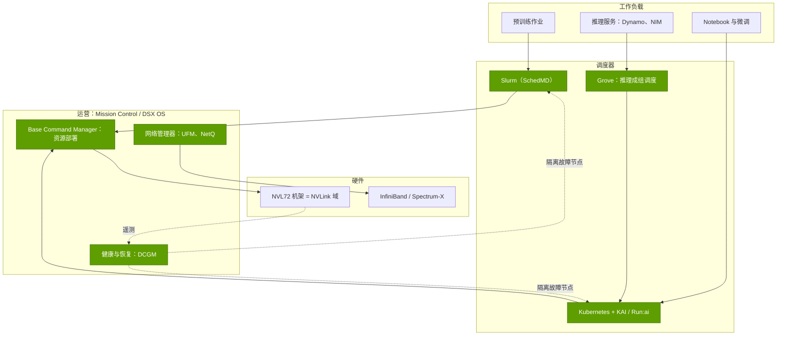
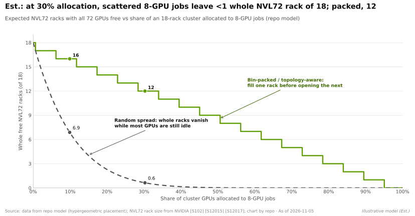
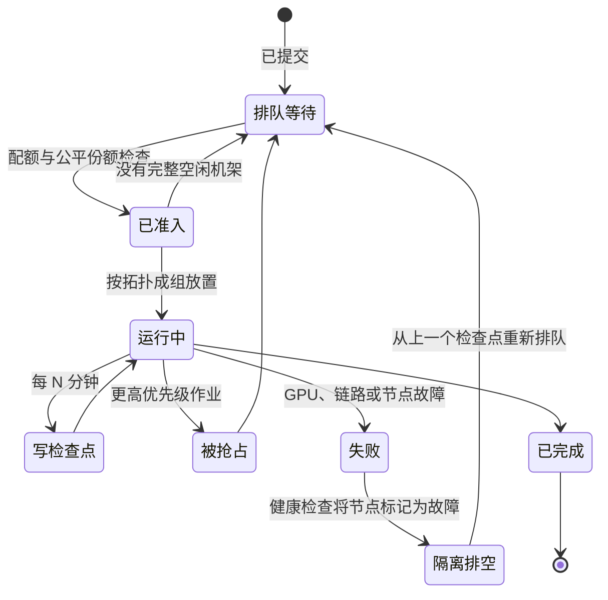

# Run:ai、Mission Control 与 Base Command：调度栈

> [!NOTE]
> 本页为英文原文的简体中文参考译文，仅供参考；如有出入，以[英文原文](../../../layers/12-orchestration-and-cloud-services/run-ai-mission-control-base-command.md "English original")为准。

第 12 层 · 编排与云服务 · 约 10 分钟阅读 · 最后核实：2026-11-05

## ⚡ 要点速览

- **英伟达已买下 AI 控制平面的大部分：** Bright Computing（2022 年，现为 [Base Command Manager](../../glossary.md#base-command-manager)）[[S478]](../../../sources/bibliography.md#s478)、[Run:ai](../../glossary.md#run-ai)（据报道约 $700M，2024-12-30 完成交割）[[S476]](../../../sources/bibliography.md#s476)[[S479]](../../../sources/bibliography.md#s479)，以及 [Slurm](../../glossary.md#slurm) 的开发商 SchedMD（2025-12-15，交易条款未披露）[[S12000]](../../../sources/bibliography.md#s12000)。它们被打包为 [Mission Control](../../glossary.md#mission-control)（GTC 2025）[[S12005]](../../../sources/bibliography.md#s12005)，并自 2026 年 5 月起整合为模块化的 [DSX OS](../../glossary.md#dsx-os) [[S12513]](../../../sources/bibliography.md#s12513)[[S12514]](../../../sources/bibliography.md#s12514)。
- **全球的 GPU 由两种调度器管理。** TOP500 前 10 名和前 100 名系统中，超过一半运行 Slurm [[S12000]](../../../sources/bibliography.md#s12000)；[Kubernetes](../../glossary.md#kubernetes) 则承载推理和混合机群。英伟达如今对两者都有主导权。
- **随后它把调度器免费放了出去：** Run:ai 的 [KAI Scheduler](../../glossary.md#kai-scheduler) 在 KubeCon Europe 2025 上以 Apache 2.0 许可开源 [[S12003]](../../../sources/bibliography.md#s12003)，现为 CNCF 沙箱项目 [[S12002]](../../../sources/bibliography.md#s12002)；完整的 Run:ai 平台也于 2026 年 10 月随之开源 [[S12510]](../../../sources/bibliography.md#s12510)[[S12511]](../../../sources/bibliography.md#s12511)。
- **提升利用率的三个手段：** [GPU 切分](../../glossary.md#fractional-gpu)（[MIG](../../glossary.md#mig) 可将一颗 GPU 最多切成七份）[[S12019]](../../../sources/bibliography.md#s12019)、[成组调度（gang scheduling）](../../glossary.md#gang-scheduling)以及[拓扑感知放置](../../glossary.md#topology-aware-scheduling) [[S12002]](../../../sources/bibliography.md#s12002)。在本资料库的模型中，分配率为 30% 时，分散放置的 8-GPU 作业会使 18 台 [NVL72](../../glossary.md#nvl72) 机架中完整空闲的不足 1 台；装箱放置则可保留 12 台。
- **故障处理是新的前沿。** 按 Llama 3 的故障率，一个 100,000 颗 GPU 的作业约每 30 分钟中断一次，若每次恢复需 15 分钟，将浪费约 33% 的时间（估计）[[S34006]](../../../sources/bibliography.md#s34006)。英伟达称 Mission Control 的作业恢复速度最高可快 10 倍（厂商说法）[[S12005]](../../../sources/bibliography.md#s12005)。
- **弱点：** 这类软件直接收入很少。Kubernetes、Kueue、Ray 和 SkyPilot 都是免费的 [[S12533]](../../../sources/bibliography.md#s12533)[[S12535]](../../../sources/bibliography.md#s12535)[[S12534]](../../../sources/bibliography.md#s12534)，[新兴云服务商（neocloud）](../../glossary.md#neocloud)会自建方案（如 CoreWeave 的 SUNK）[[S12530]](../../../sources/bibliography.md#s12530)，而拥有 Slurm 也会引来基于 AMD 和英特尔的 HPC 站点对其中立性的质疑。

## 逐层拆解调度栈

不妨把它想象成一座机场。机架是跑道和登机口，调度器是空中交通管制，集群管理是地勤运营，健康监控则是在故障飞机起飞前将其停飞的维修团队。

| 组件 | 职能 | 来源 | 许可 |
|---|---|---|---|
| Slurm | 面向 HPC 与预训练的批处理队列；以整节点为单位成组分配 | SchedMD，2025 年 12 月收购 [[S12000]](../../../sources/bibliography.md#s12000) | 开源，保持厂商中立 |
| KAI Scheduler / Run:ai | Kubernetes GPU 调度器：队列、公平份额、GPU 共享、拓扑 [[S12002]](../../../sources/bibliography.md#s12002) | Run:ai，2024 年收购 [[S476]](../../../sources/bibliography.md#s476) | Apache 2.0（KAI 2025 年；Run:ai 2026 年 10 月）[[S12510]](../../../sources/bibliography.md#s12510) |
| [Grove](../../glossary.md#grove) | 用一个 Kubernetes 资源描述整套 [Dynamo](../../glossary.md#dynamo) 推理系统 [[S12021]](../../../sources/bibliography.md#s12021) | 英伟达 Dynamo 项目 | Apache 2.0 |
| Base Command Manager | 资源部署、操作系统镜像、集群监控 | Bright Computing，2022 年 [[S478]](../../../sources/bibliography.md#s478) | 商业 |
| [DCGM](../../glossary.md#dcgm) | GPU 健康检查、诊断、遥测 [[S12020]](../../../sources/bibliography.md#s12020) | 英伟达 | 开源 |
| Mission Control | 将上述组件与 UFM/NetQ 及自主恢复功能打包 [[S12004]](../../../sources/bibliography.md#s12004) | GTC 2025 [[S12005]](../../../sources/bibliography.md#s12005) | 商业 |

> [!TIP]
> **算例 —— 同一集群，两种调度器。** 一个 576 颗 GPU 的预训练作业需要同时占用 8 台完整的 NVL72 机架，持续数周：这是典型的 Slurm 式批处理作业。一个推理服务每个副本需要 8 颗 GPU，并随流量在 4 到 40 个副本之间伸缩：这是典型的 Kubernetes 式服务。要在一个 18 台机架的集群上同时运行两者，要么让两个调度器争抢机架，要么用一个能兼顾两者的调度器。这正是 CoreWeave 在 Kubernetes 内运行 Slurm（SUNK）[[S12530]](../../../sources/bibliography.md#s12530)、英伟达把两边都买下的原因。

## 提升利用率的三个手段

**GPU 切分（拼车）。** 一个 notebook 或小模型很少需要一整颗 GPU。[MIG](../../glossary.md#mig) 可将一颗 GPU 划分为最多七个相互隔离的实例 [[S12019]](../../../sources/bibliography.md#s12019)；MPS 在强制限额下共享内存与算力；[时间片轮转（time-slicing）](../../glossary.md#gpu-time-slicing)成本最低，但共享同一个故障域，一次崩溃就会让所有租户一起宕掉 [[S12018]](../../../sources/bibliography.md#s12018)。

> [!TIP]
> **算例 —— 70 个 notebook。** 七十位数据科学家每人独占一整颗 GB300 GPU，就会占用 70 颗 GPU。若改用七分之一的 MIG 切片，10 颗就够了。按[利用率问题](the-utilization-problem.md)中估计的每已安装小时约 $1.50 计算，腾出的 60 颗 GPU 每年价值约 $788K（60 × 8,760 h × $1.50）。**结论：** GPU 切分在闲置较多的交互式工作上能够收回成本，在大型训练上则不然。

**成组调度（整桌入座）。** 餐厅只有在整张桌子空出来时才会安排十二人的聚餐入座。分布式作业也是如此：缺了另一半 GPU，这一半就毫无用处。KAI 和 Grove 会让一组中的所有 pod 要么同时启动，要么都不启动 [[S12002]](../../../sources/bibliography.md#s12002)[[S12021]](../../../sources/bibliography.md#s12021)。

> [!TIP]
> **算例 —— 成组调度所避免的死锁。** 两个各需 512 颗 GPU 的作业到达一个有 768 颗空闲 GPU 的集群。朴素的调度器给每个作业分 384 颗；两者都在无限期等待另外 128 颗，于是 768 颗 GPU 全部闲置。成组调度器则会用 512 颗 GPU 启动其中一个作业，让另一个排队。**结论：** 有 512 颗 GPU 在干活，而不是零颗。

**拓扑感知放置与装箱调度（保持整层楼空着）。** 张量并行组每一层都要交换数据，因此必须位于同一个 [NVLink](../../glossary.md#nvlink) 域内，在 NVL72 上即同一台机架（参见[第 05 层](../05-scale-up-nvlink-nvswitch/index.md)）。如果小作业被零散地撒在各台机架上，就没有哪台机架能保持完整。

🔧 技术细节：公平性、抢占与预留

KAI 采用带配额和超额权重的层级队列、[主导资源公平（DRF）](../../glossary.md#dominant-resource-fairness)份额分配 [[S12002]](../../../sources/bibliography.md#s12002)、基于时间的公平份额（考虑历史使用量）、带最短保障运行时间的[抢占](../../glossary.md#preemption)、用于消除碎片的工作负载整合，以及覆盖 GB200/GB300 和 AMD GPU 的 Kubernetes 动态资源分配（Dynamic Resource Allocation）[[S12002]](../../../sources/bibliography.md#s12002)。其 v0.10.0 版本（2025 年 10 月）新增了拓扑感知调度和层级 pod 组 [[S12002]](../../../sources/bibliography.md#s12002)。阿里巴巴在 ATC '23 发表的研究显示，在其集群轨迹数据上，碎片感知放置优于经典的最佳适配（best-fit）策略 [[S12016]](../../../sources/bibliography.md#s12016)。

## 故障是常态

在大规模集群中，总有东西是坏的。Meta 在一个 16,384 颗 GPU 的作业上 54 天内记录了 419 次意外中断，约每三小时一次，大多源于硬件 [[S34006]](../../../sources/bibliography.md#s34006)[[S31003]](../../../sources/bibliography.md#s31003)。每次故障都要付出检测、隔离故障节点、重启，以及重做自上一个[检查点](../../glossary.md#checkpoint)以来工作的代价。

DCGM 提供健康检查与诊断 [[S12020]](../../../sources/bibliography.md#s12020)。Mission Control 在此基础上增加了自主作业恢复（捕获作业上下文、定位可疑的 GPU 或节点、重启）和自主硬件恢复（在性能退化导致作业失败之前将其发现）；2.5 版将这一能力扩展到 Run:ai 管理下的 Kubernetes 工作负载 [[S12006]](../../../sources/bibliography.md#s12006)。

> [!TIP]
> **算例 —— 为什么恢复时间一代比一代重要。** Llama 3 的故障率为 419 ÷（54 天 × 24 h × 16,384 颗 GPU）≈ 每 100,000 GPU 小时 2.0 次故障 [[S34006]](../../../sources/bibliography.md#s34006)。因此，一个 100,000 颗 GPU 的作业每小时约故障 2 次。若每次恢复需 15 分钟，它将损失 0.49 ÷ 1.49 ≈ **33%** 的时间；若只需 3 分钟，则损失**约 9%**。**结论：** 在 10 万颗 GPU 的规模下，把恢复时间从 15 分钟缩短到 3 分钟，同样的 GPU 可多产出约 36% 的有效工作（0.91 ÷ 0.67，估计）。

## 控制平面如何演进，以及英伟达为何免费开放

**[Q3 · 代际进步]**（软件方面；云价格方面的图表见[超大规模云厂商与新兴云服务商](hyperscalers-vs-neoclouds.md)）：

| 年份 | 英伟达控制平面的进展 | 新增能力 |
|---|---|---|
| 2022 | Bright Computing → Base Command Manager [[S478]](../../../sources/bibliography.md#s478) | 集群部署与监控 |
| 2023 | DGX Cloud [[S12007]](../../../sources/bibliography.md#s12007) | 搭载英伟达软件的托管集群 |
| 2024 | Run:ai 完成交割 [[S476]](../../../sources/bibliography.md#s476) | Kubernetes GPU 资源池、GPU 切分、公平份额 |
| 2025 | Mission Control [[S12005]](../../../sources/bibliography.md#s12005)；KAI 开源 [[S12003]](../../../sources/bibliography.md#s12003)；Grove [[S12021]](../../../sources/bibliography.md#s12021) | 自主恢复；面向推理的拓扑感知成组调度 |
| 2025 年 12 月 | SchedMD [[S12000]](../../../sources/bibliography.md#s12000) | 掌握 HPC 默认调度器 Slurm |
| 2026 | DSX OS [[S12513]](../../../sources/bibliography.md#s12513)；Run:ai 开源 [[S12510]](../../../sources/bibliography.md#s12510) | 从资源部署到推理全覆盖的开放、模块化 AI 工厂操作系统 |

调度器是 GPU 的互补品：调度器越便宜、越好用，客户能用上的 GPU 小时就越多。开源 KAI 和 Run:ai，并承诺保持 Slurm 的厂商中立 [[S12000]](../../../sources/bibliography.md#s12000)，可以防止竞争对手的免费工具成为默认选项，同时英伟达通过技术支持、Mission Control 和 AI Enterprise 实现变现 [[S12510]](../../../sources/bibliography.md#s12510)。

> [!TIP]
> **算例 —— 免费调度器对英伟达价值几何。** 如果更好的放置与恢复能在 100 万颗已安装的 GB300 级 GPU 上仅提升 5 个百分点的利用率，客户每年就能多获得 1M × 8,760 h × 5% ≈ 4.38 亿个有效 GPU 小时，按每小时约 $1.50 计约值 $657M 的算力（估计，出自[利用率问题](the-utilization-problem.md)）。而 Run:ai 只是一次性花费约 $700M [[S479]](../../../sources/bibliography.md#s479)。**结论：** 这类软件的回报来自更便宜的有效算力和更高的客户黏性，而非授权费。

> [!WARNING]
> **🐻 看空观点：** 中立只是承诺，而非保证。如果 Slurm 或 KAI 的功能率先或最好地在英伟达硬件上落地（已有报道称 SchedMD 正在针对 Rubin 和 Vera 进行优化 [[S12001]](../../../sources/bibliography.md#s12001)），AMD 和英特尔的站点可能会分叉代码，或转向 Kueue 或 Ray。此外，作为最大买方的[超大规模云厂商](../../glossary.md#hyperscaler)运行的是自己的控制平面。

## 🎯 企业发展视角

1. **控制点，而非利润池。** Run:ai 约 $700M 的收购价 [[S479]](../../../sources/bibliography.md#s479)与英伟达 FY2026 约 $216B 的收入 [[S1]](../../../sources/bibliography.md#s1)相比微不足道；其价值在于遥测数据以及在每座 AI 工厂中的默认地位。
2. **开源编排初创公司面临挤压**，夹在英伟达的免费软件栈与超大规模云厂商的自有方案之间；价值正转向多云调度中介（类似 SkyPilot）和垂直运营商。
3. **Slurm 的中立性是一个观察项**，关乎任何非英伟达加速器厂商在 HPC 领域的市场进入策略。
4. **高通的问题（仅基于公开信息）：** 对于 AI200/AI250 等推理机架 [[S90028]](../../../sources/bibliography.md#s90028)，在 KAI、Kueue 和 Slurm 中获得一流支持，对云买方的意义是否大于额外的算子优化工作？

## 📚 来源（Sources）

<!-- Auto-generated from the [S…] citations on this page by `make build`. Edit sources/registry/*.csv, not this list. -->

- [**S1**](../../../sources/bibliography.md#s1) NVIDIA Corporation via SEC EDGAR, *NVIDIA Announces Financial Results for Fourth Quarter and Fiscal 2026 (Form 8-K exhibit 99.1)*, 2026-02-25. [Link](https://www.sec.gov/Archives/edgar/data/1045810/000104581026000019/q4fy26pr.htm)
- [**S476**](../../../sources/bibliography.md#s476) NVIDIA Blog, *NVIDIA to Acquire GPU Orchestration Software Provider Run:ai*, 2024-04-24. [Link](https://blogs.nvidia.com/blog/runai/)
- [**S478**](../../../sources/bibliography.md#s478) NVIDIA, *NVIDIA Blog and Newsroom acquisition announcements (Cumulus, SwiftStack, DeepMap, Bright Computing, Excelero, Shoreline, Brev.dev, OctoAI, VinBrain, Gretel, Lepton AI, CentML, SchedMD)*, 2025-12. [Link](https://blogs.nvidia.com/)
- [**S479**](../../../sources/bibliography.md#s479) Various (press), *Reporting on NVIDIA tuck-in acquisition prices (Run:ai, Deci, Shoreline, OctoAI, Gretel, Lepton, CentML) — The Information, Calcalist, Reuters, CNBC*, 2025-06. [Link](https://www.reuters.com/technology/)
- [**S12000**](../../../sources/bibliography.md#s12000) NVIDIA Blog, *NVIDIA Acquires Open-Source Workload Management Provider SchedMD*, 2025-12-15. [Link](https://blogs.nvidia.com/blog/nvidia-acquires-schedmd)
- [**S12001**](../../../sources/bibliography.md#s12001) SiliconANGLE, *Nvidia acquires SchedMD, developer of the Slurm workload manager*, 2025-12-15. [Link](https://siliconangle.com/?p=725204)
- [**S12002**](../../../sources/bibliography.md#s12002) KAI Scheduler project (originally NVIDIA Run:ai), *KAI Scheduler (GitHub repository README)*, 2026-04. [Link](https://github.com/kai-scheduler/KAI-Scheduler)
- [**S12003**](../../../sources/bibliography.md#s12003) The New Stack, *NVIDIA open sources KAI Scheduler to help AI teams optimize GPU utilization*, 2025-04. [Link](https://thenewstack.io/nvidia-open-sources-kai-scheduler-to-help-ai-teams-optimize-gpu-utilization/)
- [**S12004**](../../../sources/bibliography.md#s12004) NVIDIA, *NVIDIA Mission Control (product page)*, 2025. [Link](https://www.nvidia.com/en-us/data-center/mission-control/)
- [**S12005**](../../../sources/bibliography.md#s12005) NVIDIA Blog, *New NVIDIA Software for Blackwell Infrastructure Runs AI Factories at Light Speed*, 2025-03-18. [Link](https://blogs.nvidia.com/?p=78497)
- [**S12006**](../../../sources/bibliography.md#s12006) NVIDIA Technical Blog, *Automating AI Factory Operations with NVIDIA Mission Control*, 2026. [Link](https://developer.nvidia.com/blog/automating-ai-factory-operations-with-nvidia-mission-control)
- [**S12007**](../../../sources/bibliography.md#s12007) NVIDIA Newsroom, *NVIDIA Launches DGX Cloud, Giving Every Enterprise Instant Access to AI Supercomputer From a Browser*, 2023-03-21. [Link](https://nvidianews.nvidia.com/news/nvidia-launches-dgx-cloud-giving-every-enterprise-instant-access-to-ai-supercomputer-from-a-browser)
- [**S12016**](../../../sources/bibliography.md#s12016) Alibaba (GitHub), *Alibaba Cluster Trace Program (clusterdata) README incl. cluster-trace-gpu-v2026*, 2026. [Link](https://github.com/alibaba/clusterdata)
- [**S12018**](../../../sources/bibliography.md#s12018) NVIDIA (GitHub), *NVIDIA Kubernetes device plugin (GitHub README): MIG strategies and shared access via time-slicing and MPS*, 2026. [Link](https://github.com/NVIDIA/k8s-device-plugin)
- [**S12019**](../../../sources/bibliography.md#s12019) NVIDIA (GitHub), *NVIDIA MIG Partition Editor (mig-parted) README*, 2026. [Link](https://github.com/NVIDIA/mig-parted)
- [**S12020**](../../../sources/bibliography.md#s12020) NVIDIA (GitHub), *NVIDIA Data Center GPU Manager (DCGM) README*, 2026. [Link](https://github.com/NVIDIA/DCGM)
- [**S12021**](../../../sources/bibliography.md#s12021) NVIDIA Dynamo project (GitHub), *Grove: one API for any inference architecture (GitHub README)*, 2026. [Link](https://github.com/ai-dynamo/grove)
- [**S12510**](../../../sources/bibliography.md#s12510) NVIDIA Technical Blog, *NVIDIA Run:ai is now open source as part of NVIDIA DSX AI Factory platform*, 2026-10. [Link](https://developer.nvidia.com/blog/nvidia-runai-is-now-open-source-as-part-of-nvidia-dsx-ai-factory-platform/)
- [**S12511**](../../../sources/bibliography.md#s12511) TechRepublic, *Nvidia Run:ai is now open source: what's free and paid*, 2026-10-15. [Link](https://www.techrepublic.com/article/news-nvidia-runai-open-source-free-paid/)
- [**S12513**](../../../sources/bibliography.md#s12513) NVIDIA Newsroom, *NVIDIA DSX Gives Infrastructure Builders the Playbook for AI Factories*, 2026-05-31. [Link](https://nvidianews.nvidia.com/news/dsx-infrastructure-ai-factory)
- [**S12514**](../../../sources/bibliography.md#s12514) NVIDIA, *NVIDIA DSX OS (product page)*, 2026. [Link](https://www.nvidia.com/en-us/data-center/products/dsx/os/)
- [**S12530**](../../../sources/bibliography.md#s12530) CoreWeave Blog, *New CoreWeave SUNK capabilities help teams build modern AI research clusters*, 2025. [Link](https://coreweave.com/blog/new-coreweave-sunk-capabilities-help-teams-build-modern-ai-research-clusters)
- [**S12533**](../../../sources/bibliography.md#s12533) Kubernetes SIGs on GitHub, *Kueue (README)*, 2026. [Link](https://github.com/kubernetes-sigs/kueue)
- [**S12534**](../../../sources/bibliography.md#s12534) SkyPilot project on GitHub, *SkyPilot (README)*, 2026-10. [Link](https://github.com/skypilot-org/skypilot)
- [**S12535**](../../../sources/bibliography.md#s12535) Ray project on GitHub (Anyscale), *Ray (README)*, 2026. [Link](https://github.com/ray-project/ray)
- [**S31003**](../../../sources/bibliography.md#s31003) Tom's Hardware, *Faulty Nvidia H100 GPUs and HBM3 memory caused half of the failures during Llama 3 training — one failure every three hours for Meta's 16,384 GPU training cluster*, 2024-07. [Link](https://www.tomshardware.com/tech-industry/artificial-intelligence/faulty-nvidia-h100-gpus-and-hbm3-memory-caused-half-of-the-failures-during-llama-3-training-one-failure-every-three-hours-for-metas-16384-gpu-training-cluster)
- [**S34006**](../../../sources/bibliography.md#s34006) arXiv:2407.21783 (Llama Team (AI @ Meta)), *The Llama 3 Herd of Models*, 2024-07-31. [Link](https://arxiv.org/abs/2407.21783)
- [**S90028**](../../../sources/bibliography.md#s90028) TechRepublic, *Qualcomm unveils AI chips to rival Nvidia, AMD*, 2025-10-27. [Link](https://techrepublic.com/article/news-qualcomm-unveils-ai-chips-to-rival-nvidia-amd)
