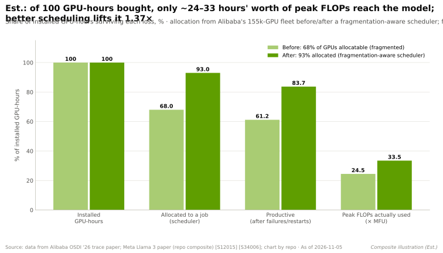
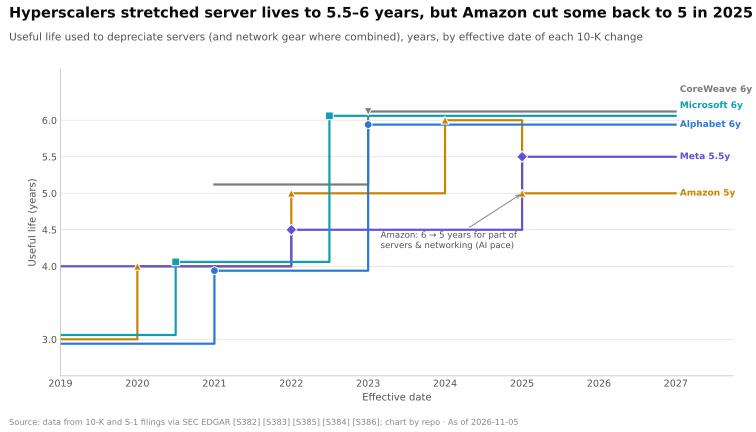

# 利用率问题：为什么闲置 GPU 会摧毁投资回报

> [!NOTE]
> 本页为英文原文的简体中文参考译文，仅供参考；如有出入，以[英文原文](../../../layers/12-orchestration-and-cloud-services/the-utilization-problem.md "English original")为准。

第 12 层 · 编排与云服务 · 约 9 分钟阅读 · 最后核实：2026-11-05

## ⚡ 要点速览

- **GPU 的成本几乎全是固定成本。** 折旧约占一颗现代 GPU 年度成本的 81–88%，按 $0.081/kWh 计电费仅约占 12–19% [[S389]](../../../sources/bibliography.md#s389)[[S382]](../../../sources/bibliography.md#s382)，因此一颗闲置 GPU 的成本几乎与满载时相同。
- **估计一颗 GB300 [NVL72](../../glossary.md#nvl72) GPU 每个已安装小时约 $1.50：** 每机架 $3.99M ÷ 72 [[S332]](../../../sources/bibliography.md#s332)，网络与存储另加 26% [[S324]](../../../sources/bibliography.md#s324)，按六年摊销 [[S382]](../../../sources/bibliography.md#s382)[[S386]](../../../sources/bibliography.md#s386)，再加约 $0.17/h 的电力 [[S337]](../../../sources/bibliography.md#s337)[[S389]](../../../sources/bibliography.md#s389)。由此得出：**利用率 30% 时每有效小时 $5.00，60% 时 $2.50，90% 时 $1.67**。
- **对 100,000 颗 GB300 GPU 而言，利用率每提升 10 个百分点，每年可节省约 $131M 成本**（估计，本资料库依据上述数字计算）。
- **浪费是结构性的，而非疏忽所致。** 在阿里巴巴 155,410 颗 GPU 的机群中，[碎片化](../../glossary.md#gpu-fragmentation)是闲置 GPU 无法被分配的主要原因；一项调度改进将[分配率](../../glossary.md#allocation-ratio)从 68% 提升至 93%，而在线推理的 [SM 利用率](../../glossary.md#sm-utilization)中位数仅约 6% [[S12015]](../../../sources/bibliography.md#s12015)。
- **即便是前沿训练也存在损耗：** Meta 的 Llama 3 405B 任务在 16,384 颗 GPU 上运行 54 天，出现 419 次意外中断，[有效训练时间](../../glossary.md#effective-training-time)保持在 90% 以上，[模型算力利用率（MFU）](../../glossary.md#mfu)为 38–41% [[S34006]](../../../sources/bibliography.md#s34006)。
- **使用寿命缩短会放大风险：** 亚马逊在 2025 年将部分服务器的使用寿命调回五年 [[S385]](../../../sources/bibliography.md#s385)，这使每小时成本上升约 18%。
- **闲置小时总要有人承担。** [照付不议（take-or-pay）](../../glossary.md#take-or-pay)合同将其转嫁给租户；英伟达对 CoreWeave 的 $6.3B 兜底承诺则把其中一部分揽到了英伟达自己的账上 [[S90067]](../../../sources/bibliography.md#s90067)。

## 为什么 GPU 就像航班座位

航班起飞后，空座位就无法再售出；一个闲置的 [GPU 小时](../../glossary.md#gpu-hour)过去之后也无法再出售。而所有者早已为飞机付了钱。对 GPU 而言，这架“飞机”就是在其使用寿命内摊销的购置成本，它占[总拥有成本（TCO）](../../glossary.md#tco)的大部分。

**[Q1 · 职能与失效后果]** 第 12 层的职能是把已安装的机架转化为能做有效工作的 GPU 小时，对云厂商而言，还要转化为有人付费的 GPU 小时。当这一层薄弱时，表面上并没有什么明显故障：GPU 处于已分配但闲置的状态，作业因碎片而排队，大型任务因故障而停滞，每个有效 token 的成本则悄然翻两三倍。

> [!TIP]
> **算例 —— 一颗 GB300 GPU 一小时的成本。** 摩根士丹利估计一台 GB300 NVL72 机架为 $3.99M [[S332]](../../../sources/bibliography.md#s332) → 每 GPU $55.4K。SemiAnalysis 的 GB200 数据意味着[横向扩展（scale-out）](../../glossary.md#scale-out)网络与存储另需约 26% [[S324]](../../../sources/bibliography.md#s324) → 约 $69.8K。按六年摊销（微软、Alphabet、CoreWeave 的会计政策）[[S382]](../../../sources/bibliography.md#s382)[[S383]](../../../sources/bibliography.md#s383)[[S386]](../../../sources/bibliography.md#s386)，即 $69.8K ÷ 6 ÷ 8,760 h = **$1.33/h**。电力：132 kW ÷ 72 颗 GPU [[S337]](../../../sources/bibliography.md#s337) × 1.15 [PUE](../../glossary.md#pue) × $0.081/kWh [[S389]](../../../sources/bibliography.md#s389) = **$0.17/h**。合计 ≈ **每已安装小时 $1.50**。再除以利用率：30% 时 $5.00，60% 时 $2.50，90% 时 $1.67。一颗 Vera Rubin NVL72 GPU（每机架约 $7.8M [[S330]](../../../sources/bibliography.md#s330)）每已安装小时约 $2.89，因此闲置造成的美元损失是前者的两倍。**结论：** 在 30% 利用率下，GB300 所有者每有效小时付出的成本，高于在[新兴云服务商（neocloud）](../../glossary.md#neocloud)上租用 H100 约 $2–3/h 的目录价 [[S393]](../../../sources/bibliography.md#s393)[[S395]](../../../sources/bibliography.md#s395)。

使用寿命是另一个杠杆。[超大规模云厂商](../../glossary.md#hyperscaler)在 2022–2023 年将服务器寿命延长至六年；亚马逊在 2025 年以 AI 技术迭代速度为由部分撤回了这一调整 [[S385]](../../../sources/bibliography.md#s385)。若按五年而非六年计算，GB300 每小时成本将从 $1.50 升至 $1.76。

🔧 技术细节：成本模型及其未涵盖的部分

每有效小时成本 =（每 GPU 资本开支 × 1.26 ÷ 寿命 ÷ 8,760 + 每 GPU 千瓦数 × PUE × 每千瓦时电价）÷ 利用率。输入数据来自 `data/tco_model_inputs.csv` 和 `data/l12_utilization_scenarios.csv`。电力按全时段最大功率计费，属于上限值。设施资本开支、人员、软件授权费和融资成本均未计入，因此每个数字都是**下限**。以高利率借款的新兴云服务商还会增加一大笔融资成本。完整的 TCO 模型参见[训练与推理经济学](../../cross-cutting/14-training-vs-inference-economics.md)。

## GPU 小时都去哪了：五大浪费来源

利用率会在多个环节流失，每个环节需要不同的修复手段。

| 浪费来源 | 机制 | 证据 | 修复手段 |
|---|---|---|---|
| 碎片化 | 空闲 GPU 分散成碎片，每块都太小，容纳不下下一个作业 | 阿里巴巴闲置 GPU 无法分配的主要原因；调度改进后分配率从 68% 升至 93% [[S12015]](../../../sources/bibliography.md#s12015) | [装箱调度（bin-packing）](../../glossary.md#bin-packing)、[拓扑感知调度](../../glossary.md#topology-aware-scheduling) |
| 故障与检查点重启 | 一颗坏 GPU 就会让同步作业停下；自上一个[检查点](../../glossary.md#checkpoint)以来的工作需要重做 | 54 天内 419 次意外中断，约 78% 与硬件相关 [[S34006]](../../../sources/bibliography.md#s34006)[[S31003]](../../../sources/bibliography.md#s31003) | 健康检查、快速自动恢复 |
| 数据停顿 | GPU 等待输入数据 | 采用 CPU 预处理时，DGX-2 在 ResNet-50 上仅达到其上限的 56% [[S4017]](../../../sources/bibliography.md#s4017) | GPU 数据加载、更快的存储 |
| 闲置预留 | 团队“以防万一”占着 GPU；notebook 独占整颗 GPU | 在一个 6,742 颗 GPU 的阿里巴巴集群中，小型分数作业导致利用率偏低 [[S12017]](../../../sources/bibliography.md#s12017) | 配额、[抢占](../../glossary.md#preemption)、[GPU 切分](../../glossary.md#fractional-gpu) |
| MFU 与分配率 | 即使处于忙碌状态，GPU 也只用到峰值 FLOPs 的一部分 | Llama 3 的 MFU 为 38–41% [[S34006]](../../../sources/bibliography.md#s34006)；在线推理 SM 利用率中位数约 6% [[S12015]](../../../sources/bibliography.md#s12015) | 算子、并行方式、批处理（第 10–11 层） |

> [!TIP]
> **算例 —— 损失层层叠加。** 从 100 个已安装 GPU 小时开始。按阿里巴巴改进前 68% 的分配率，剩下 68 个已分配小时 [[S12015]](../../../sources/bibliography.md#s12015)。再因故障与重启损失约 10% 的已分配时间（Llama 3 保持在 90% 以上）[[S34006]](../../../sources/bibliography.md#s34006)，剩下 61.2 个有效运行小时。按 40% 的 MFU，只有**相当于 24.5 小时的峰值 FLOPs** 真正作用于模型。若分配率为 93%，链条终点则为 **33.5**，同样的资本开支多产出 1.37 倍。**结论：** 这项调度改进的价值相当于硬件打了 37% 的折扣（估计，综合示例）。

> [!WARNING]
> **误区与事实：“我们的 GPU 显示 100% 利用率。”** 简单工具报告的是*任意*算子在运行的时间占比。一颗 GPU 可能显示 100%，但其大部分流式多处理器其实处于空闲状态。分配率、来自 [DCGM](../../glossary.md#dcgm) 的 [SM 利用率](../../glossary.md#sm-utilization)以及 MFU 衡量的是不同的东西；务必问清一项说法用的是哪一个。

**[Q2 · 关键指标]** 决定本层表现的有五个数字：(1) **分配率**，即已安装 GPU 中被分配给作业的比例；(2) **有效训练时间**或[有效产出（goodput）](../../glossary.md#goodput)，即已分配时间中产生实际进展的比例；(3) **MFU** 或每 GPU 小时 token 数，即每个忙碌小时完成的有效工作；(4) **[平均恢复时间](../../glossary.md#mttr)**，它决定一次故障的代价；(5) **每有效 GPU 小时美元成本**，它将前四项合并为投资回报指标。

🔧 技术细节：“利用率”的三种含义

- **分配率**（调度器视角）：已分配 GPU ÷ 已安装 GPU。容易通过过度预留而被抬高。
- **SM 活跃度 / 占用率**（DCGM 遥测视角）：每颗 GPU 计算阵列中有多少处于活跃状态。可揭示已分配但闲置的情况。
- **MFU / goodput**（模型视角）：模型所需 FLOPs ÷ 可用峰值 FLOPs，并扣除重启损失。这是唯一能直接对应到 token 产出或训练进度的指标。

## 谁承担闲置风险

每一个闲置小时都会落到某个人头上。运行自有模型的超大规模云厂商直接承担这一风险。新兴云服务商通常签订多年期照付不议合同，因此无论租户是否使用这些小时都要付费。英伟达已同意在 2032 年 4 月之前购买 CoreWeave 最多 $6.3B 的未售出容量 [[S90067]](../../../sources/bibliography.md#s90067)，自身吸收了部分风险。

> [!TIP]
> **算例 —— 这项兜底承诺覆盖了多少。** 按 2026 年 3 月约 $2.35 的 H100 一年期合同价 [[S12516]](../../../sources/bibliography.md#s12516)，$6.3B 可购买约 27 亿个 GPU 小时。分摊到截至 2032 年 4 月的约 6.5 年，相当于约 47,000 颗 GPU 全时运行（估计）。CoreWeave 在 2024 年底运营的 GPU 超过 250,000 颗 [[S12011]](../../../sources/bibliography.md#s12011)。**结论：** 这项兜底承诺是为部分机群托底，而非为全部机群提供担保。

> [!NOTE]
> **🐂 看多观点：** 更好的调度器、更快的故障恢复以及 24/7 运行的推理机群推高利用率，因此每颗 GPU 赚得更多，存量装机的价值也能维持更久。

> [!WARNING]
> **🐻 看空观点：** 如果需求降温，利用率首先会在合同期较短的新兴云服务商那里下滑。随后每有效小时成本跳升（1/利用率），租赁价格下跌，兜底承诺则变成负债。

## 🎯 企业发展视角

1. **利用率是价值数十亿美元的销货成本杠杆。** 按每 100,000 颗 GB300 GPU 每 10 个百分点约 $131M 计算（估计），调度与恢复软件具有可量化的价值，买方可以据此进行估值承保。
2. **目标公司报告的是哪个指标？** 对任何 GPU 云或 AI 基础设施软件公司做尽职调查时，都应分别索取分配率、有效时间和 MFU 数据。
3. **折旧政策是隐含的估值输入。** 使用寿命每变化一年，每小时成本约变动 18%；应比较租户与所有者各自的假设 [[S385]](../../../sources/bibliography.md#s385)[[S386]](../../../sources/bibliography.md#s386)。
4. **高通的问题（仅基于公开信息）：** 对于 AI200/AI250 等推理机架 [[S90028]](../../../sources/bibliography.md#s90028)，利用率叙事（分数共享、高占空比）对买方而言是否比峰值 TOPS 更重要？

## 📚 来源（Sources）

<!-- Auto-generated from the [S…] citations on this page by `make build`. Edit sources/registry/*.csv, not this list. -->

- [**S324**](../../../sources/bibliography.md#s324) fal.ai, *NVIDIA GB200 price in 2026: what a GPU, a tray and an NVL72 rack cost*, 2026. [Link](https://fal.ai/learn/serverless/nvidia-gb200-price)
- [**S330**](../../../sources/bibliography.md#s330) PC Gamer, *A single Nvidia Vera Rubin rack is estimated to cost $7,803,148 with over $2 million of that figure spent on memory alone*, 2026-05. [Link](https://pcgamer.com/hardware/a-single-nvidia-vera-rubin-rack-is-estimated-to-cost-usd7-803-148-with-over-usd2-million-of-that-figure-spent-on-memory-alone)
- [**S332**](../../../sources/bibliography.md#s332) Tiger Brokers (iTiger), *Morgan Stanley's BOM analysis of NVIDIA's Rubin: GPU share declines; PCB, MLCC and ABF substrate values soar*, 2026-05-20. [Link](https://www.itiger.com/news/1188068712)
- [**S337**](../../../sources/bibliography.md#s337) Spheron, *NVIDIA GB300 (rental and specifications)*, 2026. [Link](https://spheron.network/gpu-rental/gb300/)
- [**S382**](../../../sources/bibliography.md#s382) Microsoft via SEC EDGAR, *Microsoft Corporation Form 10-K filings (FY2021, FY2023) - property and equipment useful lives*, 2023-07-27. [Link](https://www.sec.gov/cgi-bin/browse-edgar?action=getcompany&CIK=0000789019&type=10-K&dateb=&owner=include&count=40)
- [**S383**](../../../sources/bibliography.md#s383) Alphabet via SEC EDGAR, *Alphabet Inc. Form 10-K filings (FY2020, FY2022) - useful lives of servers and network equipment*, 2023-02-03. [Link](https://www.sec.gov/cgi-bin/browse-edgar?action=getcompany&CIK=0001652044&type=10-K&dateb=&owner=include&count=40)
- [**S385**](../../../sources/bibliography.md#s385) Amazon via SEC EDGAR, *Amazon.com Form 10-K filings (FY2019-FY2024) - useful lives of servers*, 2025-02-07. [Link](https://www.sec.gov/cgi-bin/browse-edgar?action=getcompany&CIK=0001018724&type=10-K&dateb=&owner=include&count=40)
- [**S386**](../../../sources/bibliography.md#s386) CoreWeave via SEC EDGAR, *CoreWeave Form S-1 registration statement (2025) - technology equipment useful life*, 2025-03-03. [Link](https://www.sec.gov/cgi-bin/browse-edgar?action=getcompany&company=coreweave&type=S-1&dateb=&owner=include&count=40)
- [**S389**](../../../sources/bibliography.md#s389) U.S. Energy Information Administration, *EIA Electric Power Monthly, Table 5.6.A: average price of electricity to ultimate customers by end-use sector*, 2025. [Link](https://www.eia.gov/electricity/monthly/epm_table_grapher.php?t=epmt_5_6_a)
- [**S393**](../../../sources/bibliography.md#s393) Latent Space (Eugene Cheah), *$2 H100s: how the GPU bubble burst*, 2024-10. [Link](https://www.latent.space/p/gpu-bubble)
- [**S395**](../../../sources/bibliography.md#s395) Lambda, *Lambda GPU cloud pricing*, 2025. [Link](https://lambda.ai/pricing)
- [**S4017**](../../../sources/bibliography.md#s4017) NVIDIA Technical Blog, *Case Study: ResNet50 with DALI*, 2019. [Link](https://developer.nvidia.com/blog/case-study-resnet50-dali/)
- [**S12011**](../../../sources/bibliography.md#s12011) DatacenterDynamics, *CoreWeave files for IPO on Nasdaq stock market*, 2025-03. [Link](https://www.datacenterdynamics.com/en/news/coreweave-files-for-ipo-on-nasdaq-stock-market/)
- [**S12015**](../../../sources/bibliography.md#s12015) USENIX OSDI '26 (Li et al. (Alibaba / HKUST)), *Heterogeneity at Hyperscale: Characterization and Scheduling of Large Production AI Clusters at Alibaba*, 2026-07. [Link](https://www.usenix.org/conference/osdi26/presentation/li-suyi)
- [**S12017**](../../../sources/bibliography.md#s12017) USENIX NSDI '22 (Weng et al.), *MLaaS in the Wild: Workload Analysis and Scheduling in Large-Scale Heterogeneous GPU Clusters*, 2022-04. [Link](https://www.usenix.org/conference/nsdi22/presentation/weng)
- [**S12516**](../../../sources/bibliography.md#s12516) SemiAnalysis, *The Great GPU Shortage - Rental Capacity - Launching our H100 1 Year Rental Price Index*, 2026-03. [Link](https://newsletter.semianalysis.com/p/the-great-gpu-shortage-rental-capacity)
- [**S31003**](../../../sources/bibliography.md#s31003) Tom's Hardware, *Faulty Nvidia H100 GPUs and HBM3 memory caused half of the failures during Llama 3 training — one failure every three hours for Meta's 16,384 GPU training cluster*, 2024-07. [Link](https://www.tomshardware.com/tech-industry/artificial-intelligence/faulty-nvidia-h100-gpus-and-hbm3-memory-caused-half-of-the-failures-during-llama-3-training-one-failure-every-three-hours-for-metas-16384-gpu-training-cluster)
- [**S34006**](../../../sources/bibliography.md#s34006) arXiv:2407.21783 (Llama Team (AI @ Meta)), *The Llama 3 Herd of Models*, 2024-07-31. [Link](https://arxiv.org/abs/2407.21783)
- [**S90028**](../../../sources/bibliography.md#s90028) TechRepublic, *Qualcomm unveils AI chips to rival Nvidia, AMD*, 2025-10-27. [Link](https://techrepublic.com/article/news-qualcomm-unveils-ai-chips-to-rival-nvidia-amd)
- [**S90067**](../../../sources/bibliography.md#s90067) DatacenterDynamics, *Nvidia to purchase unsold compute capacity from CoreWeave for $6.3bn*, 2025-09-16. [Link](https://www.datacenterdynamics.com/en/news/nvidia-to-purchase-unsold-compute-capacity-from-coreweave-for-63bn/)
