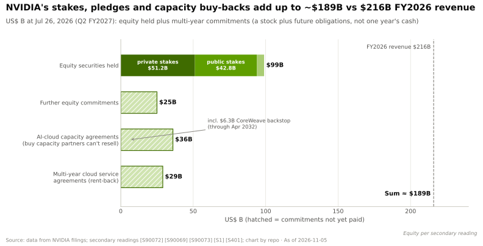
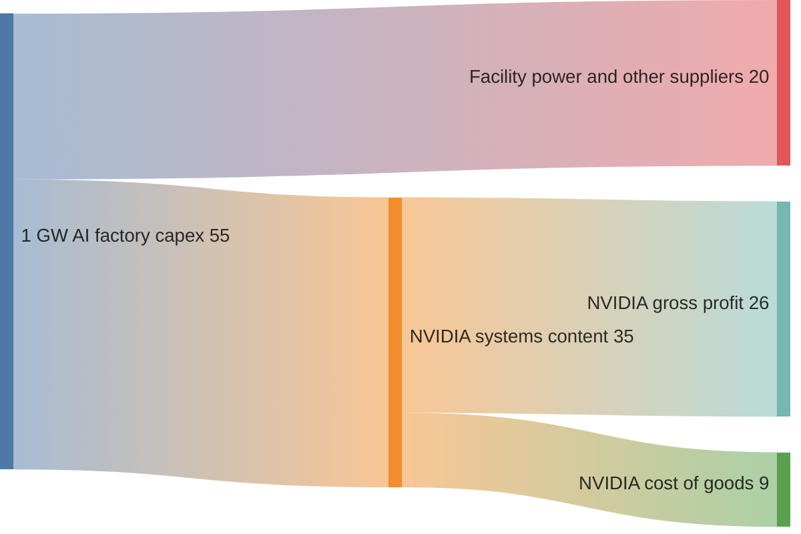
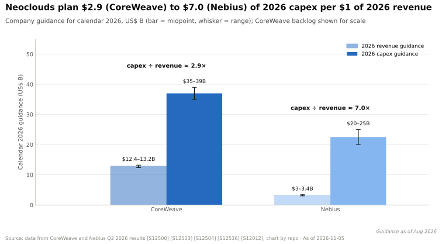
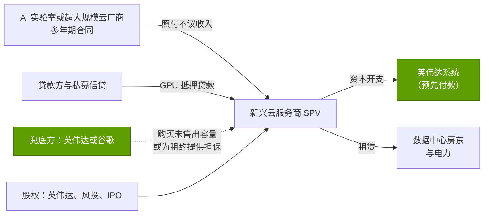
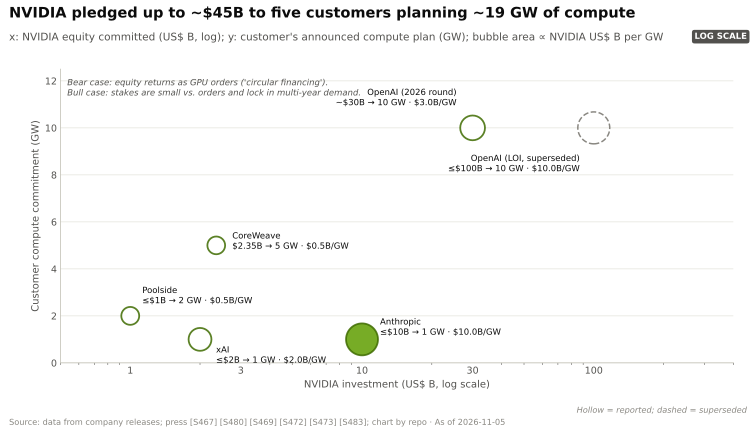
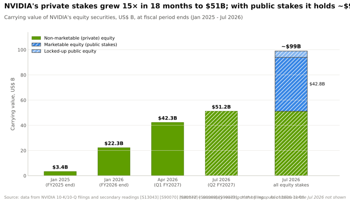
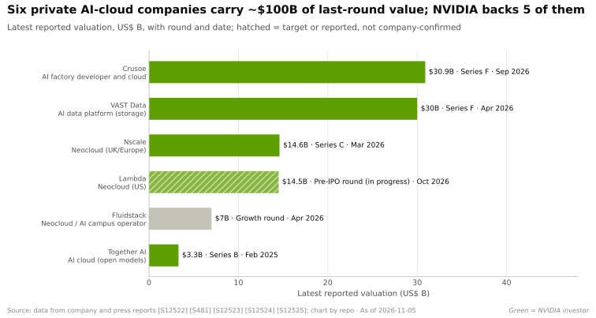

# 编排与云服务：价值链与企业发展视角

> [!NOTE]
> 本页为英文原文的简体中文参考译文，仅供参考；如有出入，以[英文原文](../../../layers/12-orchestration-and-cloud-services/value-chain-and-corp-dev.md "English original")为准。

第 12 层 · 编排与云服务 · 约 15 分钟阅读 · 最后核实：2026-11-05

## ⚡ 要点速览

- **GPU 云的每一美元大部分流回了英伟达。** 在一座约 $50–60B 的吉瓦级 AI 工厂中，英伟达产品约占 $35B；按约 75% 的毛利率计算，其中约 $26B 为英伟达的毛利（估计）[[S398]](../../../sources/bibliography.md#s398)[[S405]](../../../sources/bibliography.md#s405)。
- **风险由新兴云服务商承担。** CoreWeave 计划的 2026 年资本开支约为其 2026 年收入的 2.9 倍，Nebius 约为 7 倍。CoreWeave 背负 $35.1B 债务，2026 年第二季度支付了 $640M 利息 [[S12500]](../../../sources/bibliography.md#s12500)[[S12503]](../../../sources/bibliography.md#s12503)[[S12501]](../../../sources/bibliography.md#s12501)。
- **租赁价格是关键变量。** H100 租金从 2023 年下跌约 80%，于 2025 年 10 月触及 $1.70/小时的低点，随后到 2026 年 3 月上涨 38% 至 $2.35 [[S393]](../../../sources/bibliography.md#s393)[[S12516]](../../../sources/bibliography.md#s12516)。
- **英伟达与其客户的关联敞口合计约 $189B：** 约 $99B 的股权、约 $25B 的进一步股权承诺、$36B 的 AI 云容量协议和 $29B 的云服务协议。FY2026 收入为 $216B [[S90072]](../../../sources/bibliography.md#s90072)[[S90069]](../../../sources/bibliography.md#s90069)[[S407]](../../../sources/bibliography.md#s407)[[S1]](../../../sources/bibliography.md#s1)。
- **关于[循环融资](../../glossary.md#circular-financing)的争论，正反双方都有道理。** H1 FY2027 的股权投资（$42.4B）约占上半年收入的 24%。然而，向五家客户承诺的约 $45B，仅约占其约 19 GW 规划中英伟达产品价值的 7% 🔴 [[S90072]](../../../sources/bibliography.md#s90072)[[S403]](../../../sources/bibliography.md#s403)[[S405]](../../../sources/bibliography.md#s405)[[S398]](../../../sources/bibliography.md#s398)。
- **[Q8 · 价值池与并购机会]** 尚待争夺的价值池是融资、IPO 前的新兴云服务商股权以及利用率工具；单纯的编排软件已经商品化。

## 谁拿走了 GPU 云的每一美元

[新兴云服务商（neocloud）](../../glossary.md#neocloud)是加了杠杆的 GPU 房东：它借钱购买英伟达系统，租用电力和厂房，再出租 GPU 小时。英伟达在交货时即收到货款；新兴云服务商则要靠多年租金收回成本（CoreWeave 对 GPU 服务器按六年折旧）[[S386]](../../../sources/bibliography.md#s386)。

单位为每吉瓦十亿美元，估计 🔴：$55B 中值与 $35B 英伟达产品价值量依据英伟达首席执行官的说法 [[S398]](../../../sources/bibliography.md#s398)；毛利按 Q2 FY2027 约 75% 的 GAAP 毛利率计算 [[S405]](../../../sources/bibliography.md#s405)。销货成本涵盖台积电、HBM 厂商和 ODM（[第 03 层](../03-memory-packaging-supply-chain/value-chain-and-corp-dev.md)）。

> [!TIP]
> **算例 —— 2026 年的反弹对一颗旧 GPU 意味着什么。** 按 $2.35/小时的一年期合同价，一颗出租率 85% 的 H100 每年可收入约 $17.5K（2.35 × 8,760 × 0.85）[[S12516]](../../../sources/bibliography.md#s12516)。相对于约 $25–30K 的购置价，仅 GPU 本身的回本期约为 1.5 年，而在 2023 年约 $8/小时的价格下只需约 4–5 个月 [[S356]](../../../sources/bibliography.md#s356)[[S393]](../../../sources/bibliography.md#s393)。三年机龄的 Hopper 机群在 2026 年反而比 2025 年更值钱，从而支撑了新兴云服务商债务背后的抵押品价值。

## 新兴云服务商融资：合同、GPU 抵押贷款与兜底承诺

其运作方式类似项目融资。AI 实验室或[超大规模云厂商](../../glossary.md#hyperscaler)签订多年期[照付不议（take-or-pay）](../../glossary.md#take-or-pay)合同（[包销协议](../../glossary.md#offtake-agreement)）；新兴云服务商将合同和 GPU 装入特殊目的载体（SPV），以两者为抵押借款（[GPU 抵押贷款](../../glossary.md#gpu-backed-loan)）。第三方进一步压低利率：英伟达通过购买未售出容量（[容量兜底承诺](../../glossary.md#capacity-backstop)），谷歌则通过为 Fluidstack 与 TeraWulf（约 $3.2B）和 Cipher（约 $1.4B）的租约提供担保来换取股权 🟡 [[S90067]](../../../sources/bibliography.md#s90067)[[S12525]](../../../sources/bibliography.md#s12525)。

> [!TIP]
> **算例 —— 一句话看懂 CoreWeave 的一个季度。** 2026 年第二季度，CoreWeave 确认收入 $2.58B、净利息支出 $640M、净亏损 $626M，其 $46.7B 的净物业及设备主要由 $35.1B 的债务提供资金 [[S12500]](../../../sources/bibliography.md#s12500)[[S12501]](../../../sources/bibliography.md#s12501)。每一美元收入中约有 25 美分被利息吃掉。贷款方承保的是 $104.2B 的积压订单；兜底承诺与六年折旧期让这笔账得以算平 [[S12500]](../../../sources/bibliography.md#s12500)[[S90067]](../../../sources/bibliography.md#s90067)[[S386]](../../../sources/bibliography.md#s386)。

🔧 技术细节：为什么 GPU 折旧年限如此重要

一颗 $70K 的 GPU 按六年折旧每年约 $11.7K，按四年则约 $17.5K：50% 的差距，在约 $2–3/小时的租价下足以决定盈亏。CoreWeave 采用六年，与微软和 Alphabet 的服务器寿命一致 [[S386]](../../../sources/bibliography.md#s386)[[S382]](../../../sources/bibliography.md#s382)[[S383]](../../../sources/bibliography.md#s383)。批评者认为 GPU 一年一代的更新节奏会缩短其经济寿命；而在算力稀缺期间，2026 年 Hopper 租金的反弹则给出了相反的论据 [[S12516]](../../../sources/bibliography.md#s12516)。

## 循环融资之争

英伟达投资于购买其 GPU 的公司，为其容量提供担保，并从它们那里租回算力。这究竟是构建生态，还是制造需求？以下分别给出双方最有力的论证：

> [!WARNING]
> **🐻 看空观点（最强版本）。**
> 1. **规模。** 股权投资从 $1.2B（H1 FY2026）跃升至 $42.4B（H1 FY2027），约占 H1 FY2027 收入 $177.8B 的 24% [[S90072]](../../../sources/bibliography.md#s90072)[[S403]](../../../sources/bibliography.md#s403)[[S405]](../../../sources/bibliography.md#s405)。
> 2. **盈利质量。** Q1 FY2027 $58.3B 的净利润中包含约 $15.9B 的其他收益，主要是未实现的[按市值计价（mark-to-market）](../../glossary.md#mark-to-market)收益，在下行周期中会反转 [[S403]](../../../sources/bibliography.md#s403)。
> 3. **容量回购。** 英伟达已同意购买 $36B 合作伙伴无法转售的 AI 云容量，外加 $29B 的云服务承诺 [[S407]](../../../sources/bibliography.md#s407)。其客户的利用率中有一部分来自英伟达自己。
> 4. **集中度。** 三家直接客户分别占 H1 FY2027 收入的 16%、15% 和 13%，而 OpenAI、Anthropic 和 CoreWeave 等大买家同时也是被投资方 [[S90069]](../../../sources/bibliography.md#s90069)[[S90015]](../../../sources/bibliography.md#s90015)[[S90075]](../../../sources/bibliography.md#s90075)[[S472]](../../../sources/bibliography.md#s472)。
> 5. **历史惊人地相似。** 1999–2001 年，电信设备商为运营商提供融资，而后者的需求随即消失；[供应商融资](../../glossary.md#vendor-financing)把一次放缓变成了一场崩盘 🟡 [[S90074]](../../../sources/bibliography.md#s90074)。高盛如今谈论以英伟达算力为抵押的信贷：这种抵押品的租金曾在两年内下跌约 80%，之后才反弹 [[S12528]](../../../sources/bibliography.md#s12528)[[S12516]](../../../sources/bibliography.md#s12516)。

> [!NOTE]
> **🐂 看多观点（最强版本）。**
> 1. **相对于其撬动的规模而言很小。** 向五家客户承诺的约 $45B 支撑着约 19 GW 的规划。按每 GW 约 $35B 的英伟达产品价值计算，潜在产品价值约为 $665B，因此这些股权投资相当于约 7% 的“返利” 🔴 [[S398]](../../../sources/bibliography.md#s398)。
> 2. **具有战略意义。** 非超大规模买方（ACIE）在 Q2 FY2027 数据中心收入中约占 $40.3B；支持它们可以降低对自研 ASIC 的超大规模云厂商的依赖 [[S406]](../../../sources/bibliography.md#s406)。
> 3. **需求体现在价格上。** H100 租金在五个月内上涨 38%，容量已被预订至 2026 年 9 月，英伟达的展望是受供应约束 [[S12516]](../../../sources/bibliography.md#s12516)[[S90012]](../../../sources/bibliography.md#s90012)。
> 4. **风险正在转移给第三方。** 融资平台的目标是从六家资产管理公司调动超过 $500B 资金，而非动用英伟达的资产负债表 🟡 [[S12528]](../../../sources/bibliography.md#s12528)。
> 5. **大家都在这么做。** 谷歌为 Fluidstack 的租约提供兜底；AMD 向 OpenAI 授予了最多 1.6 亿股的认股权证 [[S12525]](../../../sources/bibliography.md#s12525)[[S13506]](../../../sources/bibliography.md#s13506)。

> [!TIP]
> **算例 —— 估算这笔“返利”的大小。** OpenAI 约 $30B 是单笔最大的股权投资 [[S90015]](../../../sources/bibliography.md#s90015)。如果 OpenAI 基于英伟达的项目达到 10 GW，按每 GW $35B 计算英伟达产品价值约为 $350B，则这笔投资约相当于该潜在收入的 8.6% [[S398]](../../../sources/bibliography.md#s398)。若只有 3 GW，同样的投资占比约为 29% 🔴。争论的焦点是部署风险，而非会计处理：只有当这些吉瓦真正落地时，这一比例才显得无害。

**结论 🔴：** 双方在不同的时间维度上各有道理。在算力稀缺时，英伟达的支持能以低成本加速建设；在下行周期中，它会让英伟达成为其最弱客户的债权人。预警信号见[路线图页面](roadmap.md)；另见[看空情景](../../cross-cutting/18-vulnerabilities-and-bear-case.md)和[第 13 层](../13-ecosystem-gtm-and-capital/index.md)。

## 值得关注的私营公司

仅基于公开信息；部分估值来自媒体报道。

| 公司 | 业务 | 阶段 / 最近一轮公开融资 | 为何重要 |
|---|---|---|---|
| Crusoe | 吉瓦级 AI 园区（Abilene）及 GPU 云 | F 轮 $3.9B，投后估值 $30.9B（2026 年 9 月）🟡；签约约 4.9 GW 🟡 | 最大的私营 AI 工厂建设商；正在采用开源 Run:ai [[S12522]](../../../sources/bibliography.md#s12522)[[S12013]](../../../sources/bibliography.md#s12013)[[S12512]](../../../sources/bibliography.md#s12512) |
| Lambda | 面向开发者的 GPU 云；与微软签有合同 | 正寻求约 $4B 的 IPO 前融资，目标投前估值约 $14.5B（2026 年 10 月）🟡 | 英伟达既是投资方又是租户（约 $1.5B 回租）[[S12521]](../../../sources/bibliography.md#s12521)[[S483]](../../../sources/bibliography.md#s483) |
| Nscale | 英国/欧洲新兴云服务商 | C 轮估值 $14.6B（2026 年 3 月）；$3.36B IPO 前可转债（2026 年 9 月） | 主权 AI 与超大规模云厂商溢出需求标的 [[S12520]](../../../sources/bibliography.md#s12520)[[S12526]](../../../sources/bibliography.md#s12526) |
| Fluidstack | 负责 Anthropic 在美国 $50B 的建设项目 | 以 $7B 估值融资超过 $750M（2026 年 4 月）；据报道正以约 $18B 估值洽谈 🟡 | 由谷歌兜底：一种非英伟达的融资范本 [[S12523]](../../../sources/bibliography.md#s12523)[[S12524]](../../../sources/bibliography.md#s12524)[[S12525]](../../../sources/bibliography.md#s12525) |
| Together AI | 开源模型推理云 | B 轮 $305M，估值 $3.3B（2025 年） | Dynamo 采用者及 Lepton 合作伙伴 [[S12522]](../../../sources/bibliography.md#s12522)[[S90066]](../../../sources/bibliography.md#s90066)[[S12008]](../../../sources/bibliography.md#s12008) |
| VAST Data | 面向 GPU 云的存储/数据平台 | F 轮约 $1B，估值 $30B（2026 年 4 月）；正考虑 IPO | 每家新兴云服务商都需要的存储层（[第 07 层](../07-dpu-supernic-storage-security/value-chain-and-corp-dev.md)）[[S7513]](../../../sources/bibliography.md#s7513)[[S7512]](../../../sources/bibliography.md#s7512) |
| SF Compute、Vast.ai | GPU 交易平台 | 私营；未找到近期公开估值 | 价格发现；闲置容量套利 [[S393]](../../../sources/bibliography.md#s393) |

## 本层的并购历史

| 年份 | 收购方 → 标的 | 金额 | 收购所得 | 来源 |
|---|---|---|---|---|
| 2022 | 英伟达 → Bright Computing | 未披露 | 集群管理器（现为 Base Command Manager） | [[S478]](../../../sources/bibliography.md#s478) |
| 2024 | 英伟达 → Run:ai | 约 $700M（据报道） | Kubernetes GPU 资源池化；2025–26 年开源 | [[S476]](../../../sources/bibliography.md#s476)[[S12510]](../../../sources/bibliography.md#s12510) |
| 2024 | 英伟达 → Shoreline.io；Brev.dev | 约 $100M（据报道）；未披露 | 机群自动化；开发者入口 | [[S478]](../../../sources/bibliography.md#s478)[[S479]](../../../sources/bibliography.md#s479) |
| 2025 | 英伟达 → Lepton AI | “数亿美元”（据报道） | DGX Cloud Lepton 市场平台的基础 | [[S479]](../../../sources/bibliography.md#s479)[[S598]](../../../sources/bibliography.md#s598) |
| 2025 | CoreWeave → Weights & Biases | 约 $1.7B（据报道） | 实验追踪与 MLOps 用户群 | [[S12507]](../../../sources/bibliography.md#s12507)[[S12506]](../../../sources/bibliography.md#s12506) |
| 2025 | CoreWeave → Core Scientific | 约 $9B 全股票交易，**遭股东否决** | 自有数据中心站点 | [[S12508]](../../../sources/bibliography.md#s12508) |
| 2025 | 英伟达 → SchedMD（Slurm） | 未披露 | HPC/AI 默认批处理调度器 | [[S12000]](../../../sources/bibliography.md#s12000) |

> [!TIP]
> **算例 —— 为什么这一层的软件估值倍数存在天花板。** 英伟达花约 $0.7B 收购 Run:ai，随后将其免费开放 [[S476]](../../../sources/bibliography.md#s476)[[S12510]](../../../sources/bibliography.md#s12510)。CoreWeave 收购 Weights & Biases 的约 $1.7B，仅约为其 $104.2B 积压订单的 1.6% [[S12507]](../../../sources/bibliography.md#s12507)[[S12500]](../../../sources/bibliography.md#s12500)。在这里，软件的价值取决于它能为 GPU 小时销售带来多少增量，而非其授权收入。

## [Q8 · 价值池与并购机会]

**[Q8 · 价值池与并购机会]** 有四个价值池尤为突出：

1. **为建设提供融资。** 新兴云服务商的资本开支是收入的 3–7 倍，因此谁能为 GPU 抵押信贷和兜底承诺定价，谁就能赚取利差。英伟达、谷歌和私募信贷已经入场 [[S12500]](../../../sources/bibliography.md#s12500)[[S12503]](../../../sources/bibliography.md#s12503)[[S12528]](../../../sources/bibliography.md#s12528)[[S12525]](../../../sources/bibliography.md#s12525)。
2. **IPO 前的新兴云服务商股权。** Crusoe、Lambda 和 Nscale 正走向公开市场，按最近一轮计算合计估值约 $60B 🟡 [[S12522]](../../../sources/bibliography.md#s12522)[[S12521]](../../../sources/bibliography.md#s12521)[[S12520]](../../../sources/bibliography.md#s12520)。
3. **利用率工具。** 调度器是免费的，但故障恢复、多云中介和推理端点仍能把闲置的 GPU 小时转化为收入（[竞争格局](competition.md)）。
4. **硬件中立的容量。** 运行非英伟达加速器的新兴云服务商需要中立的软件（Kueue、Ray、SkyPilot，或可移植性软件栈，例如高通以约 $3.9B 收购、于 2026-07-29 完成交割的 Modular 平台 [[S9511]](../../../sources/bibliography.md#s9511)）[[S12533]](../../../sources/bibliography.md#s12533)[[S12535]](../../../sources/bibliography.md#s12535)[[S12534]](../../../sources/bibliography.md#s12534)[[S90057]](../../../sources/bibliography.md#s90057)。

## 🎯 企业发展视角

1. 加速器厂商能否通过为其 GPU 提供兜底承诺或残值担保来赢得新兴云服务商的容量？这会对其资产负债表产生什么影响？
2. 哪些已签约但尚未建成电力容量的新兴云服务商会试用第二种加速器？硬件可移植的软件栈（如高通现已拥有的 Modular）是否会是前提条件？
3. 在 Run:ai、KAI 和 Slurm 都已免费的情况下，哪些编排或 MLOps 资产仍能获得溢价？又是谁愿意支付这一溢价（云厂商、芯片厂商、私募股权）？
4. 应如何对英伟达约 $189B 的关联敞口进行压力测试：租赁价格情景、客户违约，还是按市值计价的反转？

## 📚 来源（Sources）

<!-- Auto-generated from the [S…] citations on this page by `make build`. Edit sources/registry/*.csv, not this list. -->

- [**S1**](../../../sources/bibliography.md#s1) NVIDIA Corporation via SEC EDGAR, *NVIDIA Announces Financial Results for Fourth Quarter and Fiscal 2026 (Form 8-K exhibit 99.1)*, 2026-02-25. [Link](https://www.sec.gov/Archives/edgar/data/1045810/000104581026000019/q4fy26pr.htm)
- [**S356**](../../../sources/bibliography.md#s356) Tom's Hardware, *Nvidia makes nearly 1,000% profit on H100 GPUs: report*, 2023-08. [Link](https://www.tomshardware.com/news/nvidia-makes-1000-profit-on-h100-gpus-report)
- [**S382**](../../../sources/bibliography.md#s382) Microsoft via SEC EDGAR, *Microsoft Corporation Form 10-K filings (FY2021, FY2023) - property and equipment useful lives*, 2023-07-27. [Link](https://www.sec.gov/cgi-bin/browse-edgar?action=getcompany&CIK=0000789019&type=10-K&dateb=&owner=include&count=40)
- [**S383**](../../../sources/bibliography.md#s383) Alphabet via SEC EDGAR, *Alphabet Inc. Form 10-K filings (FY2020, FY2022) - useful lives of servers and network equipment*, 2023-02-03. [Link](https://www.sec.gov/cgi-bin/browse-edgar?action=getcompany&CIK=0001652044&type=10-K&dateb=&owner=include&count=40)
- [**S386**](../../../sources/bibliography.md#s386) CoreWeave via SEC EDGAR, *CoreWeave Form S-1 registration statement (2025) - technology equipment useful life*, 2025-03-03. [Link](https://www.sec.gov/cgi-bin/browse-edgar?action=getcompany&company=coreweave&type=S-1&dateb=&owner=include&count=40)
- [**S393**](../../../sources/bibliography.md#s393) Latent Space (Eugene Cheah), *$2 H100s: how the GPU bubble burst*, 2024-10. [Link](https://www.latent.space/p/gpu-bubble)
- [**S398**](../../../sources/bibliography.md#s398) NVIDIA Investor Relations, *NVIDIA Q2 FY2026 earnings call (2025-08-27): AI factory economics commentary*, 2025-08-27. [Link](https://investor.nvidia.com/events-and-presentations/events-and-presentations/default.aspx)
- [**S403**](../../../sources/bibliography.md#s403) NVIDIA Corporation via SEC EDGAR, *NVIDIA Announces Financial Results for First Quarter Fiscal 2027 (Form 8-K exhibit 99.1)*, 2026-05-20. [Link](https://www.sec.gov/Archives/edgar/data/0001045810/000104581026000051/q1fy27pr.htm)
- [**S405**](../../../sources/bibliography.md#s405) NVIDIA Corporation via SEC EDGAR, *NVIDIA Announces Financial Results for Second Quarter Fiscal 2027 (Form 8-K exhibit 99.1)*, 2026-08-26. [Link](https://www.sec.gov/Archives/edgar/data/0001045810/000104581026000073/q2fy27pr.htm)
- [**S406**](../../../sources/bibliography.md#s406) NVIDIA Corporation (Colette Kress), *CFO Commentary on Second Quarter Fiscal 2027 Results*, 2026-08-26. [Link](https://s201.q4cdn.com/141608511/files/doc_financials/2027/Q227/Q2FY27-CFO-Commentary.pdf)
- [**S407**](../../../sources/bibliography.md#s407) NVIDIA Corporation via SEC EDGAR, *NVIDIA Corporation Form 10-Q for quarter ended July 26, 2026*, 2026-08-28. [Link](https://www.sec.gov/Archives/edgar/data/1045810/000104581026000075/nvda-20260726.htm)
- [**S472**](../../../sources/bibliography.md#s472) CoreWeave Newsroom, *CoreWeave and NVIDIA expand partnership; NVIDIA invests $2B in CoreWeave Class A stock*, 2026-01-26. [Link](https://www.coreweave.com/news)
- [**S476**](../../../sources/bibliography.md#s476) NVIDIA Blog, *NVIDIA to Acquire GPU Orchestration Software Provider Run:ai*, 2024-04-24. [Link](https://blogs.nvidia.com/blog/runai/)
- [**S478**](../../../sources/bibliography.md#s478) NVIDIA, *NVIDIA Blog and Newsroom acquisition announcements (Cumulus, SwiftStack, DeepMap, Bright Computing, Excelero, Shoreline, Brev.dev, OctoAI, VinBrain, Gretel, Lepton AI, CentML, SchedMD)*, 2025-12. [Link](https://blogs.nvidia.com/)
- [**S479**](../../../sources/bibliography.md#s479) Various (press), *Reporting on NVIDIA tuck-in acquisition prices (Run:ai, Deci, Shoreline, OctoAI, Gretel, Lepton, CentML) — The Information, Calcalist, Reuters, CNBC*, 2025-06. [Link](https://www.reuters.com/technology/)
- [**S483**](../../../sources/bibliography.md#s483) Various (Bloomberg, The Information, Reuters), *Reporting on NVIDIA commitments to xAI (up to $2B in ~$20B raise), Poolside (up to $1B), Lambda (~$1.5B GPU lease-back) and Wayve ($500M LOI)*, 2025-10. [Link](https://www.bloomberg.com/technology)
- [**S598**](../../../sources/bibliography.md#s598) NVIDIA Newsroom, *NVIDIA Announces DGX Cloud Lepton to Connect Developers to NVIDIA's Global Compute Ecosystem*, 2025-05-18. [Link](https://nvidianews.nvidia.com/news/nvidia-announces-dgx-cloud-lepton-to-connect-developers-to-nvidias-global-compute-ecosystem)
- [**S7512**](../../../sources/bibliography.md#s7512) Bloomberg Law, *Nvidia-backed Vast Data triples value to $30 billion, mulls IPO*, 2026-04. [Link](https://news.bloomberglaw.com/private-equity/nvidia-backed-vast-data-triples-value-to-30-billion-mulls-ipo)
- [**S7513**](../../../sources/bibliography.md#s7513) Built In, *VAST Data raises $1B Series F at $30B valuation*, 2026-04-23. [Link](https://builtin.com/articles/vast-data-raises-1b-series-f-30b-valuation-20260423)
- [**S9511**](../../../sources/bibliography.md#s9511) Nasdaq (Qualcomm press release), *Qualcomm Completes Acquisition of Modular*, 2026-07-29. [Link](https://www.nasdaq.com/press-release/qualcomm-completes-acquisition-modular-2026-07-29)
- [**S12000**](../../../sources/bibliography.md#s12000) NVIDIA Blog, *NVIDIA Acquires Open-Source Workload Management Provider SchedMD*, 2025-12-15. [Link](https://blogs.nvidia.com/blog/nvidia-acquires-schedmd)
- [**S12008**](../../../sources/bibliography.md#s12008) NVIDIA Newsroom, *NVIDIA DGX Cloud Lepton Connects Europe's Developers to Global NVIDIA Compute Ecosystem*, 2025-06-11. [Link](https://nvidianews.nvidia.com/news/nvidia-dgx-cloud-lepton-connects-europes-developers-to-global-nvidia-compute-ecosystem)
- [**S12013**](../../../sources/bibliography.md#s12013) MarkTechPost, *Best GPU neoclouds 2026: CoreWeave, Nebius, Lambda, Crusoe and Groq ranked by published pricing and contracted power*, 2026-08-23. [Link](https://www.marktechpost.com/2026/08/23/best-gpu-neoclouds-2026/)
- [**S12500**](../../../sources/bibliography.md#s12500) CoreWeave (press release via Seeking Alpha), *CoreWeave Reports Strong Second Quarter 2026 Results*, 2026-08. [Link](https://seekingalpha.com/pr/20615715)
- [**S12501**](../../../sources/bibliography.md#s12501) Runtime Wire, *CoreWeave reports $2.58 billion Q2 revenue with $35 billion in debt*, 2026-08. [Link](https://runtimewire.com/article/coreweave-q2-2026-revenue-debt-ai-cloud)
- [**S12503**](../../../sources/bibliography.md#s12503) Quartr, *Nebius Group (NBIS) Q2 2026 earnings summary*, 2026-08. [Link](https://quartr.com/events/nebius-group-n-v-nbis-q2-2026_ozKEzQzr)
- [**S12506**](../../../sources/bibliography.md#s12506) CoreWeave Investor Relations, *CoreWeave Completes Acquisition of Weights & Biases*, 2025-05-05. [Link](https://investors.coreweave.com/news/news-details/2025/CoreWeave-Completes-Acquisition-of-Weights--Biases/default.aspx)
- [**S12507**](../../../sources/bibliography.md#s12507) Maginative, *CoreWeave acquires Weights & Biases in a $1.7 billion AI cloud play*, 2025-03. [Link](https://www.maginative.com/article/coreweave-acquires-weights-biases-in-a-1-7-billion-ai-cloud-play/)
- [**S12508**](../../../sources/bibliography.md#s12508) SiliconANGLE, *Core Scientific shareholders dismiss $9B CoreWeave deal on valuation worries*, 2025-10-30. [Link](https://siliconangle.com/2025/10/30/core-scientific-shareholders-dismiss-9b-coreweave-deal-valuation-worries/)
- [**S12510**](../../../sources/bibliography.md#s12510) NVIDIA Technical Blog, *NVIDIA Run:ai is now open source as part of NVIDIA DSX AI Factory platform*, 2026-10. [Link](https://developer.nvidia.com/blog/nvidia-runai-is-now-open-source-as-part-of-nvidia-dsx-ai-factory-platform/)
- [**S12512**](../../../sources/bibliography.md#s12512) Techstrong.ai, *NVIDIA hands Run:ai to the open source community*, 2026-10. [Link](https://techstrong.ai/articles/nvidia-hands-runai-to-the-open-source-community/)
- [**S12516**](../../../sources/bibliography.md#s12516) SemiAnalysis, *The Great GPU Shortage - Rental Capacity - Launching our H100 1 Year Rental Price Index*, 2026-03. [Link](https://newsletter.semianalysis.com/p/the-great-gpu-shortage-rental-capacity)
- [**S12520**](../../../sources/bibliography.md#s12520) Fierce Network, *Neocloud Nscale raises $3.36B ahead of IPO*, 2026-09. [Link](https://www.fierce-network.com/cloud/neocloud-nscale-raises-336b-ahead-ipo)
- [**S12521**](../../../sources/bibliography.md#s12521) TechCrunch, *AI computing startup Lambda to raise $4B ahead of planned IPO*, 2026-10-06. [Link](https://techcrunch.com/2026/10/06/ai-computing-startup-lambda-to-raise-4b-ahead-of-planned-ipo)
- [**S12522**](../../../sources/bibliography.md#s12522) ValueAdd VC, *Neocloud valuations 2026 (tracker)*, 2026-10-31. [Link](https://valueaddvc.com/blog/neocloud-valuations-2026)
- [**S12523**](../../../sources/bibliography.md#s12523) Dealroom, *Fluidstack raises $750M at $7B as Google and Anthropic anchor its AI data centres*, 2026-04-06. [Link](https://dealroom.co/news/127233-fluidstack-raises-750m-at-7b-as-google-and-anthropic-anchor-its-ai-data/)
- [**S12524**](../../../sources/bibliography.md#s12524) DatacenterDynamics, *Anthropic plans $50bn US data center spend, starting with Fluidstack sites in Texas and New York*, 2025-11-12. [Link](https://datacenterdynamics.com/en/news/anthropic-plans-50bn-us-data-center-spend-starting-with-fluidstack-sites-in-texas-and-new-york)
- [**S12525**](../../../sources/bibliography.md#s12525) The Energy Mag, *Fluidstack seeks $700M at $7B valuation; TeraWulf and Cipher leases backstopped by Google*, 2025-12-07. [Link](https://theenergymag.com/news/2025-12-07/fluidstack-ai-terawulf-cipher)
- [**S12526**](../../../sources/bibliography.md#s12526) Introl, *Microsoft's $60B neocloud bet: buying time in the AI capacity crisis*, 2025-12. [Link](https://introl.com/blog/microsoft-60-billion-neocloud-spending-2025)
- [**S12528**](../../../sources/bibliography.md#s12528) NVIDIA Newsroom, *NVIDIA Partners With Apollo, BlackRock, Blackstone, Brookfield, Goldman Sachs and KKR to Establish AI Compute Infrastructure Financing Platforms to Mobilize Over $500 Billion of Third-Party Capital*, 2026-08-10. [Link](https://nvidianews.nvidia.com/news/nvidia-partners-with-apollo-blackrock-blackstone-brookfield-goldman-sachs-and-kkr-to-establish-ai-compute-infrastructure-financing-platforms-to-mobilize-over-500-billion-of-third-party-capital)
- [**S12533**](../../../sources/bibliography.md#s12533) Kubernetes SIGs on GitHub, *Kueue (README)*, 2026. [Link](https://github.com/kubernetes-sigs/kueue)
- [**S12534**](../../../sources/bibliography.md#s12534) SkyPilot project on GitHub, *SkyPilot (README)*, 2026-10. [Link](https://github.com/skypilot-org/skypilot)
- [**S12535**](../../../sources/bibliography.md#s12535) Ray project on GitHub (Anyscale), *Ray (README)*, 2026. [Link](https://github.com/ray-project/ray)
- [**S13506**](../../../sources/bibliography.md#s13506) Tom's Hardware, *OpenAI signs 6 GW AMD GPU deal*, 2025-10-06. [Link](https://www.tomshardware.com/pc-components/gpus/openai-signs-6gw-amd-gpu-deal)
- [**S90012**](../../../sources/bibliography.md#s90012) Tomasz Tunguz (Tomasz Tunguz), *Nvidia Q2 FY27 earnings*, 2026-08. [Link](https://www.tomtunguz.com/nvidia-q2-fy27-earnings/index.md)
- [**S90015**](../../../sources/bibliography.md#s90015) DatacenterDynamics, *Nvidia plans $30bn investment in upcoming OpenAI funding round*, 2026-02. [Link](https://www.datacenterdynamics.com/en/news/nvidia-plans-30bn-investment-in-upcoming-openai-funding-round/)
- [**S90057**](../../../sources/bibliography.md#s90057) StorageReview, *Qualcomm unveils Dragonfly data center roadmap: C1000 CPU, AI300 accelerator and Modular acquisition*, 2026-06-24. [Link](https://www.storagereview.com/es/news/qualcomm-unveils-dragonfly-data-center-roadmap-c1000-cpu-ai300-accelerator-and-modular-acquisition)
- [**S90066**](../../../sources/bibliography.md#s90066) HPCwire (NVIDIA press release), *NVIDIA enters production with Dynamo, the broadly adopted inference operating system for AI factories*, 2026-03-17. [Link](https://www.hpcwire.com/aiwire/tag/dynamo-1-0/)
- [**S90067**](../../../sources/bibliography.md#s90067) DatacenterDynamics, *Nvidia to purchase unsold compute capacity from CoreWeave for $6.3bn*, 2025-09-16. [Link](https://www.datacenterdynamics.com/en/news/nvidia-to-purchase-unsold-compute-capacity-from-coreweave-for-63bn/)
- [**S90069**](../../../sources/bibliography.md#s90069) NVIDIA Corporation via SEC EDGAR, *NVIDIA Form 10-Q for the quarter ended July 26, 2026 (Q2 FY2027)*, 2026-08. [Link](https://www.sec.gov/Archives/edgar/data/0001045810/000104581026000075/nvda-20260726.htm)
- [**S90072**](../../../sources/bibliography.md#s90072) Unite.AI, *Nvidia's AI sector equity stakes grow, SEC filing shows*, 2026-08. [Link](https://unite.ai/nvidias-ai-sector-equity-stakes-grow-sec-filing-shows)
- [**S90074**](../../../sources/bibliography.md#s90074) Kavout, *Nvidia's AI dominance meets circular financing: a systemic risk underpriced?*, 2026. [Link](https://www.kavout.com/market-lens/nvidia-s-ai-dominance-meets-circular-financing-a-systemic-risk-underpriced)
- [**S90075**](../../../sources/bibliography.md#s90075) Windows Central, *NVIDIA joins Microsoft's push on Claude — piling billions into Anthropic's future*, 2025-11-18. [Link](https://www.windowscentral.com/microsoft/nvidia-joins-microsofts-push-on-claude-piling-billions-into-anthropics-future)
