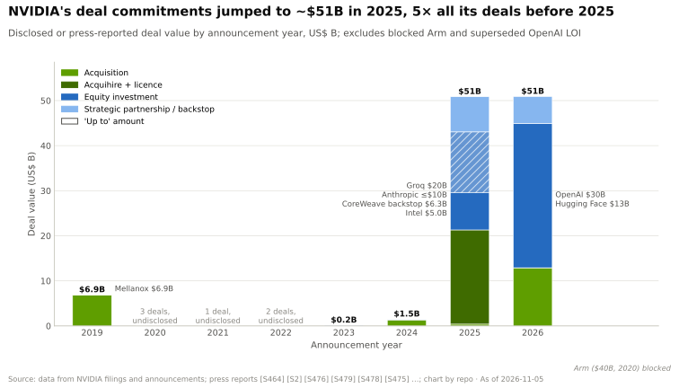
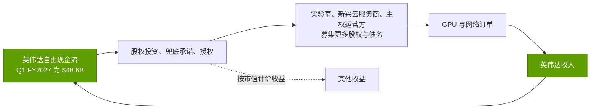
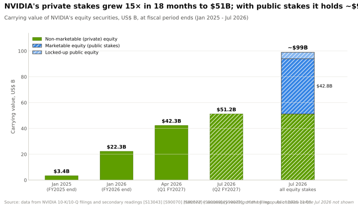
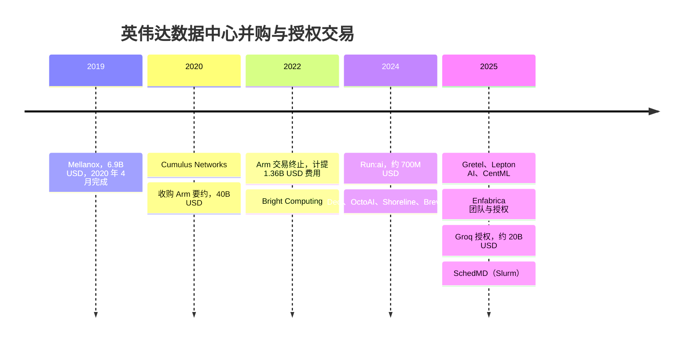
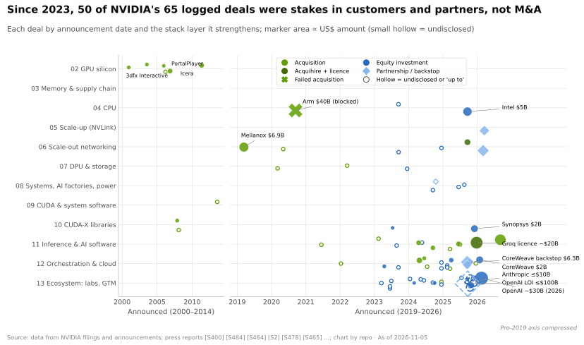
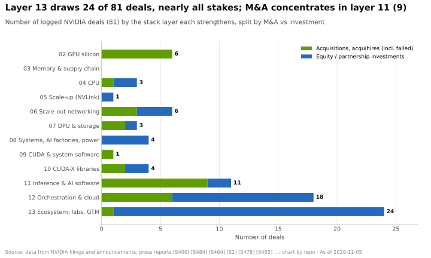

# 资本部署

> [!NOTE]
> 本页为英文原文的简体中文参考译文，仅供参考；如有出入，以[英文原文](../../../layers/13-ecosystem-gtm-and-capital/capital-deployment.md "English original")为准。

第 13 层 · 生态、市场进入与资本 · 约 9 分钟阅读 · 最近核实：2026-11-05

## ⚡ 要点速览

- **交易金额跃升五倍。** 2025 年之前英伟达所有已记录交易合计约 ~$10B。仅 2025 年一年就达到 ~$51B，以约 ~$20B 的 Groq 授权、对 Anthropic 最多 $10B、$6.3B 的 CoreWeave 兜底承诺和对英特尔（Intel）$5B 为首 [[S474]](../../../sources/bibliography.md#s474)[[S90075]](../../../sources/bibliography.md#s90075)[[S90067]](../../../sources/bibliography.md#s90067)[[S468]](../../../sources/bibliography.md#s468)。
- **股权投资组合在 18 个月内增长 15×。** 私有公司股权从 $3.4B（2025 年 1 月）增至 $51.2B（2026 年 7 月）[[S13043]](../../../sources/bibliography.md#s13043)[[S90072]](../../../sources/bibliography.md#s90072)。加上上市公司股权，英伟达共持有 ~$99B [[S90073]](../../../sources/bibliography.md#s90073)。H1 FY2027 的股权购买额为 $42.4B，上年同期为 $1.2B [[S90072]](../../../sources/bibliography.md#s90072)。
- **OpenAI 是最大的单笔押注。** 2025 年 9 月签署的最多 $100B 意向书，按每吉瓦部署量分期出资 [[S467]](../../../sources/bibliography.md#s467)，于 2026 年 2 月被搁置，改为约 ~$30B 的直接股权投资，且不设部署里程碑 🟡 [[S90015]](../../../sources/bibliography.md#s90015)[[S90016]](../../../sources/bibliography.md#s90016)[[S90017]](../../../sources/bibliography.md#s90017)。
- **并购转向授权和收购式招聘（acquihire）。** Mellanox（$6.9B）造就了网络业务 [[S464]](../../../sources/bibliography.md#s464)。Enfabrica（>$900M）和 Groq（据报道 ~$20B）属于“团队加授权”交易，被投公司本身得以保留 🟡 [[S475]](../../../sources/bibliography.md#s475)[[S90018]](../../../sources/bibliography.md#s90018)[[S90019]](../../../sources/bibliography.md#s90019)。$40B 的 Arm 收购要约于 2022 年失败，导致 $1.36B 的费用 [[S465]](../../../sources/bibliography.md#s465)[[S466]](../../../sources/bibliography.md#s466)。
- **[客户集中度](../../glossary.md#customer-concentration)很高。** 三家直接客户分别占 H1 FY2027 收入的 16%、15% 和 13%，其中一家占 Q2 FY2027 收入的 16% [[S90069]](../../../sources/bibliography.md#s90069)。
- **看空情景：**英伟达为买方提供资金，买方再用这些资金购买其 GPU。H1 FY2027 $23.7B 的股权投资净收益计入了利润 [[S90072]](../../../sources/bibliography.md#s90072)，尚有 ~$25B 的后续股权投资承诺 [[S90069]](../../../sources/bibliography.md#s90069)，英伟达还在为客户组织 >$500B 的第三方融资 [[S12528]](../../../sources/bibliography.md#s12528)。

**[Q3 · 代际进步]** 图中 2026 年的柱子未包含 2026 年 3 月约 ~$6B 的供应链股权投资：对 Lumentum 和 Coherent 各 $2B [[S6511]](../../../sources/bibliography.md#s6511)[[S13529]](../../../sources/bibliography.md#s13529)，以及据报道对美满电子（Marvell）的 $2B [[S90037]](../../../sources/bibliography.md#s90037)。图中也未包含 xAI 2026 年 1 月的融资轮，其中英伟达的出资额未披露 [[S13039]](../../../sources/bibliography.md#s13039)。媒体统计显示英伟达 2026 年的投资已超过 $40B 🟡 [[S13528]](../../../sources/bibliography.md#s13528)。

## 资本循环的运作机制

英伟达赚取的现金超过研发和回购所能消化的规模，并将其中一部分通过四种工具用于锁定需求。股权投资为实验室或云厂商提供更便宜的资本来购买 GPU。[算力兜底承诺（capacity backstop）](../../glossary.md#capacity-backstop)承诺购买未售出的算力，如对 CoreWeave 截至 2032 年的 $6.3B [[S90067]](../../../sources/bibliography.md#s90067)。授权和收购式招聘引入团队和技术。对供应商的股权投资换取产能权利，如对光器件厂商的投资 [[S6511]](../../../sources/bibliography.md#s6511)。交易往往以[意向书（letter of intent）](../../glossary.md#letter-of-intent)开局。

> [!TIP]
> **算例 —— OpenAI 股权换来了什么。** OpenAI 与英伟达的计划规模为 ≥10 GW [[S467]](../../../sources/bibliography.md#s467)。按每 100,000 颗 GB300 GPU 约 ~232 MW、英伟达价值量约 ~$5.7B 计算（估计，见[主权 AI](sovereign-ai.md)），10 GW 即 **~4.3M 颗 GPU，以及 ~$246B 的潜在英伟达收入**。约 ~$30B 的股权投资 [[S90015]](../../../sources/bibliography.md#s90015) 约占其中的 **~12%**，尚未计入股权本身的回报。OpenAI 还以一份股票认股权证为对价与 AMD 签订了 6 GW 协议 [[S13506]](../../../sources/bibliography.md#s13506)，因此这笔股权换来的是钱包份额，而非排他性。🔴 本资料库测算。

## 战略投资：投了谁，为什么投

| 交易对手 | 日期 | 英伟达出资额 | 战略逻辑 | 状态 |
|---|---|---|---|---|
| OpenAI | 2025-09 意向书 → 2026-02 | 最多 $100B 意向书 → ~$30B 股权 [[S467]](../../../sources/bibliography.md#s467)[[S90015]](../../../sources/bibliography.md#s90015) | 最大的 GPU 买方；首个吉瓦基于 Vera Rubin | 意向书已被取代；据报道股权投资已敲定 🟡 [[S13526]](../../../sources/bibliography.md#s13526) |
| Anthropic | 2025-11-18 | 最多 $10B [[S90075]](../../../sources/bibliography.md#s90075) | 争取一家重度使用 TPU 和 Trainium 的实验室；在英伟达平台上最多 1 GW | 已宣布 🟢 |
| xAI | 2025-10；2026-01 | 最多 $2B 🟡 [[S483]](../../../sources/bibliography.md#s483)；E 轮战略投资者 [[S13039]](../../../sources/bibliography.md#s13039) | Colossus 扩建 | 已完成；2026 年金额未披露 |
| Mistral AI | 2024-06；2025-09 | 未披露 [[S481]](../../../sources/bibliography.md#s481) | 欧洲主权锚点；Mistral Compute | 已完成 |
| CoreWeave | 2023 → 2026-01 | ~$2.35B 股权 + $6.3B 兜底承诺 [[S472]](../../../sources/bibliography.md#s472)[[S90067]](../../../sources/bibliography.md#s90067) | 新兴云服务商需求与优先配货 | 进行中 |
| 英特尔 | 2025-09-18 | $5B，每股 $23.28 [[S468]](../../../sources/bibliography.md#s468) | 支持 NVLink 的 x86 CPU；美国晶圆代工伙伴 | 2025 年 12 月完成 |
| 诺基亚（Nokia） | 2025-10-28 | $1B，每股 $6.01 [[S470]](../../../sources/bibliography.md#s470) | 基站中的 [AI-RAN](../../glossary.md#ai-ran) | 已完成 |
| Synopsys | 2025-12-01 | $2B，每股 $414.79 [[S471]](../../../sources/bibliography.md#s471) | GPU 加速的 EDA | 已完成 |
| 美满电子 | 2026-03 | ~$2B 🟡 [[S90037]](../../../sources/bibliography.md#s90037) | NVLink Fusion 定制 XPU | 有报道 |
| Lumentum、Coherent | 2026-03-02 | 各 $2B [[S6511]](../../../sources/bibliography.md#s6511) | 用于共封装光学的激光器与产能 | 已宣布 |

> [!TIP]
> **算例 —— 作为利润来源的英特尔股权。** 以每股 $23.28 投入 $5B，买入 **~215M 股英特尔股票** [[S468]](../../../sources/bibliography.md#s468)。上市公司股权每季度[按市值计价（mark-to-market）](../../glossary.md#mark-to-market)，因此股价波动会直接计入“其他收益”。在 Q1 FY2027，英伟达 $58.3B 的净利润中包含约 ~$15.9B 的其他收益，主要来自英特尔等股权的未实现收益 [[S403]](../../../sources/bibliography.md#s403)：**约 ~27% 的净利润**来自投资组合，而非芯片销售。

🔧 技术细节：这些股权如何影响财务报表

- **上市公司股权**（英特尔、诺基亚、Synopsys、CoreWeave）按公允价值计量；损益每季度计入其他收益。部分处于锁定期（2026 年 7 月约 ~$5.0B）[[S90072]](../../../sources/bibliography.md#s90072)。
- **私有公司股权**（[非流通股权（non-marketable equity）](../../glossary.md#non-marketable-equity)，如 OpenAI）按成本计量，在出现可观察交易时重新计量。FY2026 净增加 $17.4B，未实现收益 $2.4B [[S13043]](../../../sources/bibliography.md#s13043)。
- **兜底承诺**（如对 CoreWeave 的承诺）属于采购承诺而非股权：体现为未来义务，而不在投资科目中 [[S473]](../../../sources/bibliography.md#s473)。

> [!WARNING]
> **误区与事实：**“英伟达向 OpenAI 投资了 $100B。”这 $100B 是一份意向书，计划随每个吉瓦上线而逐步投资 [[S467]](../../../sources/bibliography.md#s467)。它已被替换为在 OpenAI 约 ~$110B 融资轮中约 ~$30B 的股权投资，且不设部署里程碑 🟡 [[S90016]](../../../sources/bibliography.md#s90016)[[S90017]](../../../sources/bibliography.md#s90017)[[S13526]](../../../sources/bibliography.md#s13526)。

## 并购、收购式招聘与授权

英伟达的收购买的是技术栈层级，而非市场份额：Mellanox 成为网络业务；Cumulus、Bright 和 SchedMD 补齐了集群软件栈 [[S478]](../../../sources/bibliography.md#s478)[[S13041]](../../../sources/bibliography.md#s13041)。Run:ai、Deci、OctoAI、CentML 和 Gretel 增强了推理和数据工具链，据报道每笔价格约 ~$250–700M 🟡 [[S479]](../../../sources/bibliography.md#s479)。自 2025 年以来，规模最大的动作是[收购式招聘（acquihire）](../../glossary.md#acquihire)授权：雇用团队、授权技术，但保留公司的独立性，从而规避并购审查 [[S90018]](../../../sources/bibliography.md#s90018)。SchedMD 交易保留了 Slurm 的开源和厂商中立属性 [[S13041]](../../../sources/bibliography.md#s13041)。

> [!TIP]
> **算例 —— Groq vs Mellanox vs Arm。** Groq 最近一轮融资估值约 ~$6.9B（2025 年 9 月）。据报道，英伟达为一份非独占授权加上创始团队支付了 ~$20B [[S90019]](../../../sources/bibliography.md#s90019)：**约为最近一次私募估值的 ~2.9×**，且并未拥有该公司。Mellanox 花费 $6.9B [[S464]](../../../sources/bibliography.md#s464)，由其孕育的网络业务在 FY2026 收入超过 $31B [[S5514]](../../../sources/bibliography.md#s5514)：**一年收入约为收购价的 ~4.5×**。而 $40B 的 Arm 交易只换来了 $1.36B 的减记 [[S466]](../../../sources/bibliography.md#s466)。监管机构决定了英伟达采用何种交易结构。

## 客户集中度

直接客户主要是 OEM 和 ODM；英伟达估计，其背后的部分间接客户收入占比也超过 10% [[S90069]](../../../sources/bibliography.md#s90069)。在 Q1 FY2027，有一家 AI 研究实验室通过云服务商贡献了可观收入 [[S90070]](../../../sources/bibliography.md#s90070)。

> [!TIP]
> **算例 —— 以美元衡量集中度。** 在 Q2 FY2027，一家直接客户占 $96.2B 收入的 16% [[S90069]](../../../sources/bibliography.md#s90069)[[S405]](../../../sources/bibliography.md#s405)，即**单季度约 ~$15.4B**。在 H1 FY2027，三家直接客户的占比分别为 16%、15% 和 13%，合计占 $177.8B 的 **44%** [[S90069]](../../../sources/bibliography.md#s90069)[[S403]](../../../sources/bibliography.md#s403)[[S405]](../../../sources/bibliography.md#s405)，即约 **~$78B** 流经三家组装商。如果其背后某家[超大规模云厂商](../../glossary.md#hyperscaler)将五分之一的加速器预算转向自研芯片，英伟达在一个季度内就会感受到影响。

> [!NOTE]
> **🐂 看多观点：**约 ~$30B 的 OpenAI 股权投资还不到一个季度的自由现金流（Q1 FY2027 为 $48.6B）[[S403]](../../../sources/bibliography.md#s403)。股权投资换来了信息和设计导入，并已产生大额收益，而客户购买 GPU 仍要支付现金。

> [!WARNING]
> **🐻 看空观点：**供应商融资会同时虚增需求和利润。股权投资收益（H1 FY2027 为 $23.7B）[[S90072]](../../../sources/bibliography.md#s90072)、兜底承诺以及 >$500B 的有组织第三方融资 [[S12528]](../../../sources/bibliography.md#s12528)，把英伟达的业绩与客户的融资能力捆绑在一起。批评者将其与 2001 年之前电信设备商的供应商融资相提并论 [[S90074]](../../../sources/bibliography.md#s90074)。

## 🎯 企业发展视角

1. **资本如今是一种竞争武器。** 英伟达约 ~$56.6B 的现金和债务证券 [[S13500]](../../../sources/bibliography.md#s13500)，加上 ~$99B 的股权持仓 [[S90073]](../../../sources/bibliography.md#s90073)，令同业相形见绌（见[价值链与企业发展视角](value-chain-and-corp-dev.md)）。认股权证、与收入挂钩的信用额度或与基础设施基金联合投资等交易结构，哪些能让资产负债表较小的公司参与竞争？
2. **“授权加团队”是新的并购模板。** Enfabrica 和 Groq 表明，无需收购公司即可绕开监管 [[S90018]](../../../sources/bibliography.md#s90018)。哪些私有推理和互连团队同样适用这种结构？
3. **对供应商的股权投资可以锁定产能。** 对光器件厂商的股权投资附带了采购承诺和产能权利 [[S6511]](../../../sources/bibliography.md#s6511)。在挑战者供应链的哪些环节（激光器、[HBM](../../glossary.md#hbm)、[CoWoS](../../glossary.md#cowos)、电力），类似的股权投资能够锁定稀缺产能？
4. **集中度是双向的。** 三家直接客户占 H1 FY2027 收入的 44% [[S90069]](../../../sources/bibliography.md#s90069)。其背后的间接客户中，哪些对第二供应商最为开放？

## 📚 来源（Sources）

<!-- Auto-generated from the [S…] citations on this page by `make build`. Edit sources/registry/*.csv, not this list. -->

- [**S403**](../../../sources/bibliography.md#s403) NVIDIA Corporation via SEC EDGAR, *NVIDIA Announces Financial Results for First Quarter Fiscal 2027 (Form 8-K exhibit 99.1)*, 2026-05-20. [Link](https://www.sec.gov/Archives/edgar/data/0001045810/000104581026000051/q1fy27pr.htm)
- [**S405**](../../../sources/bibliography.md#s405) NVIDIA Corporation via SEC EDGAR, *NVIDIA Announces Financial Results for Second Quarter Fiscal 2027 (Form 8-K exhibit 99.1)*, 2026-08-26. [Link](https://www.sec.gov/Archives/edgar/data/0001045810/000104581026000073/q2fy27pr.htm)
- [**S464**](../../../sources/bibliography.md#s464) NVIDIA Newsroom, *NVIDIA to Acquire Mellanox for $6.9 Billion*, 2019-03-11. [Link](https://nvidianews.nvidia.com/news/nvidia-to-acquire-mellanox-for-6-9-billion)
- [**S465**](../../../sources/bibliography.md#s465) NVIDIA Newsroom, *NVIDIA to Acquire Arm for $40 Billion, Creating World's Premier Computing Company for the Age of AI*, 2020-09-13. [Link](https://nvidianews.nvidia.com/news/nvidia-to-acquire-arm-for-40-billion-creating-worlds-premier-computing-company-for-the-age-of-ai)
- [**S466**](../../../sources/bibliography.md#s466) NVIDIA Newsroom, *NVIDIA and SoftBank Group Announce Termination of NVIDIA's Acquisition of Arm Limited*, 2022-02-08. [Link](https://nvidianews.nvidia.com/news/nvidia-and-softbank-group-announce-termination-of-nvidias-acquisition-of-arm-limited)
- [**S467**](../../../sources/bibliography.md#s467) NVIDIA Newsroom, *OpenAI and NVIDIA Announce Strategic Partnership to Deploy 10 Gigawatts of NVIDIA Systems*, 2025-09-22. [Link](https://nvidianews.nvidia.com/news/openai-and-nvidia-announce-strategic-partnership-to-deploy-10gw-of-nvidia-systems)
- [**S468**](../../../sources/bibliography.md#s468) NVIDIA Newsroom, *NVIDIA and Intel to Develop AI Infrastructure and Personal Computing Products*, 2025-09-18. [Link](https://nvidianews.nvidia.com/news/nvidia-and-intel-to-develop-ai-infrastructure-and-personal-computing-products)
- [**S470**](../../../sources/bibliography.md#s470) NVIDIA Newsroom, *NVIDIA and Nokia partnership on AI-RAN; NVIDIA $1B equity investment in Nokia*, 2025-10-28. [Link](https://nvidianews.nvidia.com/)
- [**S471**](../../../sources/bibliography.md#s471) NVIDIA Newsroom, *NVIDIA and Synopsys strategic partnership; NVIDIA $2B investment in Synopsys common stock*, 2025-12-01. [Link](https://nvidianews.nvidia.com/)
- [**S472**](../../../sources/bibliography.md#s472) CoreWeave Newsroom, *CoreWeave and NVIDIA expand partnership; NVIDIA invests $2B in CoreWeave Class A stock*, 2026-01-26. [Link](https://www.coreweave.com/news)
- [**S473**](../../../sources/bibliography.md#s473) U.S. Securities and Exchange Commission (EDGAR), *CoreWeave Inc. Form 8-K / S-1 filings (EDGAR index): NVIDIA capacity agreement and IPO participation*, 2025-09-15. [Link](https://www.sec.gov/cgi-bin/browse-edgar?action=getcompany&CIK=0001769628&type=8-K&dateb=&owner=include&count=40)
- [**S474**](../../../sources/bibliography.md#s474) Groq Newsroom, *Groq and NVIDIA enter non-exclusive inference technology licensing agreement*, 2025-12-24. [Link](https://groq.com/newsroom)
- [**S475**](../../../sources/bibliography.md#s475) CNBC, *Nvidia spends over $900 million on Enfabrica CEO, AI startup technology*, 2025-09-18. [Link](https://www.cnbc.com/technology/)
- [**S478**](../../../sources/bibliography.md#s478) NVIDIA, *NVIDIA Blog and Newsroom acquisition announcements (Cumulus, SwiftStack, DeepMap, Bright Computing, Excelero, Shoreline, Brev.dev, OctoAI, VinBrain, Gretel, Lepton AI, CentML, SchedMD)*, 2025-12. [Link](https://blogs.nvidia.com/)
- [**S479**](../../../sources/bibliography.md#s479) Various (press), *Reporting on NVIDIA tuck-in acquisition prices (Run:ai, Deci, Shoreline, OctoAI, Gretel, Lepton, CentML) — The Information, Calcalist, Reuters, CNBC*, 2025-06. [Link](https://www.reuters.com/technology/)
- [**S481**](../../../sources/bibliography.md#s481) Various (company announcements; Reuters, Bloomberg, TechCrunch), *Reporting on NVIDIA participation in AI-lab and neocloud funding rounds 2023–2025 (Inflection, Cohere, Hugging Face, Databricks, Mistral, xAI, Perplexity, Crusoe, Lambda, Nebius, Nscale, Together AI, Poolside, Reflection AI, Thinking Machines, Cursor)*, 2025-11. [Link](https://techcrunch.com/)
- [**S483**](../../../sources/bibliography.md#s483) Various (Bloomberg, The Information, Reuters), *Reporting on NVIDIA commitments to xAI (up to $2B in ~$20B raise), Poolside (up to $1B), Lambda (~$1.5B GPU lease-back) and Wayve ($500M LOI)*, 2025-10. [Link](https://www.bloomberg.com/technology)
- [**S5514**](../../../sources/bibliography.md#s5514) SDxCentral, *Nvidia's networking arm hits $31B as new cornerstone of AI dominance*, 2026-02. [Link](https://www.sdxcentral.com/news/nvidias-networking-arm-hits-31b-as-new-cornerstone-of-ai-dominance/)
- [**S6511**](../../../sources/bibliography.md#s6511) SiliconANGLE, *Nvidia invests $4B in co-packaged optics suppliers Lumentum and Coherent*, 2026-03-02. [Link](https://siliconangle.com/2026/03/02/nvidia-invests-4b-co-packaged-optics-suppliers-lumentum-coherent/)
- [**S12528**](../../../sources/bibliography.md#s12528) NVIDIA Newsroom, *NVIDIA Partners With Apollo, BlackRock, Blackstone, Brookfield, Goldman Sachs and KKR to Establish AI Compute Infrastructure Financing Platforms to Mobilize Over $500 Billion of Third-Party Capital*, 2026-08-10. [Link](https://nvidianews.nvidia.com/news/nvidia-partners-with-apollo-blackrock-blackstone-brookfield-goldman-sachs-and-kkr-to-establish-ai-compute-infrastructure-financing-platforms-to-mobilize-over-500-billion-of-third-party-capital)
- [**S13039**](../../../sources/bibliography.md#s13039) xAI, *xAI raises $20B Series E (announcement)*, 2026-01-06. [Link](https://x.ai/blog/series-e)
- [**S13041**](../../../sources/bibliography.md#s13041) NVIDIA Blog, *NVIDIA Acquires Open-Source Workload Management Provider SchedMD*, 2025-12-15. [Link](https://blogs.nvidia.com/blog/nvidia-acquires-schedmd)
- [**S13043**](../../../sources/bibliography.md#s13043) NVIDIA Corporation via SEC EDGAR, *NVIDIA FY2026 Form 10-K, note: non-marketable equity securities (XBRL R17)*, 2026-02-25. [Link](https://www.sec.gov/Archives/edgar/data/1045810/000104581026000021/R17.htm)
- [**S13500**](../../../sources/bibliography.md#s13500) Securities.io, *Nvidia board adds $150 billion to share repurchase program*, 2026-08. [Link](https://www.securities.io/nvidia-board-adds-150-billion-to-share-repurchase-program/)
- [**S13506**](../../../sources/bibliography.md#s13506) Tom's Hardware, *OpenAI signs 6 GW AMD GPU deal*, 2025-10-06. [Link](https://www.tomshardware.com/pc-components/gpus/openai-signs-6gw-amd-gpu-deal)
- [**S13526**](../../../sources/bibliography.md#s13526) Storyboard18, *Nvidia CEO Jensen Huang hints no further investments in OpenAI, Anthropic*, 2026. [Link](https://www.storyboard18.com/brand-makers/nvidia-ceo-jensen-huang-hints-no-further-investments-in-openai-anthropic-heres-why-91280.htm)
- [**S13528**](../../../sources/bibliography.md#s13528) Digital Today (Korea), *Nvidia emerges as major investor in AI ecosystem, puts in $40 billion this year*, 2026. [Link](https://www.digitaltoday.co.kr/en/view/54034/nvidia-emerges-as-major-investor-in-ai-ecosystem-puts-in-40-billion-this-year)
- [**S13529**](../../../sources/bibliography.md#s13529) Bloomberg Government, *Nvidia to invest $4 billion in data center optics companies*, 2026-03-02. [Link](https://news.bgov.com/artificial-intelligence/nvidia-to-invest-4-billion-in-data-center-optics-companies-1)
- [**S90015**](../../../sources/bibliography.md#s90015) DatacenterDynamics, *Nvidia plans $30bn investment in upcoming OpenAI funding round*, 2026-02. [Link](https://www.datacenterdynamics.com/en/news/nvidia-plans-30bn-investment-in-upcoming-openai-funding-round/)
- [**S90016**](../../../sources/bibliography.md#s90016) Storyboard18 (Financial Times), *Nvidia set for $30bn OpenAI deal as $100bn partnership shelved, report says (FT)*, 2026-02-20. [Link](https://www.storyboard18.com/digital/nvidia-set-for-30bn-openai-deal-as-100bn-partnership-shelved-report-says-90188.htm)
- [**S90017**](../../../sources/bibliography.md#s90017) ITdaily, *Nvidia won't invest $100 billion in OpenAI after all*, 2026-02. [Link](https://itdaily.com/news/innovation/nvidia-openai-30-billion/)
- [**S90018**](../../../sources/bibliography.md#s90018) Constellation Research, *Nvidia's Groq deal: acquisition, acquihire or creative licensing deal?*, 2025-12. [Link](https://www.constellationr.com/insights/news/nvidias-groq-deal-acquisition-acquihire-or-creative-licensing-deal)
- [**S90019**](../../../sources/bibliography.md#s90019) TechSpot, *Nvidia's $20 billion Groq deal looks a lot like an acquisition*, 2025-12. [Link](https://www.techspot.com/news/110723-nvidia-20-billion-groq-deal-looks-lot-like.html)
- [**S90037**](../../../sources/bibliography.md#s90037) Converge Digest, *NVIDIA invests $2B in Marvell to extend NVLink Fusion AI ecosystem*, 2026-03. [Link](https://convergedigest.com/nvidia-invests-2b-in-marvell-to-extend-nvlink-fusion-ai-ecosystem/)
- [**S90067**](../../../sources/bibliography.md#s90067) DatacenterDynamics, *Nvidia to purchase unsold compute capacity from CoreWeave for $6.3bn*, 2025-09-16. [Link](https://www.datacenterdynamics.com/en/news/nvidia-to-purchase-unsold-compute-capacity-from-coreweave-for-63bn/)
- [**S90069**](../../../sources/bibliography.md#s90069) NVIDIA Corporation via SEC EDGAR, *NVIDIA Form 10-Q for the quarter ended July 26, 2026 (Q2 FY2027)*, 2026-08. [Link](https://www.sec.gov/Archives/edgar/data/0001045810/000104581026000075/nvda-20260726.htm)
- [**S90070**](../../../sources/bibliography.md#s90070) NVIDIA Corporation via SEC EDGAR, *NVIDIA Form 10-Q for the quarter ended April 26, 2026 (Q1 FY2027)*, 2026-05. [Link](https://www.sec.gov/Archives/edgar/data/0001045810/000104581026000052/nvda-20260426.htm)
- [**S90072**](../../../sources/bibliography.md#s90072) Unite.AI, *Nvidia's AI sector equity stakes grow, SEC filing shows*, 2026-08. [Link](https://unite.ai/nvidias-ai-sector-equity-stakes-grow-sec-filing-shows)
- [**S90073**](../../../sources/bibliography.md#s90073) FourWeekMBA, *NVIDIA's $99 billion investment portfolio and the circular financing loop at the center of AI*, 2026-08. [Link](https://fourweekmba.com/ai-nvidia-99-billion-investment-portfolio-circular-financing-ai/)
- [**S90074**](../../../sources/bibliography.md#s90074) Kavout, *Nvidia's AI dominance meets circular financing: a systemic risk underpriced?*, 2026. [Link](https://www.kavout.com/market-lens/nvidia-s-ai-dominance-meets-circular-financing-a-systemic-risk-underpriced)
- [**S90075**](../../../sources/bibliography.md#s90075) Windows Central, *NVIDIA joins Microsoft's push on Claude — piling billions into Anthropic's future*, 2025-11-18. [Link](https://www.windowscentral.com/microsoft/nvidia-joins-microsofts-push-on-claude-piling-billions-into-anthropics-future)
