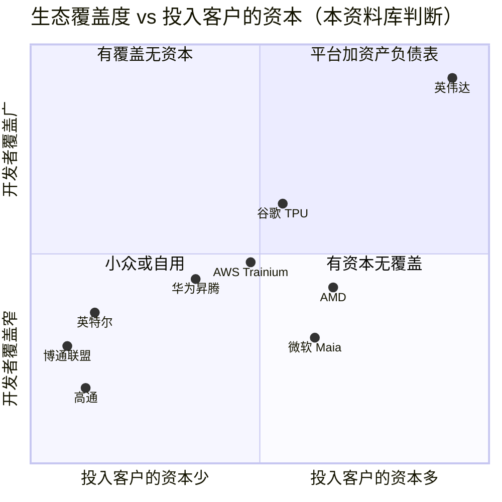
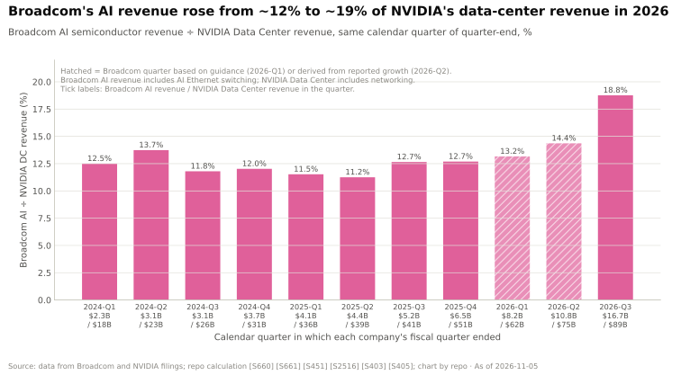
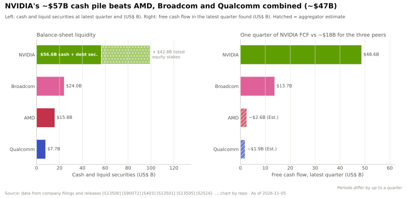

# 生态、市场进入与资本：竞争格局

> [!NOTE]
> 本页为英文原文的简体中文参考译文，仅供参考；如有出入，以[英文原文](../../../layers/13-ecosystem-gtm-and-capital/competition.md "English original")为准。

第 13 层 · 生态、市场进入与资本 · 约 11 分钟阅读 · 最近核实：2026-11-05

## ⚡ 要点速览

- **竞争的焦点在于谁为买方提供资金、培训和销售，而非芯片本身。** 英伟达拥有 ~6M [CUDA](../../glossary.md#cuda) 开发者、FY2026 >$30B 的[主权 AI](../../glossary.md#sovereign-ai) 收入，以及单季度 $48.6B 的[自由现金流](../../glossary.md#free-cash-flow) [[S528]](../../../sources/bibliography.md#s528)[[S90071]](../../../sources/bibliography.md#s90071)[[S403]](../../../sources/bibliography.md#s403)。
- **资本火力严重失衡。** 2026 年 7 月，英伟达持有 ~$57B 的现金和债务证券，超过 AMD（$15.8B）、博通（Broadcom）（$24.0B）和高通（$7.7B）三者之和 [[S13500]](../../../sources/bibliography.md#s13500)[[S13501]](../../../sources/bibliography.md#s13501)[[S2516]](../../../sources/bibliography.md#s2516)[[S13503]](../../../sources/bibliography.md#s13503)。
- **AMD 以股权而非现金支付。** OpenAI 持有最多 160M 股 AMD 股票的[认股权证](../../glossary.md#warrant)，随其部署 1 GW 至 6 GW 的 AMD GPU 逐步归属 [[S13506]](../../../sources/bibliography.md#s13506)；🟡 AMD 还计划向 Anthropic 投资最多 $5B，配套 2 GW 的 Helios [[S9538]](../../../sources/bibliography.md#s9538)。
- **博通不出资也能赢单。** OpenAI 的 10 GW 定制加速器项目未披露任何供应商资本投入 [[S174]](../../../sources/bibliography.md#s174)，而博通在截至 2026 年 8 月的季度 AI 收入达到 $16.7B，约为英伟达数据中心收入的 ~19% [[S2516]](../../../sources/bibliography.md#s2516)[[S405]](../../../sources/bibliography.md#s405)。
- **[Q5 · 最强挑战者]** [超大规模云厂商](../../glossary.md#hyperscaler)与博通主导的定制 [ASIC](../../glossary.md#asic) 联盟：在 OpenAI 已公布的 26 GW 中，英伟达仅占 10 GW；在四家大买方中合计约占 ~39%。
- **英伟达的弱点：资金买到的是配额，而非排他性。** OpenAI 和 Anthropic 接受了英伟达的股权投资，却仍与 AMD、博通和谷歌签约 [[S13506]](../../../sources/bibliography.md#s13506)[[S174]](../../../sources/bibliography.md#s174)[[S655]](../../../sources/bibliography.md#s655)。

## 生态竞争如何计分

不妨把一个平台想象成一座城市：开发者是居民，初创企业计划是学校，主权交易是条约，资本是道路。如果没人居住，再好的建筑（芯片）也无济于事。我们从开发者覆盖、初创企业计划、主权交易、资本火力和渠道广度（[OEM](../../glossary.md#oem)、云厂商、[全球系统集成商（GSI）](../../glossary.md#gsi)）五个维度打分。

| 竞争对手 | 开发者覆盖 | 初创企业计划 | 主权交易 | 资本火力 | 渠道广度 |
|---|---|---|---|---|---|
| 谷歌（TPU） | 🟦 其云上的 [JAX](../../glossary.md#jax)/[XLA](../../glossary.md#xla) | 🟩 最高 $350k 云额度 | 🟥 国家级交易很少 | 🟦 持有 Anthropic 股权 | 🟥 主要是 Google Cloud |
| AWS（Trainium） | 🟦 Neuron SDK | 🟩 Activate 云额度 | 🟦 出售云区域而非芯片 | 🟦 Anthropic、Rainier | 🟥 仅 AWS |
| 微软（Maia） | 🟦 Maia 仅限内部 | 🟩 ~$150k Founders Hub | 🟦 主权云 | 🟦 Anthropic $5B，>$60B 新兴云服务商交易 | 🟥 仅 Azure |
| 博通联盟 | 🟦 客户自有技术栈 | 🟥 无 | 🟥 无 | 🟥 无供应商资本 | 🟦 4–5 家巨头买方 |
| AMD | 🟥 [ROCm](../../glossary.md#rocm) 规模小得多 | 🟥 未发现 Inception 级计划 | 🟥 HUMAIN 500 MW | 🟦 认股权证与股权投资 | 🟨 相同的 OEM |
| 英特尔 | 🟥 oneAPI 属小众 | 🟥 未发现 | 🟥 无 | 🟥 自身融资 ~$23B | 🟨 x86 OEM 覆盖广 |
| 华为 | 🟦 [CANN](../../glossary.md#cann) 已开源 | 🟦 每年 30k 块开发板 | 🟦 中国优先 | 🟦 与国家方向一致 | 🟦 仅限中国 |
| 高通 | 🟦 Modular 技术栈（2026 年 7 月完成收购） | 🟥 无此规模计划 | 🟥 HUMAIN 200 MW | 🟥 $7.7B 现金，净负债 | 🟦 Meta、HUMAIN |

评级 = 竞争对手相对英伟达（🟩 竞争对手领先 · 🟨 持平 · 🟥 竞争对手落后 · 🟦 路线不同）。本资料库判断 🔴，依据 [[S13519]](../../../sources/bibliography.md#s13519)[[S13520]](../../../sources/bibliography.md#s13520)[[S90034]](../../../sources/bibliography.md#s90034)[[S90075]](../../../sources/bibliography.md#s90075)[[S12526]](../../../sources/bibliography.md#s12526)[[S174]](../../../sources/bibliography.md#s174)[[S9518]](../../../sources/bibliography.md#s9518)[[S13517]](../../../sources/bibliography.md#s13517)[[S13532]](../../../sources/bibliography.md#s13532)[[S13521]](../../../sources/bibliography.md#s13521)[[S13523]](../../../sources/bibliography.md#s13523)[[S9511]](../../../sources/bibliography.md#s9511)[[S90030]](../../../sources/bibliography.md#s90030)[[S13503]](../../../sources/bibliography.md#s13503)。

> [!TIP]
> **算例 —— $350,000 的初创企业云额度能买到什么。** 按每 H100 小时 $2.99（Lambda 标价）至 $6.88（AWS p5 标价）计算 [[S395]](../../../sources/bibliography.md#s395)[[S392]](../../../sources/bibliography.md#s392)，谷歌最高档 $350,000 的 AI 额度 [[S13519]](../../../sources/bibliography.md#s13519) 可购买 ~51,000–117,000 GPU 小时：相当于 6–13 颗 H100 用一年。足以微调一个产品，却不足以预训练一个前沿模型。云额度赢得的是*第一个*工作负载；英伟达则通过 [DGX Cloud Lepton](../../glossary.md#dgx-cloud-lepton) 把初创企业引导到合作伙伴的云上 [[S12529]](../../../sources/bibliography.md#s12529)。

🔧 技术细节：为什么现金与认股权证并不等价

现金入股（英伟达对 OpenAI 约 ~$30B [[S90015]](../../../sources/bibliography.md#s90015)[[S13526]](../../../sources/bibliography.md#s13526)）由当期自由现金流支付，并成为流动性差的私有资产。认股权证（AMD 的 160M 股，行权价 $0.01）不耗费现金；只有发行方股价上涨时才有价值，由现有股东通过[股权稀释](../../glossary.md#dilution)买单。面向客户的认股权证通常在各批次很可能归属时作为收入的减项入账（🔴 本资料库对通行做法的解读），而英伟达的股权投资则记在资产负债表上，损益计入其他收益 [[S90072]](../../../sources/bibliography.md#s90072)。

## 逐一分析挑战者

### 超大规模云厂商与博通主导的定制 ASIC 联盟：最强挑战者

**拥有什么。** 谷歌向 Anthropic 供应最多 1M 颗 TPU（2026 年 >1 GW），并自 2027 年起追加多吉瓦规模，同时向 Meta 出租 Ironwood，并把 TPU 部署进客户的数据中心 [[S90026]](../../../sources/bibliography.md#s90026)[[S655]](../../../sources/bibliography.md#s655)[[S90025]](../../../sources/bibliography.md#s90025)[[S90027]](../../../sources/bibliography.md#s90027)。AWS 以 ~500k 颗 Trainium2 芯片建成了 Project Rainier；微软计划自 2027 年起部署多吉瓦的 Maia [[S90034]](../../../sources/bibliography.md#s90034)[[S90045]](../../../sources/bibliography.md#s90045)。博通还与 OpenAI 共同开发其 10 GW 项目（2026 年下半年至 2029 年）[[S174]](../../../sources/bibliography.md#s174)。

**最有力的论据。** 它掌握需求：超大规模云厂商同时是云服务商、芯片设计者和投资者，因此它可以资助一家实验室（微软向 Anthropic 投资最多 $5B [[S90075]](../../../sources/bibliography.md#s90075)）、向其出租算力，并引导其转向[自研芯片（captive silicon）](../../glossary.md#captive-silicon)，而无需为配额付费。

**差距缩小了多少。** 博通的 AI 收入从相当于英伟达数据中心收入的 ~11–14%（2024 年至 2026 年初），上升到截至 2026 年 8 月季度的 ~19%，下一季度指引为 $21.7B [[S2516]](../../../sources/bibliography.md#s2516)。

> [!TIP]
> **算例 —— 在 OpenAI 保持中立的代价。** OpenAI 公布了 26 GW：英伟达 10、博通 10、AMD 6 [[S467]](../../../sources/bibliography.md#s467)[[S174]](../../../sources/bibliography.md#s174)[[S13506]](../../../sources/bibliography.md#s13506)。英伟达 2025 年的意向书按每 GW 约 ~$10B 出资，后被约 ~$30B 且不设里程碑的股权投资取代 [[S90016]](../../../sources/bibliography.md#s90016)[[S90017]](../../../sources/bibliography.md#s90017)。博通分文未出，却赢得了同样多的份额。资本让英伟达留在牌桌上；但一个大到足以自研芯片的买方，无论如何都会自研。

### AMD：“以资本换产能”的反制模式

**AMD 拥有什么。** 与 OpenAI 的交易将 6 GW 的 Instinct 部署（首个 1 GW 的 MI450 于 2026 年下半年交付）与一份最多 160M 股、行权价 $0.01 的认股权证绑定，按部署、股价和技术里程碑归属；有报道称最后一批与 $600 的股价挂钩 [[S13506]](../../../sources/bibliography.md#s13506)[[S13507]](../../../sources/bibliography.md#s13507)。AMD 收购了 ZT Systems（$4.9B）以获取其机架设计团队，并将工厂出售给 Sanmina [[S8527]](../../../sources/bibliography.md#s8527)[[S5527]](../../../sources/bibliography.md#s5527)。它还收购了 Silo AI（~$665M）、Brium、Untether AI 团队和 MK1，并吸引 2,000+ 名开发者参加 Advancing AI 2026 🟡 [[S9506]](../../../sources/bibliography.md#s9506)[[S9507]](../../../sources/bibliography.md#s9507)[[S9509]](../../../sources/bibliography.md#s9509)[[S9519]](../../../sources/bibliography.md#s9519)。

**最有力的论据。** 以股票支付的[“以资本换产能”（capital-for-capacity）](../../glossary.md#capital-for-capacity)交易，让 $15.8B 的资产负债表 [[S13501]](../../../sources/bibliography.md#s13501) 也能与英伟达的现金竞争，并把客户与 AMD 的成功绑定在一起。**差距：**AMD 目前在 OpenAI 拥有 6 GW（英伟达 10 GW），🟡 在 Anthropic 拥有 2 GW（英伟达 1 GW）[[S13506]](../../../sources/bibliography.md#s13506)[[S9538]](../../../sources/bibliography.md#s9538)，但在开发者方面仍大幅落后（[第 09 层](../09-cuda-and-system-software/competition.md)）。

> [!TIP]
> **算例 —— AMD 认股权证的成本。** 若每一批次都在报道中的门槛价归属，160M 股 × $600 = $96B，即 6 GW 下每 GW $16B（本资料库计算）[[S13507]](../../../sources/bibliography.md#s13507)。按示意性的 $200 计算，则为 $32B。AMD 以股权稀释（最多约为公司的十分之一，估计）而非现金支付，且仅在部署实际发生时才需支付。

### 英特尔、华为与高通

**英特尔**拥有最广泛的 [x86](../../glossary.md#x86) OEM 渠道，但需要 ~$23B 的外部资本，其中包括英伟达以 $5B 换取的 ~4% 股权；其晶圆代工业务取决于两家潜在 14A 客户自 2026 年下半年起的决定 🟡 [[S13532]](../../../sources/bibliography.md#s13532)[[S4009]](../../../sources/bibliography.md#s4009)[[S13531]](../../../sources/bibliography.md#s13531)。**华为**于 2025 年底开源了 CANN，每年资助 30,000 块开发板和 1,500 [PFLOPS](../../glossary.md#flops) 的开发者算力，并称外部开发者占 CANN 社区的 61% 🟡；未公布绝对人数 [[S13521]](../../../sources/bibliography.md#s13521)[[S13523]](../../../sources/bibliography.md#s13523)[[S9524]](../../../sources/bibliography.md#s9524)。**高通（仅基于公开信息）**拥有 AI200（2026 年）和 AI250（2027 年）机架、200 MW 的 HUMAIN 计划、以 Meta 为首个客户的 C1000 CPU（2028 年下半年）以及 AI300（2028 年）；它于 2026-07-29 完成了对 Modular 的全股票收购（据报道 ~$3.9B），并于 2025 年 12 月完成对 Alphawave 的收购 [[S90028]](../../../sources/bibliography.md#s90028)[[S90030]](../../../sources/bibliography.md#s90030)[[S90058]](../../../sources/bibliography.md#s90058)[[S90060]](../../../sources/bibliography.md#s90060)[[S9511]](../../../sources/bibliography.md#s9511)[[S90057]](../../../sources/bibliography.md#s90057)[[S4513]](../../../sources/bibliography.md#s4513)。

> [!NOTE]
> **🐂 看多观点。** 只有英伟达同时是开发者平台、主权合作伙伴和融资方；其一个季度的自由现金流就超过同业的现金总和，其融资平台还计划为客户撬动 >$500B 的第三方资本 [[S403]](../../../sources/bibliography.md#s403)[[S12528]](../../../sources/bibliography.md#s12528)。

> [!WARNING]
> **🐻 看空观点。** 最大的买方拿了英伟达的钱，照样多源采购：定制芯片在 OpenAI 占 10 GW，AMD 在 Anthropic 的份额不断扩大，博通的 AI 收入已相当于英伟达数据中心收入的 ~19% [[S174]](../../../sources/bibliography.md#s174)[[S9538]](../../../sources/bibliography.md#s9538)[[S2516]](../../../sources/bibliography.md#s2516)。每一笔股权投资还会招致[循环融资](../../glossary.md#circular-financing)和反垄断方面的质疑（[路线图](roadmap.md)）。

**[Q5 · 最强挑战者]** 超大规模云厂商加博通的联盟。它掌控需求、初创企业的入口以及自研芯片，因此无需购买配额。在约两年内，差距从英伟达数据中心收入的 ~11% 缩小到 ~19% [[S2516]](../../../sources/bibliography.md#s2516)。AMD 的认股权证模式是对英伟达现金最具创意的反制，纸面上已拥有 8 GW 的前沿实验室项目 🟡 [[S13506]](../../../sources/bibliography.md#s13506)[[S9538]](../../../sources/bibliography.md#s9538)。

## 🎯 企业发展视角

1. OpenAI 以每 GW $0 选择了博通，以每 GW ~$10B 选择了英伟达。买方的决策中有多少取决于资本，又有多少取决于设计控制权？
2. AMD 以股权支付，英伟达以现金支付。哪种结构更适合资本受限的新进入者？哪些里程碑可以保护其股东？
3. 超大规模云厂商的云额度赢得第一个工作负载。[新兴云服务商（neocloud）](../../glossary.md#neocloud)或主权云合作伙伴能否替代芯片厂商无力独自资助的初创企业计划？可移植技术栈（CANN、Modular）能否让该计划做到硬件中立？

## 📚 来源（Sources）

<!-- Auto-generated from the [S…] citations on this page by `make build`. Edit sources/registry/*.csv, not this list. -->

- [**S174**](../../../sources/bibliography.md#s174) OpenAI, *OpenAI and Broadcom announce strategic collaboration to deploy 10 gigawatts of OpenAI-designed AI accelerators*, 2025-10-13. [Link](https://openai.com/index/openai-and-broadcom-announce-strategic-collaboration/)
- [**S392**](../../../sources/bibliography.md#s392) AWS, *AWS announces up to 45% price reduction for Amazon EC2 NVIDIA GPU-accelerated instances (P4, P5)*, 2025-06. [Link](https://aws.amazon.com/about-aws/whats-new/2025/06/pricing-usage-model-ec2-instances-nvidia-gpus/)
- [**S395**](../../../sources/bibliography.md#s395) Lambda, *Lambda GPU cloud pricing*, 2025. [Link](https://lambda.ai/pricing)
- [**S403**](../../../sources/bibliography.md#s403) NVIDIA Corporation via SEC EDGAR, *NVIDIA Announces Financial Results for First Quarter Fiscal 2027 (Form 8-K exhibit 99.1)*, 2026-05-20. [Link](https://www.sec.gov/Archives/edgar/data/0001045810/000104581026000051/q1fy27pr.htm)
- [**S405**](../../../sources/bibliography.md#s405) NVIDIA Corporation via SEC EDGAR, *NVIDIA Announces Financial Results for Second Quarter Fiscal 2027 (Form 8-K exhibit 99.1)*, 2026-08-26. [Link](https://www.sec.gov/Archives/edgar/data/0001045810/000104581026000073/q2fy27pr.htm)
- [**S467**](../../../sources/bibliography.md#s467) NVIDIA Newsroom, *OpenAI and NVIDIA Announce Strategic Partnership to Deploy 10 Gigawatts of NVIDIA Systems*, 2025-09-22. [Link](https://nvidianews.nvidia.com/news/openai-and-nvidia-announce-strategic-partnership-to-deploy-10gw-of-nvidia-systems)
- [**S528**](../../../sources/bibliography.md#s528) NVIDIA Developer Forums, *20 Years of CUDA: Honoring the Architects of the Accelerated Age*, 2026-03. [Link](https://forums.developer.nvidia.com/t/20-years-of-cuda-honoring-the-architects-of-the-accelerated-age/364654)
- [**S655**](../../../sources/bibliography.md#s655) Anthropic, *Anthropic expands partnership with Google and Broadcom for multiple gigawatts of next-generation compute*, 2026-04-06. [Link](https://www.anthropic.com/news/google-broadcom-partnership-compute)
- [**S2516**](../../../sources/bibliography.md#s2516) Broadcom Inc. via SEC EDGAR, *Broadcom Inc. Announces Third Quarter Fiscal Year 2026 Financial Results (Form 8-K exhibit 99.1)*, 2026-09. [Link](https://www.sec.gov/Archives/edgar/data/0001730168/000173016826000076/avgo-08022026x8kxex99.htm)
- [**S4009**](../../../sources/bibliography.md#s4009) SDxCentral, *Intel gets hands on Nvidia's $5B investment*, 2025-12. [Link](https://www.sdxcentral.com/news/intel-gets-hands-on-nvidias-5b-investment/)
- [**S4513**](../../../sources/bibliography.md#s4513) I-Connect007, *Qualcomm completes acquisition of Alphawave Semi*, 2025-12-18. [Link](https://iconnect007.com/article/148161/qualcomm-completes-acquisition-of-alphawave-semi/148158/ein)
- [**S5527**](../../../sources/bibliography.md#s5527) Evertiq, *AMD completes sale of ZT Systems manufacturing unit to Sanmina*, 2025-10-27. [Link](https://evertiq.com/design/2025-10-27-amd-completes-sale-of-zt-systems-manufacturing-unit-to-sanmina)
- [**S8527**](../../../sources/bibliography.md#s8527) AMD Investor Relations, *AMD completes acquisition of ZT Systems*, 2025-03-31. [Link](https://ir.amd.com/news-events/press-releases/detail/1240/amd-completes-acquisition-of-zt-systems)
- [**S9506**](../../../sources/bibliography.md#s9506) Converge Digest, *AMD completes $665 million acquisition of Silo AI*, 2024-08. [Link](https://convergedigest.com/amd-completes-665-million-acquisition-of-silo-ai/?amp=1)
- [**S9507**](../../../sources/bibliography.md#s9507) DatacenterDynamics, *AMD extends acquisition run: brings software optimization firm Brium and staff from recently shuttered Untether AI into the fold*, 2025-06. [Link](https://www.datacenterdynamics.com/en/news/amd-extends-acquisition-run-brings-software-optimization-firm-brium-and-staff-from-recently-shuttered-untether-ai-into-the-fold/)
- [**S9509**](../../../sources/bibliography.md#s9509) PrivSource (deal record), *AMD Acquires MK1*, 2025-11. [Link](https://www.privsource.com/acquisitions/deal/y3S4jb)
- [**S9511**](../../../sources/bibliography.md#s9511) Nasdaq (Qualcomm press release), *Qualcomm Completes Acquisition of Modular*, 2026-07-29. [Link](https://www.nasdaq.com/press-release/qualcomm-completes-acquisition-modular-2026-07-29)
- [**S9518**](../../../sources/bibliography.md#s9518) StorageNewsletter, *AMD AAI 2026: AMD ROCm.ai accelerates AI development across AMD platforms*, 2026-07-27. [Link](https://storagenewsletter.com/2026/07/27/amd-aai-2026-amd-rocm-ai-accelerates-ai-development-across-amd-platforms)
- [**S9519**](../../../sources/bibliography.md#s9519) Blockchain.news, *AMD's Advancing AI 2026 draws 2,000+ developers; launches ROCm.ai*, 2026-07. [Link](https://blockchain.news/news/amd-advancing-ai-2026-rocm-ai-launch)
- [**S9524**](../../../sources/bibliography.md#s9524) TrendForce, *Huawei open-sources CANN toolkit for Ascend AI GPUs; taking aim at Nvidia's CUDA*, 2025-08-07. [Link](https://www.trendforce.com/news/2025/08/07/news-huawei-open-sources-cann-toolkit-for-ascend-ai-gpus-taking-aim-at-nvidias-cuda/)
- [**S9538**](../../../sources/bibliography.md#s9538) The Next Web, *AMD is investing $5 billion in Anthropic and deploying 2 gigawatts of Helios GPUs to run Claude*, 2026. [Link](https://thenextweb.com/news/amd-anthropic-5-billion-investment-2gw-helios-mi450)
- [**S12526**](../../../sources/bibliography.md#s12526) Introl, *Microsoft's $60B neocloud bet: buying time in the AI capacity crisis*, 2025-12. [Link](https://introl.com/blog/microsoft-60-billion-neocloud-spending-2025)
- [**S12528**](../../../sources/bibliography.md#s12528) NVIDIA Newsroom, *NVIDIA Partners With Apollo, BlackRock, Blackstone, Brookfield, Goldman Sachs and KKR to Establish AI Compute Infrastructure Financing Platforms to Mobilize Over $500 Billion of Third-Party Capital*, 2026-08-10. [Link](https://nvidianews.nvidia.com/news/nvidia-partners-with-apollo-blackrock-blackstone-brookfield-goldman-sachs-and-kkr-to-establish-ai-compute-infrastructure-financing-platforms-to-mobilize-over-500-billion-of-third-party-capital)
- [**S12529**](../../../sources/bibliography.md#s12529) NVIDIA Technical Blog, *Introducing NVIDIA DGX Cloud Lepton: a unified AI platform built for developers*, 2025-05. [Link](https://developer.nvidia.com/blog/introducing-nvidia-dgx-cloud-lepton-a-unified-ai-platform-built-for-developers)
- [**S13500**](../../../sources/bibliography.md#s13500) Securities.io, *Nvidia board adds $150 billion to share repurchase program*, 2026-08. [Link](https://www.securities.io/nvidia-board-adds-150-billion-to-share-repurchase-program/)
- [**S13501**](../../../sources/bibliography.md#s13501) Advanced Micro Devices via SEC EDGAR, *AMD Q3 2026 earnings slides (Form 8-K exhibit)*, 2026-11. [Link](https://www.sec.gov/Archives/edgar/data/0000002488/000000248826000188/amdq32026earningsslidesf.htm)
- [**S13503**](../../../sources/bibliography.md#s13503) Qualcomm via SEC EDGAR, *Qualcomm Form 10-K for fiscal year ended September 27, 2026*, 2026-11. [Link](https://www.sec.gov/Archives/edgar/data/0000804328/000080432826000128/qcom-20260927.htm)
- [**S13506**](../../../sources/bibliography.md#s13506) Tom's Hardware, *OpenAI signs 6 GW AMD GPU deal*, 2025-10-06. [Link](https://www.tomshardware.com/pc-components/gpus/openai-signs-6gw-amd-gpu-deal)
- [**S13507**](../../../sources/bibliography.md#s13507) The Motley Fool, *AMD pays a high price for blockbuster OpenAI deal*, 2025-10-07. [Link](https://www.fool.com/investing/2025/10/07/amd-pays-a-high-price-for-blockbuster-openai-deal)
- [**S13517**](../../../sources/bibliography.md#s13517) Futuriom, *NVIDIA and AMD score AI hub deals in Saudi Arabia*, 2025-05. [Link](https://www.futuriom.com/articles/news/nvidia-amd-score-deals-for-the-saudi-ai-hub/2025/05)
- [**S13519**](../../../sources/bibliography.md#s13519) Google Cloud, *Google for Startups Cloud Program*, 2026. [Link](https://cloud.google.com/startup)
- [**S13520**](../../../sources/bibliography.md#s13520) Fin.ai, *Startup programs compared 2026: AWS, Google, Microsoft*, 2026. [Link](https://fin.ai/learn/startup-credit-programs)
- [**S13521**](../../../sources/bibliography.md#s13521) Huawei, *Huawei announces open-sourcing of CANN and Ascend ecosystem investments (HUAWEI CONNECT 2025)*, 2025-09. [Link](https://www.huawei.com/br/news/2025/9/hc-shengten-opensource)
- [**S13523**](../../../sources/bibliography.md#s13523) Emerce (Industry Wire), *Huawei industry release on the Ascend/CANN open-source community (Dutch)*, 2026-09-23. [Link](https://www.emerce.nl/?p=7100764)
- [**S13526**](../../../sources/bibliography.md#s13526) Storyboard18, *Nvidia CEO Jensen Huang hints no further investments in OpenAI, Anthropic*, 2026. [Link](https://www.storyboard18.com/brand-makers/nvidia-ceo-jensen-huang-hints-no-further-investments-in-openai-anthropic-heres-why-91280.htm)
- [**S13531**](../../../sources/bibliography.md#s13531) Tom's Hardware, *Intel says it has two prospective customers for 14A and expects commitments in the second half of 2026*, 2026. [Link](https://www.tomshardware.com/tech-industry/semiconductors/intel-says-it-has-two-prospective-customers-for-14a-expects-to-hear-about-commitments-in-second-half-of-2026)
- [**S13532**](../../../sources/bibliography.md#s13532) Borecraft, *Intel's post-18A roadmap hangs on landing 14A foundry customers*, 2026-06-17. [Link](https://borecraft.com/2026/06/17/intels-post-18a-roadmap-hangs-on-landing-14a-foundry-customers/)
- [**S90015**](../../../sources/bibliography.md#s90015) DatacenterDynamics, *Nvidia plans $30bn investment in upcoming OpenAI funding round*, 2026-02. [Link](https://www.datacenterdynamics.com/en/news/nvidia-plans-30bn-investment-in-upcoming-openai-funding-round/)
- [**S90016**](../../../sources/bibliography.md#s90016) Storyboard18 (Financial Times), *Nvidia set for $30bn OpenAI deal as $100bn partnership shelved, report says (FT)*, 2026-02-20. [Link](https://www.storyboard18.com/digital/nvidia-set-for-30bn-openai-deal-as-100bn-partnership-shelved-report-says-90188.htm)
- [**S90017**](../../../sources/bibliography.md#s90017) ITdaily, *Nvidia won't invest $100 billion in OpenAI after all*, 2026-02. [Link](https://itdaily.com/news/innovation/nvidia-openai-30-billion/)
- [**S90025**](../../../sources/bibliography.md#s90025) SiliconANGLE, *Google and Meta reportedly strike new multibillion-dollar AI chip deal*, 2026-02-26. [Link](https://siliconangle.com/2026/02/26/google-meta-reportedly-strike-new-multibillion-dollar-ai-chip-deal/)
- [**S90026**](../../../sources/bibliography.md#s90026) Maginative, *Anthropic secures 1M Google TPUs while keeping Amazon as primary training partner*, 2025-10. [Link](https://www.maginative.com/anthropic-secures-1m-google-tpus-while-keeping-amazon-as-primary-training-partner)
- [**S90027**](../../../sources/bibliography.md#s90027) The Next Web, *Google is building a four-partner chip supply chain to challenge Nvidia in AI inference*, 2026. [Link](https://thenextweb.com/news/google-inference-chips-nvidia-challenge-supply-chain)
- [**S90028**](../../../sources/bibliography.md#s90028) TechRepublic, *Qualcomm unveils AI chips to rival Nvidia, AMD*, 2025-10-27. [Link](https://techrepublic.com/article/news-qualcomm-unveils-ai-chips-to-rival-nvidia-amd)
- [**S90030**](../../../sources/bibliography.md#s90030) Morningstar, *Qualcomm: Humain deal provides some AI upside*, 2025-10. [Link](https://www.morningstar.com/stocks/qualcomm-humain-deal-provides-some-ai-upside)
- [**S90034**](../../../sources/bibliography.md#s90034) NAND Research, *AWS releases Trainium3, teases Trainium4*, 2025-12. [Link](https://nand-research.com/research-note-aws-releases-trainium3-teases-trainium4/4/)
- [**S90045**](../../../sources/bibliography.md#s90045) Pulse 2.0, *Microsoft to expand Azure Maia AI infrastructure to multi-gigawatt deployments starting in 2027*, 2026-10. [Link](https://pulse2.com/microsoft-to-expand-azure-maia-ai-infrastructure/)
- [**S90057**](../../../sources/bibliography.md#s90057) StorageReview, *Qualcomm unveils Dragonfly data center roadmap: C1000 CPU, AI300 accelerator and Modular acquisition*, 2026-06-24. [Link](https://www.storagereview.com/es/news/qualcomm-unveils-dragonfly-data-center-roadmap-c1000-cpu-ai300-accelerator-and-modular-acquisition)
- [**S90058**](../../../sources/bibliography.md#s90058) Constellation Research, *Qualcomm outlines new CPU, AI accelerator roadmap, inks deal with Meta*, 2026-06-24. [Link](https://www.constellationr.com/insights/news/qualcomm-outlines-new-cpu-ai-accelerator-roadmap-inks-deal-meta)
- [**S90060**](../../../sources/bibliography.md#s90060) Qualcomm, *Qualcomm Dragonfly AI300 (product page)*, 2026-06. [Link](https://www.qualcomm.com/data-center/products/qualcomm-dragonfly-ai300)
- [**S90071**](../../../sources/bibliography.md#s90071) Crypto Briefing, *Nvidia CFO emphasizes neutral partnership with AI customers as company diversifies beyond hyperscalers*, 2026. [Link](https://cryptobriefing.com/nvidia-cfo-neutral-ai-partnership/)
- [**S90072**](../../../sources/bibliography.md#s90072) Unite.AI, *Nvidia's AI sector equity stakes grow, SEC filing shows*, 2026-08. [Link](https://unite.ai/nvidias-ai-sector-equity-stakes-grow-sec-filing-shows)
- [**S90075**](../../../sources/bibliography.md#s90075) Windows Central, *NVIDIA joins Microsoft's push on Claude — piling billions into Anthropic's future*, 2025-11-18. [Link](https://www.windowscentral.com/microsoft/nvidia-joins-microsofts-push-on-claude-piling-billions-into-anthropics-future)
