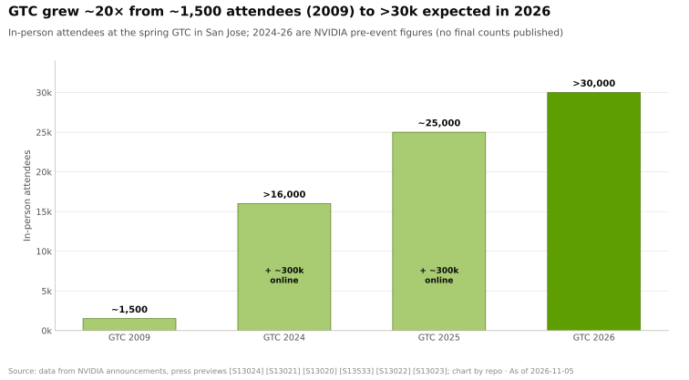
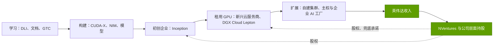

# 开发者生态与 Inception

> [!NOTE]
> 本页为英文原文的简体中文参考译文，仅供参考；如有出入，以[英文原文](../../../layers/13-ecosystem-gtm-and-capital/developer-ecosystem-and-inception.md "English original")为准。

第 13 层 · 生态、市场进入与资本 · 约 8 分钟阅读 · 最近核实：2026-11-05

## ⚡ 要点速览

- **[CUDA](../../glossary.md#cuda) 开发者数量增至三倍，随后标题数字不再变化。** 英伟达 2020 年统计的注册开发者为 2M，GTC 2025 时为 ~6M，GTC 2026 时引用的仍是 ~6M [[S529]](../../../sources/bibliography.md#s529)[[S536]](../../../sources/bibliography.md#s536)[[S528]](../../../sources/bibliography.md#s528)。
- **[GTC](../../glossary.md#gtc) 已成为行业展会。** 参会人数从首届 GTC（2009 年）的 ~1,500 人 [[S13024]](../../../sources/bibliography.md#s13024)，增至 2025 年的 ~25,000 人现场加 ~300,000 人线上 [[S13020]](../../../sources/bibliography.md#s13020)，2026 年预计 >30,000 人、来自 >190 个国家和地区 [[S13533]](../../../sources/bibliography.md#s13533)，议程超过 500 场 [[S13023]](../../../sources/bibliography.md#s13023)。
- **培训是引流渠道，而非一门生意。** [深度学习学院（Deep Learning Institute）](../../glossary.md#deep-learning-institute)在 2017 年提出培训 100,000 名开发者的目标 [[S13031]](../../../sources/bibliography.md#s13031)，到 ~2020 年已培训 >200,000 人，并拥有 >550 名认证讲师 [[S13032]](../../../sources/bibliography.md#s13032)。
- **Inception 免费且覆盖面广：**2017 年 2,000 家初创企业 [[S13027]](../../../sources/bibliography.md#s13027)，2021 年 8,500 家、累计融资 >$60B [[S13026]](../../../sources/bibliography.md#s13026)，到 2022 年 ~10,000 家 [[S531]](../../../sources/bibliography.md#s531)；二手资料称 2025 年已 >22,000 家 [[S13536]](../../../sources/bibliography.md#s13536)。
- **NVentures 是股权投资臂膀，且明显提速：**2025 年 ~30 笔交易，而 2022 年仅 1 笔；英伟达整体在 2025 年参与了 ~67 轮风险投资，2024 年为 54 轮（PitchBook 数据，经媒体转引）🟡 [[S13029]](../../../sources/bibliography.md#s13029)。
- **看空情景：**[PyTorch](../../glossary.md#pytorch)、[Triton](../../glossary.md#triton) 和 Mojo 等框架将 CUDA 抽象掉。高通于 2026 年 7 月完成对 Modular 约 ~$3.9B 的全股票收购，以掌控这样一套技术栈 [[S9511]](../../../sources/bibliography.md#s9511)[[S90057]](../../../sources/bibliography.md#s90057)。

## 开发者飞轮如何运转

不妨把 CUDA 看作一个“顺带卖硬件”的操作系统。开发者不向英伟达付费；他们学习免费工具，编写默认运行在英伟达 GPU 上的代码，而他们的雇主购买或租用 GPU。[开发者关系（developer relations）](../../glossary.md#developer-relations)正是让这一习惯持续养成的机制：免费的 SDK 和 [CUDA-X](../../glossary.md#cuda-x) 软件库、NVIDIA 开发者计划（NVIDIA Developer Program）、DLI 课程以及 GTC。每一个为 CUDA 编写的模型、内核和教程，都会抬高下一位买方的转换成本（参见[第 09 层](../09-cuda-and-system-software/index.md)和[飞轮章节](../../01-the-nvidia-flywheel.md)）。

> [!TIP]
> **算例 —— 英伟达在每位开发者身上的投入与回报。** FY2026 研发支出为 $18.5B [[S401]](../../../sources/bibliography.md#s401)。摊到 ~6M 注册开发者 [[S528]](../../../sources/bibliography.md#s528) 身上，即**每位开发者每年 ~$3,100 研发投入**。数据中心收入为 $193.7B [[S1]](../../../sources/bibliography.md#s1)，即**每位开发者 ~$32,000**。开发者是由买方买单的成本中心：人均收入与研发投入 10:1 的比例，只有在这些开发者持续选择 CUDA 时才能成立。

**[Q3 · 代际进步]** 漏斗顶部持续扩大，但开发者数量没有同步增长。从 2024 年年中到 2026 年年初，GTC 现场参会人数从 >16,000 人增至预计 >30,000 人（+~90%）[[S13021]](../../../sources/bibliography.md#s13021)[[S13533]](../../../sources/bibliography.md#s13533)，而注册开发者仅从 5.0M 增至 ~6.0M（+20%）[[S534]](../../../sources/bibliography.md#s534)[[S528]](../../../sources/bibliography.md#s528)。GTC 的受众正从程序员转向买方、合作伙伴和投资者。

🔧 技术细节：“600 万”为何停滞

- 该数字统计的是英伟达开发者计划的注册数，并在主题演讲中取整。大多数 PyTorch 用户从不注册，因此这个数字衡量的是核心忠实用户，而非实际使用量。
- 2020 年英伟达统计到每月 438,000 次 CUDA 下载，对应 ~39,000 个新注册 [[S529]](../../../sources/bibliography.md#s529)，约每十一次下载产生一个注册。
- 数字持平既可能意味着专业人才池已经饱和，也可能意味着开发者转向了隐藏 CUDA 的更高层工具。两种解读在 [CUDA 章节](../09-cuda-and-system-software/index.md)中均有讨论。

## GTC 作为平台

GTC 起初是一个 GPU 计算会议，如今已成为英伟达的年度路线图发布会、合作伙伴发布窗口和销售场所。春季主题演讲设定了供应链据以排产的节奏。GTC 2026 推出了 Vera Rubin [NVL72](../../glossary.md#nvl72)、Groq 3 LPX 机架和 Kyber 路线图 [[S90003]](../../../sources/bibliography.md#s90003)，发布了 [Dynamo](../../glossary.md#dynamo) 1.0，并点名 CoreWeave、Perplexity 和 PayPal 等采用者 [[S90066]](../../../sources/bibliography.md#s90066)，还把英伟达对截至 2027 年需求的表述从 $500B 上调到 $1 trillion [[S90001]](../../../sources/bibliography.md#s90001)。合作伙伴围绕主题演讲安排发布；区域性活动延展了这一形式，GTC DC 将于 2026 年 11 月 30 日至 12 月 3 日举行，晚于本资料库的截止日期 [[S90047]](../../../sources/bibliography.md#s90047)。

> [!TIP]
> **算例 —— 一场主题演讲，一个需求数字。** 在 GTC 2026 上，黄仁勋把 Blackwell 加 Vera Rubin 截至 2027 年的需求定为 $1 trillion，是一个月前所引用的“截至 2026 年 $500B”的两倍 [[S90001]](../../../sources/bibliography.md#s90001)[[S90002]](../../../sources/bibliography.md#s90002)。英伟达 FY2026 收入为 $215.9B [[S1]](../../../sources/bibliography.md#s1)。即使按较低的 $500B 计算，这场主题演讲也把**约 ~2.3 年的 FY2026 收入**描述为可见需求。这正是投资者、供应商和竞争对手都会出席的原因。各媒体对其指的是订单还是市场机会说法不一 🟡。

## Inception 与 NVentures：两种不同的工具

[NVIDIA Inception](../../glossary.md#nvidia-inception) 是面向初创企业的免费会员计划。[NVentures](../../glossary.md#nventures) 则是英伟达的[企业风险投资（corporate venture capital）](../../glossary.md#corporate-venture-capital)部门，负责股权投资。规模更大的战略性持股（如 OpenAI 或英特尔）则记在英伟达自身的资产负债表上（见[资本部署](capital-deployment.md)）。

| | NVIDIA Inception | NVentures | 公司层面的战略性持股 |
|---|---|---|---|
| 提供什么 | 技术支持、DLI 培训、合作伙伴与投资者对接；免费加入 [[S13536]](../../../sources/bibliography.md#s13536) | 风险投资轮次中的少数股权 | 大额股权、兜底承诺、授权 |
| 规模 | ~10,000 家会员（2022 年）[[S531]](../../../sources/bibliography.md#s531)；2025 年据称 >22,000 家 🟡 [[S13536]](../../../sources/bibliography.md#s13536) | 2025 年 ~30 笔交易，2022 年为 1 笔 🟡 [[S13029]](../../../sources/bibliography.md#s13029) | 持有股权 ~$99B（2026 年 7 月）[[S90073]](../../../sources/bibliography.md#s90073) |
| 英伟达获得什么 | 早期设计导入（design-in），以及未来 GPU 租用者的来源 | 信息权与生态影响力 | 来自实验室、云厂商和供应商的锚定需求 |

> [!TIP]
> **算例 —— 以 GPU 小时衡量 Inception 的价值。** 2021 年 Inception 的 8,500 家会员累计融资 >$60B [[S13026]](../../../sources/bibliography.md#s13026)，平均每家 ~$7M。假设一家典型初创企业把四分之一的资金用于算力 🔴，即 ~$1.8M。按 Lambda 每 H100 小时 ~$2.99 的标价 [[S395]](../../../sources/bibliography.md#s395)，可购买 **~590,000 GPU 小时，约 ~67 GPU 年**，且几乎全部在英伟达平台上。英伟达在该计划上投入甚少；硬件费用由会员背后的投资者买单。

## 生态如何转化为需求

漏斗的终点是“先租后买”。DGX Cloud Lepton 将开发者引导至合作伙伴的 GPU 云，而不是由英伟达与其正面竞争 [[S90068]](../../../sources/bibliography.md#s90068)。英伟达持有其中许多云厂商的股权：CoreWeave、Lambda、Nebius、Crusoe、Together AI 和 Nscale [[S481]](../../../sources/bibliography.md#s481)。

> [!TIP]
> **算例 —— CoreWeave：一个已完成转化的生态成员。** 英伟达对 CoreWeave 的敞口合计 ~$8.65B：IPO 前 ~$0.1B 🟡、$0.25B 的 IPO 锚定认购 🟡、2026 年 1 月 $2B 股权投资，以及 $6.3B 的算力兜底承诺 [[S481]](../../../sources/bibliography.md#s481)[[S473]](../../../sources/bibliography.md#s473)[[S472]](../../../sources/bibliography.md#s472)[[S90067]](../../../sources/bibliography.md#s90067)。CoreWeave 的目标是到 2030 年 >5 GW [[S472]](../../../sources/bibliography.md#s472)。按每 100,000 颗 GB300 GPU 约 ~232 MW 计算（见[主权 AI](sovereign-ai.md)），5 GW 即 **~2.2M 颗 GPU，按每颗 GPU ~$55,000 计约 $120B 的机架** [[S332]](../../../sources/bibliography.md#s332)。🔴 本资料库测算。

## 🎯 企业发展视角

1. **当 CUDA 被隐藏时，谁拥有开发者？** 如果 PyTorch、Triton 或 Mojo 成为交互界面，掌控编译器层的一方将攫取开发者习惯。高通收购 Modular [[S9511]](../../../sources/bibliography.md#s9511) 是这一方向上一次公开下注。可移植技术栈能以多快速度在初创企业计划中成为“默认选项”？
2. **初创企业计划是成本低廉的期权。** 云额度在各厂商之间十分常见（见[竞争格局](competition.md)）。英伟达的优势在于会员的硬件选择早已确定。竞争对手需要提供什么，初创企业才会为第二种架构进行设计？
3. **GTC 是一种协调机制。** 供应商、OEM 和云厂商都围绕它对齐发布日程。是否存在一个中立论坛（OCP、MLCommons、[UALink](../../glossary.md#ualink) 活动），让挑战者联盟能够同样高调地协同？

## 📚 来源（Sources）

<!-- Auto-generated from the [S…] citations on this page by `make build`. Edit sources/registry/*.csv, not this list. -->

- [**S1**](../../../sources/bibliography.md#s1) NVIDIA Corporation via SEC EDGAR, *NVIDIA Announces Financial Results for Fourth Quarter and Fiscal 2026 (Form 8-K exhibit 99.1)*, 2026-02-25. [Link](https://www.sec.gov/Archives/edgar/data/1045810/000104581026000019/q4fy26pr.htm)
- [**S332**](../../../sources/bibliography.md#s332) Tiger Brokers (iTiger), *Morgan Stanley's BOM analysis of NVIDIA's Rubin: GPU share declines; PCB, MLCC and ABF substrate values soar*, 2026-05-20. [Link](https://www.itiger.com/news/1188068712)
- [**S395**](../../../sources/bibliography.md#s395) Lambda, *Lambda GPU cloud pricing*, 2025. [Link](https://lambda.ai/pricing)
- [**S401**](../../../sources/bibliography.md#s401) NVIDIA Corporation via SEC EDGAR, *NVIDIA Corporation Form 10-K for fiscal year ended January 25, 2026*, 2026-02-25. [Link](https://www.sec.gov/Archives/edgar/data/1045810/000104581026000021/nvda-20260125.htm)
- [**S472**](../../../sources/bibliography.md#s472) CoreWeave Newsroom, *CoreWeave and NVIDIA expand partnership; NVIDIA invests $2B in CoreWeave Class A stock*, 2026-01-26. [Link](https://www.coreweave.com/news)
- [**S473**](../../../sources/bibliography.md#s473) U.S. Securities and Exchange Commission (EDGAR), *CoreWeave Inc. Form 8-K / S-1 filings (EDGAR index): NVIDIA capacity agreement and IPO participation*, 2025-09-15. [Link](https://www.sec.gov/cgi-bin/browse-edgar?action=getcompany&CIK=0001769628&type=8-K&dateb=&owner=include&count=40)
- [**S481**](../../../sources/bibliography.md#s481) Various (company announcements; Reuters, Bloomberg, TechCrunch), *Reporting on NVIDIA participation in AI-lab and neocloud funding rounds 2023–2025 (Inflection, Cohere, Hugging Face, Databricks, Mistral, xAI, Perplexity, Crusoe, Lambda, Nebius, Nscale, Together AI, Poolside, Reflection AI, Thinking Machines, Cursor)*, 2025-11. [Link](https://techcrunch.com/)
- [**S528**](../../../sources/bibliography.md#s528) NVIDIA Developer Forums, *20 Years of CUDA: Honoring the Architects of the Accelerated Age*, 2026-03. [Link](https://forums.developer.nvidia.com/t/20-years-of-cuda-honoring-the-architects-of-the-accelerated-age/364654)
- [**S529**](../../../sources/bibliography.md#s529) NVIDIA Blog (Will Ramey), *2 Million Registered Developers, Countless Breakthroughs*, 2020. [Link](https://blogs.nvidia.com/blog/2-million-registered-developers-breakthroughs/)
- [**S531**](../../../sources/bibliography.md#s531) TechRadar, *Nvidia GTC 2022 keynote: all the latest news, releases and more (live blog)*, 2022-03-22. [Link](https://www.techradar.com/news/live/nvidia-gtc-2022-keynote-all-the-latest-news-and-annoucnements)
- [**S534**](../../../sources/bibliography.md#s534) Yahoo Finance, *An era of robotics, 'AI factories' powered by Nvidia's chips and software is 'in our near future', CEO Jensen Huang says*, 2024-06-02. [Link](https://sg.finance.yahoo.com/news/era-robotics-ai-factories-powered-093000078.html)
- [**S536**](../../../sources/bibliography.md#s536) TechRadar, *Nvidia GTC 2025 — all the news and updates from Jensen Huang's keynote (live blog)*, 2025-03-18. [Link](https://www.techradar.com/pro/live/nvidia-gtc-2025-all-the-news-and-updates-from-jensen-huang-keynote-as-it-happens)
- [**S9511**](../../../sources/bibliography.md#s9511) Nasdaq (Qualcomm press release), *Qualcomm Completes Acquisition of Modular*, 2026-07-29. [Link](https://www.nasdaq.com/press-release/qualcomm-completes-acquisition-modular-2026-07-29)
- [**S13020**](../../../sources/bibliography.md#s13020) Quiver Quantitative (NVIDIA press release), *NVIDIA Announces GTC 2025: Premier AI Conference Set for March 17-21 in San Jose*, 2025-01. [Link](https://www.quiverquant.com/news/NVIDIA+Announces+GTC+2025%3A+Premier+AI+Conference+Set+for+March+17-21+in+San+Jose)
- [**S13021**](../../../sources/bibliography.md#s13021) GamesBeat, *NVIDIA GTC 2024 preview: AI marches forward (Greg Estes interview)*, 2024-03. [Link](https://gamesbeat.com/nvidia-gtc-2024-preview-ai-marches-forward-greg-estes)
- [**S13023**](../../../sources/bibliography.md#s13023) NVIDIA, *GTC 2026 Schedule at a Glance*, 2026. [Link](https://www.nvidia.com/gtc/conference-schedule/)
- [**S13024**](../../../sources/bibliography.md#s13024) Wikipedia, *Nvidia GTC*, 2026. [Link](https://en.wikipedia.org/wiki/Nvidia_GTC)
- [**S13026**](../../../sources/bibliography.md#s13026) AI Business, *Nvidia's Inception program now boasts 8,500 AI startup members*, 2021-08. [Link](https://aibusiness.com/verticals/nvidia-s-inception-program-now-boasts-8-500-ai-startup-members)
- [**S13027**](../../../sources/bibliography.md#s13027) MarketScreener (NVIDIA press release), *NVIDIA Inception Program for AI Startups Adds 2,000th Member*, 2017. [Link](https://in.marketscreener.com/quote/stock/NVIDIA-CORPORATION-10282/news/NVIDIA-Inception-Program-for-AI-Startups-Adds-2-000th-Member-25305924/)
- [**S13029**](../../../sources/bibliography.md#s13029) TechCrunch, *Nvidia's AI empire: a look at its top startup investments*, 2026-01-02. [Link](https://techcrunch.com/2026/01/02/nvidias-ai-empire-a-look-at-its-top-startup-investments/)
- [**S13031**](../../../sources/bibliography.md#s13031) NVIDIA Newsroom, *NVIDIA to Train 100,000 Developers on Deep Learning in 2017*, 2017-05. [Link](https://nvidianews.nvidia.com/news/nvidia-to-train-100-000-developers-on-deep-learning-in-2017)
- [**S13032**](../../../sources/bibliography.md#s13032) NVIDIA Blog, *NVIDIA Deep Learning Institute Instructor-Led Training Now Available Remotely*, 2020-05-06. [Link](https://blogs.nvidia.com/blog/2020/05/06/dli-instructor-led-training-available-remotely)
- [**S13533**](../../../sources/bibliography.md#s13533) ResearchPool (NVIDIA press release), *NVIDIA CEO Jensen Huang and global technology leaders to showcase age of AI at GTC 2026 (press release summary)*, 2026-02. [Link](https://app.researchpool.com/company/nvda-us67066g1040-nvidia-corp-e9VqYYGjs8/press/nvidia-corporation-nvda-nvidia-ceo-jensen-huang-and-global-technology-leaders-to-showcase-age-s9kKOjK0qb)
- [**S13536**](../../../sources/bibliography.md#s13536) Techsoma, *Nvidia's free startup program just unlocked AI success for 22,000 companies*, 2025. [Link](https://techsoma.africa/nvidias-free-startup-program-just-unlocked-ai-success-for-22000-companies-heres-how-to-join/)
- [**S90001**](../../../sources/bibliography.md#s90001) The Star (Reuters), *Nvidia bets on AI inference as chip revenue opportunity hits $1 trillion (Reuters)*, 2026-03-17. [Link](https://www.thestar.com.my/tech/tech-news/2026/03/17/nvidia-bets-on-ai-inference-as-chip-revenue-opportunity-hits-1-trillion)
- [**S90002**](../../../sources/bibliography.md#s90002) MarketScreener, *Nvidia forecasts $1 trillion in orders for its AI systems by 2027*, 2026-03-16. [Link](https://www.marketscreener.com/news/nvidia-forecasts-1-trillion-in-orders-for-its-ai-systems-by-2027-ce7e5edad08eff27)
- [**S90003**](../../../sources/bibliography.md#s90003) eWeek, *Everything Nvidia Just Announced at GTC 2026: 7 Chips, 5 Racks, 1 Giant Bet on Agentic AI*, 2026-03-17. [Link](https://www.eweek.com/news/nvidia-gtc-2026-ai-inference-vera-rubin-neuron/)
- [**S90047**](../../../sources/bibliography.md#s90047) NVIDIA, *NVIDIA GTC DC 2026 (November 30 – December 3, 2026)*, 2026. [Link](https://www.nvidia.com/en-us/gtc-dc/topics/ai-policy/)
- [**S90057**](../../../sources/bibliography.md#s90057) StorageReview, *Qualcomm unveils Dragonfly data center roadmap: C1000 CPU, AI300 accelerator and Modular acquisition*, 2026-06-24. [Link](https://www.storagereview.com/es/news/qualcomm-unveils-dragonfly-data-center-roadmap-c1000-cpu-ai300-accelerator-and-modular-acquisition)
- [**S90066**](../../../sources/bibliography.md#s90066) HPCwire (NVIDIA press release), *NVIDIA enters production with Dynamo, the broadly adopted inference operating system for AI factories*, 2026-03-17. [Link](https://www.hpcwire.com/aiwire/tag/dynamo-1-0/)
- [**S90067**](../../../sources/bibliography.md#s90067) DatacenterDynamics, *Nvidia to purchase unsold compute capacity from CoreWeave for $6.3bn*, 2025-09-16. [Link](https://www.datacenterdynamics.com/en/news/nvidia-to-purchase-unsold-compute-capacity-from-coreweave-for-63bn/)
- [**S90068**](../../../sources/bibliography.md#s90068) Tom's Hardware, *Nvidia steps back from DGX Cloud — stops trying to compete with AWS and Azure*, 2025-09. [Link](https://www.tomshardware.com/tech-industry/nvidia-steps-back-from-dgx-cloud)
- [**S90073**](../../../sources/bibliography.md#s90073) FourWeekMBA, *NVIDIA's $99 billion investment portfolio and the circular financing loop at the center of AI*, 2026-08. [Link](https://fourweekmba.com/ai-nvidia-99-billion-investment-portfolio-circular-financing-ai/)
