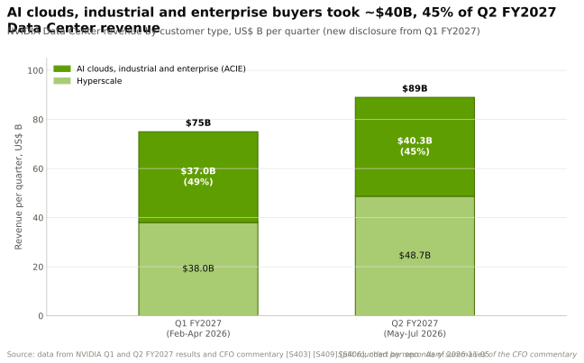
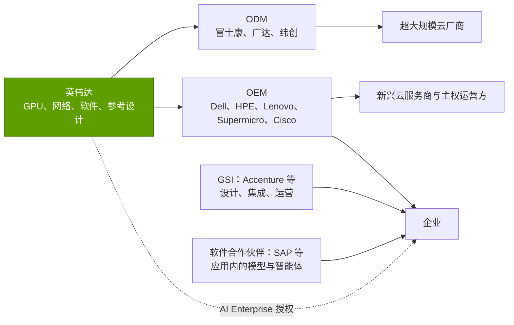

# 企业市场进入：OEM、GSI 与软件合作伙伴

> [!NOTE]
> 本页为英文原文的简体中文参考译文，仅供参考；如有出入，以[英文原文](../../../layers/13-ecosystem-gtm-and-capital/enterprise-gtm-oems-gsis.md "English original")为准。

第 13 层 · 生态、市场进入与资本 · 约 7 分钟阅读 · 最近核实：2026-11-05

## ⚡ 要点速览

- **英伟达通过少数几家大型渠道商销售。** 其直接客户主要是为他人构建系统的 [OEM](../../glossary.md#oem) 和 [ODM](../../glossary.md#odm)。其中三家合计占 H1 FY2027 收入的 44%，一家占 Q2 FY2027 收入的 16% [[S90069]](../../../sources/bibliography.md#s90069)。
- **非超大规模需求已接近数据中心收入的一半。** AI 云、工业与企业买方在 Q1 FY2027 约为 ~$37B（49%），在 Q2 FY2027 约为 ~$40.3B（45%）[[S403]](../../../sources/bibliography.md#s403)[[S406]](../../../sources/bibliography.md#s406)。
- **面向企业的方案是一套打包的“AI 工厂”。** [RTX PRO 服务器](../../glossary.md#rtx-pro-server)由思科（Cisco）、戴尔（Dell）、HPE、联想（Lenovo）和 Supermicro 供货 [[S13034]](../../../sources/bibliography.md#s13034)。一套经验证的设计将其与 [Spectrum-X](../../glossary.md#spectrum-x) 网络、[BlueField](../../glossary.md#bluefield) DPU、认证存储以及 [NVIDIA AI Enterprise](../../glossary.md#nvidia-ai-enterprise) 软件捆绑在一起 [[S13033]](../../../sources/bibliography.md#s13033)[[S13034]](../../../sources/bibliography.md#s13034)。
- **集成商提供人力。** 埃森哲（Accenture）成立了英伟达业务事业部，计划让 ~30,000 名专业人员接受英伟达技术栈培训 [[S13042]](../../../sources/bibliography.md#s13042)。
- **软件规模小，但按 GPU 定价。** AI Enterprise 标价为每 GPU 每年 $4,500，或在云上每 [GPU 小时（GPU-hour）](../../glossary.md#gpu-hour) $1 [[S13036]](../../../sources/bibliography.md#s13036)。软件与服务在 Q4 FY2024 的年化收入已超过 ~$1B [[S13037]](../../../sources/bibliography.md#s13037)。
- **杠杆效应：**英伟达以 ~$4.6B 的销售、一般及管理费用（SG&A）支撑了 FY2026 约 ~$216B 的收入，约占销售额的 2%（估计）[[S401]](../../../sources/bibliography.md#s401)[[S1]](../../../sources/bibliography.md#s1)。大部分销售成本由[渠道合作伙伴](../../glossary.md#channel-partner)承担。

## 渠道：究竟是谁在向英伟达采购

英伟达很少把成品服务器直接交付给终端用户。富士康、广达和纬创等 ODM 为[超大规模云厂商](../../glossary.md#hyperscaler)组装机架；品牌 OEM（戴尔、HPE、联想、Supermicro、思科）凭借自身的服务和融资能力向企业、政府和[新兴云服务商（neocloud）](../../glossary.md#neocloud)销售；[全球系统集成商（GSI）](../../glossary.md#gsi)负责项目实施；软件厂商则将英伟达模型嵌入其产品中。在 10-Q 中，这些体现为少数几家大型[直接客户](../../glossary.md#indirect-customer)，而英伟达会另行估算其背后的云厂商和实验室 [[S90069]](../../../sources/bibliography.md#s90069)。

> [!TIP]
> **算例 —— 单一合作伙伴承载了多少。** 一家直接客户占 Q2 FY2027 收入的 16% [[S90069]](../../../sources/bibliography.md#s90069)。以 $96.2B [[S405]](../../../sources/bibliography.md#s405) 计算，即**单季度约 ~$15.4B** 流经一家组装商。在 H1 FY2027，三家直接客户的占比分别为 16%、15% 和 13% [[S90069]](../../../sources/bibliography.md#s90069)。英伟达 FY2026 全部 SG&A 支出约 ~$4.6B（估计）[[S401]](../../../sources/bibliography.md#s401)。正是依靠渠道，一家经营利润率约 60% [[S1]](../../../sources/bibliography.md#s1) 的公司才得以无需组建庞大的直销团队。

**[Q2 · 关键指标]** 对于企业渠道，应跟踪 ACIE 占数据中心收入的比重（Q2 FY2027 为 45%）[[S406]](../../../sources/bibliography.md#s406)、拥有英伟达认证设计的 OEM 和集成商数量，以及软件附着率（已授权 GPU ÷ 已部署 GPU）。

## “为每家企业打造 AI 工厂”的推介

大多数企业无法容纳 132 kW 液冷的 GB300 [NVL72](../../glossary.md#nvl72) 机架 [[S337]](../../../sources/bibliography.md#s337)。英伟达的答案（2025 年 5 月 Computex）是 RTX PRO 服务器：搭载 RTX PRO 6000 Blackwell Server Edition GPU、可放入普通机房的 [x86](../../glossary.md#x86) 服务器 [[S13033]](../../../sources/bibliography.md#s13033)。2025 年 8 月，思科、戴尔、HPE、联想和 Supermicro 推出了 2U、双 GPU 版本 [[S13035]](../../../sources/bibliography.md#s13035)。*Enterprise AI Factory* 验证设计规定了完整的物料清单：服务器、Spectrum-X 以太网、BlueField DPU、认证存储和 AI Enterprise 软件。Cadence、富士康和礼来（Lilly）被列为早期采用者 [[S13034]](../../../sources/bibliography.md#s13034)。德国电信在慕尼黑的工业 AI 云混合采用 DGX B200 和 RTX PRO 服务器，由 SAP 提供软件栈 [[S13013]](../../../sources/bibliography.md#s13013)[[S13014]](../../../sources/bibliography.md#s13014)。

> [!TIP]
> **算例 —— 软件附着率仍然很低。** 按每 GPU 每年 $4,500 的标价 [[S13036]](../../../sources/bibliography.md#s13036) 计算，若 2024 年初 ~$1B 的软件与服务年化收入 [[S13037]](../../../sources/bibliography.md#s13037) 全部来自按标价计的 AI Enterprise，相当于 **~220,000 个 GPU 授权**。这仅是 2023 年以来出货的数百万颗数据中心 GPU 中的一小部分。黄仁勋后来提到的运行英伟达智能体软件每 GPU 每年 ~$2,000 并非正式价目 🟡 [[S13038]](../../../sources/bibliography.md#s13038)。按此价格，每一百万颗授权 GPU 将带来**每年 ~$2B** 的经常性收入 🔴。

🔧 技术细节：Enterprise AI Factory 验证设计包含什么

- **计算：**来自上述五家 OEM 以及研华（Advantech）、华硕（ASUS）等厂商的多种配置 RTX PRO 服务器 [[S13034]](../../../sources/bibliography.md#s13034)。
- **网络与 [DPU](../../glossary.md#dpu)：**Spectrum-X 以太网与 BlueField DPU（见[第 06 层](../06-scale-out-scale-across-networking/index.md)和[第 07 层](../07-dpu-supernic-storage-security/index.md)）。
- **存储：**经英伟达认证的存储合作伙伴。
- **软件：**AI Enterprise，包含英伟达的 [NIM](../../glossary.md#nim) 推理微服务和框架，按 GPU 授权 [[S13036]](../../../sources/bibliography.md#s13036)。
- **为何重要：**[参考架构（reference architecture）](../../glossary.md#reference-architecture)让 OEM 无需英伟达工程师到场，即可报价一套完整且有支持保障的系统。

## GSI 与软件合作伙伴：借来的销售团队

| 渠道角色 | 示例（公开信息） | 合作伙伴获得什么 | 英伟达获得什么 |
|---|---|---|---|
| OEM | Dell、HPE、Lenovo、Supermicro、Cisco [[S13034]](../../../sources/bibliography.md#s13034) | 硬件利润、服务、融资 | 企业市场覆盖与支持能力 |
| ODM | 富士康、广达、纬创 | 出货量；ODM 利润约占 GB300 机架的 ~2.7%（估计）[[S332]](../../../sources/bibliography.md#s332) | 快速的机架级制造能力 |
| GSI | 埃森哲（~30,000 名受训员工）[[S13042]](../../../sources/bibliography.md#s13042) | 咨询与托管服务收入 | 项目设计、变革管理、带动销售 |
| 软件合作伙伴 | 德国电信云中的 SAP [[S13014]](../../../sources/bibliography.md#s13014) | 现有应用中的 AI 功能 | 企业工作流中的推理需求 |
| 电信运营商 / 新兴云服务商 | 德国电信、Nscale、Yotta [[S13014]](../../../sources/bibliography.md#s13014)[[S13010]](../../../sources/bibliography.md#s13010)[[S13017]](../../../sources/bibliography.md#s13017) | 主权或区域云收入 | 贴近受监管客户的算力 |

德勤（Deloitte）、Infosys 和 TCS 也在推广英伟达业务线，ServiceNow 和 Salesforce 已宣布基于英伟达的智能体功能；本文未重新核实其规模。

> [!TIP]
> **算例 —— 一个集成商业务线价值几何。** 埃森哲在宣布成立英伟达业务事业部的那个财年，报告了约 ~$3B 的生成式 AI 新签订单 [[S13042]](../../../sources/bibliography.md#s13042)。摊到该事业部目标的 ~30,000 名专业人员身上，即**每名受训人员约 ~$100,000 的新签订单**。英伟达不为这些人员支付任何薪酬，却获得了指定其硬件的项目 🔴。

> [!WARNING]
> **🐻 看空观点：**以合作伙伴为主导的渠道，意味着客户归合作伙伴所有。OEM 同样销售 AMD Helios 机架 [[S90020]](../../../sources/bibliography.md#s90020)，集成商则跟随客户需求；因此，一旦企业推理转向更便宜、可移植的硬件，渠道可以迅速转向。

## 🎯 企业发展视角

1. **在企业市场，OEM 是关键的摇摆票。** 戴尔、HPE、联想、Supermicro 和思科决定标准报价中出现哪些加速器。挑战者的推理卡要进入同一产品目录，在验证设计和支持方面需要具备什么条件？
2. **集成商产能稀缺。** 仅埃森哲一家就为英伟达技术栈投入了 ~30,000 人 [[S13042]](../../../sources/bibliography.md#s13042)。与其在最大的集成商处争夺关注，联合出资在一家中型集成商建立专属业务线是否更有价值？
3. **按 GPU 计价的软件定价提供了模板。** 每 GPU 每年 $4,500 的 AI Enterprise [[S13036]](../../../sources/bibliography.md#s13036) 表明企业愿意为有支持保障的软件付费。高通的 Modular [[S9511]](../../../sources/bibliography.md#s9511) 这类可移植技术栈，能否以同样方式跨硬件定价？

## 📚 来源（Sources）

<!-- Auto-generated from the [S…] citations on this page by `make build`. Edit sources/registry/*.csv, not this list. -->

- [**S1**](../../../sources/bibliography.md#s1) NVIDIA Corporation via SEC EDGAR, *NVIDIA Announces Financial Results for Fourth Quarter and Fiscal 2026 (Form 8-K exhibit 99.1)*, 2026-02-25. [Link](https://www.sec.gov/Archives/edgar/data/1045810/000104581026000019/q4fy26pr.htm)
- [**S332**](../../../sources/bibliography.md#s332) Tiger Brokers (iTiger), *Morgan Stanley's BOM analysis of NVIDIA's Rubin: GPU share declines; PCB, MLCC and ABF substrate values soar*, 2026-05-20. [Link](https://www.itiger.com/news/1188068712)
- [**S337**](../../../sources/bibliography.md#s337) Spheron, *NVIDIA GB300 (rental and specifications)*, 2026. [Link](https://spheron.network/gpu-rental/gb300/)
- [**S401**](../../../sources/bibliography.md#s401) NVIDIA Corporation via SEC EDGAR, *NVIDIA Corporation Form 10-K for fiscal year ended January 25, 2026*, 2026-02-25. [Link](https://www.sec.gov/Archives/edgar/data/1045810/000104581026000021/nvda-20260125.htm)
- [**S403**](../../../sources/bibliography.md#s403) NVIDIA Corporation via SEC EDGAR, *NVIDIA Announces Financial Results for First Quarter Fiscal 2027 (Form 8-K exhibit 99.1)*, 2026-05-20. [Link](https://www.sec.gov/Archives/edgar/data/0001045810/000104581026000051/q1fy27pr.htm)
- [**S405**](../../../sources/bibliography.md#s405) NVIDIA Corporation via SEC EDGAR, *NVIDIA Announces Financial Results for Second Quarter Fiscal 2027 (Form 8-K exhibit 99.1)*, 2026-08-26. [Link](https://www.sec.gov/Archives/edgar/data/0001045810/000104581026000073/q2fy27pr.htm)
- [**S406**](../../../sources/bibliography.md#s406) NVIDIA Corporation (Colette Kress), *CFO Commentary on Second Quarter Fiscal 2027 Results*, 2026-08-26. [Link](https://s201.q4cdn.com/141608511/files/doc_financials/2027/Q227/Q2FY27-CFO-Commentary.pdf)
- [**S9511**](../../../sources/bibliography.md#s9511) Nasdaq (Qualcomm press release), *Qualcomm Completes Acquisition of Modular*, 2026-07-29. [Link](https://www.nasdaq.com/press-release/qualcomm-completes-acquisition-modular-2026-07-29)
- [**S13010**](../../../sources/bibliography.md#s13010) ITPro, *UK to host largest European GPU cluster under GBP 11 billion Nvidia investment plans*, 2025-09. [Link](https://www.itpro.com/infrastructure/uk-to-host-largest-european-gpu-cluster-under-gbp11-billion-nvidia-investment-plans)
- [**S13013**](../../../sources/bibliography.md#s13013) DatacenterDynamics, *Deutsche Telekom launches NVIDIA-powered AI factory in Munich's Tucherpark*, 2026. [Link](https://www.datacenterdynamics.com/en/news/deutsche-telekom-launches-nvidia-powered-ai-factory-in-munichs-tucherpark/)
- [**S13014**](../../../sources/bibliography.md#s13014) heise online, *Telekom data center with 10,000 Nvidia GPUs being built in Munich*, 2025-11-04. [Link](https://heise.de/-11056781)
- [**S13017**](../../../sources/bibliography.md#s13017) Computer Weekly, *Nvidia backs India's sovereign AI push with gigawatt-scale infrastructure*, 2026-02. [Link](https://www.computerweekly.com/news/366639266/Nvidia-backs-Indias-sovereign-AI-push-with-gigawatt-scale-infrastructure)
- [**S13033**](../../../sources/bibliography.md#s13033) NVIDIA Newsroom, *NVIDIA RTX PRO Servers Speed Trillion-Dollar Enterprise IT Industry Transition to AI Factories*, 2025-05-19. [Link](https://nvidianews.nvidia.com/news/nvidia-rtx-pro-blackwell-servers-speed-trillion-dollar-enterprise-it-industry-transition-to-ai-factories)
- [**S13034**](../../../sources/bibliography.md#s13034) NVIDIA Investor Relations, *Industry Leaders Transform Enterprise Data Centers for the AI Era With NVIDIA RTX PRO Servers*, 2025-08-11. [Link](https://investor.nvidia.com/news/press-release-details/2025/Industry-Leaders-Transform-Enterprise-Data-Centers-for-the-AI-Era-With-NVIDIA-RTX-PRO-Servers/default.aspx)
- [**S13035**](../../../sources/bibliography.md#s13035) Tom's Hardware, *Nvidia unveils 2U RTX Pro 6000 servers at SIGGRAPH*, 2025-08. [Link](https://www.tomshardware.com/pc-components/gpus/nvidia-unveils-2u-rtx-pro-6000-servers-at-siggraph-double-shot-of-blackwell-power-comes-to-smaller-rackmount-form-factors)
- [**S13036**](../../../sources/bibliography.md#s13036) The Register, *Nvidia's software empire (NVIDIA AI Enterprise pricing)*, 2024-08-06. [Link](https://www.theregister.com/2024/08/06/nvidia_software_empire/)
- [**S13037**](../../../sources/bibliography.md#s13037) The Motley Fool, *Here's Nvidia's newest $1 billion business*, 2024-02-28. [Link](https://www.fool.com/investing/2024/02/28/heres-nvidias-newest-1-billion-business-and-ceo-je)
- [**S13038**](../../../sources/bibliography.md#s13038) TechSpot, *Nvidia's AI chips already make billions; now Jensen Huang wants $2000 per GPU in annual software fees*, 2026. [Link](https://www.techspot.com/news/114333-nvidia-ai-chips-already-make-billions-now-jensen.html)
- [**S13042**](../../../sources/bibliography.md#s13042) HPCwire / AIwire, *Accenture and NVIDIA strengthen partnership to accelerate deployment and scaling of AI-driven solutions*, 2024-10-09. [Link](https://www.hpcwire.com/aiwire/2024/10/09/accenture-and-nvidia-strengthen-partnership-to-accelerate-deployment-and-scaling-of-ai-driven-solutions/)
- [**S90020**](../../../sources/bibliography.md#s90020) Shacknews, *AMD Helios AI rack system on track for initial shipments in Q3 2026*, 2026. [Link](https://www.shacknews.com/article/150249/amd-helios-ai-system-shipping-q3-2026)
- [**S90069**](../../../sources/bibliography.md#s90069) NVIDIA Corporation via SEC EDGAR, *NVIDIA Form 10-Q for the quarter ended July 26, 2026 (Q2 FY2027)*, 2026-08. [Link](https://www.sec.gov/Archives/edgar/data/0001045810/000104581026000075/nvda-20260726.htm)
