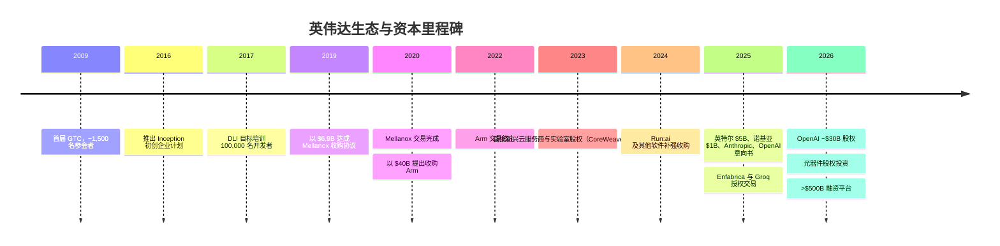
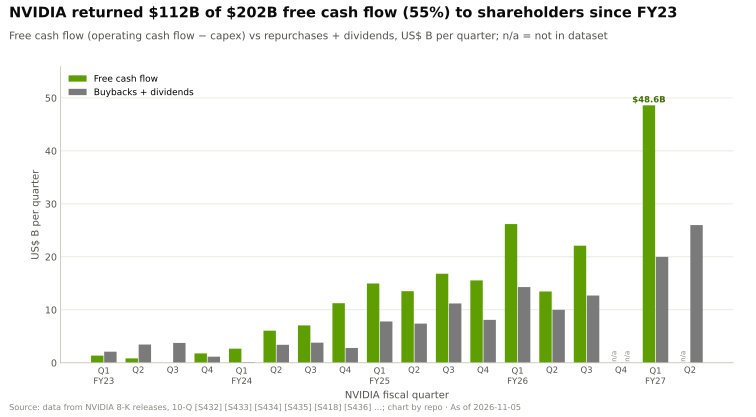

# 生态、市场进入与资本：发展历程与英伟达如何建成

> [!NOTE]
> 本页为英文原文的简体中文参考译文，仅供参考；如有出入，以[英文原文](../../../layers/13-ecosystem-gtm-and-capital/history-and-how-built.md "English original")为准。

第 13 层 · 生态、市场进入与资本 · 约 12 分钟阅读 · 最近核实：2026-11-05

## ⚡ 要点速览

- **四个时代。** 开发者平台（2009 年起的 GTC、2016 年起的 Inception、2017 年提出培训 100,000 名开发者的目标）、平台型并购（Mellanox、失败的 Arm 收购要约）、软件补强收购，以及 2023 年起的股权投资、授权和融资交易浪潮 [[S13024]](../../../sources/bibliography.md#s13024)[[S13027]](../../../sources/bibliography.md#s13027)[[S13031]](../../../sources/bibliography.md#s13031)[[S464]](../../../sources/bibliography.md#s464)[[S465]](../../../sources/bibliography.md#s465)。
- **交易结构发生逆转。** 自 2023 年以来，英伟达已记录的 66 笔交易中只有 18% 是收购；47 笔是对客户、供应商和合作伙伴的股权投资（见下图）。
- **2026 年 8 月，英伟达转向动用他人的资金：**与六家资产管理公司签署谅解备忘录，为其客户撬动 >$500B 的第三方资本 [[S12528]](../../../sources/bibliography.md#s12528)。
- **[Q4 · 优势来源]** 现金流加上生态中心地位：Q1 FY2027 $48.6B 的自由现金流 [[S403]](../../../sources/bibliography.md#s403)、~6M [CUDA](../../../glossary.md#cuda) 开发者，以及 FY2026 > $30B 的主权 AI 收入（见[竞争格局](competition.md)），使英伟达能够同时扮演开发者平台、融资方和主权合作伙伴三重角色，这一组合目前没有任何竞争对手能够匹敌（🔴 本资料库判断）。
- **[Q6 · 复制成本]** 资本层面，[超大规模云厂商](../../../glossary.md#hyperscaler)可在数年内复制；开发者与合作伙伴生态则是一个需要 7–10 年、耗资数百亿美元的工程（🔴 本资料库估计）。

## 时间线：从开发者大会到资本配置者

| 日期 | 决策 | 为何重要 | 来源 |
|---|---|---|---|
| 2009 | 首届 GTC（~1,500 名参会者） | 一场开发者大会演变为产品发布舞台；2026 年预计 30,000+ 人参会 | [[S13024]](../../../sources/bibliography.md#s13024)[[S13533]](../../../sources/bibliography.md#s13533) |
| 2016 | Inception 计划 | 提供免费工具和投资者对接，不出资金；约 ~18 个月内会员达 2,000 家 | [[S13027]](../../../sources/bibliography.md#s13027) |
| 2019-03 | Mellanox，$6.9B 现金 | 成为网络业务（FY2026 收入 >$31B） | [[S464]](../../../sources/bibliography.md#s464)[[S402]](../../../sources/bibliography.md#s402) |
| 2020-09 → 2022-02 | Arm，$40B 收购要约，最终放弃 | 被监管机构阻止；英伟达将 $1.36B 预付款计入费用，并保留一份 20 年授权 | [[S465]](../../../sources/bibliography.md#s465)[[S466]](../../../sources/bibliography.md#s466)[[S418]](../../../sources/bibliography.md#s418) |
| 2023 | 首批新兴云服务商与实验室股权投资 | 在超大规模云厂商之外培育 GPU 买方 | [[S481]](../../../sources/bibliography.md#s481) |
| 2024-04 → 2024-12 | Run:ai，~$700M | 经欧盟审查后才完成交割：补强收购如今也会受到审查 | [[S476]](../../../sources/bibliography.md#s476) |
| 2025-09 | 对 CoreWeave 截至 2032 年的算力[兜底承诺](../../../glossary.md#capacity-backstop) | 最多 $6.3B 的未售出算力风险转由英伟达承担 | [[S90067]](../../../sources/bibliography.md#s90067) |
| 2025-09 → 12 | 英特尔 $5B（~4%） | 一笔合作伙伴股权投资，同时锁定一家美国供应商 | [[S468]](../../../sources/bibliography.md#s468)[[S4009]](../../../sources/bibliography.md#s4009) |
| 2025-09 → 12 | Enfabrica、Groq [授权加收购式招聘](../../../glossary.md#licence-plus-acquihire) | 无需并购申报即可获得团队和知识产权 | [[S475]](../../../sources/bibliography.md#s475)[[S474]](../../../sources/bibliography.md#s474) |
| 2025-09 → 2026-02 | OpenAI：最多 $100B 意向书 → ~$30B 股权 | 从与里程碑挂钩转为普通股权投资 | [[S467]](../../../sources/bibliography.md#s467)[[S90015]](../../../sources/bibliography.md#s90015)[[S13526]](../../../sources/bibliography.md#s13526) |
| 2026-03 | Lumentum 和 Coherent 各 $2B | 股权投资加上激光器产能的采购承诺 | [[S13529]](../../../sources/bibliography.md#s13529) |
| 2026-08 | 融资平台（目标 >$500B） | 将资产负债表风险转移给第三方 | [[S12528]](../../../sources/bibliography.md#s12528) |

🔧 技术细节：股权投资为何始于 2023 年

2023 年之前，英伟达的现金主要用于回购和两次平台型收购要约；在 Mellanox 和 Arm 交易期间（FY2020–FY2022），回购曾暂停 [[S2]](../../../sources/bibliography.md#s2)。ChatGPT 问世后，配额本身成了稀缺品，而对 CoreWeave 这类纯 GPU 云的小额股权投资（2023 年约 ~$100M [[S481]](../../../sources/bibliography.md#s481)），就造就了一个没有自研芯片、快速增长的买方。据 PitchBook 统计，英伟达在 2025 年参与了 ~67 轮风险投资，高于 2024 年的 54 轮 [[S13029]](../../../sources/bibliography.md#s13029)。

> [!TIP]
> **算例 —— Mellanox 的收购价只需几周销售额即可收回。** 英伟达在 2019 年支付了 $6.9B [[S464]](../../../sources/bibliography.md#s464)；FY2026 网络业务收入约 ~$31.4B，仅 Q2 FY2027 一个季度估计就达 $17.5B [[S402]](../../../sources/bibliography.md#s402)[[S408]](../../../sources/bibliography.md#s408)。按 Q2 的年化节奏，收购价约相当于五周的网络业务销售额。

## [Q4 · 优势来源] 现金流加上生态中心地位

**其机制**是一个闭环：开发者基于 CUDA 构建，因此买方指定英伟达；买方支付约 ~75% 的[毛利率](../../../glossary.md#gross-margin) [[S405]](../../../sources/bibliography.md#s405)；这些现金再用于股权投资、兜底承诺和主权合作，进而创造更多 CUDA 买方。竞争对手可以复制其中某一步，却无法以同等规模复制整个闭环。

> [!TIP]
> **算例 —— 一笔 $30B 的股权投资对各家公司意味着什么。** 英伟达对 OpenAI 约 ~$30B 的股权投资，相当于一个季度自由现金流（Q1 FY2027 为 $48.6B）的 62% [[S90015]](../../../sources/bibliography.md#s90015)[[S403]](../../../sources/bibliography.md#s403)。对 AMD 而言，同样一张支票约为其全部 $15.8B 现金的 ~1.9×；对高通而言约为其 $7.7B 现金的 ~3.9× [[S13501]](../../../sources/bibliography.md#s13501)[[S13503]](../../../sources/bibliography.md#s13503)。这正是 AMD 以认股权证向 OpenAI 支付的原因，也是“比肩英伟达的资本”对同业而言并非现实策略的原因（[竞争格局](competition.md)）。

## [Q6 · 复制成本] 时间、资金与人才

| 组成部分 | 英伟达拥有什么 | 复制所需时间 | 资金（🔴 本资料库估计） | 人才 |
|---|---|---|---|---|
| 开发者基础 | ~6M CUDA 开发者，CUDA 已有 20 年历史 [[S528]](../../../sources/bibliography.md#s528) | 7–10 年 | 每年 ~$1–2B | 数千名工程师 |
| 初创企业计划 | Inception，~22,000 家会员（二手估计）[[S13536]](../../../sources/bibliography.md#s13536) | 3–5 年 | 不高；需要云合作伙伴 | 面向风投的团队 |
| 活动与培训 | GTC 30,000+ 名参会者；DLI 到 2020 年已培训 >200,000 人 [[S13533]](../../../sources/bibliography.md#s13533)[[S13032]](../../../sources/bibliography.md#s13032) | 3–5 年 | <$1B | 内容与讲师 |
| 资本组合 | ~$99B 股权持仓（2026 年 7 月）[[S90073]](../../../sources/bibliography.md#s90073) | 若有现金则 1–2 年 | $50–100B 资产负债表 | 小型交易团队 |
| 主权关系 | FY2026 主权收入 >$30B [[S90071]](../../../sources/bibliography.md#s90071) | 3–5 年 | 由合作伙伴融资 | 政策团队与本地合作伙伴 |

**结论。** 超大规模云厂商可以在一到两年内匹配资本（Alphabet、亚马逊和 Meta 最初对 2026 年资本开支的指引约为 ~$505B，之后上调至 ~$558B [[S12518]](../../../sources/bibliography.md#s12518)[[S12519]](../../../sources/bibliography.md#s12519) [[S460]](../../../sources/bibliography.md#s460)[[S461]](../../../sources/bibliography.md#s461)[[S462]](../../../sources/bibliography.md#s462)），但无法保持中立，因为其云业务与其所资助的实验室存在竞争。AMD 以股权替代现金。高通持有 $7.7B 现金且处于净负债状态 [[S13503]](../../../sources/bibliography.md#s13503)，需要合作伙伴提供资本，并借助 Modular 这类可移植层来缩小开发者差距 [[S9511]](../../../sources/bibliography.md#s9511)。总体 🔴 估计：**7–10 年、$50–100B 的可部署资本外加 ~$10–20B 的累计生态投入，以及数千名面向开发者的工程师**；真正的约束条件是开发者基础，而非资金。

> [!TIP]
> **算例 —— 以年为单位的开发者差距。** CUDA 用了 ~20 年才达到 ~6M 开发者 [[S528]](../../../sources/bibliography.md#s528)，平均每年 ~300,000 人。一家竞争对手若从较小的基数出发、以同样的平均速度增加开发者，需要 ~7 年才能达到 2M（🔴 本资料库测算）；资金可以加快活动和云额度的投放，却无法加速习惯的养成。

## 反事实推演：如果英伟达当初没有……

- 🔴 **……失去 Arm？** 英伟达将拥有一套授权给竞争对手 CPU 设计者的指令集，这正是监管机构反对的原因 [[S466]](../../../sources/bibliography.md#s466)。此后它在不拥有 Arm 的情况下已获得了大部分好处：其 Grace 和 Vera CPU 基于 Arm 架构 [[S100]](../../../sources/bibliography.md#s100)，[NVLink Fusion](../../../glossary.md#nvlink-fusion) 如今也可将 Arm Neoverse 设计接入英伟达机架 [[S90036]](../../../sources/bibliography.md#s90036)。若拥有 Arm，则会在当下的资本中立性问题之上，再叠加中立性方面的问题。
- 🔴 **……投资新兴云服务商？** 若没有对 CoreWeave 等公司的股权投资，超大规模云厂商将几乎掌控全部可租用的 GPU 算力，并能将客户引向 TPU、Trainium 和 Maia。区域性[新兴云服务商（neocloud）](../../../glossary.md#neocloud)在 Q2 FY2027 同比增长 >3× [[S90071]](../../../sources/bibliography.md#s90071)；这一买方群体是英伟达对冲自研芯片的屏障（见[第 12 层](../../../layers/12-orchestration-and-cloud-services/value-chain-and-corp-dev.md)）。
- 🔴 **……直接收购 Groq？** 以 $20B 收购一家推理芯片竞争对手，将面临全面的[并购审查](../../../glossary.md#merger-review)；仅 ~$700M 的 Run:ai 交易就耗时八个月，其中包括欧盟审查 [[S476]](../../../sources/bibliography.md#s476)。授权结构在数日内即完成交割，但转而招致了参议员的质询 [[S13511]](../../../sources/bibliography.md#s13511)。

> [!TIP]
> **算例 —— 失败的 Arm 收购要约代价几何。** $40B 的价格中大部分是股票（$21.5B），外加 $12B 现金 [[S465]](../../../sources/bibliography.md#s465)；交易告吹时，英伟达减记了 $1.36B 的预付款 [[S418]](../../../sources/bibliography.md#s418)，不到 FY2026 $215.9B 收入的 1% [[S1]](../../../sources/bibliography.md#s1)。真正的代价是时间：审查耗时 17 个月。

## 🎯 企业发展视角

1. 英伟达的资本优势在于现金流，而非现金存量。对同业而言，哪些资产（主权合作伙伴、云厂商、认股权证）可以替代一个 $48.6B 的季度？
2. 在复制成本估算中，开发者基础是真正的约束条件。收购一个可移植的软件层（如高通收购 Modular）能否缩短 7–10 年的时间，还是只能降低移植成本？
3. 英伟达在十年内两次尝试平台型并购，成功了一次。Arm 交易的终止，对任何考虑大型横向交易的芯片公司有何监管层面的借鉴意义？
4. 对新兴云服务商的股权投资创造了非自用型买方。如今哪些客户群体缺少非自用型融资方，又有谁能扮演这一角色？

## 📚 来源（Sources）

<!-- Auto-generated from the [S…] citations on this page by `make build`. Edit sources/registry/*.csv, not this list. -->

- [**S1**](../../../sources/bibliography.md#s1) NVIDIA Corporation via SEC EDGAR, *NVIDIA Announces Financial Results for Fourth Quarter and Fiscal 2026 (Form 8-K exhibit 99.1)*, 2026-02-25. [Link](https://www.sec.gov/Archives/edgar/data/1045810/000104581026000019/q4fy26pr.htm)
- [**S2**](../../../sources/bibliography.md#s2) U.S. Securities and Exchange Commission (EDGAR), *NVIDIA Corporation Form 10-K annual reports FY2020–FY2025 (filing index)*, 2025-02-26. [Link](https://www.sec.gov/cgi-bin/browse-edgar?action=getcompany&CIK=0001045810&type=10-K&dateb=&owner=include&count=40)
- [**S100**](../../../sources/bibliography.md#s100) NVIDIA Technical Blog, *Inside the NVIDIA Vera Rubin Platform: Six New Chips, One AI Supercomputer*, 2026-01-05. [Link](https://developer.nvidia.com/blog/inside-the-nvidia-rubin-platform-six-new-chips-one-ai-supercomputer/)
- [**S402**](../../../sources/bibliography.md#s402) NVIDIA Corporation via SEC EDGAR (Colette Kress), *CFO Commentary on Fourth Quarter and Fiscal 2026 Results (Form 8-K exhibit 99.2)*, 2026-02-25. [Link](https://www.sec.gov/Archives/edgar/data/1045810/000104581026000019/q4fy26cfocommentary.htm)
- [**S403**](../../../sources/bibliography.md#s403) NVIDIA Corporation via SEC EDGAR, *NVIDIA Announces Financial Results for First Quarter Fiscal 2027 (Form 8-K exhibit 99.1)*, 2026-05-20. [Link](https://www.sec.gov/Archives/edgar/data/0001045810/000104581026000051/q1fy27pr.htm)
- [**S405**](../../../sources/bibliography.md#s405) NVIDIA Corporation via SEC EDGAR, *NVIDIA Announces Financial Results for Second Quarter Fiscal 2027 (Form 8-K exhibit 99.1)*, 2026-08-26. [Link](https://www.sec.gov/Archives/edgar/data/0001045810/000104581026000073/q2fy27pr.htm)
- [**S408**](../../../sources/bibliography.md#s408) NVIDIA Corporation, *NVIDIA Corp. (NVDA) Q2 Fiscal 2027 earnings call transcript (26 August 2026)*, 2026-08-26. [Link](https://s201.q4cdn.com/141608511/files/content_files/TRANSCRIPT_-NVIDIA-Corp-NVDA-US-Q2-2027-Earnings-Call-26-August-2026-5_00-PM-ET.pdf)
- [**S418**](../../../sources/bibliography.md#s418) NVIDIA Corporation via SEC EDGAR, *NVIDIA Corporation Form 10-K for fiscal year ended January 29, 2023*, 2023-02-24. [Link](https://www.sec.gov/Archives/edgar/data/1045810/000104581023000017/nvda-20230129.htm)
- [**S460**](../../../sources/bibliography.md#s460) Alphabet Investor Relations, *Alphabet Q4 and fiscal year 2025 results and 2026 capex outlook*, 2026-02. [Link](https://abc.xyz/investor/)
- [**S461**](../../../sources/bibliography.md#s461) Amazon Investor Relations, *Amazon.com Q4 2025 results and 2026 capex commentary*, 2026-02. [Link](https://ir.aboutamazon.com/)
- [**S462**](../../../sources/bibliography.md#s462) Meta Investor Relations, *Meta Q4 and full year 2025 results and 2026 capex outlook*, 2026-01. [Link](https://investor.atmeta.com/)
- [**S464**](../../../sources/bibliography.md#s464) NVIDIA Newsroom, *NVIDIA to Acquire Mellanox for $6.9 Billion*, 2019-03-11. [Link](https://nvidianews.nvidia.com/news/nvidia-to-acquire-mellanox-for-6-9-billion)
- [**S465**](../../../sources/bibliography.md#s465) NVIDIA Newsroom, *NVIDIA to Acquire Arm for $40 Billion, Creating World's Premier Computing Company for the Age of AI*, 2020-09-13. [Link](https://nvidianews.nvidia.com/news/nvidia-to-acquire-arm-for-40-billion-creating-worlds-premier-computing-company-for-the-age-of-ai)
- [**S466**](../../../sources/bibliography.md#s466) NVIDIA Newsroom, *NVIDIA and SoftBank Group Announce Termination of NVIDIA's Acquisition of Arm Limited*, 2022-02-08. [Link](https://nvidianews.nvidia.com/news/nvidia-and-softbank-group-announce-termination-of-nvidias-acquisition-of-arm-limited)
- [**S467**](../../../sources/bibliography.md#s467) NVIDIA Newsroom, *OpenAI and NVIDIA Announce Strategic Partnership to Deploy 10 Gigawatts of NVIDIA Systems*, 2025-09-22. [Link](https://nvidianews.nvidia.com/news/openai-and-nvidia-announce-strategic-partnership-to-deploy-10gw-of-nvidia-systems)
- [**S468**](../../../sources/bibliography.md#s468) NVIDIA Newsroom, *NVIDIA and Intel to Develop AI Infrastructure and Personal Computing Products*, 2025-09-18. [Link](https://nvidianews.nvidia.com/news/nvidia-and-intel-to-develop-ai-infrastructure-and-personal-computing-products)
- [**S474**](../../../sources/bibliography.md#s474) Groq Newsroom, *Groq and NVIDIA enter non-exclusive inference technology licensing agreement*, 2025-12-24. [Link](https://groq.com/newsroom)
- [**S475**](../../../sources/bibliography.md#s475) CNBC, *Nvidia spends over $900 million on Enfabrica CEO, AI startup technology*, 2025-09-18. [Link](https://www.cnbc.com/technology/)
- [**S476**](../../../sources/bibliography.md#s476) NVIDIA Blog, *NVIDIA to Acquire GPU Orchestration Software Provider Run:ai*, 2024-04-24. [Link](https://blogs.nvidia.com/blog/runai/)
- [**S481**](../../../sources/bibliography.md#s481) Various (company announcements; Reuters, Bloomberg, TechCrunch), *Reporting on NVIDIA participation in AI-lab and neocloud funding rounds 2023–2025 (Inflection, Cohere, Hugging Face, Databricks, Mistral, xAI, Perplexity, Crusoe, Lambda, Nebius, Nscale, Together AI, Poolside, Reflection AI, Thinking Machines, Cursor)*, 2025-11. [Link](https://techcrunch.com/)
- [**S528**](../../../sources/bibliography.md#s528) NVIDIA Developer Forums, *20 Years of CUDA: Honoring the Architects of the Accelerated Age*, 2026-03. [Link](https://forums.developer.nvidia.com/t/20-years-of-cuda-honoring-the-architects-of-the-accelerated-age/364654)
- [**S4009**](../../../sources/bibliography.md#s4009) SDxCentral, *Intel gets hands on Nvidia's $5B investment*, 2025-12. [Link](https://www.sdxcentral.com/news/intel-gets-hands-on-nvidias-5b-investment/)
- [**S9511**](../../../sources/bibliography.md#s9511) Nasdaq (Qualcomm press release), *Qualcomm Completes Acquisition of Modular*, 2026-07-29. [Link](https://www.nasdaq.com/press-release/qualcomm-completes-acquisition-modular-2026-07-29)
- [**S12518**](../../../sources/bibliography.md#s12518) Datacentres.com, *Hyperscaler capex trends: over $700 billion for 2026*, 2026-08. [Link](https://www.datacentres.com/guides/hyperscaler-capex-trends)
- [**S12519**](../../../sources/bibliography.md#s12519) Hargreaves Lansdown, *AI hyperscalers are expected to finish the year spending a whopping $828 billion on capex*, 2026-10. [Link](https://www.hl.co.uk/news/ai-hyperscalers-are-expected-to-finish-the-year-spending-a-whopping-828-billion-on-capex)
- [**S12528**](../../../sources/bibliography.md#s12528) NVIDIA Newsroom, *NVIDIA Partners With Apollo, BlackRock, Blackstone, Brookfield, Goldman Sachs and KKR to Establish AI Compute Infrastructure Financing Platforms to Mobilize Over $500 Billion of Third-Party Capital*, 2026-08-10. [Link](https://nvidianews.nvidia.com/news/nvidia-partners-with-apollo-blackrock-blackstone-brookfield-goldman-sachs-and-kkr-to-establish-ai-compute-infrastructure-financing-platforms-to-mobilize-over-500-billion-of-third-party-capital)
- [**S13024**](../../../sources/bibliography.md#s13024) Wikipedia, *Nvidia GTC*, 2026. [Link](https://en.wikipedia.org/wiki/Nvidia_GTC)
- [**S13027**](../../../sources/bibliography.md#s13027) MarketScreener (NVIDIA press release), *NVIDIA Inception Program for AI Startups Adds 2,000th Member*, 2017. [Link](https://in.marketscreener.com/quote/stock/NVIDIA-CORPORATION-10282/news/NVIDIA-Inception-Program-for-AI-Startups-Adds-2-000th-Member-25305924/)
- [**S13029**](../../../sources/bibliography.md#s13029) TechCrunch, *Nvidia's AI empire: a look at its top startup investments*, 2026-01-02. [Link](https://techcrunch.com/2026/01/02/nvidias-ai-empire-a-look-at-its-top-startup-investments/)
- [**S13031**](../../../sources/bibliography.md#s13031) NVIDIA Newsroom, *NVIDIA to Train 100,000 Developers on Deep Learning in 2017*, 2017-05. [Link](https://nvidianews.nvidia.com/news/nvidia-to-train-100-000-developers-on-deep-learning-in-2017)
- [**S13032**](../../../sources/bibliography.md#s13032) NVIDIA Blog, *NVIDIA Deep Learning Institute Instructor-Led Training Now Available Remotely*, 2020-05-06. [Link](https://blogs.nvidia.com/blog/2020/05/06/dli-instructor-led-training-available-remotely)
- [**S13501**](../../../sources/bibliography.md#s13501) Advanced Micro Devices via SEC EDGAR, *AMD Q3 2026 earnings slides (Form 8-K exhibit)*, 2026-11. [Link](https://www.sec.gov/Archives/edgar/data/0000002488/000000248826000188/amdq32026earningsslidesf.htm)
- [**S13503**](../../../sources/bibliography.md#s13503) Qualcomm via SEC EDGAR, *Qualcomm Form 10-K for fiscal year ended September 27, 2026*, 2026-11. [Link](https://www.sec.gov/Archives/edgar/data/0000804328/000080432826000128/qcom-20260927.htm)
- [**S13511**](../../../sources/bibliography.md#s13511) Kavout, *Is Nvidia's Groq deal a masterstroke or an antitrust minefield?*, 2026. [Link](https://www.kavout.com/market-lens/is-nvidia-s-groq-deal-a-masterstroke-or-an-antitrust-minefield)
- [**S13526**](../../../sources/bibliography.md#s13526) Storyboard18, *Nvidia CEO Jensen Huang hints no further investments in OpenAI, Anthropic*, 2026. [Link](https://www.storyboard18.com/brand-makers/nvidia-ceo-jensen-huang-hints-no-further-investments-in-openai-anthropic-heres-why-91280.htm)
- [**S13529**](../../../sources/bibliography.md#s13529) Bloomberg Government, *Nvidia to invest $4 billion in data center optics companies*, 2026-03-02. [Link](https://news.bgov.com/artificial-intelligence/nvidia-to-invest-4-billion-in-data-center-optics-companies-1)
- [**S13533**](../../../sources/bibliography.md#s13533) ResearchPool (NVIDIA press release), *NVIDIA CEO Jensen Huang and global technology leaders to showcase age of AI at GTC 2026 (press release summary)*, 2026-02. [Link](https://app.researchpool.com/company/nvda-us67066g1040-nvidia-corp-e9VqYYGjs8/press/nvidia-corporation-nvda-nvidia-ceo-jensen-huang-and-global-technology-leaders-to-showcase-age-s9kKOjK0qb)
- [**S13536**](../../../sources/bibliography.md#s13536) Techsoma, *Nvidia's free startup program just unlocked AI success for 22,000 companies*, 2025. [Link](https://techsoma.africa/nvidias-free-startup-program-just-unlocked-ai-success-for-22000-companies-heres-how-to-join/)
- [**S90015**](../../../sources/bibliography.md#s90015) DatacenterDynamics, *Nvidia plans $30bn investment in upcoming OpenAI funding round*, 2026-02. [Link](https://www.datacenterdynamics.com/en/news/nvidia-plans-30bn-investment-in-upcoming-openai-funding-round/)
- [**S90036**](../../../sources/bibliography.md#s90036) Converge Digest, *Arm extends Neoverse with NVIDIA NVLink Fusion*, 2025-11. [Link](https://convergedigest.com/arm-extends-neoverse-with-nvidia-nvlink-fusion/)
- [**S90067**](../../../sources/bibliography.md#s90067) DatacenterDynamics, *Nvidia to purchase unsold compute capacity from CoreWeave for $6.3bn*, 2025-09-16. [Link](https://www.datacenterdynamics.com/en/news/nvidia-to-purchase-unsold-compute-capacity-from-coreweave-for-63bn/)
- [**S90071**](../../../sources/bibliography.md#s90071) Crypto Briefing, *Nvidia CFO emphasizes neutral partnership with AI customers as company diversifies beyond hyperscalers*, 2026. [Link](https://cryptobriefing.com/nvidia-cfo-neutral-ai-partnership/)
- [**S90073**](../../../sources/bibliography.md#s90073) FourWeekMBA, *NVIDIA's $99 billion investment portfolio and the circular financing loop at the center of AI*, 2026-08. [Link](https://fourweekmba.com/ai-nvidia-99-billion-investment-portfolio-circular-financing-ai/)
