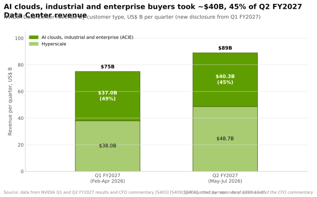
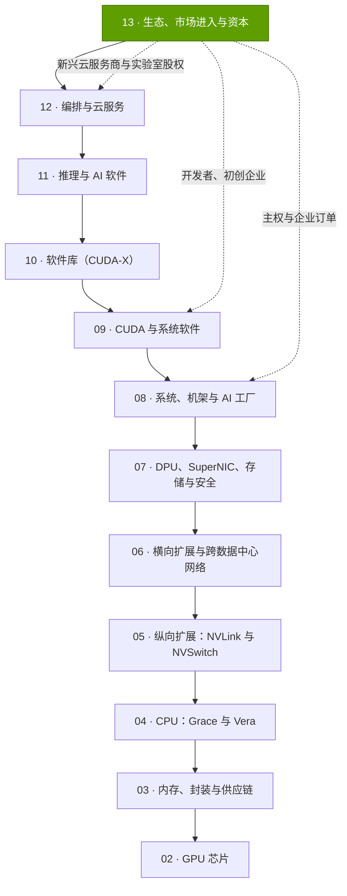
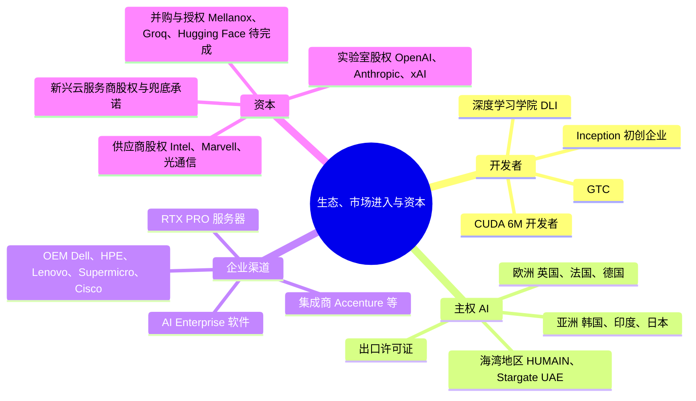

# 第 13 层 —— 生态、市场进入与资本

> [!NOTE]
> 本页为英文原文的简体中文参考译文，仅供参考；如有出入，以[英文原文](../../../layers/13-ecosystem-gtm-and-capital/index.md "English original")为准。

第 13 层 · 12 层技术栈的最顶层 · 开发者、初创企业、主权与企业渠道、资本部署 · 约 8 分钟阅读 · 最近核实：2026-11-05

## ⚡ 要点速览

- **本层把英伟达的技术转化为订单：**涵盖 [CUDA](../../../glossary.md#cuda) 开发者（~6M，自 GTC 2025 以来持平 [[S536]](../../../sources/bibliography.md#s536)[[S528]](../../../sources/bibliography.md#s528)）、初创企业、各国政府、企业客户，以及为买方提供资金的资本。
- **开发者漏斗顶部持续扩大：**GTC 参会人数从 2009 年的 ~1,500 人增长到 2026 年预计的 >30,000 人，来自 >190 个国家和地区 [[S13024]](../../../sources/bibliography.md#s13024)[[S13533]](../../../sources/bibliography.md#s13533)；[NVIDIA Inception](../../../glossary.md#nvidia-inception) 到 2022 年覆盖 ~10,000 家初创企业 [[S531]](../../../sources/bibliography.md#s531)，据二手资料，到 2025 年已 >22,000 家 [[S13536]](../../../sources/bibliography.md#s13536)。
- **[主权 AI](../../../glossary.md#sovereign-ai) 已成为需求支柱：**FY2026 收入 > ~$30B（+80%）[[S90071]](../../../sources/bibliography.md#s90071)，约占 $215.9B 的 ~14% [[S1]](../../../sources/bibliography.md#s1)。已公布的国家级交易合计涉及 ~1.03M 颗英伟达 GPU，以 HUMAIN（最多 600,000 颗）和韩国（260,000 颗）为首 [[S13003]](../../../sources/bibliography.md#s13003)[[S13000]](../../../sources/bibliography.md#s13000)。
- **一半的数据中心需求不经过[超大规模云厂商](../../../glossary.md#hyperscaler)：**AI 云、工业与企业客户约 ~$40.3B，占 Q2 FY2027 数据中心收入的 45% [[S406]](../../../sources/bibliography.md#s406)；这部分需求通过 OEM、系统集成商和[新兴云服务商（neocloud）](../../../glossary.md#neocloud)触达，而非依靠庞大的直销团队。
- **英伟达已成为资本配置者：**其私有公司股权从 $3.4B（2025 年 1 月）增至 $51.2B（2026 年 7 月），全部股权持仓增至 ~$99B [[S13043]](../../../sources/bibliography.md#s13043)[[S90072]](../../../sources/bibliography.md#s90072)[[S90073]](../../../sources/bibliography.md#s90073)，其中以对 OpenAI 的 ~$30B（🟡 有报道）[[S90015]](../../../sources/bibliography.md#s90015) 和对 Anthropic 最多 $10B [[S90075]](../../../sources/bibliography.md#s90075) 为最大。
- **弱点与看空情景：**这一闭环带有循环融资色彩，且高度集中。单一直接客户贡献了 Q2 FY2027 收入的 16% [[S90069]](../../../sources/bibliography.md#s90069)；H1 FY2027 $23.7B 的股权投资净收益美化了利润 [[S90072]](../../../sources/bibliography.md#s90072)；各国主权 GPU 计划远超已落地的确定订单 [[S13514]](../../../sources/bibliography.md#s13514)[[S13516]](../../../sources/bibliography.md#s13516)。
- **本层最强挑战者：**竞争对手同样以资本和生态竞争。AMD 向 OpenAI 授予最多 160M 股的认股权证，与 6 GW 部署挂钩 [[S13506]](../../../sources/bibliography.md#s13506)；谷歌向 Anthropic 供应最多 1M 颗 TPU [[S90026]](../../../sources/bibliography.md#s90026)；HUMAIN 也与 AMD（500 MW）和高通（Qualcomm）（200 MW）签约 [[S13517]](../../../sources/bibliography.md#s13517)[[S90030]](../../../sources/bibliography.md#s90030)。

## 本层的职能，以及薄弱时会出什么问题

**[Q1 · 职能与失效后果]** 第 02–12 层让 AI 工厂得以运转；第 13 层则决定谁来购买、购买速度多快、用谁的钱购买——通过开发者关系、主权交易、企业渠道和资本来实现。若本层走弱，买方无法为采购融资时供给将被搁置，收入会集中到自研芯片的超大规模云厂商手中，开发者也会流向可移植的技术栈，从而降低下方每一层的转换成本。

> [!TIP]
> **算例 —— 以硬件衡量，“主权”市场有多大？** 一座 100,000 颗 GPU 的 GB300 工厂前期成本约 ~$8.5B，其中英伟达开票约 ~$5.3–6.1B（估计，见[主权 AI](sovereign-ai.md)）。因此英伟达 FY2026 > ~$30B 的主权收入 [[S90071]](../../../sources/bibliography.md#s90071) 相当于**每年 ~5 座这样的工厂，约 ~525,000 颗 GPU**。国家级交易中已公布的 ~1.03M 颗 GPU [[S13003]](../../../sources/bibliography.md#s13003)[[S13000]](../../../sources/bibliography.md#s13000)[[S13009]](../../../sources/bibliography.md#s13009) 大约相当于这一年化规模的两年量。🔴 本资料库测算。

**[Q2 · 关键指标]**

| 指标 | 最新数值 | 为何重要 |
|---|---|---|
| 非超大规模客户占数据中心收入比重 | ~45%（Q2 FY2027）[[S406]](../../../sources/bibliography.md#s406) | 摆脱对自研芯片买方的依赖、实现多元化 |
| 主权收入 | > ~$30B，+80%（FY2026）[[S90071]](../../../sources/bibliography.md#s90071) | 一个兼具政治与经济属性的需求来源 |
| 最大直接客户 | 占 Q2 FY2027 收入的 16% [[S90069]](../../../sources/bibliography.md#s90069) | 集中度与议价能力风险 |
| 持有股权 | ~$99B（2026 年 7 月）[[S90073]](../../../sources/bibliography.md#s90073) | 循环融资敞口的规模 |
| 注册 CUDA 开发者 | ~6M，自 2025 年以来持平 [[S528]](../../../sources/bibliography.md#s528) | 软件锁定效应的领先指标 |

## 本层在技术栈中的位置

## 本层全景图

## 八个问题一览

| # | 问题 | 简要回答 | 详见 |
|---|---|---|---|
| Q1 | 本层承担什么职能？薄弱时会出什么问题？ | 把技术转化为有资金支撑的需求；薄弱会导致供给搁置、收入集中 | 本页；[开发者生态](developer-ecosystem-and-inception.md) |
| Q2 | 关键指标有哪些？ | 非超大规模客户占比、主权收入、最大客户占比、股权投资组合、开发者数量 | 本页；[资本部署](capital-deployment.md) |
| Q3 | 英伟达的供给如何改进？ | GTC 增长 ~20×，Inception 到 2022 年增长 5×，交易金额从 ~$10B（2025 年之前累计）增至 2025 年的 ~$51B | [开发者生态](developer-ecosystem-and-inception.md)；[资本部署](capital-deployment.md) |
| Q4 | 优势来源？ | 装机基础生态，加上竞争对手无法匹敌的资产负债表 | [发展历程与建成之路](history-and-how-built.md) |
| Q5 | 最强挑战者？ | 超大规模云厂商生态（谷歌 TPU）以及 AMD 的“以股权换吉瓦”方案 | [竞争格局](competition.md) |
| Q6 | 复制成本？ | 数十年的开发者关系积累，外加 ~$100B 可部署资本 | [发展历程与建成之路](history-and-how-built.md) |
| Q7 | 路线图与变数？ | 2026–27 年主权项目分期落地、第三方融资平台、GTC DC（2026 年 12 月） | [路线图](roadmap.md) |
| Q8 | 价值池与并购机会？ | 渠道、融资与新兴云服务商股权；私有生态公司 | [价值链与企业发展视角](value-chain-and-corp-dev.md) |

## 本层各页

| 页面 | 你将了解 |
|---|---|
| [开发者生态与 Inception](developer-ecosystem-and-inception.md) | CUDA 开发者、GTC、DLI、Inception 与 NVentures 对比、从漏斗到需求 |
| [主权 AI](sovereign-ai.md) | 国家级交易、10 万 GPU 工厂的成本、出口管制 |
| [企业市场进入：OEM 与 GSI](enterprise-gtm-oems-gsis.md) | 渠道、RTX PRO 服务器、AI Enterprise 软件 |
| [资本部署](capital-deployment.md) | 股权投资、兜底承诺、并购、股权投资组合、集中度 |
| [竞争格局](competition.md) | 竞争对手的生态与资本方案 |
| [发展历程：英伟达如何建成](history-and-how-built.md) | 时间线、关键决策、复制成本、反事实推演 |
| [路线图](roadmap.md) | 下一步是什么，以及什么会改变格局 |
| [价值链与企业发展视角](value-chain-and-corp-dev.md) | 谁攫取了价值、私有公司、并购 |

🔧 技术细节：如何解读英伟达的客户披露

- **直接客户与间接客户。** 10-Q 会列出收入占比超过 10% 的*直接*客户（主要是 OEM 和 ODM），并*估算*其背后的云厂商和实验室 [[S90069]](../../../sources/bibliography.md#s90069)。
- **超大规模与 ACIE。** 自 Q1 FY2027 起，数据中心收入拆分为超大规模云厂商，以及 AI 云、工业与企业客户（ACIE）两类 [[S403]](../../../sources/bibliography.md#s403)；管理层评论中的拆分数字为约数 [[S406]](../../../sources/bibliography.md#s406)。
- **主权并非一个报告分部。** > ~$30B 这一数字来自管理层评论 [[S90071]](../../../sources/bibliography.md#s90071)，且与上述两类均有重叠。

## 🎯 企业发展视角

1. **护城河正沿技术栈上移。** 当竞争对手在硬件上逼近持平时，渠道、开发者和资产负债表承担起防御职能。挑战者可以“租用”哪些（云额度、集成商业务线），又必须自建哪些？
2. **融资已成为产品的一部分。** 英伟达 ~$99B 的股权持仓 [[S90073]](../../../sources/bibliography.md#s90073)，以及 2026 年 8 月为撬动 >$500B 第三方资本而设立的融资平台 [[S12528]](../../../sources/bibliography.md#s12528)，改变了赢得交易的方式。对资产负债表较小的公司而言，何种供应商融资姿态最为合适？
3. **主权买方采取多源采购。** HUMAIN 同时与英伟达、AMD 和高通签约 [[S13003]](../../../sources/bibliography.md#s13003)[[S13517]](../../../sources/bibliography.md#s13517)[[S90030]](../../../sources/bibliography.md#s90030)。在哪些主权招标中，第二供应商比现有技术栈更能获得青睐？
4. **集中度是一把双刃剑。** 占比 16% 的直接客户 [[S90069]](../../../sources/bibliography.md#s90069) 同样获得了议价筹码。哪些中端市场渠道（OEM、集成商、区域云厂商）仍未被充分覆盖？

## 📚 来源（Sources）

<!-- Auto-generated from the [S…] citations on this page by `make build`. Edit sources/registry/*.csv, not this list. -->

- [**S1**](../../../sources/bibliography.md#s1) NVIDIA Corporation via SEC EDGAR, *NVIDIA Announces Financial Results for Fourth Quarter and Fiscal 2026 (Form 8-K exhibit 99.1)*, 2026-02-25. [Link](https://www.sec.gov/Archives/edgar/data/1045810/000104581026000019/q4fy26pr.htm)
- [**S403**](../../../sources/bibliography.md#s403) NVIDIA Corporation via SEC EDGAR, *NVIDIA Announces Financial Results for First Quarter Fiscal 2027 (Form 8-K exhibit 99.1)*, 2026-05-20. [Link](https://www.sec.gov/Archives/edgar/data/0001045810/000104581026000051/q1fy27pr.htm)
- [**S406**](../../../sources/bibliography.md#s406) NVIDIA Corporation (Colette Kress), *CFO Commentary on Second Quarter Fiscal 2027 Results*, 2026-08-26. [Link](https://s201.q4cdn.com/141608511/files/doc_financials/2027/Q227/Q2FY27-CFO-Commentary.pdf)
- [**S528**](../../../sources/bibliography.md#s528) NVIDIA Developer Forums, *20 Years of CUDA: Honoring the Architects of the Accelerated Age*, 2026-03. [Link](https://forums.developer.nvidia.com/t/20-years-of-cuda-honoring-the-architects-of-the-accelerated-age/364654)
- [**S531**](../../../sources/bibliography.md#s531) TechRadar, *Nvidia GTC 2022 keynote: all the latest news, releases and more (live blog)*, 2022-03-22. [Link](https://www.techradar.com/news/live/nvidia-gtc-2022-keynote-all-the-latest-news-and-annoucnements)
- [**S536**](../../../sources/bibliography.md#s536) TechRadar, *Nvidia GTC 2025 — all the news and updates from Jensen Huang's keynote (live blog)*, 2025-03-18. [Link](https://www.techradar.com/pro/live/nvidia-gtc-2025-all-the-news-and-updates-from-jensen-huang-keynote-as-it-happens)
- [**S12528**](../../../sources/bibliography.md#s12528) NVIDIA Newsroom, *NVIDIA Partners With Apollo, BlackRock, Blackstone, Brookfield, Goldman Sachs and KKR to Establish AI Compute Infrastructure Financing Platforms to Mobilize Over $500 Billion of Third-Party Capital*, 2026-08-10. [Link](https://nvidianews.nvidia.com/news/nvidia-partners-with-apollo-blackrock-blackstone-brookfield-goldman-sachs-and-kkr-to-establish-ai-compute-infrastructure-financing-platforms-to-mobilize-over-500-billion-of-third-party-capital)
- [**S13000**](../../../sources/bibliography.md#s13000) The Korea Times, *Nvidia to supply 260,000 chips to Korea for AI factories with Samsung, SK, Hyundai*, 2025-10-31. [Link](https://www.koreatimes.co.kr/amp/business/tech-science/20251031/nvidia-to-supply-260000-chips-to-korea-for-ai-factories-with-samsung-sk-hyundai)
- [**S13003**](../../../sources/bibliography.md#s13003) Middle East AI News, *HUMAIN to deploy 600,000 NVIDIA GPUs across KSA, USA*, 2025-11-19. [Link](https://www.middleeastainews.com/p/humain-to-deploy-600000-nvidia-gpus)
- [**S13009**](../../../sources/bibliography.md#s13009) NVIDIA Newsroom, *NVIDIA and United Kingdom Build Nation's AI Infrastructure and Ecosystem to Fuel Innovation, Economic Growth and Jobs*, 2025-09-16. [Link](https://nvidianews.nvidia.com/news/nvidia-and-united-kingdom-build-nations-ai-infrastructure-and-ecosystem-to-fuel-innovation-economic-growth-and-jobs)
- [**S13024**](../../../sources/bibliography.md#s13024) Wikipedia, *Nvidia GTC*, 2026. [Link](https://en.wikipedia.org/wiki/Nvidia_GTC)
- [**S13043**](../../../sources/bibliography.md#s13043) NVIDIA Corporation via SEC EDGAR, *NVIDIA FY2026 Form 10-K, note: non-marketable equity securities (XBRL R17)*, 2026-02-25. [Link](https://www.sec.gov/Archives/edgar/data/1045810/000104581026000021/R17.htm)
- [**S13506**](../../../sources/bibliography.md#s13506) Tom's Hardware, *OpenAI signs 6 GW AMD GPU deal*, 2025-10-06. [Link](https://www.tomshardware.com/pc-components/gpus/openai-signs-6gw-amd-gpu-deal)
- [**S13514**](../../../sources/bibliography.md#s13514) The Daily Star, *Saudi AI firm Humain inks Nvidia deal (Reuters)*, 2025-05-13. [Link](https://www.thedailystar.net/business/global-economy/news/saudi-ai-firm-humain-inks-nvidia-deal-4039841)
- [**S13516**](../../../sources/bibliography.md#s13516) The National, *Saudi Arabia's Humain expands Nvidia deal with 84 MW AI computing plan*, 2026-10-22. [Link](https://www.thenationalnews.com/future/technology/2026/10/22/saudi-arabias-humain-expands-nvidia-deal-with-84mw-ai-computing-plan/)
- [**S13517**](../../../sources/bibliography.md#s13517) Futuriom, *NVIDIA and AMD score AI hub deals in Saudi Arabia*, 2025-05. [Link](https://www.futuriom.com/articles/news/nvidia-amd-score-deals-for-the-saudi-ai-hub/2025/05)
- [**S13533**](../../../sources/bibliography.md#s13533) ResearchPool (NVIDIA press release), *NVIDIA CEO Jensen Huang and global technology leaders to showcase age of AI at GTC 2026 (press release summary)*, 2026-02. [Link](https://app.researchpool.com/company/nvda-us67066g1040-nvidia-corp-e9VqYYGjs8/press/nvidia-corporation-nvda-nvidia-ceo-jensen-huang-and-global-technology-leaders-to-showcase-age-s9kKOjK0qb)
- [**S13536**](../../../sources/bibliography.md#s13536) Techsoma, *Nvidia's free startup program just unlocked AI success for 22,000 companies*, 2025. [Link](https://techsoma.africa/nvidias-free-startup-program-just-unlocked-ai-success-for-22000-companies-heres-how-to-join/)
- [**S90015**](../../../sources/bibliography.md#s90015) DatacenterDynamics, *Nvidia plans $30bn investment in upcoming OpenAI funding round*, 2026-02. [Link](https://www.datacenterdynamics.com/en/news/nvidia-plans-30bn-investment-in-upcoming-openai-funding-round/)
- [**S90026**](../../../sources/bibliography.md#s90026) Maginative, *Anthropic secures 1M Google TPUs while keeping Amazon as primary training partner*, 2025-10. [Link](https://www.maginative.com/anthropic-secures-1m-google-tpus-while-keeping-amazon-as-primary-training-partner)
- [**S90030**](../../../sources/bibliography.md#s90030) Morningstar, *Qualcomm: Humain deal provides some AI upside*, 2025-10. [Link](https://www.morningstar.com/stocks/qualcomm-humain-deal-provides-some-ai-upside)
- [**S90069**](../../../sources/bibliography.md#s90069) NVIDIA Corporation via SEC EDGAR, *NVIDIA Form 10-Q for the quarter ended July 26, 2026 (Q2 FY2027)*, 2026-08. [Link](https://www.sec.gov/Archives/edgar/data/0001045810/000104581026000075/nvda-20260726.htm)
- [**S90071**](../../../sources/bibliography.md#s90071) Crypto Briefing, *Nvidia CFO emphasizes neutral partnership with AI customers as company diversifies beyond hyperscalers*, 2026. [Link](https://cryptobriefing.com/nvidia-cfo-neutral-ai-partnership/)
- [**S90072**](../../../sources/bibliography.md#s90072) Unite.AI, *Nvidia's AI sector equity stakes grow, SEC filing shows*, 2026-08. [Link](https://unite.ai/nvidias-ai-sector-equity-stakes-grow-sec-filing-shows)
- [**S90073**](../../../sources/bibliography.md#s90073) FourWeekMBA, *NVIDIA's $99 billion investment portfolio and the circular financing loop at the center of AI*, 2026-08. [Link](https://fourweekmba.com/ai-nvidia-99-billion-investment-portfolio-circular-financing-ai/)
- [**S90075**](../../../sources/bibliography.md#s90075) Windows Central, *NVIDIA joins Microsoft's push on Claude — piling billions into Anthropic's future*, 2025-11-18. [Link](https://www.windowscentral.com/microsoft/nvidia-joins-microsofts-push-on-claude-piling-billions-into-anthropics-future)
