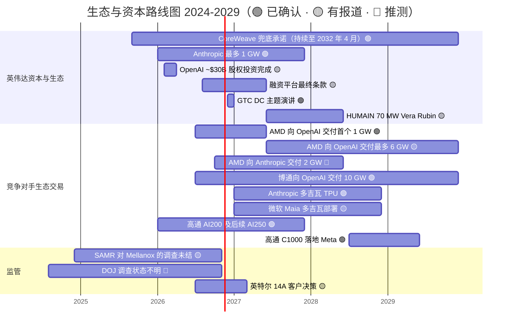
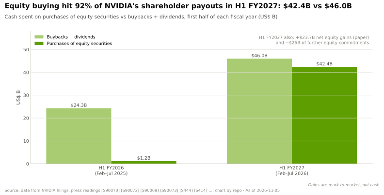
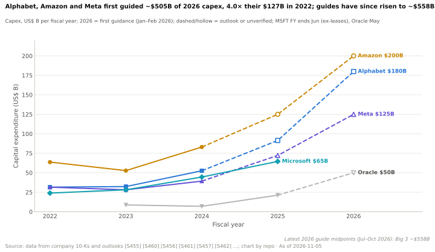
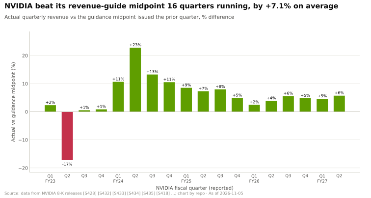

# 生态、市场进入与资本：路线图

> [!NOTE]
> 本页为英文原文的简体中文参考译文，仅供参考；如有出入，以[英文原文](../../../layers/13-ecosystem-gtm-and-capital/roadmap.md "English original")为准。

第 13 层 · 生态、市场进入与资本 · 约 11 分钟阅读 · 最近核实：2026-11-05

## ⚡ 要点速览

- **下一个节点：**2026-12-01 的 GTC DC 主题演讲，就在本页截止日期之后 [[S90047]](../../../sources/bibliography.md#s90047)。
- **2026–2029 年是一份合同分期的日程表。** AMD 为 OpenAI 交付的首个 1 GW 于 2026 年下半年开始，博通的 10 GW 从 2026 年下半年持续到 2029 年，Anthropic 的下一批多吉瓦 TPU 于 2027 年开始，微软的 Maia 自 2027 年起达到多吉瓦规模 [[S13506]](../../../sources/bibliography.md#s13506)[[S174]](../../../sources/bibliography.md#s174)[[S655]](../../../sources/bibliography.md#s655)[[S90045]](../../../sources/bibliography.md#s90045)。
- **英伟达自身的承诺期限更长。** 对 CoreWeave 的[算力兜底承诺](../../../glossary.md#capacity-backstop)持续到 2032-04-13，2026 年 8 月宣布的融资平台仍是有待签署最终协议的谅解备忘录 🟡 [[S90067]](../../../sources/bibliography.md#s90067)[[S12528]](../../../sources/bibliography.md#s12528)。
- **监管机构仍有未结案件。** 中国国家市场监督管理总局（SAMR）于 2025 年 9 月发布初步调查结果，认定英伟达违反了 Mellanox 收购的批准条件；美国司法部（DOJ）于 2024 年启动调查；两者均未在 2026 年公开结案 🔴 [[S9505]](../../../sources/bibliography.md#s9505)[[S9503]](../../../sources/bibliography.md#s9503)[[S9504]](../../../sources/bibliography.md#s9504)。
- **投资组合如今会影响利润。** 英伟达在 H1 FY2027 确认了 $23.7B 的股权投资净收益，主要来自[按市值计价（mark-to-market）](../../../glossary.md#mark-to-market)；这些收益可能反转 [[S90072]](../../../sources/bibliography.md#s90072)。
- **[Q7 · 路线图与变数]** 三件事会改变格局：针对“以投资换配额”的反垄断行动、[超大规模云厂商](../../../glossary.md#hyperscaler)资本开支周期的拐点，以及私有公司股权的减记。

各行来源见下表；OpenAI 股权投资条目：约 ~$30B 的直接投资取代了意向书 [[S90015]](../../../sources/bibliography.md#s90015)[[S13526]](../../../sources/bibliography.md#s13526)。

| 事项 | 时间窗口 | 状态 | 置信度 | 来源 |
|---|---|---|---|---|
| GTC DC 主题演讲 | 2026-12-01 | 已排期 | 🟢 | [[S90047]](../../../sources/bibliography.md#s90047) |
| 英伟达–Anthropic 最多 1 GW，最多 $10B | 2026 年起 | 已宣布 | 🟢 | [[S469]](../../../sources/bibliography.md#s469) |
| 与六家资产管理公司的融资平台（目标 >$500B） | 2026 年 8 月起 | 谅解备忘录 | 🟡 | [[S12528]](../../../sources/bibliography.md#s12528) |
| HUMAIN 84 MW（~27k 颗 GPU），随后 70 MW Vera Rubin | 当前；2027 年年中起 | 已宣布 | 🟡 | [[S13516]](../../../sources/bibliography.md#s13516) |
| CoreWeave 兜底承诺，最多 $6.3B | 至 2032-04-13 | 生效中 | 🟢 | [[S90067]](../../../sources/bibliography.md#s90067) |
| AMD–OpenAI 首个 1 GW 的 MI450，认股权证第 1 批 | 2026 年下半年 | 部署中 | 🟢 | [[S13506]](../../../sources/bibliography.md#s13506)[[S90020]](../../../sources/bibliography.md#s90020) |
| AMD–Anthropic 最多 $5B，2 GW Helios | 2026 年起 | 已宣布 | 🟡 | [[S9538]](../../../sources/bibliography.md#s9538) |
| 博通–OpenAI 10 GW 定制加速器 | 2026 年下半年 – 2029 年 | 已宣布 | 🟢 | [[S174]](../../../sources/bibliography.md#s174) |
| Anthropic 多吉瓦 TPU 扩容 | 2027 年起 | 已宣布 | 🟢 | [[S655]](../../../sources/bibliography.md#s655) |
| 高通–Modular | 2026-07-29 完成 | 已完成 | 🟢 | [[S9511]](../../../sources/bibliography.md#s9511) |
| 高通 C1000 落地 Meta | 2028 年下半年 | 已宣布 | 🟢 | [[S90058]](../../../sources/bibliography.md#s90058) |
| SAMR 对 Mellanox 的调查 | 2024 年 12 月起 | 初步调查结果 | 🟡 | [[S9505]](../../../sources/bibliography.md#s9505) |

## 如何在资本层解读路线图

在这里，路线图是一份**义务与期权**的时间表：按吉瓦归属的分期、在算力未售出时触发的兜底承诺、随融资轮次重新定价的股权。对每一项都要问：如果需求放缓，风险由谁承担？

> [!TIP]
> **算例 —— 私有公司股权减记 30% 会怎样。** 2026 年 7 月，英伟达持有 $51.2B 的非流通股权 [[S90072]](../../../sources/bibliography.md#s90072)。30% 的减记——一次降价融资或一家停滞的实验室就可能引发这种重估——将通过其他收益产生 ~$15.4B 的损失，约为 Q2 FY2027 $59.7B 净利润的 26% [[S405]](../../../sources/bibliography.md#s405)。会很痛，但不致命；更大的风险在于，同样的冲击会波及这些客户的 GPU 订单。

🔧 技术细节：这些事项在财报中的位置

私有公司股权列示为非流通股权证券，按成本计量并根据可观察的价格变动进行调整；上市公司股权（英特尔、诺基亚、Synopsys、CoreWeave）每季度按市值计价 [[S90072]](../../../sources/bibliography.md#s90072)[[S90073]](../../../sources/bibliography.md#s90073)。兜底承诺和多年期云协议列于承诺事项附注中，而非资产负债表：2026 年 7 月有 $29B 的云服务承诺和 $36B 的 AI 云算力协议 [[S407]](../../../sources/bibliography.md#s407)。像 AMD 这样的客户认股权证，通常在各批次很可能归属时作为收入的减项入账（应付客户对价），因此其成本体现在 AMD 报告的利润率中，而非现金中（🔴 本资料库对美国通用会计准则（US GAAP）通行做法的解读）。

## [Q7 · 路线图与变数]

**1. 针对“以投资换配额”的反垄断行动。** 调查人员表明的关切包括：使客户更难更换供应商，以及惩罚未独家使用英伟达的买方 [[S9503]](../../../sources/bibliography.md#s9503)。若认定股权投资与配额挂钩，将限制这一打法。SAMR 的罚款可能为上一年度中国销售额的 1% 至 10% [[S9505]](../../../sources/bibliography.md#s9505)；参议员也质疑 Groq 授权交易是在规避并购审查 [[S13511]](../../../sources/bibliography.md#s13511)。

**2. 资本开支周期拐点。** 英伟达对 Q3 FY2027 收入的指引为 $108B ± 2%，不含中国数据中心计算业务 [[S3]](../../../sources/bibliography.md#s3)。

> [!TIP]
> **算例 —— 超大规模云厂商暂停采购会削减多少收入。** 在英伟达 Q2 FY2027 $89.0B 的数据中心收入中，超大规模客户贡献了约 ~$48.7B [[S90011]](../../../sources/bibliography.md#s90011)[[S405]](../../../sources/bibliography.md#s405)。若其在英伟达上的支出削减 20%，每季度将减少 ~$9.7B，接近英伟达指引中从 Q2（$96.2B）到 Q3（$108B）约 ~$11.8B 的全部增量 [[S405]](../../../sources/bibliography.md#s405)[[S3]](../../../sources/bibliography.md#s3)。[新兴云服务商（neocloud）](../../../glossary.md#neocloud)和主权买方可以起到缓冲作用，但其中许多正是由英伟达提供资金的。

**3. 按市值计价损失。** H1 FY2027 $23.7B 的股权投资净收益美化了其他收益；一旦反转，将在客户融资收紧之际冲击利润 [[S90072]](../../../sources/bibliography.md#s90072)。

**4. 定制芯片兑现。** SemiAnalysis 认为，OpenAI 由博通打造的推理芯片在单位[总拥有成本（TCO）](../../../glossary.md#tco)性能上可与 Blackwell 竞争 🟡 [[S628]](../../../sources/bibliography.md#s628)。若按时交付，该联盟在每一家前沿实验室中的说服力都会增强。

**5. 哪些因素有利于英伟达。** >$500B 融资平台若签署最终协议，将把融资风险转移给第三方 [[S12528]](../../../sources/bibliography.md#s12528)；连续 16 个季度超越自身指引（见下图）也有助于赢得融资方的信任。

| 需关注的信号 | 领先指标 | 对英伟达的影响方向 |
|---|---|---|
| 反垄断 | DOJ/FTC 起诉、SAMR 罚款、欧盟就某项授权交易移交审查 | ⬇ 负面 |
| 资本开支周期 | 超大规模云厂商 2027 年资本开支指引（2027 年 1–2 月） | ± |
| 私有股权估值 | 实验室或新兴云服务商的降价融资；CoreWeave 兜底承诺被动用 | ⬇ 负面 |
| 定制芯片 | OpenAI–博通首个吉瓦的时间；Anthropic 2027 年的 TPU 批次 | ⬇ 负面 |
| 融资平台 | 签署最终协议并完成首批基金募集 | ⬆ 正面 |

## 🎯 企业发展视角

1. 英伟达的哪些承诺（兜底承诺、云协议、股权投资承诺）会被算力买方视为价格底线？这一底线对新进入者的定价是有利还是不利？
2. 如果监管机构限制“以投资换配额”，由政府承担资本的主权合作是否会成为所有厂商的主要市场进入路径？
3. AMD 的认股权证分期自 2026 年下半年起按部署里程碑归属。合作伙伴在与 AMD 共同投入之前，应要求看到哪些按时交付的证据？
4. 如果私有 AI 资产估值重置，哪些资产（光器件供应商、软件团队、已授权知识产权）会变得更便宜、更易收购？又有谁拥有足以出手的资产负债表？

## 📚 来源（Sources）

<!-- Auto-generated from the [S…] citations on this page by `make build`. Edit sources/registry/*.csv, not this list. -->

- [**S3**](../../../sources/bibliography.md#s3) StorageNewsletter, *NVIDIA Q2 Fiscal 2027 results coverage: revenue $96.2B*, 2026-08-27. [Link](https://www.storagenewsletter.com/2026/08/27/nvidia-fiscal-2q27-financial-results/)
- [**S174**](../../../sources/bibliography.md#s174) OpenAI, *OpenAI and Broadcom announce strategic collaboration to deploy 10 gigawatts of OpenAI-designed AI accelerators*, 2025-10-13. [Link](https://openai.com/index/openai-and-broadcom-announce-strategic-collaboration/)
- [**S405**](../../../sources/bibliography.md#s405) NVIDIA Corporation via SEC EDGAR, *NVIDIA Announces Financial Results for Second Quarter Fiscal 2027 (Form 8-K exhibit 99.1)*, 2026-08-26. [Link](https://www.sec.gov/Archives/edgar/data/0001045810/000104581026000073/q2fy27pr.htm)
- [**S407**](../../../sources/bibliography.md#s407) NVIDIA Corporation via SEC EDGAR, *NVIDIA Corporation Form 10-Q for quarter ended July 26, 2026*, 2026-08-28. [Link](https://www.sec.gov/Archives/edgar/data/1045810/000104581026000075/nvda-20260726.htm)
- [**S469**](../../../sources/bibliography.md#s469) Microsoft Official Blog, *Microsoft, NVIDIA and Anthropic announce strategic partnerships*, 2025-11-18. [Link](https://blogs.microsoft.com/blog/2025/11/18/microsoft-nvidia-and-anthropic-announce-strategic-partnerships/)
- [**S628**](../../../sources/bibliography.md#s628) SemiAnalysis, *OpenAI Jalapeño: Better Than Nvidia Blackwell*, 2026-08-25. [Link](https://github.com/SemiAnalysisAI/InferenceX-app/blob/main/packages/app/content/blog/openai-jalapeno-better-than-nvidia.mdx)
- [**S655**](../../../sources/bibliography.md#s655) Anthropic, *Anthropic expands partnership with Google and Broadcom for multiple gigawatts of next-generation compute*, 2026-04-06. [Link](https://www.anthropic.com/news/google-broadcom-partnership-compute)
- [**S9503**](../../../sources/bibliography.md#s9503) Business Standard (Bloomberg), *Nvidia gets subpoena from US Justice Dept as antitrust probe deepens*, 2024-09-04. [Link](https://www.business-standard.com/world-news/nvidia-gets-subpoena-from-us-justice-dept-as-antitrust-probe-deepens-124090400121_1.html)
- [**S9504**](../../../sources/bibliography.md#s9504) Business Standard, *US launches antitrust investigation into Nvidia over sales practices*, 2024-08-02. [Link](https://www.business-standard.com/world-news/us-launches-antitrust-investigation-into-nvidia-over-sales-practices-124080201689_1.html)
- [**S9505**](../../../sources/bibliography.md#s9505) JURIST, *China finds Nvidia violated antimonopoly law in preliminary probe*, 2025-09-15. [Link](https://www.jurist.org/news/2025/09/china-finds-nvidia-violated-antimonopoly-law-in-preliminary-probe/)
- [**S9511**](../../../sources/bibliography.md#s9511) Nasdaq (Qualcomm press release), *Qualcomm Completes Acquisition of Modular*, 2026-07-29. [Link](https://www.nasdaq.com/press-release/qualcomm-completes-acquisition-modular-2026-07-29)
- [**S9538**](../../../sources/bibliography.md#s9538) The Next Web, *AMD is investing $5 billion in Anthropic and deploying 2 gigawatts of Helios GPUs to run Claude*, 2026. [Link](https://thenextweb.com/news/amd-anthropic-5-billion-investment-2gw-helios-mi450)
- [**S12528**](../../../sources/bibliography.md#s12528) NVIDIA Newsroom, *NVIDIA Partners With Apollo, BlackRock, Blackstone, Brookfield, Goldman Sachs and KKR to Establish AI Compute Infrastructure Financing Platforms to Mobilize Over $500 Billion of Third-Party Capital*, 2026-08-10. [Link](https://nvidianews.nvidia.com/news/nvidia-partners-with-apollo-blackrock-blackstone-brookfield-goldman-sachs-and-kkr-to-establish-ai-compute-infrastructure-financing-platforms-to-mobilize-over-500-billion-of-third-party-capital)
- [**S13506**](../../../sources/bibliography.md#s13506) Tom's Hardware, *OpenAI signs 6 GW AMD GPU deal*, 2025-10-06. [Link](https://www.tomshardware.com/pc-components/gpus/openai-signs-6gw-amd-gpu-deal)
- [**S13511**](../../../sources/bibliography.md#s13511) Kavout, *Is Nvidia's Groq deal a masterstroke or an antitrust minefield?*, 2026. [Link](https://www.kavout.com/market-lens/is-nvidia-s-groq-deal-a-masterstroke-or-an-antitrust-minefield)
- [**S13516**](../../../sources/bibliography.md#s13516) The National, *Saudi Arabia's Humain expands Nvidia deal with 84 MW AI computing plan*, 2026-10-22. [Link](https://www.thenationalnews.com/future/technology/2026/10/22/saudi-arabias-humain-expands-nvidia-deal-with-84mw-ai-computing-plan/)
- [**S13526**](../../../sources/bibliography.md#s13526) Storyboard18, *Nvidia CEO Jensen Huang hints no further investments in OpenAI, Anthropic*, 2026. [Link](https://www.storyboard18.com/brand-makers/nvidia-ceo-jensen-huang-hints-no-further-investments-in-openai-anthropic-heres-why-91280.htm)
- [**S90011**](../../../sources/bibliography.md#s90011) Nasdaq (Zacks), *NVIDIA Q2 earnings beat on Blackwell Ultra and Data Center strength*, 2026-08-27. [Link](https://www.nasdaq.com/articles/nvidia-q2-earnings-beat-blackwell-ultra-data-center-strength)
- [**S90015**](../../../sources/bibliography.md#s90015) DatacenterDynamics, *Nvidia plans $30bn investment in upcoming OpenAI funding round*, 2026-02. [Link](https://www.datacenterdynamics.com/en/news/nvidia-plans-30bn-investment-in-upcoming-openai-funding-round/)
- [**S90020**](../../../sources/bibliography.md#s90020) Shacknews, *AMD Helios AI rack system on track for initial shipments in Q3 2026*, 2026. [Link](https://www.shacknews.com/article/150249/amd-helios-ai-system-shipping-q3-2026)
- [**S90045**](../../../sources/bibliography.md#s90045) Pulse 2.0, *Microsoft to expand Azure Maia AI infrastructure to multi-gigawatt deployments starting in 2027*, 2026-10. [Link](https://pulse2.com/microsoft-to-expand-azure-maia-ai-infrastructure/)
- [**S90047**](../../../sources/bibliography.md#s90047) NVIDIA, *NVIDIA GTC DC 2026 (November 30 – December 3, 2026)*, 2026. [Link](https://www.nvidia.com/en-us/gtc-dc/topics/ai-policy/)
- [**S90058**](../../../sources/bibliography.md#s90058) Constellation Research, *Qualcomm outlines new CPU, AI accelerator roadmap, inks deal with Meta*, 2026-06-24. [Link](https://www.constellationr.com/insights/news/qualcomm-outlines-new-cpu-ai-accelerator-roadmap-inks-deal-meta)
- [**S90067**](../../../sources/bibliography.md#s90067) DatacenterDynamics, *Nvidia to purchase unsold compute capacity from CoreWeave for $6.3bn*, 2025-09-16. [Link](https://www.datacenterdynamics.com/en/news/nvidia-to-purchase-unsold-compute-capacity-from-coreweave-for-63bn/)
- [**S90072**](../../../sources/bibliography.md#s90072) Unite.AI, *Nvidia's AI sector equity stakes grow, SEC filing shows*, 2026-08. [Link](https://unite.ai/nvidias-ai-sector-equity-stakes-grow-sec-filing-shows)
- [**S90073**](../../../sources/bibliography.md#s90073) FourWeekMBA, *NVIDIA's $99 billion investment portfolio and the circular financing loop at the center of AI*, 2026-08. [Link](https://fourweekmba.com/ai-nvidia-99-billion-investment-portfolio-circular-financing-ai/)
