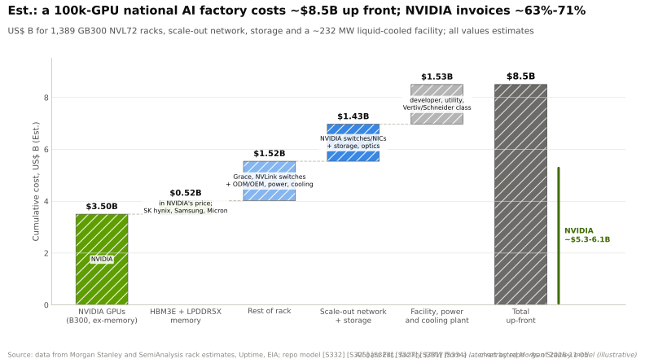
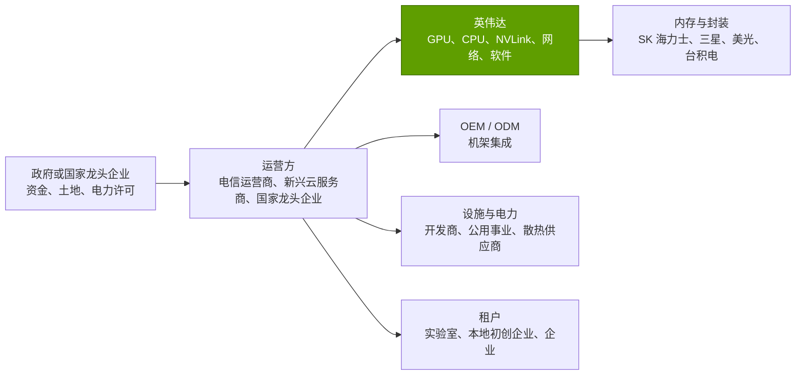

# 主权 AI

> [!NOTE]
> 本页为英文原文的简体中文参考译文，仅供参考；如有出入，以[英文原文](../../../layers/13-ecosystem-gtm-and-capital/sovereign-ai.md "English original")为准。

第 13 层 · 生态、市场进入与资本 · 约 9 分钟阅读 · 最近核实：2026-11-05

## ⚡ 要点速览

- **[主权 AI](../../../glossary.md#sovereign-ai) 已成为需求支柱。** 管理层称 FY2026 主权收入 > ~$30B，增长 ~80% 🟡 [[S90071]](../../../sources/bibliography.md#s90071)，约占英伟达 $215.9B 收入的 14% [[S1]](../../../sources/bibliography.md#s1)。
- **已公布的国家级交易合计涉及 ~1.03M 颗英伟达 GPU。** HUMAIN（沙特阿拉伯）计划在三年内于沙特和美国站点部署最多 600,000 颗 [[S13003]](../../../sources/bibliography.md#s13003)。韩国为 260,000 颗 [[S13000]](../../../sources/bibliography.md#s13000)，英国到 2026 年底最多 120,000 颗 [[S13009]](../../../sources/bibliography.md#s13009)，印度 Yotta 20,736 颗 [[S13017]](../../../sources/bibliography.md#s13017)，法国 Mistral 18,000 颗 [[S13011]](../../../sources/bibliography.md#s13011)，德国电信（Deutsche Telekom）10,000 颗 [[S13014]](../../../sources/bibliography.md#s13014)。
- **规划远远跑在确定订单之前。** HUMAIN 迄今的确定分期为 18,000 颗 GB300（2025 年 5 月）和 ~27,000 颗 GPU / 84 MW（2026 年 10 月）[[S13514]](../../../sources/bibliography.md#s13514)[[S13516]](../../../sources/bibliography.md#s13516)。美国许可证最初将 HUMAIN 和 G42 各自限制在 35,000 颗 Blackwell 等效芯片 🟡 [[S13515]](../../../sources/bibliography.md#s13515)。
- **一座 100,000 颗 GPU 的国家级 [AI 工厂](../../../glossary.md#ai-factory)前期成本约 ~$8.5B（估计）。** 其中英伟达开票约 ~$5.3–6.1B，因此主权收入约相当于每年五座这样的工厂 🔴。
- **出口管制决定谁能购买。** 美国允许向获批的中国买方出售 H200，但需将 25% 的收入上缴美国政府 [[S90032]](../../../sources/bibliography.md#s90032)。英伟达尚未确认任何 H200 收入，且业绩指引不含中国数据中心计算业务 [[S90081]](../../../sources/bibliography.md#s90081)[[S3]](../../../sources/bibliography.md#s3)。
- **看空情景：**主权买方会对冲。HUMAIN 还与 AMD 签订最多 500 MW 的协议 [[S13517]](../../../sources/bibliography.md#s13517)，与高通签订 200 MW 的协议 [[S90030]](../../../sources/bibliography.md#s90030)。韩国的交易既未披露金额，也没有时间表 [[S13001]](../../../sources/bibliography.md#s13001)。

## 各国为何购买 AI 工厂

主权 AI 工厂类似于国家航空公司或电力公用事业：即便从美国云厂商租用更便宜，各国政府仍希望拥有本土算力，原因包括数据驻留、本地语言模型、产业政策和议价能力。建设方通常是国家龙头企业（HUMAIN、G42）、电信运营商（德国电信、SK）或本地[新兴云服务商（neocloud）](../../../glossary.md#neocloud)（Nscale、Yotta），并常以一家前沿实验室作为锚定租户：沙特的 xAI [[S13004]](../../../sources/bibliography.md#s13004)，以及 Stargate UAE 和 Stargate UK 中的 OpenAI [[S13007]](../../../sources/bibliography.md#s13007)[[S13010]](../../../sources/bibliography.md#s13010)。

英伟达出售的是整套方案（GPU、网络、参考设计、软件、本地 Inception 初创企业），从而把硬件销售变成国家级项目。

**[Q2 · 关键指标]** 对于主权需求，应关注四个数字，而非标题性的 GPU 数量：确定订单、已通电的兆瓦数、已发放的出口许可证，以及英伟达披露的主权收入。

> [!TIP]
> **算例 —— $30B 相当于多少颗 GPU？** 按每 100,000 颗 GB300 GPU 对应约 ~$5.7B 的英伟达价值量（下文估计区间的中值）计算，> ~$30B 的主权收入 [[S90071]](../../../sources/bibliography.md#s90071) 可购买**每年 ~525,000 颗 GPU**。已公布的 ~1.03M 颗 GPU 约相当于两年的量。若像 HUMAIN 的计划那样分摊到三至五年 [[S13003]](../../../sources/bibliography.md#s13003)[[S13005]](../../../sources/bibliography.md#s13005)，这一储备可以支撑当前的年化规模，但难以支撑太多增长。🔴 本资料库测算。

## 国家级交易逐一核查

| 国家 | 日期 | 建设方与合作伙伴 | 英伟达 GPU / 电力 | 状态与说明 |
|---|---|---|---|---|
| 沙特阿拉伯 | 2025-05 → 2026-10 | HUMAIN（PIF）；xAI 为首个租户；AWS | 三年内最多 600,000 颗（沙特 + 美国）；500 MW+ 站点 [[S13003]](../../../sources/bibliography.md#s13003)[[S13004]](../../../sources/bibliography.md#s13004) | 首批 GB300 于 2025 年 12 月发货 [[S13006]](../../../sources/bibliography.md#s13006)；确定分期为 18,000 颗和 ~27,000 颗 [[S13514]](../../../sources/bibliography.md#s13514)[[S13516]](../../../sources/bibliography.md#s13516) |
| 阿联酋 | 2025-05-22 | G42、OpenAI、甲骨文（Oracle）、思科（Cisco）、软银（SoftBank）（Stargate UAE） | 基于 GB300 的 1 GW 集群；首批 200 MW 于 2026 年上线 [[S13007]](../../../sources/bibliography.md#s13007)[[S13008]](../../../sources/bibliography.md#s13008) | 未披露 GPU 数量；许可证最初上限为 35,000 颗 Blackwell 等效芯片 🟡 [[S13515]](../../../sources/bibliography.md#s13515) |
| 英国 | 2025-09-16 | Nscale、CoreWeave、微软（Microsoft）、OpenAI（Stargate UK） | 到 2026 年底最多 120,000 颗 Blackwell Ultra；最多 £11B [[S13009]](../../../sources/bibliography.md#s13009) | Nscale 60,000 颗，其中 8,000 颗用于 Stargate UK [[S13010]](../../../sources/bibliography.md#s13010) |
| 法国 | 2025-06-11 | Mistral AI（Mistral Compute） | 18,000 颗 Grace Blackwell；40 MW 站点，可扩展至 100 MW [[S13011]](../../../sources/bibliography.md#s13011)[[S13012]](../../../sources/bibliography.md#s13012) | 2026 年全面部署 |
| 德国 | 2025-11-04 | 德国电信 / T-Systems、SAP、西门子（Siemens） | 10,000 颗 Blackwell（DGX B200、RTX PRO）；~€1B [[S13014]](../../../sources/bibliography.md#s13014)[[S13015]](../../../sources/bibliography.md#s13015) | 2026 年在慕尼黑投运 [[S13013]](../../../sources/bibliography.md#s13013) |
| 韩国 | 2025-10-31 | 政府、三星、SK、现代、Naver Cloud | 260,000 颗 Blackwell 系列 [[S13000]](../../../sources/bibliography.md#s13000) | 未披露金额与时间表 [[S13001]](../../../sources/bibliography.md#s13001)；Naver 目标为吉瓦级规模（2026 年 6 月）[[S13002]](../../../sources/bibliography.md#s13002) |
| 印度 | 2026-02 | Yotta，服务于 IndiaAI Mission 和 NVIDIA DGX Cloud | 20,736 颗 B300；~$2B 🟡 [[S13017]](../../../sources/bibliography.md#s13017)[[S13019]](../../../sources/bibliography.md#s13019) | 据报道英伟达租用约一半；IndiaAI 总计运行 >38,000 颗 GPU [[S13018]](../../../sources/bibliography.md#s13018) |
| 日本 | 2024-05 | KDDI、软银、Sakura Internet、GMO 等 | > $740M 国家补贴 [[S13016]](../../../sources/bibliography.md#s13016) | 未披露 GPU 数量；2026 年项目的相关报道仅有单一来源 🔴 |

> [!TIP]
> **算例 —— 以美元和兆瓦衡量韩国的 260,000 颗 GPU。** 按每个 GB300 [NVL72](../../../glossary.md#nvl72) 机架 72 颗 GPU 计算，260,000 颗 GPU 约为 ~3,611 个机架。按每机架 ~$3.99M（估计，摩根士丹利）[[S332]](../../../sources/bibliography.md#s332)，即**约 ~$14.4B 的机架**。按每机架含网络约 ~145 kW [[S340]](../../../sources/bibliography.md#s340)、[PUE](../../../glossary.md#pue) 为 1.15 [[S387]](../../../sources/bibliography.md#s387)[[S388]](../../../sources/bibliography.md#s388) 计算，需要 **~600 MW**。路透社报道称，该交易将使韩国的英伟达 GPU 保有量从 ~65,000 颗提升至 >300,000 颗 [[S13513]](../../../sources/bibliography.md#s13513)。🔴 本资料库测算。

## 算例：一座 100,000 颗 GPU 的国家级 AI 工厂要花多少钱

> [!TIP]
> **算例 —— 1,389 个机架的账单。** 100,000 颗 GPU ÷ 72 = 1,389 个 GB300 NVL72 机架。每个约 ~$3.99M，其中 GPU 约 ~$2.52M、内存约 ~$0.37M（估计，摩根士丹利）[[S332]](../../../sources/bibliography.md#s332)[[S331]](../../../sources/bibliography.md#s331)，机架合计 **~$5.5B**。[横向扩展（scale-out）](../../../glossary.md#scale-out)网络与存储约占整套集群的 ~20.5%（估计，SemiAnalysis）[[S324]](../../../sources/bibliography.md#s324)，增加 **~$1.4B**。按每机架 ~145 kW [[S340]](../../../sources/bibliography.md#s340)、PUE 1.15 计算，站点功耗为 **~232 MW**。按每 MW $6.6M（取自摩根士丹利一个后来撤回的模型，此处仅作示意）[[S357]](../../../sources/bibliography.md#s357)，设施主体与电力设施成本为 **~$1.5B**。合计 **~$8.5B**，另按 $0.081/kWh 计每年电费约 ~$164M [[S389]](../../../sources/bibliography.md#s389)。英伟达开票约 ~$5.3–6.1B（63–71%），具体取决于其供应多少 CPU、交换机和网络 🔴。

🔧 技术细节：该估算未涵盖的内容

- **平台选择。** 若采用每机架约 ~$7.8M（估计）的 Vera Rubin NVL72 [[S330]](../../../sources/bibliography.md#s330)[[S332]](../../../sources/bibliography.md#s332)，同样 100,000 颗 GPU 仅机架就需 ~$10.8B，但每颗 GPU 的工作量要大得多。
- **设施成本。** 每兆瓦成本因站点差异很大；所用数字只是占位值。
- **软件与服务。** NVIDIA AI Enterprise 授权、集成商服务和模型开发叠加在其上（见[企业市场进入](enterprise-gtm-oems-gsis.md)）。

## 出口管制：主权 AI 的另一半

催生主权 AI 的逻辑，同样催生了[出口管制](../../../glossary.md#export-controls)：由美国决定哪些国家和买方能获得顶级 GPU，以及能获得多少。

- **中国。** 2025 年 4 月，美国要求 H20 级芯片须获得许可证，英伟达因此计提约 ~$4.5B 的费用 [[S90081]](../../../sources/bibliography.md#s90081)[[S90082]](../../../sources/bibliography.md#s90082)。2025 年 12 月，美国允许向获批的中国买方出售 H200，但需将 25% 的收入上缴美国政府 [[S90032]](../../../sources/bibliography.md#s90032)。英伟达于 2026 年 3 月收到采购订单 [[S90033]](../../../sources/bibliography.md#s90033)，但尚未确认任何 H200 收入，其业绩指引仍不含中国数据中心计算业务 [[S90081]](../../../sources/bibliography.md#s90081)[[S3]](../../../sources/bibliography.md#s3)。
- **海湾地区。** 交易在获得美国批准后签署，但许可证是分批计量发放的：首批批准将 HUMAIN 和 G42 各自限制在 35,000 颗 Blackwell 等效芯片 🟡 [[S13515]](../../../sources/bibliography.md#s13515)。
- **收入结构。** 总部不在美国的客户占 Q1 FY2027 收入的比重降至 22%，一年前为 42% [[S90070]](../../../sources/bibliography.md#s90070)。

> [!TIP]
> **算例 —— 25% 安排对利润率的影响。** 假设对华 H200 销售额 $10B，毛利率 ~75%（英伟达 Q2 FY2027 的 GAAP 水平 [[S3]](../../../sources/bibliography.md#s3)）：毛利为 $7.5B。上缴 25% 的收入（$2.5B）后剩余 $5.0B，**有效利润率约 ~50%**，仍然盈利，但每颗芯片的利润比其他市场少三分之一。该上缴款项如何入账尚未披露 🔴。

> [!WARNING]
> **误区与事实：**“主权 AI 是非周期性的政府支出。”许多交易由国家关联基金、电信运营商和新兴云服务商以租户合同为依托进行融资，并依赖可被撤销的美国出口许可证。韩国的公告既未披露价格，也未披露时间表 [[S13001]](../../../sources/bibliography.md#s13001)。

## 🎯 企业发展视角

1. **主权招标中确实存在第二供应商需求。** HUMAIN 与 AMD（500 MW）和高通（200 MW）的协议与其英伟达计划并行 [[S13517]](../../../sources/bibliography.md#s13517)[[S90030]](../../../sources/bibliography.md#s90030)。哪些主权项目会公开采购，使专注推理的机架能凭借功耗或价格胜出？
2. **运营方是控制点。** 电信运营商和新兴云服务商（德国电信、Nscale、Yotta、Naver）掌握客户。其中哪些可能为主权推理层引入一家挑战者？
3. **出口政策是摇摆因素。** 许可证上限和收入分成条款会随政府更迭而变化。交易模型应如何为签约后被收窄的许可证定价？
4. **关注确定订单，而非 GPU 数量。** HUMAIN 计划的 600,000 颗与约 ~45,000 颗确定订单之间的差距 [[S13003]](../../../sources/bibliography.md#s13003)[[S13514]](../../../sources/bibliography.md#s13514)[[S13516]](../../../sources/bibliography.md#s13516)，正是竞争对手仍有空间之处。

## 📚 来源（Sources）

<!-- Auto-generated from the [S…] citations on this page by `make build`. Edit sources/registry/*.csv, not this list. -->

- [**S1**](../../../sources/bibliography.md#s1) NVIDIA Corporation via SEC EDGAR, *NVIDIA Announces Financial Results for Fourth Quarter and Fiscal 2026 (Form 8-K exhibit 99.1)*, 2026-02-25. [Link](https://www.sec.gov/Archives/edgar/data/1045810/000104581026000019/q4fy26pr.htm)
- [**S3**](../../../sources/bibliography.md#s3) StorageNewsletter, *NVIDIA Q2 Fiscal 2027 results coverage: revenue $96.2B*, 2026-08-27. [Link](https://www.storagenewsletter.com/2026/08/27/nvidia-fiscal-2q27-financial-results/)
- [**S324**](../../../sources/bibliography.md#s324) fal.ai, *NVIDIA GB200 price in 2026: what a GPU, a tray and an NVL72 rack cost*, 2026. [Link](https://fal.ai/learn/serverless/nvidia-gb200-price)
- [**S330**](../../../sources/bibliography.md#s330) PC Gamer, *A single Nvidia Vera Rubin rack is estimated to cost $7,803,148 with over $2 million of that figure spent on memory alone*, 2026-05. [Link](https://pcgamer.com/hardware/a-single-nvidia-vera-rubin-rack-is-estimated-to-cost-usd7-803-148-with-over-usd2-million-of-that-figure-spent-on-memory-alone)
- [**S331**](../../../sources/bibliography.md#s331) Wccftech, *NVIDIA's Vera Rubin rack hit with 435% memory price surge, pushing HBM4 & LPDDR5X bill to $2M of $7.8M total*, 2026-05. [Link](https://wccftech.com/nvidia-vera-rubin-rack-hit-with-memory-price-surge-pushing-hbm4-lpddr5x-bill-to-2m-of-7-8m-total/)
- [**S332**](../../../sources/bibliography.md#s332) Tiger Brokers (iTiger), *Morgan Stanley's BOM analysis of NVIDIA's Rubin: GPU share declines; PCB, MLCC and ABF substrate values soar*, 2026-05-20. [Link](https://www.itiger.com/news/1188068712)
- [**S340**](../../../sources/bibliography.md#s340) SemiAnalysis (Dylan Patel et al.), *Huawei AI CloudMatrix 384 - China's answer to Nvidia GB200 NVL72*, 2025-04-16. [Link](https://newsletter.semianalysis.com/p/huawei-ai-cloudmatrix-384-chinas-answer-to-nvidia-gb200-nvl72)
- [**S357**](../../../sources/bibliography.md#s357) Wccftech, *Morgan Stanley: NVIDIA GB200 NVL72 racks deliver a profit margin of 77.6% vs AMD MI355X while entailing nearly the same TCO (report later retracted)*, 2025-08. [Link](https://wccftech.com/morgan-stanley-nvidia-gb200-nvl72-racks-deliver-a-profit-margin-of-77-6-vs-64-for-amd-mi355x-while-entailing-nearly-the-same-tco/)
- [**S387**](../../../sources/bibliography.md#s387) Uptime Institute, *Uptime Institute Global Data Center Survey 2024*, 2024-07. [Link](https://uptimeinstitute.com/resources/research-and-reports/uptime-institute-global-data-center-survey-results-2024)
- [**S388**](../../../sources/bibliography.md#s388) Google, *Google data centers: efficiency (fleet-wide PUE)*, 2025. [Link](https://datacenters.google/efficiency/)
- [**S389**](../../../sources/bibliography.md#s389) U.S. Energy Information Administration, *EIA Electric Power Monthly, Table 5.6.A: average price of electricity to ultimate customers by end-use sector*, 2025. [Link](https://www.eia.gov/electricity/monthly/epm_table_grapher.php?t=epmt_5_6_a)
- [**S13000**](../../../sources/bibliography.md#s13000) The Korea Times, *Nvidia to supply 260,000 chips to Korea for AI factories with Samsung, SK, Hyundai*, 2025-10-31. [Link](https://www.koreatimes.co.kr/amp/business/tech-science/20251031/nvidia-to-supply-260000-chips-to-korea-for-ai-factories-with-samsung-sk-hyundai)
- [**S13001**](../../../sources/bibliography.md#s13001) Data Center Knowledge, *South Korea to boost AI infrastructure with 260,000 Nvidia chips*, 2025-11. [Link](https://www.datacenterknowledge.com/infrastructure/south-korea-to-boost-ai-infrastructure-with-260-000-nvidia-chips)
- [**S13002**](../../../sources/bibliography.md#s13002) The Korea Herald, *Naver and NVIDIA expand sovereign AI partnership toward gigawatt-scale AI factories*, 2026-06. [Link](https://www.koreaherald.com/article/10765602)
- [**S13003**](../../../sources/bibliography.md#s13003) Middle East AI News, *HUMAIN to deploy 600,000 NVIDIA GPUs across KSA, USA*, 2025-11-19. [Link](https://www.middleeastainews.com/p/humain-to-deploy-600000-nvidia-gpus)
- [**S13004**](../../../sources/bibliography.md#s13004) GIGAZINE, *xAI to co-develop 500MW+ data center in Saudi Arabia*, 2025-11-20. [Link](https://gigazine.net/gsc_news/en/20251120-xai-nvidia-saudi-arabia-data-center)
- [**S13005**](../../../sources/bibliography.md#s13005) Middle East AI News, *Saudi to build 500MW AI factories with NVIDIA tech*, 2025-05. [Link](https://www.middleeastainews.com/p/saudi-nvidia-500mw-ai-factories)
- [**S13006**](../../../sources/bibliography.md#s13006) AGBI, *Humain receives first shipment of fast Nvidia AI chips*, 2025-12. [Link](https://www.agbi.com/ai/2025/12/humain-receives-first-shipment-of-fast-nvidia-ai-chips/)
- [**S13007**](../../../sources/bibliography.md#s13007) Intelligent CIO Middle East, *G42, OpenAI, Oracle, NVIDIA, SoftBank, Cisco launch Stargate UAE from UAE-US AI Campus in Abu Dhabi*, 2025-05-23. [Link](https://www.intelligentcio.com/me/2025/05/23/g42-openai-oracle-nvidia-softbank-cisco-launch-stargate-uae-from-uae-us-ai-campus-in-abu-dhabi/)
- [**S13008**](../../../sources/bibliography.md#s13008) Gulf News, *New update on Stargate UAE: first phase of 200MW to complete by 2026*, 2025-10. [Link](https://gulfnews.com/business/markets/stargate-uae-first-phase-of-200mw-to-complete-by-2026-1.500310364)
- [**S13009**](../../../sources/bibliography.md#s13009) NVIDIA Newsroom, *NVIDIA and United Kingdom Build Nation's AI Infrastructure and Ecosystem to Fuel Innovation, Economic Growth and Jobs*, 2025-09-16. [Link](https://nvidianews.nvidia.com/news/nvidia-and-united-kingdom-build-nations-ai-infrastructure-and-ecosystem-to-fuel-innovation-economic-growth-and-jobs)
- [**S13010**](../../../sources/bibliography.md#s13010) ITPro, *UK to host largest European GPU cluster under GBP 11 billion Nvidia investment plans*, 2025-09. [Link](https://www.itpro.com/infrastructure/uk-to-host-largest-european-gpu-cluster-under-gbp11-billion-nvidia-investment-plans)
- [**S13011**](../../../sources/bibliography.md#s13011) Sifted, *Mistral Compute launch*, 2025-06-11. [Link](https://sifted.eu/articles/mistral-compute-launch)
- [**S13012**](../../../sources/bibliography.md#s13012) ActuIA, *Mistral AI and NVIDIA towards a sovereign AI infrastructure in Europe*, 2025-06. [Link](https://www.actuia.com/en/news/mistral-ai-and-nvidia-towards-a-sovereign-ai-infrastructure-in-europe)
- [**S13013**](../../../sources/bibliography.md#s13013) DatacenterDynamics, *Deutsche Telekom launches NVIDIA-powered AI factory in Munich's Tucherpark*, 2026. [Link](https://www.datacenterdynamics.com/en/news/deutsche-telekom-launches-nvidia-powered-ai-factory-in-munichs-tucherpark/)
- [**S13014**](../../../sources/bibliography.md#s13014) heise online, *Telekom data center with 10,000 Nvidia GPUs being built in Munich*, 2025-11-04. [Link](https://heise.de/-11056781)
- [**S13015**](../../../sources/bibliography.md#s13015) eWEEK, *Nvidia and Deutsche Telekom unveil EUR 1B AI factory in Munich*, 2025-11. [Link](https://www.eweek.com/news/nvidia-deutsche-telekom-ai-factory/)
- [**S13016**](../../../sources/bibliography.md#s13016) NVIDIA Blog, *NVIDIA to Help Elevate Japan's Sovereign AI Efforts Through Generative AI Infrastructure Build-Out*, 2024-05. [Link](https://blogs.nvidia.com/?p=71602)
- [**S13017**](../../../sources/bibliography.md#s13017) Computer Weekly, *Nvidia backs India's sovereign AI push with gigawatt-scale infrastructure*, 2026-02. [Link](https://www.computerweekly.com/news/366639266/Nvidia-backs-Indias-sovereign-AI-push-with-gigawatt-scale-infrastructure)
- [**S13018**](../../../sources/bibliography.md#s13018) Business Today, *Nvidia embeds itself at the heart of India's sovereign AI push*, 2026-02-18. [Link](https://www.businesstoday.in/technology/news/story/nvidia-embeds-itself-at-the-heart-of-indias-sovereign-ai-push-516628-2026-02-18)
- [**S13019**](../../../sources/bibliography.md#s13019) YourStory, *Yotta to spend $2B on NVIDIA chips*, 2026-02. [Link](https://yourstory.com/ai-story/yotta-to-spend-2-billion-on-nvidia-chips)
- [**S13513**](../../../sources/bibliography.md#s13513) AOL / Yahoo Finance, *Nvidia steps up South Korea AI push with 260 000-chip rollout (Reuters)*, 2025-10-31. [Link](https://www.aol.com/finance/nvidia-steps-south-korea-ai-060026309.html)
- [**S13514**](../../../sources/bibliography.md#s13514) The Daily Star, *Saudi AI firm Humain inks Nvidia deal (Reuters)*, 2025-05-13. [Link](https://www.thedailystar.net/business/global-economy/news/saudi-ai-firm-humain-inks-nvidia-deal-4039841)
- [**S13515**](../../../sources/bibliography.md#s13515) The Sun (Malaysia), *Saudi AI firm Humain signs major Nvidia chip deal after US approval*, 2025-11. [Link](https://thesun.my/news/world-news/saudi-ai-firm-humain-signs-major-nvidia-chip-deal-after-us-approval)
- [**S13516**](../../../sources/bibliography.md#s13516) The National, *Saudi Arabia's Humain expands Nvidia deal with 84 MW AI computing plan*, 2026-10-22. [Link](https://www.thenationalnews.com/future/technology/2026/10/22/saudi-arabias-humain-expands-nvidia-deal-with-84mw-ai-computing-plan/)
- [**S13517**](../../../sources/bibliography.md#s13517) Futuriom, *NVIDIA and AMD score AI hub deals in Saudi Arabia*, 2025-05. [Link](https://www.futuriom.com/articles/news/nvidia-amd-score-deals-for-the-saudi-ai-hub/2025/05)
- [**S90030**](../../../sources/bibliography.md#s90030) Morningstar, *Qualcomm: Humain deal provides some AI upside*, 2025-10. [Link](https://www.morningstar.com/stocks/qualcomm-humain-deal-provides-some-ai-upside)
- [**S90032**](../../../sources/bibliography.md#s90032) Bloomberg Government, *Nvidia gets US license for small amount of H200 exports to China*, 2026-02. [Link](https://news.bgov.com/international-trade/nvidia-gets-us-license-for-small-amount-of-h200-exports-to-china)
- [**S90033**](../../../sources/bibliography.md#s90033) Tom's Hardware, *Nvidia has received POs from Chinese customers*, 2026-03-17. [Link](https://tomshardware.com/tech-industry/nvidia-has-received-pos-from-chinese-customers)
- [**S90070**](../../../sources/bibliography.md#s90070) NVIDIA Corporation via SEC EDGAR, *NVIDIA Form 10-Q for the quarter ended April 26, 2026 (Q1 FY2027)*, 2026-05. [Link](https://www.sec.gov/Archives/edgar/data/0001045810/000104581026000052/nvda-20260426.htm)
- [**S90071**](../../../sources/bibliography.md#s90071) Crypto Briefing, *Nvidia CFO emphasizes neutral partnership with AI customers as company diversifies beyond hyperscalers*, 2026. [Link](https://cryptobriefing.com/nvidia-cfo-neutral-ai-partnership/)
- [**S90081**](../../../sources/bibliography.md#s90081) NVIDIA Corporation via SEC EDGAR, *NVIDIA Form 10-K for fiscal year 2026 (ended January 25, 2026)*, 2026-02. [Link](https://www.sec.gov/Archives/edgar/data/1045810/000104581026000021/nvda-20260125.htm)
- [**S90082**](../../../sources/bibliography.md#s90082) Verdict, *Nvidia writedown on H20 chip*, 2025-04. [Link](https://www.verdict.co.uk/nvidia-writedown-h20-chip/)
