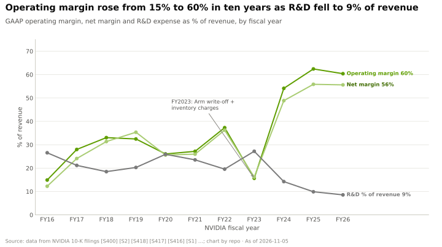
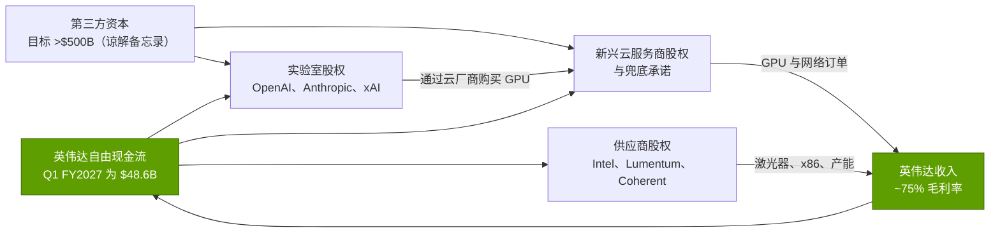
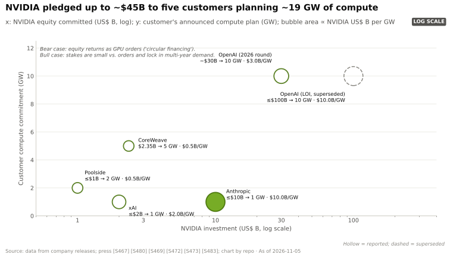
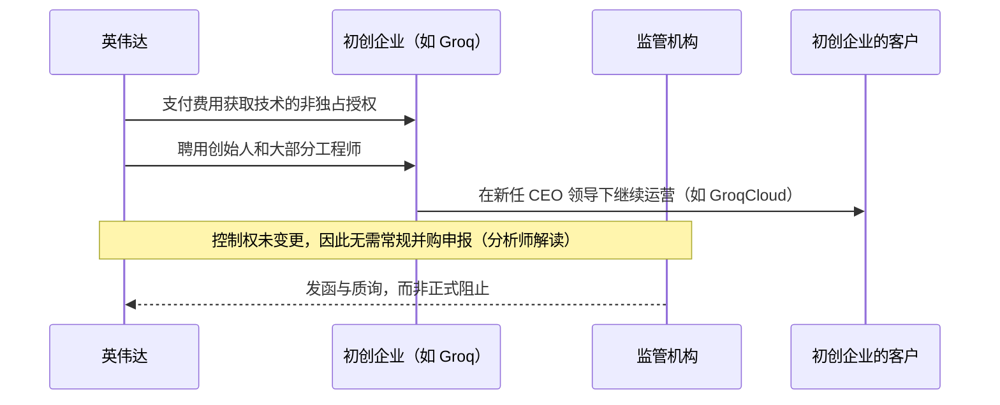

# 生态、市场进入与资本：价值链与企业发展视角

> [!NOTE]
> 本页为英文原文的简体中文参考译文，仅供参考；如有出入，以[英文原文](../../../layers/13-ecosystem-gtm-and-capital/value-chain-and-corp-dev.md "English original")为准。

第 13 层 · 生态、市场进入与资本 · 约 13 分钟阅读 · 最近核实：2026-11-05

## ⚡ 要点速览

- **英伟达牢牢把握其可控环节中最丰厚的利润率。** 其 Q2 FY2027 毛利率为 75.0%，台积电为 66.4%，为其组装机架的 [ODM](../../../glossary.md#odm) 估计仅约 ~2–3%；目前只有存储厂商赚得更多（美光 86.8%）[[S405]](../../../sources/bibliography.md#s405)[[S3538]](../../../sources/bibliography.md#s3538)[[S332]](../../../sources/bibliography.md#s332)[[S3533]](../../../sources/bibliography.md#s3533)。
- **其资本以需求的形式回流。** 英伟达每吉瓦的价值量约 ~$35B（CEO，2025 年 8 月），因此每 GW $10B 的股权投资预付的还不到其销售额的三分之一 [[S398]](../../../sources/bibliography.md#s398)[[S469]](../../../sources/bibliography.md#s469)。
- **三种并购结构。** 平台型收购（Mellanox，$6.9B）、软件补强收购（Run:ai ~$700M）以及[授权加收购式招聘](../../../glossary.md#licence-plus-acquihire)（Enfabrica >$900M，Groq 据报道 ~$20B）[[S464]](../../../sources/bibliography.md#s464)[[S476]](../../../sources/bibliography.md#s476)[[S475]](../../../sources/bibliography.md#s475)[[S90019]](../../../sources/bibliography.md#s90019)。
- **股权投资如今既锁定需求，也锁定供给。** 对英特尔（$5B）、Lumentum 和 Coherent（各 $2B）以及据报道对美满电子（$2B）的股权投资，都附带产能或产品承诺 [[S4009]](../../../sources/bibliography.md#s4009)[[S13529]](../../../sources/bibliography.md#s13529)[[S90037]](../../../sources/bibliography.md#s90037)。
- **[Q8 · 价值池与并购机会]** 稀缺资产是配额、开发者和团队，而非工厂。英伟达通过授权获取团队，通过股权投资锁定需求，通过预付式股权投资锁定供给；留给其他公司的机会在于可移植软件、主权融资和供应商产能。

## 谁攫取了价值

| 参与者 | 经济特征 | 英伟达的资本如何触及 |
|---|---|---|
| 英伟达 | 毛利率 75.0%，营业利润率 ~60%（FY2026）[[S405]](../../../sources/bibliography.md#s405)[[S1]](../../../sources/bibliography.md#s1) | 现金来源 |
| 存储与晶圆代工（SK 海力士、美光、台积电） | 利润率 66–87% [[S3533]](../../../sources/bibliography.md#s3533)[[S3538]](../../../sources/bibliography.md#s3538) | 预付款及 $279B 的供应承诺 [[S407]](../../../sources/bibliography.md#s407) |
| 光器件与元器件（Lumentum、Coherent） | 产能受限 | $2B 股权投资加采购承诺 [[S13529]](../../../sources/bibliography.md#s13529) |
| 机架 ODM（富士康等） | 公司整体毛利率 ~6%；单机架 ~2–3%（估计）[[S3522]](../../../sources/bibliography.md#s3522)[[S332]](../../../sources/bibliography.md#s332) | 无需投资 |
| 新兴云服务商（CoreWeave、Lambda、Nscale） | 高杠杆：2026 年年中 CoreWeave 背负约 ~$35B 债务 [[S12501]](../../../sources/bibliography.md#s12501) | 股权投资、兜底承诺、GPU 售后回租 [[S472]](../../../sources/bibliography.md#s472)[[S90067]](../../../sources/bibliography.md#s90067)[[S483]](../../../sources/bibliography.md#s483) |
| 前沿实验室（OpenAI、Anthropic、xAI） | 依靠超大规模股权融资 | ~$30B、最多 $10B、E 轮股权 [[S13526]](../../../sources/bibliography.md#s13526)[[S469]](../../../sources/bibliography.md#s469)[[S13039]](../../../sources/bibliography.md#s13039) |

> [!TIP]
> **算例 —— 一个 Vera Rubin [NVL72](../../../glossary.md#nvl72) 机架上谁赚多少。** 摩根士丹利估计该机架约 ~$7.8M，其中 72 颗 Rubin GPU 约 ~$3.96M [[S332]](../../../sources/bibliography.md#s332)。仅 GPU 这一项，英伟达 75% 的毛利率就带来约 ~$3.0M 的毛利（示意性计算；它还销售机架中的 CPU、交换机和网卡）。ODM 约 ~1.9% 的机架利润率约为 ~$0.15M（估计）[[S332]](../../../sources/bibliography.md#s332)。在同一台设备上，英伟达的收益约为组装商的 20 倍。

## 英伟达的资本流向何处，谁从中受益

这一闭环正是[循环融资](../../../glossary.md#circular-financing)之争的核心：英伟达投出的一美元股权，可能以 GPU 收入的形式回流。受益者包括：无法以同样低成本融资的买方、需要资金扩产的供应商，以及 2026 年 8 月融资平台引入的资产管理公司 [[S12528]](../../../sources/bibliography.md#s12528)。风险在于[供应商融资（vendor financing）](../../../glossary.md#vendor-financing)：一旦终端需求走弱，英伟达将同时持有应收账款和股权。

> [!TIP]
> **算例 —— 一个吉瓦的投资回收。** 英伟达承诺向 Anthropic 投资最多 $10B，同时配套最多 1 GW 的英伟达系统 [[S469]](../../../sources/bibliography.md#s469)。按每 GW ~$35B 的英伟达价值量 [[S398]](../../../sources/bibliography.md#s398) 和 ~75% 的毛利率 [[S405]](../../../sources/bibliography.md#s405) 计算，该吉瓦若建成，可带来 ~$26B 的毛利，约为投资额的 2.6 倍。这笔股权投资本质上是获客成本，只有在吉瓦级算力真正落地时才算便宜。

## 并购打法

| 交易结构 | 示例（价格） | 完成所需时间 | 监管敞口 | 英伟达获得了什么 |
|---|---|---|---|---|
| 平台型收购 | Mellanox $6.9B；Arm $40B（失败）[[S464]](../../../sources/bibliography.md#s464)[[S465]](../../../sources/bibliography.md#s465) | 13 个月；17 个月后终止 [[S466]](../../../sources/bibliography.md#s466) | 多国全面审查 | 一个新的层级（网络） |
| 软件补强收购 | Run:ai ~$700M；Deci、OctoAI、CentML、Lepton；SchedMD [[S476]](../../../sources/bibliography.md#s476)[[S479]](../../../sources/bibliography.md#s479)[[S13041]](../../../sources/bibliography.md#s13041) | 数周至 8 个月 | Run:ai 经历欧盟审查 | 编排与推理团队 |
| 授权加收购式招聘 | Enfabrica >$900M；Groq ~$20B 🟡 [[S475]](../../../sources/bibliography.md#s475)[[S90019]](../../../sources/bibliography.md#s90019) | 数日 | 政治层面审视，未发现申报 [[S13511]](../../../sources/bibliography.md#s13511) | 创始人、工程师、非独占知识产权 |
| 对客户的股权投资 | OpenAI ~$30B、Anthropic 最多 $10B、CoreWeave $2B [[S13526]](../../../sources/bibliography.md#s13526)[[S469]](../../../sources/bibliography.md#s469)[[S472]](../../../sources/bibliography.md#s472) | 随融资轮交割 | 涉及配额的反垄断关切 [[S9503]](../../../sources/bibliography.md#s9503) | 需求与设计参与 |
| 对供应商或合作伙伴的股权投资 | 英特尔 $5B、Synopsys $2B、诺基亚 $1B、Lumentum 和 Coherent 各 $2B [[S4009]](../../../sources/bibliography.md#s4009)[[S471]](../../../sources/bibliography.md#s471)[[S470]](../../../sources/bibliography.md#s470)[[S13529]](../../../sources/bibliography.md#s13529) | 数周至 3 个月 | 常规审批（英特尔交易于 2025 年 12 月获批） | 产能、协同设计、新市场 |

> [!TIP]
> **算例 —— 速度值多少钱。** Groq 授权交易在数日内完成；Run:ai 则耗时八个月，其中包括欧盟审查 [[S474]](../../../sources/bibliography.md#s474)[[S476]](../../../sources/bibliography.md#s476)。对一笔 ~$20B 的交易，按假设的 10% 资本成本计算，八个月的时间价值约为 ~$1.3B（🔴 本资料库测算），尚未计入交易被阻止的风险。

🔧 技术细节：“授权加收购式招聘”为何可行，以及其局限

美国的并购申报覆盖超过规模门槛的有表决权股份或资产收购；而非独占授权加上雇佣要约既不转移控制权，也不转移独占性资产。这正是分析师认为 Groq 交易实质上是一次收购、却在未经公开审查的情况下完成交割的原因 [[S90018]](../../../sources/bibliography.md#s90018)[[S90019]](../../../sources/bibliography.md#s90019)。其局限在于：授权方保留向他方授权的权利；关键员工未必全部转入；且监管机构已释放信号，将审视此类结构——正如参议员在 Groq 交易后所敦促的那样 [[S13511]](../../../sources/bibliography.md#s13511)。

### 值得了解的私有公司（仅基于公开信息）

| 公司 | 业务 | 最近一次公开融资（据记录） | 与英伟达的关联 | 为何重要 |
|---|---|---|---|---|
| Mistral AI | 欧洲开放权重模型；Mistral Compute 云 | €1.7B C 轮，2025 年 9 月，由 ASML 领投 [[S481]](../../../sources/bibliography.md#s481)[[S13030]](../../../sources/bibliography.md#s13030) | 投资方；18,000 颗 Grace Blackwell [[S13011]](../../../sources/bibliography.md#s13011) | 欧洲主权 AI 的锚点 |
| Thinking Machines Lab | 前沿实验室（前 OpenAI CTO 创立） | $2B 种子轮，2025 年 [[S481]](../../../sources/bibliography.md#s481) | 投资方 | 新的吉瓦级买方 |
| Reflection AI | 美国开放权重前沿模型 | 英伟达领投约 ~$2B 融资，2025 年 10 月 [[S481]](../../../sources/bibliography.md#s481) | 领投方 | 在英伟达平台上的开放模型需求 |
| Poolside | 编程模型；2 GW 的 Project Horizon | 在约 ~$2B 融资中英伟达最多出资 $1B [[S483]](../../../sources/bibliography.md#s483) | 投资方 | 缩微版的“以资本换产能” |
| Crusoe | 能源优先的 AI 数据中心开发商 | $3.9B F 轮，估值 $30.9B（2026 年 9 月，数据追踪平台）[[S12522]](../../../sources/bibliography.md#s12522) | 投资方 [[S481]](../../../sources/bibliography.md#s481) | 为实验室建设吉瓦级站点 |
| Lambda | GPU 云 | 约 ~$4B IPO 前融资（2026 年 10 月）[[S12521]](../../../sources/bibliography.md#s12521) | 投资方；约 ~$1.5B 的 GPU 售后回租 [[S483]](../../../sources/bibliography.md#s483) | 一家英伟达既投资、又向其租用算力的新兴云服务商 |
| Groq | 授权交易后的 GroqCloud 推理服务 | 据报道英伟达授权费 ~$20B（2025 年 12 月）[[S474]](../../../sources/bibliography.md#s474)[[S90019]](../../../sources/bibliography.md#s90019) | 被授权方及团队聘用 | 授权结构的试金石 |
| Ayar Labs | 光 I/O 芯粒（chiplet） | $155M D 轮（2024 年 12 月）[[S482]](../../../sources/bibliography.md#s482) | 投资方（AMD、英特尔亦参投） | 面向纵向扩展互连架构的光学方案 |

标注 [[S481]](../../../sources/bibliography.md#s481)–[[S483]](../../../sources/bibliography.md#s483) 的融资数据部分凭记忆录入（见核实队列），仅供参考。新兴云服务商在[第 12 层](../../../layers/12-orchestration-and-cloud-services/value-chain-and-corp-dev.md)中有深入讨论。

**[Q8 · 价值池与并购机会]** 这里的一切都在守护英伟达 ~75% 的利润率，每种稀缺资产各用一种工具：平台型并购补齐缺失的层级，补强收购和授权获取团队，对客户的股权投资锁定配额，对供应商的股权投资锁定产能。留给他人的机会，是英伟达无法在不引发利益冲突的情况下占据的领域：可移植软件（高通–Modular [[S9511]](../../../sources/bibliography.md#s9511)）、多供应商的主权项目（HUMAIN 同时向英伟达、AMD 和高通采购 [[S13005]](../../../sources/bibliography.md#s13005)[[S13517]](../../../sources/bibliography.md#s13517)[[S90030]](../../../sources/bibliography.md#s90030)），以及不依赖单一厂商资产负债表的融资结构。

## 🎯 企业发展视角

1. **授权加收购式招聘：**哪些推理、互连或编译器团队可以通过这种方式获得？买方应如何为监管机构开始将这种结构视同并购的风险定价？
2. **对客户的战略性股权投资：**英伟达的股权投资只有在算力真正建成时，才能按每吉瓦毛利收回约 ~2.6 倍。规模较小的厂商需要怎样的回报？应采用股权、认股权证还是预付算力的形式？
3. **主权合作：**当主权基金提供资本时，芯片厂商是否仍需要强大的资产负债表，还是只需要可信的路线图和本地合作伙伴？
4. **供应商产能：**英伟达如今用股权购买光器件产能。哪些元器件（激光器、[HBM](../../../glossary.md#hbm)、基板）稀缺到股权投资比长期协议更有效？

## 📚 来源（Sources）

<!-- Auto-generated from the [S…] citations on this page by `make build`. Edit sources/registry/*.csv, not this list. -->

- [**S1**](../../../sources/bibliography.md#s1) NVIDIA Corporation via SEC EDGAR, *NVIDIA Announces Financial Results for Fourth Quarter and Fiscal 2026 (Form 8-K exhibit 99.1)*, 2026-02-25. [Link](https://www.sec.gov/Archives/edgar/data/1045810/000104581026000019/q4fy26pr.htm)
- [**S332**](../../../sources/bibliography.md#s332) Tiger Brokers (iTiger), *Morgan Stanley's BOM analysis of NVIDIA's Rubin: GPU share declines; PCB, MLCC and ABF substrate values soar*, 2026-05-20. [Link](https://www.itiger.com/news/1188068712)
- [**S398**](../../../sources/bibliography.md#s398) NVIDIA Investor Relations, *NVIDIA Q2 FY2026 earnings call (2025-08-27): AI factory economics commentary*, 2025-08-27. [Link](https://investor.nvidia.com/events-and-presentations/events-and-presentations/default.aspx)
- [**S405**](../../../sources/bibliography.md#s405) NVIDIA Corporation via SEC EDGAR, *NVIDIA Announces Financial Results for Second Quarter Fiscal 2027 (Form 8-K exhibit 99.1)*, 2026-08-26. [Link](https://www.sec.gov/Archives/edgar/data/0001045810/000104581026000073/q2fy27pr.htm)
- [**S407**](../../../sources/bibliography.md#s407) NVIDIA Corporation via SEC EDGAR, *NVIDIA Corporation Form 10-Q for quarter ended July 26, 2026*, 2026-08-28. [Link](https://www.sec.gov/Archives/edgar/data/1045810/000104581026000075/nvda-20260726.htm)
- [**S464**](../../../sources/bibliography.md#s464) NVIDIA Newsroom, *NVIDIA to Acquire Mellanox for $6.9 Billion*, 2019-03-11. [Link](https://nvidianews.nvidia.com/news/nvidia-to-acquire-mellanox-for-6-9-billion)
- [**S465**](../../../sources/bibliography.md#s465) NVIDIA Newsroom, *NVIDIA to Acquire Arm for $40 Billion, Creating World's Premier Computing Company for the Age of AI*, 2020-09-13. [Link](https://nvidianews.nvidia.com/news/nvidia-to-acquire-arm-for-40-billion-creating-worlds-premier-computing-company-for-the-age-of-ai)
- [**S466**](../../../sources/bibliography.md#s466) NVIDIA Newsroom, *NVIDIA and SoftBank Group Announce Termination of NVIDIA's Acquisition of Arm Limited*, 2022-02-08. [Link](https://nvidianews.nvidia.com/news/nvidia-and-softbank-group-announce-termination-of-nvidias-acquisition-of-arm-limited)
- [**S469**](../../../sources/bibliography.md#s469) Microsoft Official Blog, *Microsoft, NVIDIA and Anthropic announce strategic partnerships*, 2025-11-18. [Link](https://blogs.microsoft.com/blog/2025/11/18/microsoft-nvidia-and-anthropic-announce-strategic-partnerships/)
- [**S470**](../../../sources/bibliography.md#s470) NVIDIA Newsroom, *NVIDIA and Nokia partnership on AI-RAN; NVIDIA $1B equity investment in Nokia*, 2025-10-28. [Link](https://nvidianews.nvidia.com/)
- [**S471**](../../../sources/bibliography.md#s471) NVIDIA Newsroom, *NVIDIA and Synopsys strategic partnership; NVIDIA $2B investment in Synopsys common stock*, 2025-12-01. [Link](https://nvidianews.nvidia.com/)
- [**S472**](../../../sources/bibliography.md#s472) CoreWeave Newsroom, *CoreWeave and NVIDIA expand partnership; NVIDIA invests $2B in CoreWeave Class A stock*, 2026-01-26. [Link](https://www.coreweave.com/news)
- [**S474**](../../../sources/bibliography.md#s474) Groq Newsroom, *Groq and NVIDIA enter non-exclusive inference technology licensing agreement*, 2025-12-24. [Link](https://groq.com/newsroom)
- [**S475**](../../../sources/bibliography.md#s475) CNBC, *Nvidia spends over $900 million on Enfabrica CEO, AI startup technology*, 2025-09-18. [Link](https://www.cnbc.com/technology/)
- [**S476**](../../../sources/bibliography.md#s476) NVIDIA Blog, *NVIDIA to Acquire GPU Orchestration Software Provider Run:ai*, 2024-04-24. [Link](https://blogs.nvidia.com/blog/runai/)
- [**S479**](../../../sources/bibliography.md#s479) Various (press), *Reporting on NVIDIA tuck-in acquisition prices (Run:ai, Deci, Shoreline, OctoAI, Gretel, Lepton, CentML) — The Information, Calcalist, Reuters, CNBC*, 2025-06. [Link](https://www.reuters.com/technology/)
- [**S481**](../../../sources/bibliography.md#s481) Various (company announcements; Reuters, Bloomberg, TechCrunch), *Reporting on NVIDIA participation in AI-lab and neocloud funding rounds 2023–2025 (Inflection, Cohere, Hugging Face, Databricks, Mistral, xAI, Perplexity, Crusoe, Lambda, Nebius, Nscale, Together AI, Poolside, Reflection AI, Thinking Machines, Cursor)*, 2025-11. [Link](https://techcrunch.com/)
- [**S482**](../../../sources/bibliography.md#s482) Various (company announcements; Reuters, Bloomberg), *Reporting on NVIDIA participation in robotics, autonomy, photonics, storage and energy rounds (Figure AI, Wayve, Scale AI, Ayar Labs, Enfabrica, VAST Data, Sakana AI, TerraPower, Commonwealth Fusion Systems, Applied Digital, Recursion)*, 2025-09. [Link](https://www.reuters.com/technology/)
- [**S483**](../../../sources/bibliography.md#s483) Various (Bloomberg, The Information, Reuters), *Reporting on NVIDIA commitments to xAI (up to $2B in ~$20B raise), Poolside (up to $1B), Lambda (~$1.5B GPU lease-back) and Wayve ($500M LOI)*, 2025-10. [Link](https://www.bloomberg.com/technology)
- [**S3522**](../../../sources/bibliography.md#s3522) AI CERTS News, *Foxconn results and AI server margin pressure*, 2026. [Link](https://www.aicerts.ai/news/?p=29781)
- [**S3533**](../../../sources/bibliography.md#s3533) Micron Technology via SEC EDGAR, *Micron Technology fiscal Q4 2026 results (Form 8-K exhibit 99.1)*, 2026-09. [Link](https://www.sec.gov/Archives/edgar/data/0000723125/000072312526000018/a2026q4ex991-pressrelease.htm)
- [**S3538**](../../../sources/bibliography.md#s3538) TSMC, *TSMC reports third quarter 2026 results*, 2026-10. [Link](https://pr.tsmc.com/english/news/3346)
- [**S4009**](../../../sources/bibliography.md#s4009) SDxCentral, *Intel gets hands on Nvidia's $5B investment*, 2025-12. [Link](https://www.sdxcentral.com/news/intel-gets-hands-on-nvidias-5b-investment/)
- [**S9503**](../../../sources/bibliography.md#s9503) Business Standard (Bloomberg), *Nvidia gets subpoena from US Justice Dept as antitrust probe deepens*, 2024-09-04. [Link](https://www.business-standard.com/world-news/nvidia-gets-subpoena-from-us-justice-dept-as-antitrust-probe-deepens-124090400121_1.html)
- [**S9511**](../../../sources/bibliography.md#s9511) Nasdaq (Qualcomm press release), *Qualcomm Completes Acquisition of Modular*, 2026-07-29. [Link](https://www.nasdaq.com/press-release/qualcomm-completes-acquisition-modular-2026-07-29)
- [**S12501**](../../../sources/bibliography.md#s12501) Runtime Wire, *CoreWeave reports $2.58 billion Q2 revenue with $35 billion in debt*, 2026-08. [Link](https://runtimewire.com/article/coreweave-q2-2026-revenue-debt-ai-cloud)
- [**S12521**](../../../sources/bibliography.md#s12521) TechCrunch, *AI computing startup Lambda to raise $4B ahead of planned IPO*, 2026-10-06. [Link](https://techcrunch.com/2026/10/06/ai-computing-startup-lambda-to-raise-4b-ahead-of-planned-ipo)
- [**S12522**](../../../sources/bibliography.md#s12522) ValueAdd VC, *Neocloud valuations 2026 (tracker)*, 2026-10-31. [Link](https://valueaddvc.com/blog/neocloud-valuations-2026)
- [**S12528**](../../../sources/bibliography.md#s12528) NVIDIA Newsroom, *NVIDIA Partners With Apollo, BlackRock, Blackstone, Brookfield, Goldman Sachs and KKR to Establish AI Compute Infrastructure Financing Platforms to Mobilize Over $500 Billion of Third-Party Capital*, 2026-08-10. [Link](https://nvidianews.nvidia.com/news/nvidia-partners-with-apollo-blackrock-blackstone-brookfield-goldman-sachs-and-kkr-to-establish-ai-compute-infrastructure-financing-platforms-to-mobilize-over-500-billion-of-third-party-capital)
- [**S13005**](../../../sources/bibliography.md#s13005) Middle East AI News, *Saudi to build 500MW AI factories with NVIDIA tech*, 2025-05. [Link](https://www.middleeastainews.com/p/saudi-nvidia-500mw-ai-factories)
- [**S13011**](../../../sources/bibliography.md#s13011) Sifted, *Mistral Compute launch*, 2025-06-11. [Link](https://sifted.eu/articles/mistral-compute-launch)
- [**S13030**](../../../sources/bibliography.md#s13030) Rallies.ai, *Nvidia participates in 14 European funding rounds in 2025, including EUR 1.7B Mistral Series C*, 2026-01. [Link](https://rallies.ai/news/nvidia-doubles-european-startup-investments-to-14-rounds-backs-17b-mistral)
- [**S13039**](../../../sources/bibliography.md#s13039) xAI, *xAI raises $20B Series E (announcement)*, 2026-01-06. [Link](https://x.ai/blog/series-e)
- [**S13041**](../../../sources/bibliography.md#s13041) NVIDIA Blog, *NVIDIA Acquires Open-Source Workload Management Provider SchedMD*, 2025-12-15. [Link](https://blogs.nvidia.com/blog/nvidia-acquires-schedmd)
- [**S13511**](../../../sources/bibliography.md#s13511) Kavout, *Is Nvidia's Groq deal a masterstroke or an antitrust minefield?*, 2026. [Link](https://www.kavout.com/market-lens/is-nvidia-s-groq-deal-a-masterstroke-or-an-antitrust-minefield)
- [**S13517**](../../../sources/bibliography.md#s13517) Futuriom, *NVIDIA and AMD score AI hub deals in Saudi Arabia*, 2025-05. [Link](https://www.futuriom.com/articles/news/nvidia-amd-score-deals-for-the-saudi-ai-hub/2025/05)
- [**S13526**](../../../sources/bibliography.md#s13526) Storyboard18, *Nvidia CEO Jensen Huang hints no further investments in OpenAI, Anthropic*, 2026. [Link](https://www.storyboard18.com/brand-makers/nvidia-ceo-jensen-huang-hints-no-further-investments-in-openai-anthropic-heres-why-91280.htm)
- [**S13529**](../../../sources/bibliography.md#s13529) Bloomberg Government, *Nvidia to invest $4 billion in data center optics companies*, 2026-03-02. [Link](https://news.bgov.com/artificial-intelligence/nvidia-to-invest-4-billion-in-data-center-optics-companies-1)
- [**S90018**](../../../sources/bibliography.md#s90018) Constellation Research, *Nvidia's Groq deal: acquisition, acquihire or creative licensing deal?*, 2025-12. [Link](https://www.constellationr.com/insights/news/nvidias-groq-deal-acquisition-acquihire-or-creative-licensing-deal)
- [**S90019**](../../../sources/bibliography.md#s90019) TechSpot, *Nvidia's $20 billion Groq deal looks a lot like an acquisition*, 2025-12. [Link](https://www.techspot.com/news/110723-nvidia-20-billion-groq-deal-looks-lot-like.html)
- [**S90030**](../../../sources/bibliography.md#s90030) Morningstar, *Qualcomm: Humain deal provides some AI upside*, 2025-10. [Link](https://www.morningstar.com/stocks/qualcomm-humain-deal-provides-some-ai-upside)
- [**S90037**](../../../sources/bibliography.md#s90037) Converge Digest, *NVIDIA invests $2B in Marvell to extend NVLink Fusion AI ecosystem*, 2026-03. [Link](https://convergedigest.com/nvidia-invests-2b-in-marvell-to-extend-nvlink-fusion-ai-ecosystem/)
- [**S90067**](../../../sources/bibliography.md#s90067) DatacenterDynamics, *Nvidia to purchase unsold compute capacity from CoreWeave for $6.3bn*, 2025-09-16. [Link](https://www.datacenterdynamics.com/en/news/nvidia-to-purchase-unsold-compute-capacity-from-coreweave-for-63bn/)
