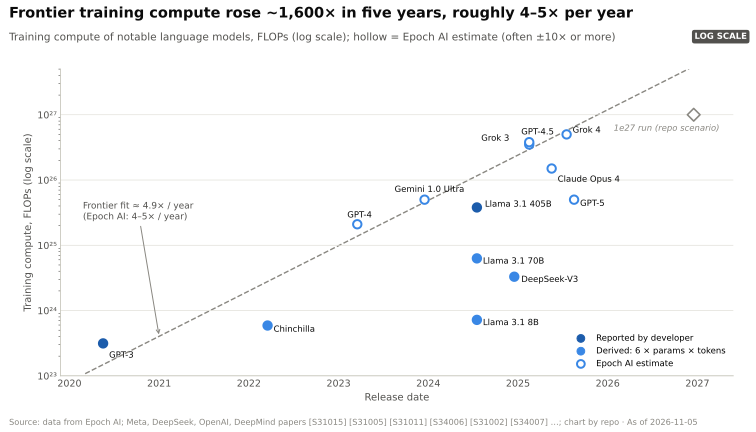
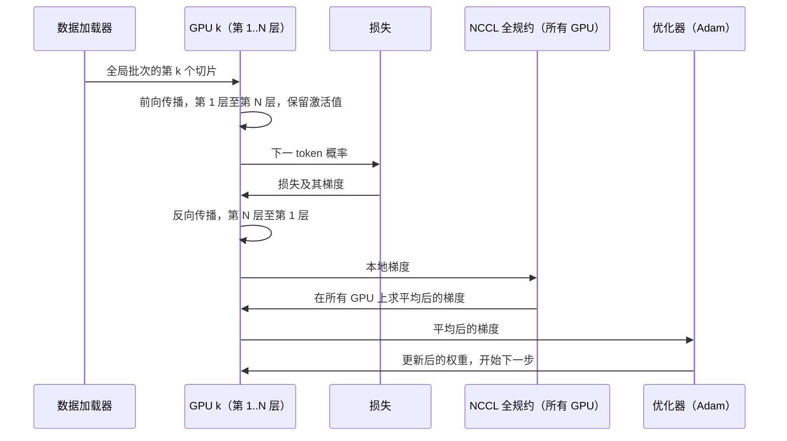
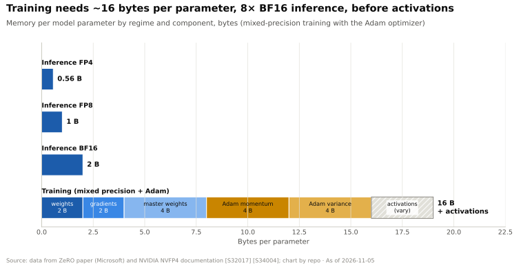
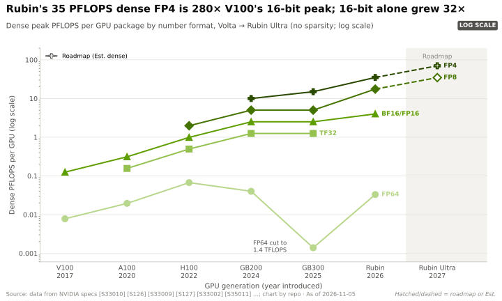
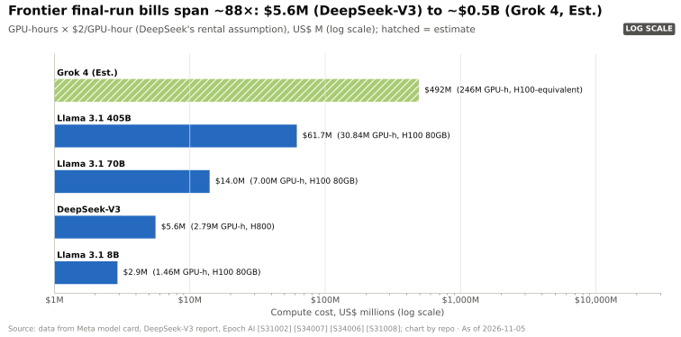
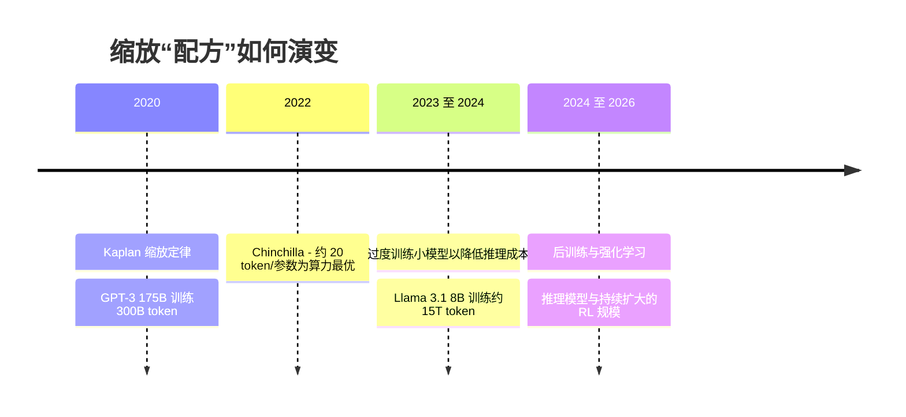
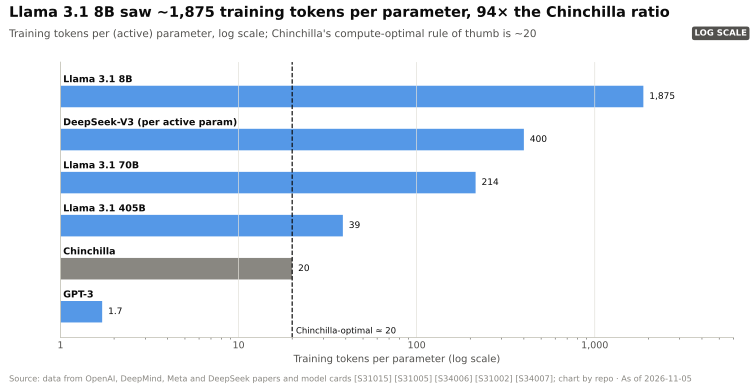
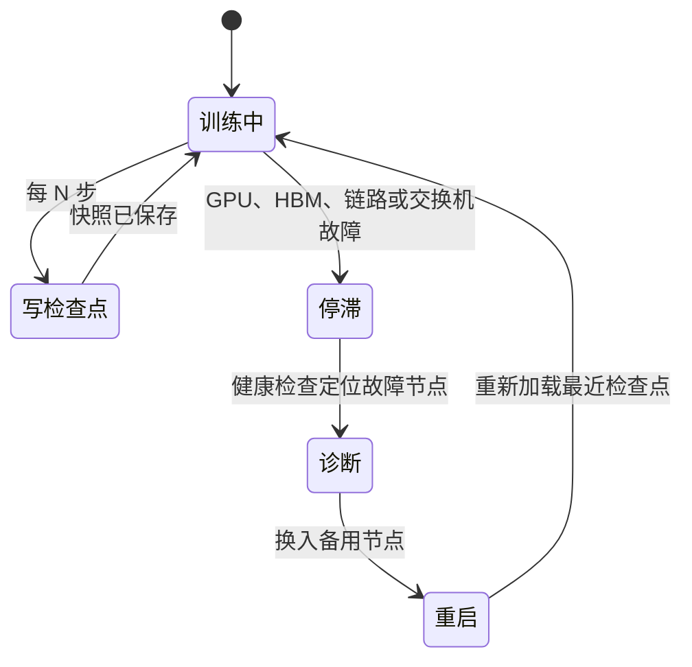
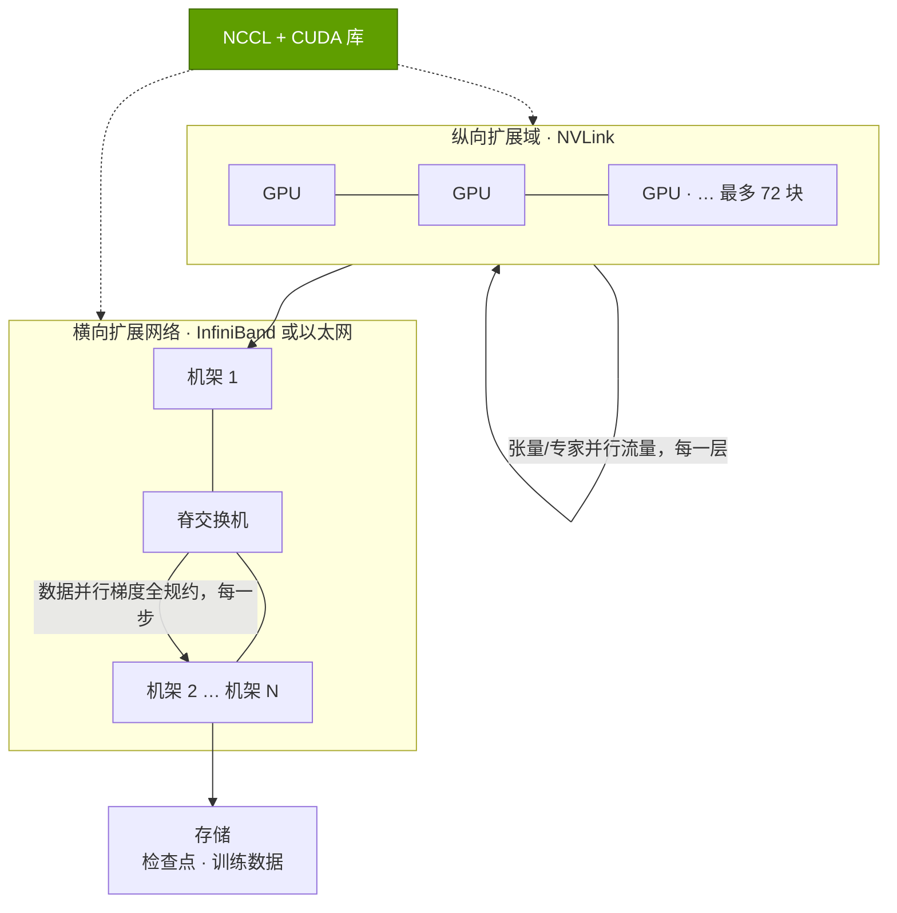

# P1 · AI 训练原理

> [!NOTE]
> 本页为英文原文的简体中文参考译文，仅供参考；如有出入，以[英文原文](../../primers/P1-how-ai-training-works.md "English original")为准。

入门篇 P1 · 写给非工程师的基础知识 · 约 22 分钟阅读 · 最近核实：2026-11-05

> [!NOTE]
> **如果你熟悉电子表格和财务、但不熟悉芯片，请从这里开始。** 本篇解释“训练一个模型”在物理上意味着什么、为何它需要数万块
> GPU 连续运行数月，以及应当追问哪些数字。推理（使用已训练好的模型）见 [P2](P2-how-ai-inference-works.md)；工作如何在多块
> GPU 之间拆分见 [P4](P4-parallelism-explained.md)。

## ⚡ 要点速览

- **训练是一项规模巨大、高度重复的计算。** 模型预测下一个 [token（词元）](../glossary.md#token)，衡量误差，再把每一个[参数](../glossary.md#parameter)朝“错得少一点”的方向微调——在数万亿个 token 上反复进行。总计算量 ≈ **6 × 参数量 × 训练 token 数**：Meta 的 Llama 3.1 405B（405B 参数、15.6T token）需要 **3.8 × 10²⁵ FLOPs** [[S34006]](../../sources/bibliography.md#s34006)。
- **这可以直接换算为 GPU 时数和美元。** Llama 3.1 405B 消耗了 **30.84M H100 GPU 时** [[S31002]](../../sources/bibliography.md#s31002)；按 DeepSeek 在自身成本测算中采用的 ~$2/GPU 时租赁价格 [[S34007]](../../sources/bibliography.md#s34007)，仅最终一次训练的算力成本就达 **~$62M**（估计，本资料库测算）。
- **GPU 在训练中的实际效率远低于峰值。** Meta 在最多 16,384 块 H100 上测得的**模型 FLOPs 利用率（MFU）为 38–43%** [[S34006]](../../sources/bibliography.md#s34006)；用公布的 FLOPs 除以公布的 GPU 时数，隐含的整体利用率 ~35%，因为重启、评估和数据停顿同样会消耗机时。
- **设定下限的不只是算力，还有内存。** 采用 Adam 优化器的混合精度训练，在计入激活值之前就需要 **~16 字节/参数** [[S34004]](../../sources/bibliography.md#s34004)，是 BF16 推理的 8 倍：一个 405B 模型的训练状态 ~6.5 TB，超过 81 块 H100 的内存总量。
- **前沿模型的训练算力每年增长 ~4–5×** [[S31007]](../../sources/bibliography.md#s31007)：从 2020 年 GPT-3 的 3.1 × 10²³ FLOPs [[S31015]](../../sources/bibliography.md#s31015)，到 2025 年 Grok 4 的 ~5 × 10²⁶（估计，Epoch AI）[[S31008]](../../sources/bibliography.md#s31008)，五年间增长约 1,600×。
- **训练“配方”已两度改变。** Chinchilla（2022）表明当时的模型训练不足（~20 token/参数为算力最优）[[S31005]](../../sources/bibliography.md#s31005)；此后各实验室有意对较小模型进行[**过度训练**](../glossary.md#over-training)（Llama 3.1 8B 每个参数约对应 ~1,875 个 token）[[S31002]](../../sources/bibliography.md#s31002)，并把投入转向[**后训练**](../glossary.md#post-training)和[**强化学习**](../glossary.md#reinforcement-learning)：Epoch AI 估计 GPT-5 的总算力*少于* GPT-4.5 [[S31010]](../../sources/bibliography.md#s31010)。
- **在大规模下，硬件故障是常态。** Llama 3 为期 54 天的预训练快照记录了 **466 次作业中断，其中 419 次为非计划中断**，约每三小时一次，GPU 和 [HBM](../glossary.md#hbm) 是首要原因 [[S34006]](../../sources/bibliography.md#s34006)[[S31003]](../../sources/bibliography.md#s31003)。可靠性、检查点和快速重启本身就是产品的一部分。
- **为何这对英伟达重要：** 训练是高度同步、通信密集的作业，因此胜出的系统不是最快的芯片，而是最快的*集群*：GPU + [NVLink](../glossary.md#nvlink) [纵向扩展（scale-up）](../glossary.md#scale-up) + [InfiniBand](../glossary.md#infiniband)/以太网[横向扩展（scale-out）](../glossary.md#scale-out) + NCCL + 具备容错能力的软件。这一组合是英伟达的护城河，也恰恰是看空情景认为效率提升可能将其商品化的部分。

## 1. 训练的对象：神经网络、Transformer、token 与参数

**类比。** 可以把模型想象成一张由数字构成的巨型电子表格。文本从顶部输入，流经数百张做乘法运算的工作表，底部输出每个可能的下一个词的
概率。训练就是不断调整表格中的数字，直到这些概率足够准确。这些数字就是模型的**参数**（也称权重）；除此之外，模型并没有“学到”
任何别的东西。

- [神经网络](../glossary.md#neural-network)是由若干层堆叠而成的结构；每一层把输入与一个参数矩阵相乘，再施加一个简单的非线性函数。矩阵乘法正是
  GPU 及其[张量核心](../glossary.md#tensor-core)专门为高速执行而设计的那一种运算。
- [Transformer](../glossary.md#transformer) 是近年来几乎所有前沿语言模型背后的网络架构。每一层由两部分组成：**[注意力（attention）](../glossary.md#attention)**，
  即每个 token 回看之前的 token 以获取上下文；以及**前馈模块**（MLP），大部分参数都位于此。Llama 3.1 70B 堆叠了 80 个这样的层
  [[S32006]](../../sources/bibliography.md#s32006)。
- **token** 是文本的基本单位：长度为几个字符的词片段。模型读取 token、在 token 上训练，也按 token
  计价。

> [!TIP]
> **算例 —— “405B 参数”究竟有多大？** 以 [BF16](../glossary.md#bf16) 存储时每个参数占 2 字节，
> 因此仅 Llama 3.1 405B 的权重就有 405B × 2 B = **810 GB**。一块 H100 拥有 80 GB HBM [[S33002]](../../sources/bibliography.md#s33002)，所以仅仅*装下*
> 这个模型就至少需要 11 块 H100，这还没算任何训练状态。即便在 288 GB 的 Blackwell Ultra 或 Rubin GPU 上
> [[S32004]](../../sources/bibliography.md#s32004)[[S33005]](../../sources/bibliography.md#s33005)，也仍需三块。迫使系统走向多 GPU 的不只是速度，还有模型规模。

🔧 技术细节：参数位于何处

在稠密 Transformer 中，几乎所有参数都位于每一层的注意力投影矩阵和前馈（MLP）矩阵中；在前沿规模下，嵌入层只占很小一部分。
[混合专家模型（MoE）](../glossary.md#mixture-of-experts)用许多“专家”MLP 取代单一 MLP，并把每个 token 路由到其中少数几个，
因此总参数量与*激活*参数量不同：DeepSeek-V3 拥有 671B 参数，但每个 token
只激活 37B [[S34007]](../../sources/bibliography.md#s34007)。训练算力随激活参数量扩展，内存则随总参数量扩展。

## 2. 训练循环：前向传播、损失、反向传播、优化器步

训练把同一个循环重复数百万次。每一步处理一个由 token 序列组成的**批次**（前沿模型训练中每批可达数百万个
token）：

1. **[前向传播](../glossary.md#forward-pass)：** 让批次数据流经每一层，预测每个下一 token。
2. **[损失](../glossary.md#loss-function)：** 将预测与实际的下一 token 比较；损失是衡量“错了多少”的
   单一数值。
3. **[反向传播](../glossary.md#backward-pass)（backpropagation）：** 逆序遍历各层，为每个参数计算一个
   [梯度](../glossary.md#gradient)：即为降低损失，应朝哪个方向、以多大幅度调整该参数。
4. **同步：** 每块 GPU 处理的是批次中的不同切片，因此需要通过[全规约（all-reduce）](../glossary.md#all-reduce)在 GPU 之间对梯度求平均，
   通常借助英伟达的 [NCCL](../glossary.md#nccl) 库完成 [[S34013]](../../sources/bibliography.md#s34013)。
5. **[优化器](../glossary.md#optimizer)步：** 优化器（几乎总是 [Adam](../glossary.md#adam) 或其变体）把
   梯度转换为权重更新。

下面的时序图从数据并行集群中某一块 GPU 的视角展示同一步骤。中间的全规约正是训练成为*网络*问题的原因：在每块 GPU
都贡献完自己的部分之前，任何 GPU 都无法进入下一步。

> [!TIP]
> **算例 —— “6 × N × D”从何而来。** 在前向传播中，每个参数对每个 token 执行一次乘法和一次加法：
> **2 FLOPs**。反向传播要计算两个梯度（分别相对于该层的输入和权重），约
> **4 FLOPs**。因此训练成本约为 **每参数每 token ~6 FLOPs** [[S31006]](../../sources/bibliography.md#s31006)。以 Llama 3.1 405B 为例：6 × 405 × 10⁹ ×
> 15.6 × 10¹² tokens = **3.79 × 10²⁵ FLOPs**，与 Meta 公布的 3.8 × 10²⁵ 相符 [[S34006]](../../sources/bibliography.md#s34006)。该规则忽略了随序列长度增长的注意力
> 计算，因此只是近似值，但它是 Epoch AI 和各实验室通用的标准初步估算方法 [[S31011]](../../sources/bibliography.md#s31011)。

🔧 技术细节：为何反向传播的成本是前向传播的两倍

对于计算 *y = W·x* 的一层，反向传播既需要 ∂loss/∂x（以继续向更早的层传播），**也**需要
∂loss/∂W（以更新本层权重）。两者都是与前向计算同等规模的矩阵乘法，因此
约为前向 FLOPs 的 2 倍。训练还需要保存前向传播的中间结果（**[激活值](../glossary.md#activation)**），
供反向传播使用；这是一项规模可观、随批次和序列长度变化的内存开销。工程师通过*激活重计算*以算力换内存：
丢弃部分激活值，并在反向传播时重新计算
[[S34008]](../../sources/bibliography.md#s34008)。

## 3. 内存：为何训练需要 ~16 字节/参数

**机制。** 推理只需要权重。训练则需要权重，*再加上*优化器为每个权重保存的全部信息。在标准的[混合精度](../glossary.md#mixed-precision)训练中，
算术运算以 BF16（速度快，2 字节）进行，但优化器会保留一份全精度 FP32 “主”副本，以免微小的更新被舍入抹掉，此外还有 Adam
为每个参数维护的两个滑动平均值。

| 组成部分（每参数） | 精度 | 字节 | 存在原因 |
|---|---|---|---|
| 工作权重 | BF16 | 2 | 用于前向和反向计算 |
| 梯度 | BF16 | 2（若以 FP32 保存则为 4） | 反向传播的输出 |
| 主权重 | FP32 | 4 | 累积微小更新而不因舍入丢失 |
| Adam 动量 | FP32 | 4 | 梯度的滑动均值 |
| Adam 方差 | FP32 | 4 | 梯度平方的滑动均值 |
| **激活值之前合计** | | **16（采用 FP32 梯度时 ~18）** | ZeRO 论文的核算口径 [[S34004]](../../sources/bibliography.md#s34004) |

> [!TIP]
> **算例 —— 405B 模型的内存下限。** 405B 参数 × 16 字节 = **6.5 TB** 训练状态。
> 分摊到 80 GB 的 H100 上 [[S33002]](../../sources/bibliography.md#s33002)，仅存放这些状态就需要 **≥ 81 块 GPU**；在 288 GB 的 Blackwell Ultra 或 Rubin GPU 上
> [[S32004]](../../sources/bibliography.md#s32004)[[S33005]](../../sources/bibliography.md#s33005) 则需要 **≥ 23 块**。再加上激活值——在长序列下其规模可与训练状态本身相当。没有
> 任何单块 GPU 或单台服务器能接近这一需求，因此训练状态被**分片**到多块 GPU 上（ZeRO / FSDP）[[S34004]](../../sources/bibliography.md#s34004)，这把
> 内存问题转化为网络问题：每一步都必须收集和分散这些分片。这一权衡正是
> [P4](P4-parallelism-explained.md) 的主题。

**降低精度是主要杠杆。** 与 BF16 相比，[FP8](../glossary.md#fp8) 使每个数值的字节数减半，并使 Hopper 和 Blackwell 上的张量核心
吞吐量翻倍（H100：稠密 BF16 989 TFLOPS，稠密 FP8 1,979 [[S33002]](../../sources/bibliography.md#s33002)）。DeepSeek-V3 采用
FP8 混合精度框架训练 [[S34007]](../../sources/bibliography.md#s34007)；英伟达如今以其 4 位 [NVFP4](../glossary.md#nvfp4) 格式宣传 Rubin 的训练性能
（35 [PFLOPS](../glossary.md#flops)）[[S33004]](../../sources/bibliography.md#s33004)。问题在于：精度每减半一次，都需要新的数值技巧（缩放因子、更高精度的
累加）来避免训练不稳定。

## 4. FLOPs 算术：从 6 × N × D 到 GPU 时、MFU 与美元

每一份训练预算都遵循这条链条：

**所需 FLOPs（6 × N × D）÷（每 GPU 峰值 FLOPS × [MFU](../glossary.md#mfu)）= GPU 秒 → GPU 时 × $/GPU 时 = 成本。**

[模型 FLOPs 利用率](../glossary.md#mfu)是 GPU 理论峰值中真正转化为有效模型计算的比例。
它是训练中最重要的单一效率指标：综合反映了内核质量、通信重叠、
流水线气泡和掉队节点（straggler）的影响。

> [!TIP]
> **算例 —— 倒推 Llama 3.1 405B。**
> 1. **算力：** 3.8 × 10²⁵ FLOPs [[S34006]](../../sources/bibliography.md#s34006)。
> 2. **时数：** 30.84M H100 GPU 时 [[S31002]](../../sources/bibliography.md#s31002)。按每块 H100 稠密 BF16 989 TFLOPS [[S33002]](../../sources/bibliography.md#s33002) 计算，这些时数理论上
>    可提供 30.84M × 3,600 s × 989 × 10¹² = **1.10 × 10²⁶ FLOPs**。
> 3. **隐含利用率：** 3.8 × 10²⁵ ÷ 1.10 × 10²⁶ = **~35%**，而 Meta 在稳态训练期间测得的 **MFU 为 38–43%**
>    [[S34006]](../../sources/bibliography.md#s34006)。差额来自故障、重启、评估以及长上下文
>    阶段损失的时间。谷歌公布 PaLM 在 TPU v4 上的 MFU 为 46.2% [[S34021]](../../sources/bibliography.md#s34021)，因此这是行业普遍区间，而非某一家厂商的短板。
> 4. **墙钟时间：** 30.84M GPU 时 ÷ 16,384 块 GPU ≈ 1,880 小时 ≈ **78 天**（假设每块 GPU 不间断运行）。
> 5. **美元：** × $2/GPU 时（DeepSeek 公布的租赁价格假设 [[S34007]](../../sources/bibliography.md#s34007)）≈ **$62M**；按 $3 计 ~$93M。
>    作为参照，H100 租赁价格从 AWS 上市挂牌价（2023 年）的 ~$12/GPU 时，到 2024 年末 GPU
>    交易平台上的 ~$2 以下不等 [[S391]](../../sources/bibliography.md#s391)[[S393]](../../sources/bibliography.md#s393)，因此同一次训练的定价可在 ~$60M 至 ~$380M 之间。
>    **能耗：** 30.84M h × 0.7 kW GPU TDP ≈ 21.6 GWh，仅为 GPU 本身，未计 CPU、网络和冷却；Meta
>    公布 405B 模型的排放为 8,930 t CO₂e（基于地点法）[[S31002]](../../sources/bibliography.md#s31002)。

| 训练任务 | 算力 | 硬件与时间 | 租赁等价算力成本 | 数字背后未体现的部分 |
|---|---|---|---|---|
| Llama 3.1 405B（2024 年 7 月） | 3.8 × 10²⁵ FLOPs [[S34006]](../../sources/bibliography.md#s34006) | 30.84M H100 时，最多 16,384 块 GPU [[S31002]](../../sources/bibliography.md#s31002)[[S34006]](../../sources/bibliography.md#s34006) | 按 $2/h 计 ~$62M（估计） | 消融实验、较小的测试模型、数据工作 |
| DeepSeek-V3（2024 年 12 月） | ~3.3 × 10²⁴（6 × 37B 激活参数 × 14.8T，估计） | 在 2,048 块 GPU 上运行 2.788M H800 时 [[S34007]](../../sources/bibliography.md#s34007) | 按 $2/h 公布为 $5.576M [[S34007]](../../sources/bibliography.md#s34007) | 前期研究与自有集群的资本开支 [[S31013]](../../sources/bibliography.md#s31013) |
| Grok 4（2025 年 7 月） | ~5 × 10²⁶（估计）[[S31008]](../../sources/bibliography.md#s31008) | ~246M H100 等效时（估计）[[S31008]](../../sources/bibliography.md#s31008) | 按 $2/h 计 ~$0.5B（估计） | Epoch 提示存在较大不确定性 [[S31008]](../../sources/bibliography.md#s31008) |

> [!WARNING]
> **误区与事实：“DeepSeek 用 $6M 训练出了一个前沿模型。”** 这 $5.576M 只是最终一次训练的 GPU 时数 × 假设的租赁价格
> [[S34007]](../../sources/bibliography.md#s34007)。它不包括前期研究、失败的训练以及集群本身 [[S31013]](../../sources/bibliography.md#s31013)。对英伟达而言，
> 教训是真实的，但范围更窄：算法效率（MoE、FP8）使达到特定能力所需的算力下降了一个数量级，
> 从而降低了挑战者以及不需要最大规模集群的买家的门槛。参见
> [CS5](../case-studies/CS5-deepseek-moment-and-efficiency-shock.md)。

该图把算力预算换算成集群规模。若要在 90 天内以 40% MFU 完成 Grok 4 规模的预算，需要
~160,000 块 H100、~71,000 块 B200 或 ~40,000 块 Rubin GPU（BF16 峰值分别为 0.989、2.25 和 4 PFLOPS [[S33002]](../../sources/bibliography.md#s33002)[[S33003]](../../sources/bibliography.md#s33003)[[S33005]](../../sources/bibliography.md#s33005)）；
一次 10²⁷ FLOPs 的训练——大致是每年 4–5× 趋势指向的下一站（🔴 本资料库情景）[[S31007]](../../sources/bibliography.md#s31007)——所需数量还要翻倍。这正是
吉瓦级园区背后的算术。

## 5. 缩放定律：Kaplan → Chinchilla → 过度训练 → 后训练

[缩放定律](../glossary.md#scaling-laws)是一条经验曲线：增加参数、数据或算力时，模型损失会以幂律形式可预测地下降。这正是
各实验室持续采购 GPU 的原因：曲线表明更多算力能换来更好的模型，而且迄今为止一直如此。

| 阶段 | 关键结论 | 实践法则 | 示例 |
|---|---|---|---|
| Kaplan 等，2020 年 1 月 | 损失与参数、数据和算力呈幂律关系；更大的模型样本效率更高 [[S31006]](../../sources/bibliography.md#s31006) | 额外算力主要用于扩大模型 | GPT-3：175B 参数仅训练 300B token， ~1.7 token/参数 [[S31015]](../../sources/bibliography.md#s31015) |
| Chinchilla，2022 年 3 月 | 参数与 token 应同比例扩展（[Chinchilla 最优](../glossary.md#chinchilla-optimal)）；在相同算力下，用 1.4T token 训练的 70B Chinchilla 胜过 280B 的 Gopher [[S31005]](../../sources/bibliography.md#s31005) | **~20 token/参数**为算力最优 | 2020–21 年的大多数模型训练不足 |
| 过度训练，2023 年起 | 推理成本主导模型全生命周期成本，因此训练时间长得多的较小模型服务成本更低 | 远超 20 token/参数 | Llama 3.1 8B 训练 ~15T token：~1,875 token/参数 [[S31002]](../../sources/bibliography.md#s31002) |
| 后训练与 RL，2024 年起 | 在可验证任务（数学、代码）和推理轨迹上进行强化学习，提升每 FLOP 带来的能力 | 将算力从预训练转向后训练 | Epoch AI：GPT-5 ~5 × 10²⁵ FLOPs（含 RL），GPT-4.5 > 10²⁶（估计）[[S31010]](../../sources/bibliography.md#s31010) |

> [!TIP]
> **算例 —— 为何要过度训练？** 假设两个模型达到相同质量：一个是按 Chinchilla 比率训练的 70B 模型，另一个是
> 用多得多的 token 训练的 8B 模型。用 15T token 训练 8B 模型的成本为 6 × 8 × 10⁹ × 15 × 10¹² = 7.2 × 10²³
> FLOPs；Chinchilla 最优的 70B 模型成本为 6 × 70 × 10⁹ × 1.4 × 10¹² = 5.9 × 10²³ FLOPs，大致相当。但推理时每生成一个
> token 约需 ~2 FLOPs/参数，因此 8B 模型的**服务成本永久低 ~9×**（70 ÷ 8）。8B 模型能否真正
> 与 70B 模型比肩是一个经验问题；对许多产品而言已足够接近，这就是
> “过度训练”的小模型主导实际部署的原因。

**向后训练和 RL 的转变**对硬件需求意义重大。RL 后训练会生成海量候选答案（一种*推理*负载）
并对其打分，然后用最佳答案进行训练：如今一次训练任务内部就包含一个推理
引擎。Epoch AI 估计 GPT-5 的总训练算力少于 GPT-4.5 [[S31010]](../../sources/bibliography.md#s31010)，但这**并不**意味着算力
需求下降：节省下来的预训练 FLOPs 转移到了 RL、实验，以及最重要的——推理模型的服务（参见
[P2](P2-how-ai-inference-works.md)）。

> [!NOTE]
> **🐂 看多观点。** 前沿训练算力仍以每年 4–5× 的速度复合增长 [[S31007]](../../sources/bibliography.md#s31007)；据 Epoch 统计，截至 2024 年底超过
> 10²⁵ FLOPs 的模型有 24 个 [[S31014]](../../sources/bibliography.md#s31014)，到 2025 年年中超过 30 个 [[S31009]](../../sources/bibliography.md#s31009)，预测中位数为到 2028 年底达到 165 个 [[S31014]](../../sources/bibliography.md#s31014)。
> 每一种新范式（过度训练、RL、推理）都新增了一个算力消耗方向，而非取代原有方向。

> [!WARNING]
> **🐻 看空观点。** 在 GPT-4.5 与 GPT-5 之间，已披露的最大规模预训练任务停止了增长 [[S31010]](../../sources/bibliography.md#s31010)，而
> DeepSeek-V3 仅用 2,048 块 GPU 就取得了接近前沿的结果 [[S34007]](../../sources/bibliography.md#s34007)。如果能力提升主要来自算法和
> 后训练，那么需要 100,000 块 GPU 同步集群的买家会减少——而这正是英伟达全栈
> 优势（NVLink、InfiniBand、NCCL）最大的配置。训练在总支出中的占比可能缩小，竞争也可能更激烈。

## 6. 大规模下的故障与检查点

**机制。** 同步训练就像一支车队：每一步都要等待最慢的 GPU；一旦任何一块 GPU、一个内存堆栈、
一根线缆或一台交换机出现故障，整个作业就会停止。随后作业从最近一次**[检查点](../glossary.md#checkpoint)**重启——
检查点是写入存储的权重与优化器状态快照——自该检查点以来的所有工作都会丢失。

> [!TIP]
> **算例 —— 故障率与集群规模。** Meta 在最多 16,384 块 H100 上为期 54 天的快照中出现了 419 次意外
> 中断 [[S34006]](../../sources/bibliography.md#s34006)，约**每天 7.8 次，即每 ~3 小时一次** [[S31003]](../../sources/bibliography.md#s31003)。其中 58.7% 与 GPU 相关，包括 30.1% 的
> GPU 故障和 17.2% 的 HBM3 内存故障 [[S31003]](../../sources/bibliography.md#s31003)。若故障数随 GPU 数量线性增长（🔴 本资料库
> 外推），一个 100,000 块 GPU 的作业每天将中断 ~47 次，**约每 30 分钟一次**。405B 模型的每个检查点
> 约为 ~6.5 TB 的权重加优化器状态（见第 3 节），因此存储带宽和重启速度决定了集群有多少时间
> 处于有效工作状态。Meta 仍实现了 **> 90% 的有效训练时间** [[S34006]](../../sources/bibliography.md#s34006)，靠的是自动化，
> 而非运气。

🔧 技术细节：运维方如何维持较高的“有效产出”（goodput）

运维方衡量的是[**有效产出（goodput）**](../glossary.md#goodput)，即真正推进模型训练的 GPU 时数占比。可用杠杆包括：（1）故障越频繁，
检查点就要越频繁，这需要高速并行存储；（2）异步检查点，即先把状态复制到主机内存，再在后台写出；
（3）热备节点和自动健康检查，可在几分钟内剔除故障 GPU；（4）遥测系统，用于发现“变慢但未宕机”的 GPU——
这类 GPU 会悄无声息地拖慢同步作业。其中若干环节属于英伟达的系统软件和网络产品（第 07、09 和 12 层），
也有若干环节是云厂商和初创公司相互竞争的领域。

## 7. 训练需求如何映射到技术栈

上述每一项需求都落在技术栈的某一特定层级上。下表是连接本篇入门与各层深度分析的
桥梁。

上图的差距说明了为何流量最大、最频繁的通信（每一层内部的张量并行与专家并行交换）都保留在
NVLink 域内，而每步一次的梯度同步则可以跨越较慢的横向扩展网络；[P4](P4-parallelism-explained.md) 会详细推演这些数字。

| 训练需求 | 原因 | 技术栈层级 | 英伟达产品示例 | 替代方案 |
|---|---|---|---|---|
| 低精度稠密矩阵运算 | 6 × N × D FLOPs | [第 02 层](../layers/02-gpu-silicon/index.md) | H100、B200、B300、Rubin 张量核心 | TPU、Trainium、MI355X |
| 内存容量与带宽 | 16 B/参数的状态 + 激活值 | [第 03 层](../layers/03-memory-packaging-supply-chain/index.md) | 基于 CoWoS 的 HBM3E / HBM4 | 同一批供应商为所有厂商供货 |
| 极高速的 GPU 间互连 | 每一层的张量并行与专家并行流量 | [第 05 层](../layers/05-scale-up-nvlink-nvswitch/index.md) | NVLink 5/6、NVL72 机架 | TPU ICI、UALink、Trainium NeuronLink |
| 全集群梯度同步 | 每步一次的数据并行全规约 | [第 06 层](../layers/06-scale-out-scale-across-networking/index.md) | InfiniBand、Spectrum-X 以太网 | 博通/Arista 以太网、谷歌 Jupiter |
| 检查点 I/O 与数据加载 | TB 级快照、流式输入 token | [第 07 层](../layers/07-dpu-supernic-storage-security/index.md) | BlueField DPU、SuperNIC | VAST、Weka、DDN 存储 |
| 集合通信库与内核 | 全规约、全收集、FP8 内核 | [第 09 层](../layers/09-cuda-and-system-software/index.md)与[第 10 层](../layers/10-libraries-cuda-x/index.md) | CUDA、NCCL、cuDNN、Megatron | TPU 上的 XLA/JAX、ROCm/RCCL |
| 调度与容错 | 每隔几小时发生一次故障 | [第 12 层](../layers/12-orchestration-and-cloud-services/index.md) | DGX Cloud、Mission Control | 超大规模云厂商调度器、Slurm、Kubernetes |

> [!IMPORTANT]
> **最需要记住的一点：** 训练吞吐量 = 芯片数量 × 利用率，而利用率既取决于芯片，同样取决于内存、
> 互连、软件和可靠性。这就是英伟达销售的是机架和网络而非单块 GPU 的原因，
> 也是一个芯片更快但集群更弱的挑战者仍可能输掉训练订单的原因。

## 与各层的关联

- **[第 02 层 · GPU 芯片](../layers/02-gpu-silicon/index.md)：** 执行 6 × N × D FLOPs 的地方；精度
  格式（BF16 → FP8 → NVFP4）是最大的代际杠杆。
- **[第 03 层 · 内存、封装与供应链](../layers/03-memory-packaging-supply-chain/index.md)：** 每参数 16 字节的
  状态存放在 HBM 中；HBM 和 [CoWoS](../glossary.md#cowos) 的供应决定了训练 GPU 的数量上限。
- **[第 05 层 · 纵向扩展（NVLink、NVSwitch）](../layers/05-scale-up-nvlink-nvswitch/index.md)**与
  **[第 06 层 · 横向扩展网络](../layers/06-scale-out-scale-across-networking/index.md)：** 全规约和
  分片流量，使 MFU 维持在 40% 左右而不致崩塌；另见 [P4 · 并行方式](P4-parallelism-explained.md)。
- **[第 07 层 · DPU、SuperNIC、存储](../layers/07-dpu-supernic-storage-security/index.md)：** 检查点与数据
  流水线。
- **[第 08 层 · 系统、机架与 AI 工厂](../layers/08-systems-racks-ai-factories/index.md)：** 100,000 块 GPU 的
  集群和吉瓦级园区如何建成。
- **[第 09 层 · CUDA](../layers/09-cuda-and-system-software/index.md)**与
  **[第 10 层 · CUDA-X 库](../layers/10-libraries-cuda-x/index.md)：** NCCL、cuDNN、Megatron，以及决定 MFU 的各类内核。
- **[第 12 层 · 编排与云服务](../layers/12-orchestration-and-cloud-services/index.md)：** 调度、健康
  检查和重启自动化。
- 模型全生命周期的经济学：[第 14 章 · 训练与推理经济学](../cross-cutting/14-training-vs-inference-economics.md)；
  瓶颈直觉：[P3](P3-the-four-bottlenecks.md)；芯片成本：[P5](P5-chip-economics-101.md)。

## 需要记住的关键数字

| 指标 | 数值 | 来源 |
|---|---|---|
| 训练 FLOPs 经验法则 | ≈ 6 × 参数量 × token 数 | [[S31006]](../../sources/bibliography.md#s31006) |
| Llama 3.1 405B 算力 | 3.8 × 10²⁵ FLOPs，训练 15.6T token | [[S34006]](../../sources/bibliography.md#s34006) |
| Llama 3.1 405B GPU 时 | 30.84M H100 时（8B/70B/405B 全系列合计 39.3M） | [[S31002]](../../sources/bibliography.md#s31002) |
| 实测 MFU，Llama 3 405B | 38–43%（BF16，H100） | [[S34006]](../../sources/bibliography.md#s34006) |
| 每参数内存，混合精度 + Adam | ~16 字节（采用 FP32 梯度时 ≈18），不含激活值 | [[S34004]](../../sources/bibliography.md#s34004) |
| Chinchilla 算力最优比率 | ~20 token/参数 | [[S31005]](../../sources/bibliography.md#s31005) |
| 前沿算力增速 | 每年 ~4–5× | [[S31007]](../../sources/bibliography.md#s31007) |
| 最大的公开估计（2025 年末） | Grok 4 ~5 × 10²⁶ FLOPs，~246M H100 时（估计） | [[S31008]](../../sources/bibliography.md#s31008) |
| DeepSeek-V3 最终训练成本 | 2.788M H800 时，按 $2/h 计 $5.576M | [[S34007]](../../sources/bibliography.md#s34007) |
| 16k GPU 规模下的故障率 | 54 天内 419 次意外中断（~每 3 小时 1 次） | [[S34006]](../../sources/bibliography.md#s34006)[[S31003]](../../sources/bibliography.md#s31003) |

## 🎯 企业发展视角

1. **利用率是隐藏的价值池。** 一个 MFU 为 40% 的集群有一半以上的峰值 FLOPs 被闲置。能把 MFU 或有效产出提升
   5–10 个百分点的软件（编译器、通信重叠、故障预测、检查点）每一美元的价值都高于芯片速度的边际提升。
   该领域有哪些独立公司可以成为合作伙伴或收购标的？又有哪些会率先被英伟达纳入 [CUDA-X](../glossary.md#cuda-x) 或 Mission Control？
2. **谁掌握训练客户？** 在 Epoch AI 的估计中，算力超过 10²⁶ FLOPs 的只有少数几家实验室（在本篇数据中为 xAI、OpenAI
   和 Anthropic）[[S31011]](../../sources/bibliography.md#s31011)。这种集中度
   使它们有筹码为训练——英伟达根基最深的负载——资助定制芯片（TPU、Trainium、MTIA）。
   这种筹码会以多快的速度转化为份额流失？商用芯片挑战者又能在哪里找到位置？
3. **配方转变是一个切入点。** 过度训练和 RL 后训练使算力转向以生成为主、
   类似推理的工作（参见 [P2](P2-how-ai-inference-works.md)），在这类工作中，内存带宽和每 token 成本
   比 10 万块 GPU 规模的同步网络更重要。这是否有利于针对推理效率优化的架构？时间表如何？
4. **效率冲击是一把双刃剑。** DeepSeek 式的效率提升 [[S34007]](../../sources/bibliography.md#s34007) 降低了训练的入场门槛，但从
   历史看反而扩大了总需求。应把 10²⁵ FLOPs 以上模型的数量（2024 年底为 24 个，预测到 2028 年达 165 个
   [[S31014]](../../sources/bibliography.md#s31014)）作为需求信号来跟踪，而非盯住任何一家实验室的集群。
5. **可靠性就是产品。** 在 16k GPU 规模下每隔几小时就发生一次故障 [[S34006]](../../sources/bibliography.md#s34006)，集群级遥测、备件和
   重启自动化都是差异化因素。在跨英伟达、AMD 和定制芯片保持厂商中立的可靠性/可观测性工具领域，
   是否存在并购机会？

## 📚 来源（Sources）

<!-- Auto-generated from the [S…] citations on this page by `make build`. Edit sources/registry/*.csv, not this list. -->

- [**S391**](../../sources/bibliography.md#s391) AWS, *Amazon EC2 P5 instances (NVIDIA H100) - product and on-demand pricing*, 2023-07-26. [Link](https://aws.amazon.com/ec2/instance-types/p5/)
- [**S393**](../../sources/bibliography.md#s393) Latent Space (Eugene Cheah), *$2 H100s: how the GPU bubble burst*, 2024-10. [Link](https://www.latent.space/p/gpu-bubble)
- [**S31002**](../../sources/bibliography.md#s31002) Meta (GitHub meta-llama/llama-models), *Llama 3.1 model card (MODEL_CARD.md)*, 2024-07-23. [Link](https://github.com/meta-llama/llama-models/blob/main/models/llama3_1/MODEL_CARD.md)
- [**S31003**](../../sources/bibliography.md#s31003) Tom's Hardware, *Faulty Nvidia H100 GPUs and HBM3 memory caused half of the failures during Llama 3 training — one failure every three hours for Meta's 16,384 GPU training cluster*, 2024-07. [Link](https://www.tomshardware.com/tech-industry/artificial-intelligence/faulty-nvidia-h100-gpus-and-hbm3-memory-caused-half-of-the-failures-during-llama-3-training-one-failure-every-three-hours-for-metas-16384-gpu-training-cluster)
- [**S31005**](../../sources/bibliography.md#s31005) Google DeepMind (arXiv 2203.15556) (Hoffmann et al.), *Training Compute-Optimal Large Language Models (Chinchilla)*, 2022-03-29. [Link](https://arxiv.org/abs/2203.15556)
- [**S31006**](../../sources/bibliography.md#s31006) OpenAI (arXiv 2001.08361) (Kaplan et al.), *Scaling Laws for Neural Language Models*, 2020-01-23. [Link](https://arxiv.org/abs/2001.08361)
- [**S31007**](../../sources/bibliography.md#s31007) Epoch AI (Sevilla, Roldán), *Training compute of frontier AI models grows by 4-5x per year*, 2024-05-28. [Link](https://epoch.ai/blog/training-compute-of-frontier-ai-models-grows-by-4-5x-per-year)
- [**S31008**](../../sources/bibliography.md#s31008) Epoch AI, *Grok 4 training resources (data insight)*, 2025. [Link](https://epoch.ai/data-insights/grok-4-training-resources)
- [**S31009**](../../sources/bibliography.md#s31009) Epoch AI, *Models over 1e25 FLOP (data insight)*, 2025. [Link](https://epoch.ai/data-insights/models-over-1e25-flop)
- [**S31010**](../../sources/bibliography.md#s31010) Epoch AI (Gradient Updates), *Why GPT-5 used less training compute than GPT-4.5 (but GPT-6 probably won't)*, 2025. [Link](https://epoch.ai/gradient-updates/why-gpt5-used-less-training-compute-than-gpt45-but-gpt6-probably-wont)
- [**S31011**](../../sources/bibliography.md#s31011) Epoch AI, *Data on Notable AI Models (database)*, 2026. [Link](https://epoch.ai/data/notable-ai-models)
- [**S31013**](../../sources/bibliography.md#s31013) Interconnects (Nathan Lambert), *DeepSeek V3 and the actual cost of training frontier AI models*, 2025-01. [Link](https://www.interconnects.ai/p/deepseek-v3-and-the-actual-cost-of)
- [**S31014**](../../sources/bibliography.md#s31014) arXiv 2504.16138, *Trends in Frontier AI Model Count: A Forecast to 2028*, 2025-04. [Link](https://arxiv.org/abs/2504.16138)
- [**S31015**](../../sources/bibliography.md#s31015) OpenAI (arXiv 2005.14165) (Brown et al.), *Language Models are Few-Shot Learners (GPT-3)*, 2020-05-28. [Link](https://arxiv.org/abs/2005.14165)
- [**S32004**](../../sources/bibliography.md#s32004) NVIDIA, *NVIDIA GB300 NVL72 / Blackwell Ultra (product page)*, 2025-03. [Link](https://www.nvidia.com/en-us/data-center/gb300-nvl72/)
- [**S32006**](../../sources/bibliography.md#s32006) Meta via Hugging Face, *Llama 3.1 70B configuration (config.json)*, 2024-07-23. [Link](https://huggingface.co/meta-llama/Llama-3.1-70B/blob/main/config.json)
- [**S33002**](../../sources/bibliography.md#s33002) NVIDIA, *NVIDIA H100 Tensor Core GPU (product page and datasheet)*, 2022-03-22. [Link](https://www.nvidia.com/en-us/data-center/h100/)
- [**S33003**](../../sources/bibliography.md#s33003) Lenovo Press, *ThinkSystem NVIDIA B200 180GB 1000W GPU product guide*, 2025. [Link](https://lenovopress.lenovo.com/lp2226-thinksystem-nvidia-b200-180gb-1000w-gpu)
- [**S33004**](../../sources/bibliography.md#s33004) NVIDIA Newsroom, *NVIDIA Kicks Off the Next Generation of AI With Rubin — Six New Chips; One Incredible AI Supercomputer*, 2026-01-05. [Link](https://nvidianews.nvidia.com/news/rubin-platform-ai-supercomputer)
- [**S33005**](../../sources/bibliography.md#s33005) NVIDIA, *NVIDIA Vera Rubin NVL72 (product page and specifications)*, 2026. [Link](https://www.nvidia.com/en-us/data-center/vera-rubin-nvl72/)
- [**S34004**](../../sources/bibliography.md#s34004) arXiv:1910.02054 (SC20) (Samyam Rajbhandari, Jeff Rasley, Olatunji Ruwase, Yuxiong He (Microsoft)), *ZeRO: Memory Optimizations Toward Training Trillion Parameter Models*, 2019-10-04. [Link](https://arxiv.org/abs/1910.02054)
- [**S34006**](../../sources/bibliography.md#s34006) arXiv:2407.21783 (Llama Team (AI @ Meta)), *The Llama 3 Herd of Models*, 2024-07-31. [Link](https://arxiv.org/abs/2407.21783)
- [**S34007**](../../sources/bibliography.md#s34007) arXiv:2412.19437 (DeepSeek-AI), *DeepSeek-V3 Technical Report*, 2024-12-27. [Link](https://arxiv.org/abs/2412.19437)
- [**S34008**](../../sources/bibliography.md#s34008) arXiv:2205.05198 (MLSys 2023) (Vijay Korthikanti, Jared Casper, Sangkug Lym et al. (NVIDIA)), *Reducing Activation Recomputation in Large Transformer Models*, 2022-05-10. [Link](https://arxiv.org/abs/2205.05198)
- [**S34013**](../../sources/bibliography.md#s34013) NVIDIA Docs, *NCCL User Guide — Collective Operations*, 2025. [Link](https://docs.nvidia.com/deeplearning/nccl/user-guide/docs/usage/collectives.html)
- [**S34021**](../../sources/bibliography.md#s34021) arXiv:2204.02311 (Aakanksha Chowdhery, Sharan Narang, Jacob Devlin et al. (Google)), *PaLM: Scaling Language Modeling with Pathways*, 2022-04-05. [Link](https://arxiv.org/abs/2204.02311)
