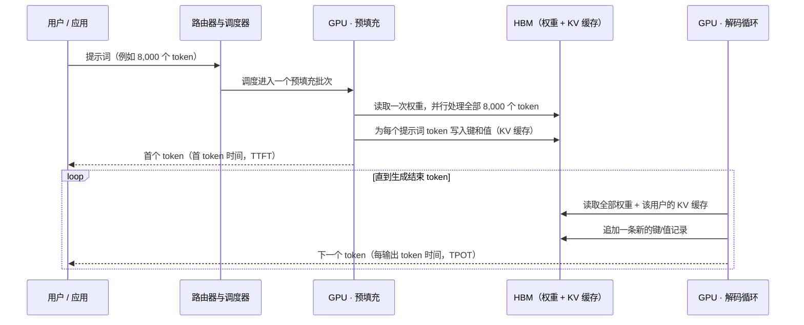
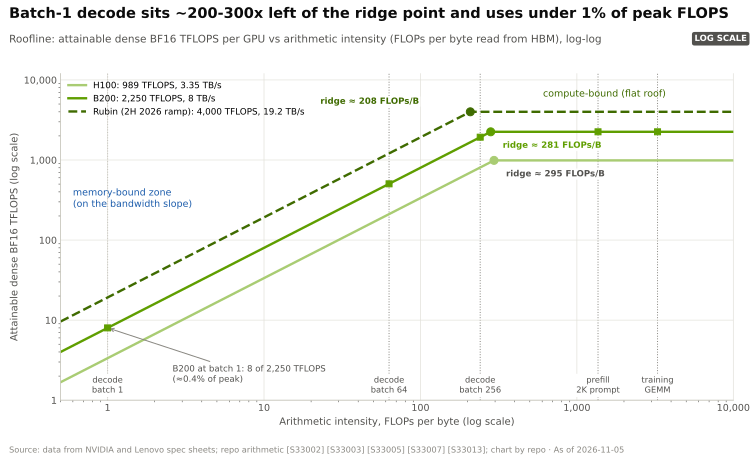
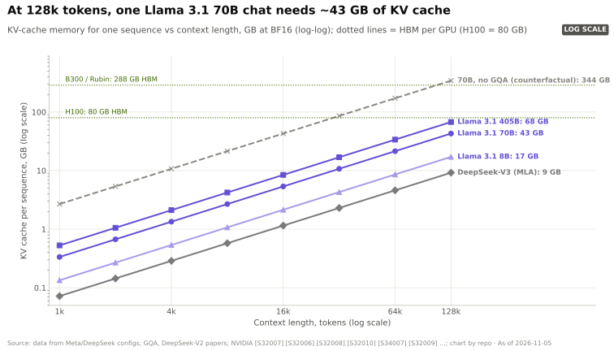
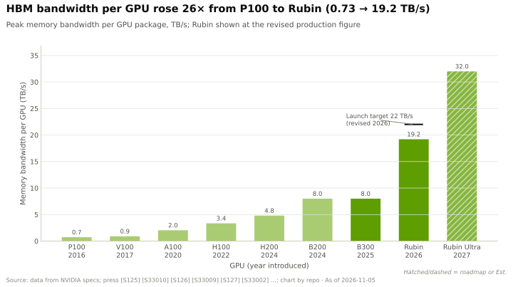
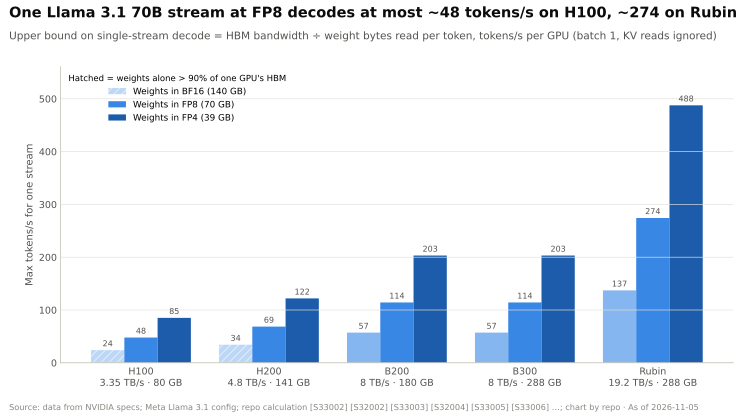
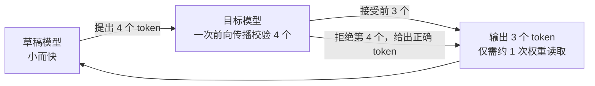
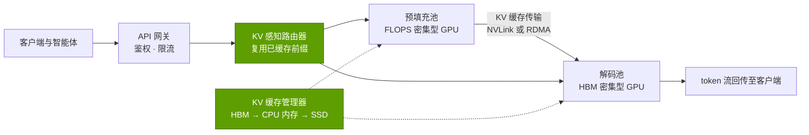
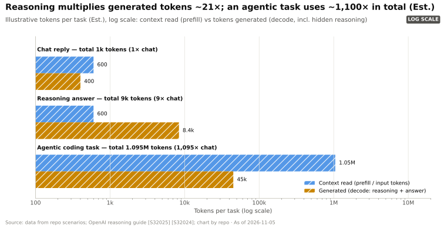
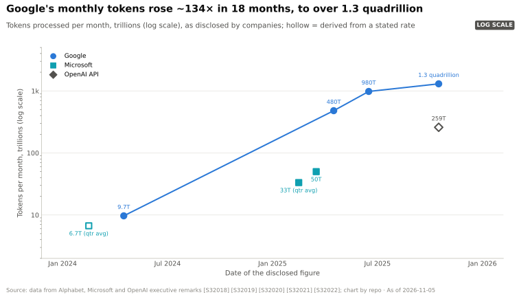

# P2 · AI 推理原理

> [!NOTE]
> 本页为英文原文的简体中文参考译文，仅供参考；如有出入，以[英文原文](../../primers/P2-how-ai-inference-works.md "English original")为准。

入门篇 P2 · 写给非工程师的基础知识 · 约 22 分钟阅读 · 最近核实：2026-11-05

> [!NOTE]
> **如果你熟悉电子表格和财务、但不熟悉芯片，请从这里开始。** [推理](../glossary.md#inference)就是*使用*已训练好的
> 模型：每一次聊天机器人的回答、每一次代码补全和每一个智能体步骤都是推理。训练（[P1](P1-how-ai-training-works.md)）是
> 一次性的资本项目；推理则是 AI 的经常性销货成本，也是 token 用量以及英伟达收入争夺战增长最快的领域。

## ⚡ 要点速览

- **每个请求都包含两个瓶颈截然相反的阶段。** [预填充（prefill）](../glossary.md#prefill)一次性读入整个提示词，属于*算力受限*；[解码（decode）](../glossary.md#decode)每次生成一个 token，属于*内存带宽受限*，因为每生成一个新 token 都要从 [HBM](../glossary.md#hbm) 中重新读取模型的全部权重 [[S32027]](../../sources/bibliography.md#s32027)[[S33013]](../../sources/bibliography.md#s33013)。
- **单用户解码速度 ≈ 内存带宽 ÷ 每个 token 读取的字节数。** 在 H100（3.35 TB/s）上，[FP8](../glossary.md#fp8) 精度的 Llama 3.1 70B（权重 70 GB）单条流的速度永远不可能超过 ~48 tokens/s [[S33002]](../../sources/bibliography.md#s33002)；在 Rubin 上（按当前规格为 19.2 TB/s，较发布时的 22 TB/s 有所下调）[[S33005]](../../sources/bibliography.md#s33005)[[S33007]](../../sources/bibliography.md#s33007)，上限约为 ~274 tokens/s。
- **[KV 缓存](../glossary.md#kv-cache)是推理的“内存税”。** 对话中的每个 token 都会在 HBM 中留下键（key）和值（value）：即便采用[分组查询注意力](../glossary.md#grouped-query-attention)，一段 128k token 的 Llama 3.1 70B 对话也要占用 ~43 GB [[S32006]](../../sources/bibliography.md#s32006)[[S32010]](../../sources/bibliography.md#s32010)。决定一块 GPU 能承载多少用户的是内存*容量*，而非 FLOPs。
- **[批处理](../glossary.md#batching)把闲置的 FLOPs 转化为吞吐量，代价是单用户速度下降。** 连续批处理和分页 KV 内存在同等延迟下把服务吞吐量提高了 2–4× [[S32011]](../../sources/bibliography.md#s32011)[[S32012]](../../sources/bibliography.md#s32012)。由此形成每 GPU tokens/s 与每用户 tokens/s 之间的 [Pareto 前沿](../glossary.md#pareto-frontier)；按本资料库的模型，在每用户 100 tokens/s 时，B200 节点每 GPU 的 token 产出约为 H100 节点的 ~4×，Rubin 约为 ~10×（估计）。
- **各项效率杠杆可以叠加：** [量化](../glossary.md#quantization)至 FP8/[NVFP4](../glossary.md#nvfp4) [[S32017]](../../sources/bibliography.md#s32017)、[推测解码](../glossary.md#speculative-decoding)（原论文中提速 2–3×）[[S32013]](../../sources/bibliography.md#s32013)、[混合专家模型](../glossary.md#mixture-of-experts)（DeepSeek-V3 在 671B 参数中仅激活 37B）[[S34007]](../../sources/bibliography.md#s34007)，以及预填充与解码的[分离式服务](../glossary.md#disaggregated-serving) [[S32014]](../../sources/bibliography.md#s32014)[[S32015]](../../sources/bibliography.md#s32015)。
- **需求正在复合增长。** 谷歌每月处理的 token 从 9.7 万亿（2024 年 4 月）增至超过 1.3 千万亿（2025 年 10 月）[[S32018]](../../sources/bibliography.md#s32018)[[S32020]](../../sources/bibliography.md#s32020)；微软在 2025 年 1–3 月处理了 100T+ token，是一年前的 5 倍 [[S32021]](../../sources/bibliography.md#s32021)。[推理模型](../glossary.md#reasoning-model)和[智能体](../glossary.md#agentic-ai)使每项任务的 token 数增加一到三个数量级（估计）[[S32025]](../../sources/bibliography.md#s32025)。
- **为何这对英伟达重要：** 推理是一场每 token 成本的竞争，比训练更易拆分、也更易被争夺。专用芯片（TPU、Trainium、Cerebras、以 SRAM 为主的设计）首先在这里展开竞争。英伟达的应对是机架级 [NVLink](../glossary.md#nvlink) 域、[FP4](../glossary.md#fp4) 和推理服务软件（[Dynamo](../glossary.md#dynamo)），以及据报道 ~$20B 的 Groq LPU 技术授权加收购式招聘（acquihire）交易（2025 年 12 月），该技术现已作为解码协处理器随 Vera Rubin 平台出货 [[S113]](../../sources/bibliography.md#s113)。

## 1. 预填充与解码：瓶颈截然相反的两项工作

**类比。** 预填充相当于通读整道题目；解码相当于逐字写出答案，而且每写一个字之前，都必须把整本教科书（模型权重）
重新翻一遍。阅读很快，因为所有词可以并行处理。书写很慢，因为它是串行的，而且每一步都要完整遍历一次内存。

| | 预填充（上下文阶段） | 解码（生成阶段） |
|---|---|---|
| 每步处理的 token 数 | 整个提示词，并行处理 | 每步每用户一个 |
| 瓶颈 | 张量核心 FLOPS（算力受限） | HBM 带宽（内存受限） |
| 影响的延迟指标 | 首 token 时间（TTFT） | 每输出 token 时间（TPOT） |
| 最佳硬件特性 | 原始 FLOPS，即便搭配较便宜的内存 | 每 GPU 的带宽与容量 |
| 英伟达产品线索 | Rubin CPX（GDDR7，上下文阶段）：2025 年发布，随后从 2026 年路线图中撤下 [[S33023]](../../sources/bibliography.md#s33023)[[S115]](../../sources/bibliography.md#s115) | NVL72 机架中配备大量 HBM 的 GPU；源自 Groq 的 LPX（SRAM）机架 [[S113]](../../sources/bibliography.md#s113) |

> [!TIP]
> **算例 —— 在 Llama 3.1 70B 上处理 8,000 token 的提示词。** 前向传播中每个 token 约消耗 ~2 FLOPs/参数，
> 因此预填充需要 2 × 70 × 10⁹ × 8,000 = **1.1 × 10¹⁵ FLOPs**。H100 的稠密 FP8 算力为 1,979 TFLOPS [[S33002]](../../sources/bibliography.md#s33002)：以峰值计约
> ~0.57 s，以现实的 50% 效率计 ~1.1 s，分摊到 8 块 GPU 上 ~0.15 s。解码则不同：每个输出 token 仅需
> 2 × 70 × 10⁹ = 1.4 × 10¹¹ FLOPs（H100 算力下 0.07 ms），但必须读取全部 70 GB 的 FP8 权重，在 3.35 TB/s 下耗时
> **21 ms**。在批大小为 1 时，解码受内存约束的程度约为受算力约束的 ~300×。

🔧 技术细节：算术强度与“脊点”（ridge point）

[算术强度](../glossary.md#arithmetic-intensity)是每从内存搬运一个字节所执行的 FLOPs。对 FP8 模型的单条流进行解码，
约为 ~2 FLOPs/字节（每个 1 字节权重对应一次乘加）。H100 的算力为 1,979 TFLOPS、带宽为
3.35 TB/s，“脊点”约为 ~590 FLOPs/字节 [[S33002]](../../sources/bibliography.md#s33002)；B200 约为 ~560 [[S33003]](../../sources/bibliography.md#s33003)，Rubin 约为 ~910 [[S33005]](../../sources/bibliography.md#s33005)。低于
脊点时，芯片处于等待内存的状态。批处理能提高算术强度，因为一次权重读取可服务批次中的每一条序列：
批大小为 256 时，算术强度约为 ~512 FLOPs/字节，接近脊点（忽略 KV 缓存读取）。下图以 [BF16](../glossary.md#bf16) 展示同样的
情形，此时两侧都减半：批大小为 1 的解码约为 ~1 FLOP/字节，而 H100 的脊点约为 ~295。roofline 图景将在
[P3 · 四大瓶颈](P3-the-four-bottlenecks.md)中展开 [[S33013]](../../sources/bibliography.md#s33013)。

## 2. KV 缓存：随每个 token 增长的内存

**机制。** 在注意力计算中，每个新 token 都要与之前的每个 token 进行比较。为避免每一步都重新计算之前
token 的“键”和“值”，服务器会把它们存储起来：这就是 KV 缓存。它随上下文长度和
并发用户数线性增长，并且与权重共用同样稀缺的 HBM。

**大小公式（每 token）：** 2（键和值）× 层数 × KV 头数 × 头维度 × 每个数值的字节数 [[S32027]](../../sources/bibliography.md#s32027)。

> [!TIP]
> **算例 —— Llama 3.1 70B 在其 128k 上下文下。** 该模型有 80 层、8 个 KV 头，头维度为
> 128 [[S32006]](../../sources/bibliography.md#s32006)。每 token：2 × 80 × 8 × 128 × 2 字节（BF16）= **327,680 字节 ≈ 0.33 MB**。在 131,072 个 token 时：0.33 MB ×
> 131,072 = **单个对话 42.9 GB**，超过一块 80 GB H100 容量的一半 [[S33002]](../../sources/bibliography.md#s33002)。八个这样的用户需要 344 GB，
> 超过一块 288 GB 的 Rubin GPU [[S33005]](../../sources/bibliography.md#s33005)。如果不采用分组查询注意力（64 个 KV 头而非 8 个），同一个
> 对话将需要 **344 GB** [[S32010]](../../sources/bibliography.md#s32010)。以 FP8 存储缓存可使上述每个数字减半。

模型设计者会直接针对 KV 缓存下手。**分组查询注意力**让每个键/值头被多个
查询头共享（Llama 3.1：64 个查询头对应 8 个 KV 头）[[S32010]](../../sources/bibliography.md#s32010)[[S32006]](../../sources/bibliography.md#s32006)。DeepSeek 的[**多头潜在注意力
（MLA）**](../glossary.md#multi-head-latent-attention)为每层每个 token 只缓存一个压缩后的 576 维潜在向量 [[S32009]](../../sources/bibliography.md#s32009)；DeepSeek-V2 报告称，借此 KV 缓存缩小了 93.3%，
最大生成吞吐量提高到 5.76× [[S32026]](../../sources/bibliography.md#s32026)。在服务端，
[PagedAttention](../glossary.md#paged-attention) 像虚拟内存一样把缓存存放在固定大小的页中，从而不会
因碎片化而浪费 HBM [[S32011]](../../sources/bibliography.md#s32011)。

🔧 技术细节：前缀缓存与 KV 卸载

许多请求共享一段很长的公共前缀（系统提示词、代码仓库、智能体不断增长的对话记录）。服务器
会保留这些 KV 页并加以复用，因此重复的前缀可以完全跳过预填充；这就是 API 提供商对
“缓存输入” token 的定价远低于新输入 token 的原因。当 HBM 用尽时，不活跃的 KV 页可以被移至 CPU 内存或 SSD，
需要时再调回。这两种技术都使 GPU 周边的网络和内存层级（连接 Grace/Vera CPU 的 NVLink-C2C、
网卡、存储）成为推理性能的一部分，这也是与第 04、07 和 11 层的关联所在。

## 3. 批处理与连续批处理

**机制。** 由于解码受内存限制，只服务一个用户的 GPU 几乎所有张量核心都处于闲置状态。在同一步中服务
多个用户，可以把每次权重读取的成本分摊到所有用户身上。早期的服务器采用*静态*批处理：等待
N 个请求凑齐后一起运行，短回答则闲置等待，直到最长的回答完成。[**连续
批处理**](../glossary.md#continuous-batching)（迭代级调度，由 Orca 提出 [[S32012]](../../sources/bibliography.md#s32012)）允许请求在每一步加入或离开批次。
[vLLM](../glossary.md#vllm) 的 PagedAttention 增加了高效的 KV 内存管理，报告称在同等延迟下吞吐量比
FasterTransformer 和 Orca **高 2–4×** [[S32011]](../../sources/bibliography.md#s32011)。

> [!TIP]
> **算例 —— 批处理在 8× H100 节点上能带来什么（本资料库模型，估计）。** FP8 精度的 Llama 3.1 70B 拆分到 8 块 H100 上
> （合计 26.8 TB/s [[S33002]](../../sources/bibliography.md#s33002)），平均上下文 4k token，FP8 KV 缓存，实际带宽利用率 75%，每步
> 额外开销 3 ms [[S32025]](../../sources/bibliography.md#s32025)：
>
> | 批大小（并发用户数） | 单步时间 | 每用户 tokens/s | 每 GPU tokens/s |
> |---|---|---|---|
> | 1 | 6.5 ms | ~150 | ~19 |
> | 8 | 6.8 ms | ~148 | ~150 |
> | 64 | 8.6 ms | ~116 | ~930 |
> | 256 | 15.0 ms | ~67 | ~2,130 |
>
> 从 1 个用户增至 64 个用户，吞吐量提高 ~49×，而每个用户的速度仅下降 ~25%。超过这一点后，KV 缓存读取量
> 随批次增大而增长，每个用户的速度会急剧下降。运营方的任务是在这条曲线上选出产品的
> 延迟承诺所允许的那个点。

## 4. 延迟与吞吐量：各项指标与 Pareto 前沿

| 指标 | 衡量内容 | 谁关心 | 典型驱动因素 |
|---|---|---|---|
| [TTFT](../glossary.md#ttft)（首 token 时间） | 回答开始前的等待时间 | 聊天体验、等待工具结果的智能体 | 预填充算力、排队 |
| [TPOT / ITL](../glossary.md#tpot)（每输出 token 时间 / token 间延迟） | 流式输出的 token 之间的间隔 | 阅读速度、智能体循环速度 | 解码带宽、批大小 |
| 每用户 tokens/s（交互速度） | 1 ÷ TPOT | 高级付费档位、推理模型 | 每用户可用带宽 |
| 每 GPU tokens/s（吞吐量） | 所有用户的总输出 | 运营方的每 GPU 收入 | 批大小、内存容量 |
| [有效产出（goodput）](../glossary.md#goodput) | 仍满足延迟目标的吞吐量 | 受 SLA 约束的服务 | 以上所有因素 [[S32014]](../../sources/bibliography.md#s32014) |

**前沿。** 把每个批大小画成一个点：x = 每用户 tokens/s，y = 每 GPU tokens/s。曲线向下倾斜：
批次越大，总 token 越多，但单个用户越慢。评判硬件和软件的代际进步，要看它们把*整条*曲线向右上方推了多远，
而不是看某一个峰值数字。本页顶部的图表是基于第一性原理对这一前沿的建模
（一个估计；它忽略了注意力计算、MoE、推测解码、[NVL72](../glossary.md#nvl72)
[纵向扩展](../glossary.md#scale-up)和 Dynamo）。

> [!TIP]
> **算例 —— 把前沿曲线当作损益表来读。** 在该模型中，每用户 100 tokens/s 时，H100 节点每 GPU 产出 ~1,270
> tokens/s，B200 节点 ~4,950，Rubin 节点 ~13,300（估计）[[S32025]](../../sources/bibliography.md#s32025)。每用户 50 tokens/s 时，B200 的领先
> 缩小至 ~2.8×。每 [GPU 时](../glossary.md#gpu-hour)收入 = 每 GPU tokens/s × 3,600 × 每 token 价格：以每百万输出 token $1 的示意价格计，
> 每 H100 时 ~$4.60，每 B200 时 ~$17.80。产品承诺的速度越快，较新一代硬件的
> 优势就越大，这正是英伟达在宣传中采用按交互速度加权的比较的原因。

> [!WARNING]
> **误区与事实：“每 FLOP 最便宜的芯片会赢得推理市场。”** 解码很少用满 FLOPs；它受内存
> 带宽、KV 容量以及（对大模型而言）GPU 间互连的制约。正确的比较口径是
> **在给定延迟目标下**的每 token 成本。在宽松延迟（大批次）下胜出的芯片，在高交互速度下可能大败，
> 反之亦然。

## 5. 量化，以及为何解码 tokens/s ≈ 带宽 ÷ 每 token 字节数

**机制。** 如果每生成一个 token 都需要把每个权重读取一次，那么单条流所能达到的最高速度就是
内存带宽除以模型字节数。把每个权重的字节数减半（BF16 → FP8 → FP4），大致可使这一上限翻倍，并使
内存占用减半。英伟达的 NVFP4 以 4 位存储数值，每 16 个数值组成的块配一个 FP8 缩放因子，另加一个张量级
缩放因子 [[S32017]](../../sources/bibliography.md#s32017)，计入缩放因子后约为每个权重 4.5 位。

这一比率中带宽一侧的增长远慢于算力，这就是决定用户体验的是解码而非 FLOPS 的
原因：

> [!TIP]
> **算例 —— 单条 Llama 3.1 70B 流：H100、B200 与 Rubin 对比。**
>
> | GPU | HBM 带宽 | BF16 权重（140 GB） | FP8（70 GB） | FP4（~39 GB） |
> |---|---|---|---|---|
> | H100 | 3.35 TB/s [[S33002]](../../sources/bibliography.md#s33002) | ~24 tok/s（80 GB 中放不下） | ~48 | ~85 |
> | B200 | 8 TB/s [[S33003]](../../sources/bibliography.md#s33003) | ~57 | ~114 | ~203 |
> | Rubin | 19.2 TB/s [[S33005]](../../sources/bibliography.md#s33005)[[S33007]](../../sources/bibliography.md#s33007) | ~137 | ~274 | ~488 |
>
> 以上为批大小为 1 时的上限（忽略 KV 读取、额外开销和多 GPU 拆分）。Rubin 相对 H100 ~5.7× 的带宽
> 是其解码更快的主要原因；而英伟达在 2026 年下半年把 Rubin 的标称带宽从 22 TB/s 下调至 19.2 TB/s
> [[S33007]](../../sources/bibliography.md#s33007)[[S33008]](../../sources/bibliography.md#s33008)，使这一上限降低 ~13%（🟡 有报道）。

| 格式 | 每权重位数 | 相对 BF16 的内存 | 硬件支持 | 质量风险 |
|---|---|---|---|---|
| BF16 | 16 | 1× | 所有现役 GPU | 基准 |
| FP8 | 8 | 0.5× | Hopper 及之后的张量核心 [[S33002]](../../sources/bibliography.md#s33002) | 采用张量级缩放时较小 |
| NVFP4 | ~4.5（含缩放因子） | ~0.28× | Blackwell 和 Rubin 张量核心 [[S32017]](../../sources/bibliography.md#s32017) | 需要块级缩放；因模型而异 |

## 6. 推测解码：提前猜测

**机制。** 由一个小而便宜的*草稿*模型提出接下来的若干个 token；大模型随后在
**一次**前向传播中校验所有这些 token（这看起来像一次短的预填充，因此对算力友好），并保留最长的正确
前缀。输出分布在数学上与大模型完全一致 [[S32013]](../../sources/bibliography.md#s32013)。由于解码受
内存限制，校验四个 token 所需的权重读取量与生成一个 token 大致相同。

> [!TIP]
> **算例 —— 它为何有效。** 如果目标模型平均接受每 4 个草稿 token 中的 3 个，并且每次校验还会额外给出
> 一个正确 token，那么每一次昂贵的 70 GB 权重读取就能产出 ~4 个 token，而不是 1 个。草稿模型和
> 校验的开销会抵消其中一部分，这就是原论文报告的提速为 **2–3×** 而非 4× 的原因
> [[S32013]](../../sources/bibliography.md#s32013)。在大批次下收益会缩小，因为此时 GPU 已更接近算力受限。

## 7. 推理中的混合专家模型

MoE 模型把每个 token 路由到少数几个专家子网络。DeepSeek-V3 拥有 671B 参数，但每个 token 只激活
37B [[S34007]](../../sources/bibliography.md#s34007)。对推理而言，这把两个瓶颈拆分开来：

- **每 token 的计算量**与一个 37B 模型相当（便宜）。
- **内存**必须容纳全部 671B 参数：FP8 下 ~671 GB，在计入任何 KV 缓存之前就超过两块 288 GB GPU 的容量。
- **流量：** 在每个 MoE 层，token 都要被分发到其他 GPU 上的专家并再汇总回来（*全交换（all-to-all）*通信）。
  DeepSeek 自己的解码部署把专家分布在 320 块 GPU 上 [[S34007]](../../sources/bibliography.md#s34007)。

> [!TIP]
> **算例 —— 为何 MoE 偏好大型 NVLink 域。** 在小批次下，每个 token 只涉及 ~37B 参数（FP8 下 ~37 GB），
> 因此单条流的解码速度几乎与 37B 稠密模型相当。在大批次下，不同 token 命中不同专家，
> 每一步几乎要读取全部 671 GB，于是吞吐量取决于多块 GPU 的总带宽以及它们之间的全交换网络。
> 一个 72 GPU 的 NVLink 域可以让全交换通信保持在最快的链路上；而 8 GPU 服务器则会把它推到
> 较慢的[横向扩展](../glossary.md#scale-out)网络上。这就是英伟达声称 GB200 NVL72 配合 Dynamo 可服务多达 30× DeepSeek-R1 请求
> （🟡 厂商说法）[[S32015]](../../sources/bibliography.md#s32015)背后的机制；参见[第 05 层](../layers/05-scale-up-nvlink-nvswitch/index.md)。

## 8. 预填充与解码分离

由于预填充受算力限制而解码受带宽限制，在同一批 GPU 上同时运行两者会相互干扰：
一次长时间的预填充会拖慢所有用户的解码步骤。**分离式服务**把两者放在不同的 GPU 池上运行，并在两者之间传输
KV 缓存；DistServe 展示了这种拆分对有效产出的好处 [[S32014]](../../sources/bibliography.md#s32014)，英伟达的开源 Dynamo
框架（GTC 2025）则以 KV 感知路由将其产品化 [[S32015]](../../sources/bibliography.md#s32015)。英伟达随后尝试针对每个阶段专门设计*硬件*，
而且其计划变化很快：

- **预填充：** Rubin CPX——一款以 128 GB GDDR7 替代 HBM、面向算力受限的上下文阶段的 GPU——于
  2025 年 9 月发布，计划 2026 年底推出 [[S33023]](../../sources/bibliography.md#s33023)，随后从 GTC 2026 路线图中撤下 [[S115]](../../sources/bibliography.md#s115)；英伟达表示该产品被推迟，
  以便集中精力于解码 [[S116]](../../sources/bibliography.md#s116)。据报道，一款采用 [HBM4](../glossary.md#hbm4) 的重新设计版本目标为 1Q27（🟡 分析师说法，英伟达未确认）[[S117]](../../sources/bibliography.md#s117)。
- **解码：** 在完成 ~$20B 的 Groq 授权与收购式招聘之后，英伟达把 Groq 3 LPU（LP30）加入 Vera Rubin 平台：
  每颗芯片 ~500 MB 片上 [SRAM](../glossary.md#sram)、带宽 ~150 TB/s，每个 LPX 机架 256 颗芯片，据英伟达称自 Q3 2026 起出货（🟡 有报道）
  [[S113]](../../sources/bibliography.md#s113)[[S114]](../../sources/bibliography.md#s114)。

> [!TIP]
> **算例 —— 估算 KV 交接的数据量。** Llama 3.1 70B 上一个 8,000 token 的提示词会产生 8,000 × 0.33 MB ≈
> **2.6 GB** 的 BF16 KV 缓存（FP8 下为 1.3 GB）[[S32006]](../../sources/bibliography.md#s32006)。要在 ~10 ms 内把它从预填充 GPU 传到解码 GPU，
> 需要 ~130–260 GB/s：通过 NVLink 绰绰有余，通过单个 400 Gb/s（50 GB/s）网络端口则相当吃紧。因此，
> 分离式架构会把推理也拉向训练所使用的同类高速网络。

> [!TIP]
> **算例 —— 英伟达为何想要一颗 SRAM 解码芯片。** 解码速度 = 带宽 ÷ 每 token 字节数（见第 5 节）。
> Groq 3 LPU 的片上 SRAM 可提供 ~150 TB/s，约为 Rubin GPU 19.2 TB/s HBM4 带宽的 ~8× [[S114]](../../sources/bibliography.md#s114)[[S33005]](../../sources/bibliography.md#s33005)，但每颗
> 芯片仅能容纳 ~0.5 GB。因此 FP8 精度的 Llama 3.1 70B（70 GB）必须分布在 ~140 颗芯片上，占用一个
> LPX 机架 128 GB SRAM 的一半以上 [[S114]](../../sources/bibliography.md#s114)。这是以极小的单芯片容量换取极高的每字节带宽：对于能装得下的模型，
> 其低延迟解码表现极佳；但对于庞大的 KV 缓存和长上下文则表现不佳，后者仍然需要 HBM。

## 9. 推理模型、测试时计算、智能体与 token 需求

**推理模型**会先思考再回答：它们生成用户看不到的隐藏思维链 token，但这些 token
按输出计费，并消耗解码时间 [[S32024]](../../sources/bibliography.md#s32024)。OpenAI 建议在起步阶段为推理加输出预留至少 25,000 个 token
[[S32024]](../../sources/bibliography.md#s32024)。为获得更好的答案而在每个问题上投入更多推理算力，被称为
[测试时计算](../glossary.md#test-time-compute)。**智能体**则循环运行：规划、调用工具、读取结果、重新读取不断增长的
上下文、再次决策，因此一项任务可能涉及数十次模型调用。

> [!TIP]
> **算例 —— 每项任务的 token 数（示意，估计）。** 一次聊天回复：读取 ~600 个 token，生成 ~400 个。对同一问题的
> 推理回答：同样读取 600 个，但会生成 ~8,000 个隐藏推理 token 加 400 个 token 的答案，**生成 token 数约为
> ~21×**。一个上下文从 10k 增长到 60k token 的 30 轮编程智能体，会重读 ~1.05M 个 token 并
> 生成 ~45k 个，**约为聊天总量的 ~1,100×** [[S32025]](../../sources/bibliography.md#s32025)。前缀缓存可以降低重读成本，但生成的
> token 需要按全价进行解码。英伟达 CEO 在 GTC 2025 上表示，推理和智能体 AI 所需的
> 计算量轻松达到一年前预期的 100×（🟡 厂商说法）[[S33020]](../../sources/bibliography.md#s33020)。

| 披露方 | 数据 | 日期 | 来源 |
|---|---|---|---|
| 谷歌，全部产品 | 9.7T tokens/月 → 480T（~50×） | 2024 年 4 月 → 2025 年 4 月 | [[S32018]](../../sources/bibliography.md#s32018) |
| 谷歌 | ~980T tokens/月 | 2025 年年中 | [[S32019]](../../sources/bibliography.md#s32019) |
| 谷歌 | 超过 1.3 千万亿 tokens/月 | 2025 年 10 月 | [[S32020]](../../sources/bibliography.md#s32020) |
| 微软 | 2025 年 1–3 月处理 100T+ token（同比 5×）；仅 3 月即 50T | 2025 年 4 月 | [[S32021]](../../sources/bibliography.md#s32021) |
| OpenAI API | 每分钟 ~6B token（每月 ~259T） | 2025 年 10 月 | [[S32022]](../../sources/bibliography.md#s32022) |

> [!TIP]
> **算例 —— 每月 1.3 千万亿 token 在硬件上意味着什么。** 1.3 × 10¹⁵ token ÷ 每月 2.59M 秒
> ≈ 平均 **500M tokens/s**。按本篇模型给出的数字——B200 节点在每用户 100 tokens/s 下运行 70B
> 稠密模型时每 GPU ~5,000 tokens/s——这相当于 ~100,000 颗加速器满负荷运行（🔴 仅为示意：谷歌
> 在很大程度上用自研 TPU 承担这部分负载，模型规模各异，且峰值负载高于平均值）。

> [!NOTE]
> **🐂 看多观点。** 仅谷歌一家，token 需求在 18 个月内就增长了 ~134× [[S32018]](../../sources/bibliography.md#s32018)[[S32020]](../../sources/bibliography.md#s32020)；推理模型和智能体使
> 每项任务的 token 数成倍增加；客户为之付费的每一点交互速度，都有利于最新、带宽最高的英伟达机架。
> 推理将成为规模更大的经常性市场，而英伟达的软件（Dynamo、[TensorRT-LLM](../glossary.md#tensorrt-llm)）会进一步放大其硬件领先优势。

> [!WARNING]
> **🐻 看空观点。** 推理会拆分为大量小型、彼此独立的作业，并不需要英伟达的同步网络；
> 而每 token 成本很容易进行基准测试，因此买家可以多源采购。[超大规模云厂商](../glossary.md#hyperscaler)已在自研芯片上运行大量
> 负载（🟡 谷歌的自有模型主要在 TPU 上提供服务），而效率提升（MoE、MLA、FP4、蒸馏）会削减每 token
> 所需的硬件，其速度可能快于需求增长。

## 与各层的关联

- **[第 02 层 · GPU 芯片](../layers/02-gpu-silicon/index.md)：** FP8/FP4 张量核心，以及决定预填充与解码性能的
  FLOPS 与带宽之间的平衡。
- **[第 03 层 · 内存与封装](../layers/03-memory-packaging-supply-chain/index.md)：** HBM 带宽是解码的
  上限，HBM 容量是 KV 缓存的预算；HBM4 是 Rubin 的核心故事。
- **[第 04 层 · CPU（Grace、Vera）](../layers/04-cpu-grace-vera/index.md)：** 一致性 CPU 内存可作为 KV 缓存的溢出层。
- **[第 05 层 · 纵向扩展（NVLink）](../layers/05-scale-up-nvlink-nvswitch/index.md)：** 在 NVL72 域内以张量并行和专家并行
  方式服务大模型与 MoE 模型。
- **[第 06 层 · 横向扩展网络](../layers/06-scale-out-scale-across-networking/index.md)**与
  **[第 07 层 · DPU、SuperNIC、存储](../layers/07-dpu-supernic-storage-security/index.md)：** 分离式服务中的 KV 传输，
  以及把 KV 卸载到存储。
- **[第 08 层 · 系统与 AI 工厂](../layers/08-systems-racks-ai-factories/index.md)：** 机架级系统、LPX
  解码机架，以及不断调整的预填充硬件计划。
- **[第 11 层 · 推理与 AI 软件](../layers/11-inference-and-ai-software/index.md)：** TensorRT-LLM、Dynamo、NIM，
  以及开源替代方案（vLLM、[SGLang](../glossary.md#sglang)）。
- **[第 12 层 · 编排与云服务](../layers/12-orchestration-and-cloud-services/index.md)：** 跨集群的自动扩缩容与
  路由。
- 经济学：[第 14 章 · 训练与推理经济学](../cross-cutting/14-training-vs-inference-economics.md)；
  roofline 直觉：[P3](P3-the-four-bottlenecks.md)；多 GPU 拆分：[P4](P4-parallelism-explained.md)。

## 需要记住的关键数字

| 指标 | 数值 | 来源 |
|---|---|---|
| 单条流的解码上限 | ≈ HBM 带宽 ÷ 每 token 读取字节数 | [[S33013]](../../sources/bibliography.md#s33013) |
| Llama 3.1 70B FP8，批大小 1 | H100 上 ≤ ~48 tok/s · B200 上 ~114 · Rubin 上 ~274 | [[S33002]](../../sources/bibliography.md#s33002)[[S33003]](../../sources/bibliography.md#s33003)[[S33005]](../../sources/bibliography.md#s33005) |
| 每 token KV 缓存，Llama 3.1 70B（BF16） | ~0.33 MB（2 × 80 层 × 8 个 KV 头 × 128 × 2 B） | [[S32006]](../../sources/bibliography.md#s32006) |
| 128k token 时的 KV 缓存，同一模型 | 每个对话 ~43 GB（无 GQA 时为 344 GB） | [[S32006]](../../sources/bibliography.md#s32006)[[S32010]](../../sources/bibliography.md#s32010) |
| MLA 对 KV 缓存的缩减（DeepSeek-V2） | −93.3%，最大生成吞吐量 5.76× | [[S32026]](../../sources/bibliography.md#s32026) |
| 连续批处理 + PagedAttention | 同等延迟下吞吐量提高 2–4× | [[S32011]](../../sources/bibliography.md#s32011) |
| 推测解码（原论文） | 提速 2–3×，输出完全相同 | [[S32013]](../../sources/bibliography.md#s32013) |
| DeepSeek-V3 激活参数与总参数 | 671B 中激活 37B | [[S34007]](../../sources/bibliography.md#s34007) |
| 谷歌每月 token 量 | 9.7T（2024 年 4 月）→ 1.3 千万亿（2025 年 10 月） | [[S32018]](../../sources/bibliography.md#s32018)[[S32020]](../../sources/bibliography.md#s32020) |
| 微软 token 量，2025 年 1–3 月 | 100T+，同比 5× | [[S32021]](../../sources/bibliography.md#s32021) |

## 🎯 企业发展视角

1. **真正重要的指标是给定延迟目标下的每 token 成本。** 每一项厂商宣称都应对应到吞吐量–交互速度前沿上的
   某一个点。在采信任何“便宜 10×”的说法之前，应要求竞争对手（以及英伟达）提供完整曲线，而非单一峰值。
2. **内存是兵家必争的资源。** 解码受带宽和 KV 容量限制，因此 HBM 供应（第 03 层）和
   内存分层（CPU 内存、CXL、SSD 卸载）是推理价值池所在。哪些内存层级和 KV 缓存
   软件公司可能对一份以推理为重点的数据中心路线图至关重要？
3. **分离式架构为异构集群打开了大门。** 一旦预填充和解码运行在不同的资源池上，
   非英伟达加速器无需两者兼得，只需赢下其中一个阶段即可。英伟达显然也看到了同样的拆分：它发布了一款
   预填充 GPU（Rubin CPX）[[S33023]](../../sources/bibliography.md#s33023)，随后将其从 GTC 2026 路线图中撤下 [[S115]](../../sources/bibliography.md#s115)，接着又据报道斥资 ~$20B 把 Groq 基于 SRAM 的解码架构
   收入囊中 [[S113]](../../sources/bibliography.md#s113)。对挑战者而言，最现实的切入点是解码池、上下文池，还是路由/调度软件？
   还有多少专注解码的初创公司保持独立？
4. **效率技术正在快速商品化。** 连续批处理、分页 KV、推测解码和 FP8 都是开放的，
   且已被广泛实现 [[S32011]](../../sources/bibliography.md#s32011)[[S32013]](../../sources/bibliography.md#s32013)；差异化正在向机架级系统和集群级软件迁移。谁
   掌控开源推理服务层（vLLM、SGLang）及其人才，是任何加速器厂商都必须面对的战略问题。
5. **token 增长是需要跟踪的需求信号。** 谷歌 18 个月 ~134× 的增长 [[S32018]](../../sources/bibliography.md#s32018)[[S32020]](../../sources/bibliography.md#s32020) 以及推理/智能体带来的
   倍增效应 [[S32025]](../../sources/bibliography.md#s32025) 支持推理算力容量的增长；效率提升则指向相反方向。按季度跟踪
   已披露的 token 用量与已部署加速器容量之比，就能看出哪一股力量占上风。

## 📚 来源（Sources）

<!-- Auto-generated from the [S…] citations on this page by `make build`. Edit sources/registry/*.csv, not this list. -->

- [**S113**](../../sources/bibliography.md#s113) Tom's Hardware, *How Nvidia's $20 billion Groq 3 LPU deal reshapes the Nvidia Vera Rubin Platform*, 2026-03. [Link](https://www.tomshardware.com/tech-industry/semiconductors/nvidias-20-billion-groq-deal-produces-its-first-chip)
- [**S114**](../../sources/bibliography.md#s114) StorageReview, *NVIDIA Groq 3 LPX: Everything we know*, 2026-03. [Link](https://www.storagereview.com/news/nvidia-groq-3-lpx-everything-we-know)
- [**S115**](../../sources/bibliography.md#s115) Tom's Hardware, *Nvidia removes Rubin CPX accelerators from its roadmap - Groq 3 LPUs take center stage*, 2026-03. [Link](https://www.tomshardware.com/pc-components/gpus/nvidia-removes-rubin-cpx-accelerators-from-its-roadmap-groq-3-lpus-take-center-stage-as-cpx-is-removed)
- [**S116**](../../sources/bibliography.md#s116) Wccftech, *NVIDIA's Rubin CPX Is Off the Roadmap, Replaced by Groq LPUs for Inference, But May Return With Feynman in 2028*, 2026-03. [Link](https://wccftech.com/nvidia-rubin-cpx-is-off-the-roadmap-but-may-return-with-feynman-in-2028/)
- [**S117**](../../sources/bibliography.md#s117) TechNews (Taiwan), *Nvidia Rubin CPX re-enters roadmap with HBM4 for AI prefill*, 2026-09-02. [Link](https://technews.tw/2026/09/02/nvidia-rubin-cpx-reenters-roadmap-hbm4-ai-prefill/)
- [**S32006**](../../sources/bibliography.md#s32006) Meta via Hugging Face, *Llama 3.1 70B configuration (config.json)*, 2024-07-23. [Link](https://huggingface.co/meta-llama/Llama-3.1-70B/blob/main/config.json)
- [**S32009**](../../sources/bibliography.md#s32009) DeepSeek-AI via Hugging Face, *DeepSeek-V3 configuration (config.json)*, 2024-12-26. [Link](https://huggingface.co/deepseek-ai/DeepSeek-V3/blob/main/config.json)
- [**S32010**](../../sources/bibliography.md#s32010) Google Research (arXiv 2305.13245) (Ainslie et al.), *GQA: Training Generalized Multi-Query Transformer Models from Multi-Head Checkpoints*, 2023-05. [Link](https://arxiv.org/abs/2305.13245)
- [**S32011**](../../sources/bibliography.md#s32011) SOSP 2023 (arXiv 2309.06180) (Kwon et al.), *Efficient Memory Management for Large Language Model Serving with PagedAttention (vLLM)*, 2023-09. [Link](https://arxiv.org/abs/2309.06180)
- [**S32012**](../../sources/bibliography.md#s32012) USENIX OSDI 2022 (Yu et al.), *Orca: A Distributed Serving System for Transformer-Based Generative Models*, 2022-07. [Link](https://www.usenix.org/conference/osdi22/presentation/yu)
- [**S32013**](../../sources/bibliography.md#s32013) Google Research (arXiv 2211.17192) (Leviathan, Kalman, Matias), *Fast Inference from Transformers via Speculative Decoding*, 2022-11. [Link](https://arxiv.org/abs/2211.17192)
- [**S32014**](../../sources/bibliography.md#s32014) USENIX OSDI 2024 (arXiv 2401.09670) (Zhong et al.), *DistServe: Disaggregating Prefill and Decoding for Goodput-optimized LLM Serving*, 2024-01. [Link](https://arxiv.org/abs/2401.09670)
- [**S32015**](../../sources/bibliography.md#s32015) NVIDIA Newsroom, *NVIDIA Dynamo open-source inference framework announcement (GTC 2025)*, 2025-03-18. [Link](https://nvidianews.nvidia.com/news/nvidia-dynamo-open-source-library-accelerates-and-scales-ai-reasoning-models)
- [**S32017**](../../sources/bibliography.md#s32017) NVIDIA Technical Blog, *Introducing NVFP4 for Efficient and Accurate Low-Precision Inference*, 2025-06. [Link](https://developer.nvidia.com/blog/introducing-nvfp4-for-efficient-and-accurate-low-precision-inference/)
- [**S32018**](../../sources/bibliography.md#s32018) Google (The Keyword) (Sundar Pichai), *Google I/O 2025 keynote remarks (Sundar Pichai)*, 2025-05-20. [Link](https://blog.google/technology/ai/io-2025-keynote/)
- [**S32019**](../../sources/bibliography.md#s32019) Alphabet / Google (The Keyword) (Sundar Pichai), *Alphabet Q2 2025 earnings call - CEO remarks*, 2025-07-23. [Link](https://blog.google/inside-google/message-ceo/alphabet-earnings-q2-2025/)
- [**S32020**](../../sources/bibliography.md#s32020) Alphabet / Google (The Keyword) (Sundar Pichai), *Alphabet CEO remarks on token volume (October 2025)*, 2025-10. [Link](https://blog.google/inside-google/message-ceo/alphabet-earnings-q3-2025/)
- [**S32021**](../../sources/bibliography.md#s32021) Microsoft Investor Relations (Satya Nadella), *Microsoft FY2025 Q3 earnings call (Satya Nadella remarks)*, 2025-04-30. [Link](https://www.microsoft.com/en-us/investor/events/fy-2025/earnings-fy-2025-q3)
- [**S32022**](../../sources/bibliography.md#s32022) OpenAI (Sam Altman), *OpenAI DevDay 2025 keynote*, 2025-10-06. [Link](https://openai.com/devday/)
- [**S32024**](../../sources/bibliography.md#s32024) OpenAI, *Reasoning models guide (OpenAI API documentation)*, 2025. [Link](https://platform.openai.com/docs/guides/reasoning)
- [**S32025**](../../sources/bibliography.md#s32025) nvidia_deep_dive_claude repository, *Repo analysis: inference token-budget scenarios and roofline serving model (Primer P2)*, 2026-11-05. [Link](https://github.com/FrankHuang94/nvidia_deep_dive_claude/blob/main/primers/P2-how-ai-inference-works.md)
- [**S32026**](../../sources/bibliography.md#s32026) DeepSeek-AI (arXiv 2405.04434) (DeepSeek-AI), *DeepSeek-V2: A Strong, Economical, and Efficient Mixture-of-Experts Language Model*, 2024-05. [Link](https://arxiv.org/abs/2405.04434)
- [**S32027**](../../sources/bibliography.md#s32027) NVIDIA Technical Blog, *Mastering LLM Techniques: Inference Optimization*, 2023-11. [Link](https://developer.nvidia.com/blog/mastering-llm-techniques-inference-optimization/)
- [**S33002**](../../sources/bibliography.md#s33002) NVIDIA, *NVIDIA H100 Tensor Core GPU (product page and datasheet)*, 2022-03-22. [Link](https://www.nvidia.com/en-us/data-center/h100/)
- [**S33003**](../../sources/bibliography.md#s33003) Lenovo Press, *ThinkSystem NVIDIA B200 180GB 1000W GPU product guide*, 2025. [Link](https://lenovopress.lenovo.com/lp2226-thinksystem-nvidia-b200-180gb-1000w-gpu)
- [**S33005**](../../sources/bibliography.md#s33005) NVIDIA, *NVIDIA Vera Rubin NVL72 (product page and specifications)*, 2026. [Link](https://www.nvidia.com/en-us/data-center/vera-rubin-nvl72/)
- [**S33007**](../../sources/bibliography.md#s33007) Dataconomy, *Nvidia Quietly Cuts Vera Rubin HBM4 And NVLink Bandwidth Specs*, 2026-11-02. [Link](https://dataconomy.com/2026/11/02/nvidia-quietly-cuts-vera-rubin-hbm4-and-nvlink-bandwidth/)
- [**S33008**](../../sources/bibliography.md#s33008) CloudNews.tech, *NVIDIA Vera Rubin: HBM4 and NVLink bandwidth cut in spec sheet*, 2026-11. [Link](https://cloudnews.tech/nvidia-lowers-vera-rubins-memory-and-nvlink-bandwidth-blames-production-ramp/)
- [**S33013**](../../sources/bibliography.md#s33013) kipp.ly (Carol Chen (kipply)), *Transformer Inference Arithmetic*, 2022-03-30. [Link](https://kipp.ly/transformer-inference-arithmetic/)
- [**S33020**](../../sources/bibliography.md#s33020) NVIDIA (Jensen Huang), *NVIDIA GTC 2025 keynote (Jensen Huang)*, 2025-03-18. [Link](https://www.nvidia.com/gtc/keynote/)
- [**S33023**](../../sources/bibliography.md#s33023) NVIDIA Newsroom, *NVIDIA Unveils Rubin CPX: A New Class of GPU Designed for Massive-Context Inference*, 2025-09-09. [Link](https://nvidianews.nvidia.com/news/nvidia-unveils-rubin-cpx-a-new-class-of-gpu-designed-for-massive-context-inference)
- [**S34007**](../../sources/bibliography.md#s34007) arXiv:2412.19437 (DeepSeek-AI), *DeepSeek-V3 Technical Report*, 2024-12-27. [Link](https://arxiv.org/abs/2412.19437)
