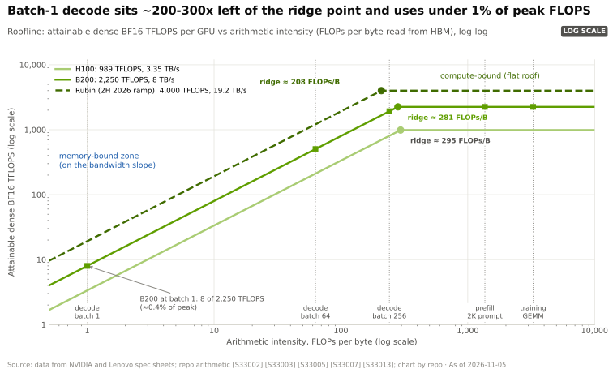
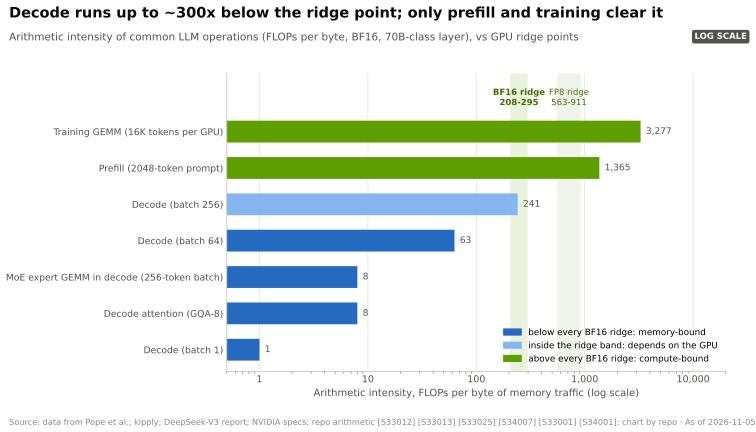
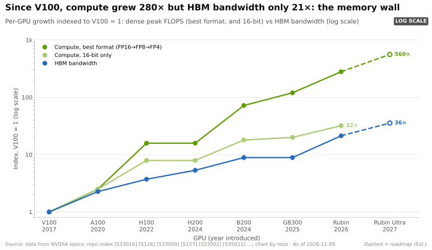
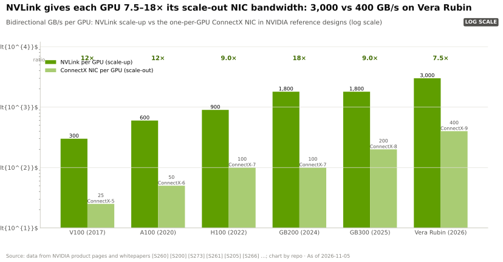
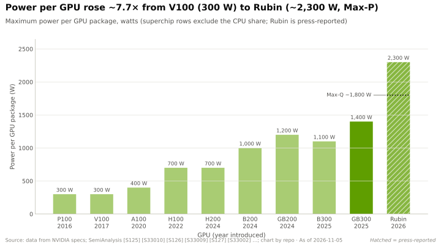
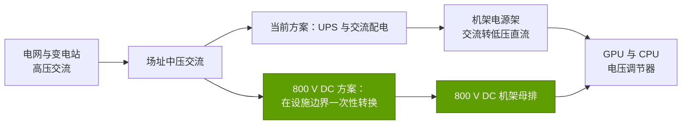
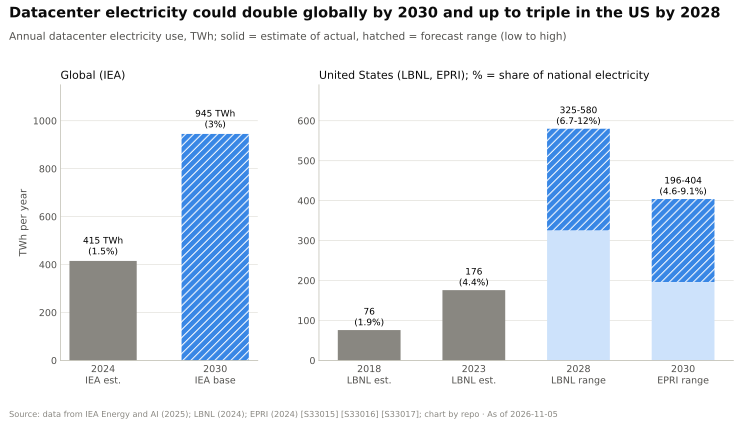
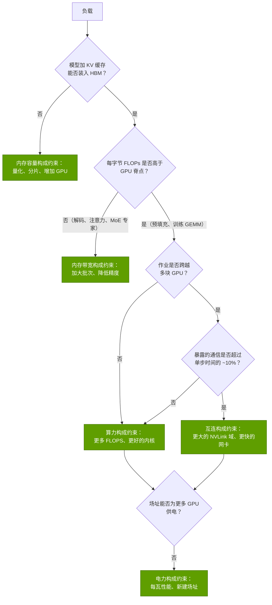
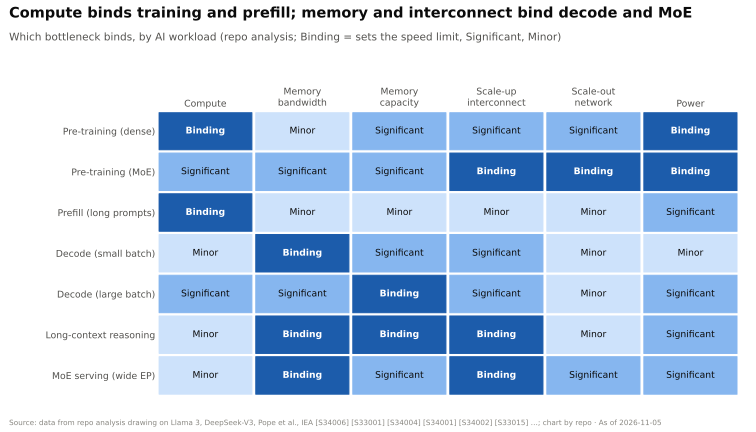

# P3 · 四大瓶颈

> [!NOTE]
> 本页为英文原文的简体中文参考译文，仅供参考；如有出入，以[英文原文](../../primers/P3-the-four-bottlenecks.md "English original")为准。

入门篇 P3 · 写给非工程师的基础知识 · 约 22 分钟阅读 · 最近核实：2026-11-05

## ⚡ 要点速览

- **AI 系统的运行速度取决于四种资源中最先耗尽的那一种：** 算力（[FLOPS](../glossary.md#flops)）、内存（[HBM](../glossary.md#hbm) 的带宽与容量）、互连（[纵向扩展（scale-up）](../glossary.md#scale-up)与[横向扩展（scale-out）](../glossary.md#scale-out)网络）以及电力。为一项并不构成约束的资源多花钱几乎换不来任何收益，这就是为何单看“峰值 PFLOPS”难以判断价值。
- **[roofline 模型](../glossary.md#roofline-model)能告诉你哪一项构成约束。** 用峰值 FLOPS 除以内存带宽即可得到[脊点（ridge point）](../glossary.md#ridge-point)：H100 在稠密 [BF16](../glossary.md#bf16) 下约为 295 FLOPs/字节（989 TFLOPS ÷ 3.35 TB/s）[[S33002]](../../sources/bibliography.md#s33002)，B200 约为 ~281（2,250 TFLOPS ÷ 8 TB/s）[[S33003]](../../sources/bibliography.md#s33003)，Rubin 约为 ~208（4,000 TFLOPS ÷ 19.2 TB/s）[[S33005]](../../sources/bibliography.md#s33005)[[S33007]](../../sources/bibliography.md#s33007)。每字节 FLOPs 低于该值的工作即为[内存受限](../glossary.md#memory-bound)。
- **聊天机器人式的生成任务严重受限于内存。** 在批大小为 1 时生成一个 token，每读取一个字节的权重只做 ~1 FLOP，因此一块服务 70B 参数 BF16 模型的 B200 只用到了其 2,250 TFLOPS 中的 ~8 TFLOPS，约 0.4%（本资料库基于 [[S33003]](../../sources/bibliography.md#s33003)[[S33013]](../../sources/bibliography.md#s33013) 的测算）。批处理会让工作负载在 roofline 上向右移动，直到 [KV 缓存](../glossary.md#kv-cache)耗尽内存容量为止。
- **[内存墙](../glossary.md#memory-wall)真实存在，但标称 FLOPS 夸大了它。** 从 V100 到 Rubin，以最低支持精度计的峰值稠密 FLOPS 增长了 ~280×，而 HBM 带宽仅增长 ~21× [[S33010]](../../sources/bibliography.md#s33010)[[S33005]](../../sources/bibliography.md#s33005)[[S33007]](../../sources/bibliography.md#s33007)；在同为 16 位精度的可比口径下，差距为 32× 对 21×。从全行业看，峰值 FLOPS 每两年增长 ~3.0×，而 DRAM 带宽为 ~1.6×，互连为 ~1.4× [[S33011]](../../sources/bibliography.md#s33011)。
- **按照[阿姆达尔定律（Amdahl's law）](../glossary.md#amdahls-law)，通信限制了扩展能力。** 即便是 Meta 精心调优的 Llama 3 405B 训练，在最多 16,384 块 H100 上的 BF16 [模型 FLOPs 利用率](../glossary.md#mfu)也只有 38–43% [[S34006]](../../sources/bibliography.md#s34006)；其余大部分损失在通信、流水线气泡和内存停顿上（详见 [P4](P4-parallelism-explained.md)）。
- **电力如今是场址层面的速度上限。** IEA 估计 2024 年数据中心用电 ~415 TWh，并预测到 2030 年达到 ~945 TWh [[S33015]](../../sources/bibliography.md#s33015)；LBNL 测算美国数据中心 2023 年用电 176 TWh（占美国用电量的 4.4%），到 2028 年将达到 325–580 TWh [[S33016]](../../sources/bibliography.md#s33016)。机架功率从四台 DGX H100 系统的 ~41 kW [[S33022]](../../sources/bibliography.md#s33022) 升至一台 GB200 [NVL72](../glossary.md#nvl72) 的 ~120–132 kW [[S33021]](../../sources/bibliography.md#s33021)，另有报道称 2027 年的 Kyber 机架将达 🟡 ~600 kW [[S35019]](../../sources/bibliography.md#s35019)。
- **英伟达的优势在于同时为这四项瓶颈提供答案**（大容量 HBM 的 GPU、NVLink、InfiniBand/Spectrum-X、液冷机架以及 800 V DC 供电方案 [[S33019]](../../sources/bibliography.md#s33019)）。看空观点则指出：推理的约束性资源 HBM，英伟达和其他所有厂商一样都是向同样的三家存储厂商采购；而英伟达自己的 Rubin [HBM4](../glossary.md#hbm4) 标称带宽在 2026 年末已从 22 TB/s 下调至 19.2 TB/s [[S33006]](../../sources/bibliography.md#s33006)[[S33007]](../../sources/bibliography.md#s33007)。

## 从这里开始：一个有四种方式变慢的厨房

想象一个餐厅厨房。**厨师**代表算力：如果所有食材都在手边，他们每分钟能做多少道菜。**储藏室的门**代表内存带宽：食材送到操作台的速度有多快。**储藏室的大小**代表内存容量：你需要的东西是否全都在这栋楼里。**厨房之间的传菜员**代表互连：当一顿饭要由八个厨房共同完成时，盘子必须来回传递。**燃气管道**则代表电力：无论雇多少厨师，灶具能提供的热量都是有限的。

一个厨师出色但储藏室门很窄的厨房，出菜量不会超过那扇门所允许的上限。AI 硬件也是如此。GPU 的标称数字是其峰值 FLOPS（每秒浮点运算次数），但大多数 AI 负载会先撞上另外三项限制中的某一项。系统设计者——以及任何评判竞争对手宣传的人——的任务，就是追问*对于这项负载，究竟是哪种资源构成约束*。

| 瓶颈 | 衡量内容 | 单位 | H100 → B200 → Rubin（每 GPU） | 何时构成约束 | 英伟达的应对 | 最有力的替代方案 |
|---|---|---|---|---|---|---|
| **算力** | 每秒算术运算量 | PFLOPS（稠密） | BF16 0.99 → 2.25 → 4.0 [[S33002]](../../sources/bibliography.md#s33002)[[S33003]](../../sources/bibliography.md#s33003)[[S33005]](../../sources/bibliography.md#s33005) | 训练、预填充 | 张量核心；FP8 → [NVFP4](../glossary.md#nvfp4) 数值格式 [[S32017]](../../sources/bibliography.md#s32017) | TPU 和 Trainium 的脉动阵列；晶圆级芯片（Cerebras） |
| **内存** | 从 HBM 读取的每秒字节数；可容纳的 GB 数 | TB/s；GB | 3.35 → 8 → 19.2 TB/s；80 → 180 → 288 GB [[S33002]](../../sources/bibliography.md#s33002)[[S33003]](../../sources/bibliography.md#s33003)[[S33005]](../../sources/bibliography.md#s33005)[[S33007]](../../sources/bibliography.md#s33007) | 解码、长上下文、MoE 服务 | 更多、更新的 HBM 堆栈；借助 Rubin CPX 拆分预填充与解码 [[S33023]](../../sources/bibliography.md#s33023)（已从 GTC 2026 路线图撤下；有报道称将以 HBM4 版本回归，未经确认 🟡 [[S115]](../../sources/bibliography.md#s115)[[S117]](../../sources/bibliography.md#s117)） | 以 SRAM 为主的芯片（Groq、Cerebras）；基于 LPDDR 的推理卡 |
| **互连** | GPU 间每秒传输字节数 | TB/s（纵向扩展）；Gb/s（横向扩展） | NVLink 0.9 → 1.8 → 3.0 TB/s [[S34014]](../../sources/bibliography.md#s34014)[[S33007]](../../sources/bibliography.md#s33007)；网卡 400 → 800 → 1,600 Gb/s [[S34015]](../../sources/bibliography.md#s34015)[[S33004]](../../sources/bibliography.md#s33004) | 大规模训练、MoE 全交换 | [NVLink](../glossary.md#nvlink)/[NVSwitch](../glossary.md#nvswitch) NVL72；[InfiniBand](../glossary.md#infiniband) 与 [Spectrum-X](../glossary.md#spectrum-x) | 采用光交换的谷歌 ICI；UALink；以太网纵向扩展 |
| **电力** | 每芯片、每机架、每场址的瓦数 | W；kW；MW | 700 → 1,000 W [[S33002]](../../sources/bibliography.md#s33002)[[S33003]](../../sources/bibliography.md#s33003)；机架 ~41 → ~120–132 kW [[S33022]](../../sources/bibliography.md#s33022)[[S33021]](../../sources/bibliography.md#s33021) | 场址建设、电网接入 | [液冷](../glossary.md#liquid-cooling)；[800 V DC](../glossary.md#hvdc-800v) 机架 [[S33019]](../../sources/bibliography.md#s33019) | 效率优先的 ASIC；选址靠近廉价电力 |

> [!IMPORTANT]
> **最需要记住的一点：** 负载的*算术强度*（每搬运一个字节所做的 FLOPs）决定了约束来自算力还是内存；其*通信模式*决定了它能扩展到多大规模；而*场址的电力*则从一开始就决定了你能买多少块 GPU。

## 1. 算力：每秒多少 FLOPs

**它是什么。** 现代英伟达 GPU 的大部分 AI 运算在[张量核心](../glossary.md#tensor-core)中完成，这类单元可以一步完成小矩阵的乘法。数据手册上的大数字是*峰值*速率：即每个张量核心在每个周期都满负荷处理形状完美的数据时芯片所能达到的速度。它们取决于数值格式。位数减半，速率大约翻倍：B200 的稠密算力在 BF16 下标称 2.25 PFLOPS，在 [FP8](../glossary.md#fp8) 下为 4.5，在 [FP4](../glossary.md#fp4) 下为 9 [[S33003]](../../sources/bibliography.md#s33003)。英伟达的标称数字通常假设 2:4 [稀疏性](../glossary.md#sparsity)，这会使数字再翻一倍；除非另有说明，本资料库一律引用**稠密**数字。

**为何达不到峰值。** 只有在大型、形状规整、且操作数已位于片上内存中的[矩阵乘法（GEMM）](../glossary.md#gemm)上，芯片才能达到峰值。真实的训练步骤还包括逐元素运算、通信等待和流水线空闲时间。业界指标是模型 FLOPs 利用率（MFU）：有效模型 FLOPs ÷ 峰值 FLOPs。英伟达自己的 Megatron-LM 团队报告，在 3,072 块 A100 上运行 1 万亿参数基准测试时达到了峰值的 52% [[S34002]](../../sources/bibliography.md#s34002)；Meta 报告 Llama 3 405B 在 H100 上的 BF16 MFU 为 38–43% [[S34006]](../../sources/bibliography.md#s34006)。

> [!TIP]
> **算例 —— Llama 3 405B 的算力账单折合多少 GPU 天。** Meta 训练 Llama 3 405B 使用了 ~3.8 × 10²⁵ FLOPs [[S34006]](../../sources/bibliography.md#s34006)。按其在 16,384 块 H100 上实际达到的每 GPU ~400 TFLOPS（41% MFU）[[S34006]](../../sources/bibliography.md#s34006) 计算，集群每秒提供 16,384 × 400 × 10¹² ≈ 6.6 × 10¹⁸ FLOPs，因此纯计算时间为 3.8 × 10²⁵ ÷ 6.6 × 10¹⁸ ≈ 580 万秒 ≈ **67 天**。若换成 B200 并保持同样 41% 的 MFU（2,250 中的 ≈ 920 TFLOPS [[S33003]](../../sources/bibliography.md#s33003)）重新计算，则降至 ~29 天。**商业解读：** 每一代的算力提升都会直接转化为更短的模型产出时间，或在同样日历时间内训练更大的模型——但前提是另外三项瓶颈能够跟上，而这正是本页其余部分的主题。

🔧 技术细节：为何更低的精度是“免费”的算力——以及何时并非如此

4 位数的乘法器所需的晶体管远少于 16 位数的乘法器，因此相同的硅面积每个周期能执行更多运算；位数更少也意味着需要搬运的字节更少，这有助于缓解内存瓶颈。问题在于精度：4 位数值只有 16 个可能的取值，因此 NVFP4 等格式为每 16 个数值组成的块附加一个共享的 FP8 缩放因子，另加一个张量级缩放因子 [[S32017]](../../sources/bibliography.md#s32017)。端到端的 FP4 训练仍是活跃的研究领域，这就是为何 Rubin 分别给出 NVFP4 “训练”（35 PFLOPS）和“推理”（50 PFLOPS）两个数字 [[S33004]](../../sources/bibliography.md#s33004)。还要注意 Rubin 如何重新分配其芯片资源：稠密 FP8 为 17.5 PFLOPS，而 BF16 仅 4 PFLOPS，比值为 4.4×，而 B200 上为 2× [[S33005]](../../sources/bibliography.md#s33005)[[S33003]](../../sources/bibliography.md#s33003)——这是押注未来大部分工作将以 8 位或更低精度运行。

## 2. 内存：带宽、容量与 roofline

### 直观理解 roofline

每一次计算都需要数据。问题在于，你每从内存中取一个字节能做多少次计算：这就是**[算术强度](../glossary.md#arithmetic-intensity)**，单位为 FLOPs/字节。芯片的速度永远不可能超过以下两个上限中较低的那一个：

- **算力屋顶**：峰值 FLOPS，一条水平线；以及
- **带宽斜坡**：内存带宽 × 算术强度，一条斜线（更快地搬运字节，或在每个字节上做更多工作，速度就会更快）。

把两者画在双对数坐标上，就得到了 roofline，它由 Williams、Waterman 和 Patterson 于 2009 年提出 [[S33001]](../../sources/bibliography.md#s33001)。斜坡与屋顶相交的拐角就是**脊点** = 峰值 FLOPS ÷ 内存带宽。位于脊点左侧时属于[内存受限](../glossary.md#memory-bound)：多出的 FLOPS 处于闲置状态。位于脊点右侧时属于[算力受限](../glossary.md#compute-bound)：多出的带宽处于闲置状态。

> [!TIP]
> **算例 —— 三代 GPU 的脊点。** 用稠密峰值除以 HBM 带宽（TFLOPS ÷ TB/s = FLOPs/字节）：
>
> | GPU | 稠密 BF16 | 稠密 FP8 | 稠密 FP4 | HBM 带宽 | BF16 脊点 | FP8 脊点 | FP4 脊点 |
> |---|---|---|---|---|---|---|---|
> | H100 SXM | 989 TFLOPS | 1,979 TFLOPS | — | 3.35 TB/s | **295** | 591 | — |
> | B200（[HGX](../glossary.md#hgx)） | 2,250 TFLOPS | 4,500 TFLOPS | 9,000 TFLOPS | 8.0 TB/s | **281** | 563 | 1,125 |
> | Rubin | 4,000 TFLOPS | 17,500 TFLOPS | 35,000 TFLOPS（NVFP4 训练） | 19.2 TB/s | **208** | 911 | 1,823 |
>
> 来源：[[S33002]](../../sources/bibliography.md#s33002)[[S33003]](../../sources/bibliography.md#s33003)[[S33005]](../../sources/bibliography.md#s33005)[[S33004]](../../sources/bibliography.md#s33004)[[S33007]](../../sources/bibliography.md#s33007)。**解读：** 三代以来 BF16 脊点一直保持在 200–300 FLOPs/字节附近，因为英伟达让带宽与 16 位算力大致同步增长。但在 FP8 和 FP4 下，脊点*向右*移动——Rubin 需要 ~900 FLOPs/字节才能让其 FP8 单元保持满载——因此数值格式越“便宜”，就有越多的工作变为内存受限。

### 为何小批次解码远在脊点左侧

当语言模型生成文本（[解码](../glossary.md#decode)）时，每一步产生一个 [token](../glossary.md#token)，而每一步都必须从 HBM 中读取模型的*每一个*权重。每个参数对每个 token 约做两次 FLOPs（一次乘法、一次加法），而在 BF16 下每个参数占两个字节。因此在批大小为 1 时，算术强度约为 ~2 FLOPs ÷ 2 字节 ≈ **1 FLOP/字节**——比脊点低了两三百倍 [[S33012]](../../sources/bibliography.md#s33012)[[S33013]](../../sources/bibliography.md#s33013)。

[批处理](../glossary.md#batching)是解决之道：如果 64 个用户的请求被一起处理，权重只需读取一次就能使用 64 次，算术强度因此升至 ~63 FLOPs/字节；批大小为 256 时达到 ~241，接近 H100 和 B200 的脊点（本资料库基于 [[S33013]](../../sources/bibliography.md#s33013) 中 GEMM 公式的测算）。相比之下，[预填充](../glossary.md#prefill)——读取一个 2,048 token 的提示词——本身就为每次矩阵乘法提供了 2,048 行（~1,365 FLOPs/字节），而每 GPU 处理 16K token 的训练 GEMM 约为 ~3,300，稳稳处于算力受限区间 [[S33025]](../../sources/bibliography.md#s33025)。

有两类运算*不会*因批处理而改善。**解码阶段的注意力**读取的是每个用户各自的 KV 缓存，因此其强度由模型结构决定——对于 64 个查询头共享 8 个键/值头的模型，约为 8 FLOPs/字节 [[S33013]](../../sources/bibliography.md#s33013)[[S32027]](../../sources/bibliography.md#s32027)。而在**[混合专家模型](../glossary.md#mixture-of-experts)**中，每个专家只处理路由给它的 token：以 DeepSeek-V3 为例，共 256 个路由专家、每个 token 激活 8 个 [[S34007]](../../sources/bibliography.md#s34007)，一个 256 token 的批次分到每个专家只有 ~8 个 token，因此其矩阵乘法的强度又回到 ~8 FLOPs/字节。MoE 节省了 FLOPs，却让服务*更加*受限于内存。

> [!TIP]
> **算例 —— 服务一个 70B 参数模型：批大小 1 与批大小 256。**
> **批大小 1。** 在 BF16 下，权重为 70B × 2 字节 = 140 GB。每生成一个 token 都必须从 HBM 中流式读取全部 140 GB，因此上限为带宽 ÷ 140 GB：一块 H100（80 GB）装不下该模型，因此由两块 H100 拆分承载，速度 ≤ 2 × 3.35 TB/s ÷ 140 GB ≈ **48 tokens/s**；一块 B200（180 GB）可达 ≤ 8 ÷ 0.14 ≈ **57 tokens/s**；一块 Rubin ≤ 19.2 ÷ 0.14 ≈ **137 tokens/s** [[S33002]](../../sources/bibliography.md#s33002)[[S33003]](../../sources/bibliography.md#s33003)[[S33005]](../../sources/bibliography.md#s33005)[[S33007]](../../sources/bibliography.md#s33007)。所用算力：57 tokens/s × 每 token 140 GFLOPs ≈ 8 TFLOPS，仅占 B200 2,250 TFLOPS 的 **0.36%**。
> **批大小 256。** 现在同样 140 GB 的读取可服务 256 个用户：理论上 B200 可达 ~14,600 tokens/s，使用 ~2.0 PFLOPS，约为 BF16 峰值的 ~91%。但每个用户的 KV 缓存需要 2 × 80 层 × 8 个 KV 头 × 128 维 × 2 字节 ≈ **每 token 0.33 MB** [[S32027]](../../sources/bibliography.md#s32027)，因此 256 个用户 × 4,096 token 的上下文需要 ~344 GB 的 KV 缓存——而可用空间只有 180 − 140 = 40 GB。40 GB 可容纳 ~122,000 个 token，即在 4K 上下文下 ~30 个用户。**构成约束的是容量，而非带宽或算力。** 把权重量化为 FP8（70 GB）可腾出 ~110 GB，足以容纳 ~80 个用户；Rubin 的 288 GB [[S33005]](../../sources/bibliography.md#s33005) 又能使这一数字大约再翻一倍。这就是每一次“每 GPU 更多 HBM”发布背后的经济逻辑。

### 内存墙

[内存墙](../glossary.md#memory-wall)指的是这样一个现象：处理器的提速远快于内存为其供给数据的速度。Gholami 等人测算，在二十年间，服务器峰值 FLOPS 每两年增长 ~3.0×，而 DRAM 带宽为 ~1.6×，互连带宽为 ~1.4× [[S33011]](../../sources/bibliography.md#s33011)。英伟达自己的旗舰产品也呈现出相同的规律：

读这张图时要小心，因为它的含义是双向的。从 V100 到 Rubin，低精度 FLOPS 增长了 ~280×，但其中很大一部分来自数值格式的缩小（FP16 → FP8 → FP4），而这每一次*也*都使每个参数的字节数减半——因此实际的墙比标称差距更窄。在同为 16 位精度的可比口径下，算力增长 ~32×，带宽增长 ~21× [[S33010]](../../sources/bibliography.md#s33010)[[S33005]](../../sources/bibliography.md#s33005)[[S33007]](../../sources/bibliography.md#s33007)。容量增长最慢（~9×，32 GB → 288 GB），这就是为何长上下文和[智能体](../glossary.md#agentic-ai)负载越来越多地先撞上容量墙、而非带宽墙。

*内存层级每下降一级，可容纳的数据更多，但传输速度大约慢一个数量级；AI 软件的艺术就在于让工作集尽可能停留在这架梯子的高处（H100 L2 容量 [[S33024]](../../sources/bibliography.md#s33024)；HBM 与 NVLink 数据 [[S33002]](../../sources/bibliography.md#s33002)[[S33005]](../../sources/bibliography.md#s33005)[[S33007]](../../sources/bibliography.md#s33007)[[S34014]](../../sources/bibliography.md#s34014)；[网卡](../glossary.md#nic)速率 [[S34015]](../../sources/bibliography.md#s34015)）。*

🔧 技术细节：HBM 为何快，又为何贵

HBM 把 DRAM 裸片垂直堆叠，并通过硅中介层把这些堆栈放置在距 GPU 仅几毫米的位置，以极宽的总线相连；一个 Rubin 封装搭载八个 HBM4 堆栈 [[S33006]](../../sources/bibliography.md#s33006)。使其快速的是位宽而非时钟频率——而堆叠、硅通孔和先进封装则是其昂贵的原因（参见 [P5](P5-chip-economics-101.md) 和[第 03 层](../layers/03-memory-packaging-supply-chain/index.md)）。由此带来两个实际后果：每 GPU 的 HBM 容量随堆栈数量和堆叠高度阶梯式增长；而发布时看似可以实现的 HBM 引脚速率在量产中可能会打折扣——这很可能就是英伟达把 Rubin 标称带宽从 22 TB/s 改为 19.2 TB/s 的原因，英伟达对此的说法是从初步目标调整为系统在量产中可持续达到的水平（🟡）[[S33007]](../../sources/bibliography.md#s33007)[[S104]](../../sources/bibliography.md#s104)[[S33008]](../../sources/bibliography.md#s33008)。

> [!WARNING]
> **误区与事实：**“Rubin 的 FP8 FLOPS 是 Blackwell 的 4×，所以它服务聊天机器人的速度也快 4×。”小批次解码受 HBM 带宽约束，而带宽只从 8 → 19.2 TB/s（2.4×），并不受 FLOPS 约束 [[S33003]](../../sources/bibliography.md#s33003)[[S33007]](../../sources/bibliography.md#s33007)。推理基准测试上的大幅提升来自带宽、容量、更大的 NVLink 域、更低精度的权重以及软件（批处理、推测解码、分离式服务）的综合作用——而非仅靠 FLOPS。

## 3. 互连：纵向扩展、横向扩展与阿姆达尔定律

**它是什么。** 一旦一个模型或一项作业跨越多块 GPU，数据就必须在 GPU 之间移动。在机架内部，英伟达通过 NVSwitch 芯片以 NVLink 连接各 GPU——这就是**纵向扩展**域，其表现几乎如同一块巨型 GPU。在机架之间，每块 GPU 都通过各自的网卡接入 InfiniBand 或以太网**横向扩展**网络。每跨越一道边界，带宽就会急剧下降：一块 B200 读取自身 HBM 的速度为 8 TB/s [[S33003]](../../sources/bibliography.md#s33003)，访问 NVL72 中其余 71 块 GPU 的速度为 1.8 TB/s（每个方向 900 GB/s）[[S34014]](../../sources/bibliography.md#s34014)，而访问其他机架中的 GPU 则要通过其自身 400–800 Gb/s 的网卡，即每个方向 50–100 GB/s [[S34015]](../../sources/bibliography.md#s34015)（Rubin 搭配 ConnectX-9 时为每 GPU 1.6 Tb/s [[S33004]](../../sources/bibliography.md#s33004)）。这大致是先下降约 10×，再下降 ~8–18×。

一项负载受影响的程度，取决于它必须交换*什么*以及*多频繁*——梯度每个训练步交换一次，激活值每一层交换一次，发往专家的 token 每个 MoE 层交换一次。[P4 · 并行方式详解](P4-parallelism-explained.md)会逐一分析每种模式；这里要说明的是制约所有模式的一般规律。

**[阿姆达尔定律](../glossary.md#amdahls-law)**（1967 年）指出，如果一项作业中有一部分无法通过增加处理器来加速，那么这部分就会限制总加速比 [[S33014]](../../sources/bibliography.md#s33014)：若有 5% 的串行工作，无论用多少处理器都无法突破 20×。在 AI 集群中，“串行”部分通常是*暴露的通信*——即 GPU 等待那些无法与计算重叠的数据的时间。

> [!TIP]
> **算例 —— 为何集群规模翻倍并不能让训练时间减半。** 假设一个训练步需要 10 s 的计算，外加 1 s 无法隐藏的通信。把同一作业分摊到更多 GPU 上（总批大小不变）：计算时间缩短，通信时间不变。
>
> | GPU 数（相对值） | 每步计算 | 暴露的通信 | 单步时间 | 扩展效率 | 相对 ×1 的加速比 |
> |---|---|---|---|---|---|
> | ×1 | 10.0 s | 1.0 s | 11.0 s | 91% | 1.0× |
> | ×2 | 5.0 s | 1.0 s | 6.0 s | 83% | 1.8× |
> | ×4 | 2.5 s | 1.0 s | 3.5 s | 71% | 3.1× |
> | ×8 | 1.25 s | 1.0 s | 2.25 s | 56% | 4.9× |
> | ×8，网络速度提高 2× | 1.25 s | 0.5 s | 1.75 s | 71% | 6.3× |
>
> 数字仅为示意；公式来自阿姆达尔 [[S33014]](../../sources/bibliography.md#s33014)。**商业解读：** 在 ×8 时，最后一次 GPU 数量翻倍只换来 ~1.6× 的提速，而在 GPU 数量不变的情况下把网络速度翻倍，又能多换来 ~1.3×。这从量化角度说明了为何应投资于网络、而不只是购买更多 GPU——也是英伟达把 NVLink、网卡和交换机与 GPU 捆绑销售的原因。

**可靠性也是互连瓶颈的一部分。** 同步训练作业以其最慢的 GPU 的速度运行，并在任何 GPU 或链路发生故障时停止。Meta 在 Llama 3 为期 54 天的快照中记录了 466 次作业中断，其中 419 次为意外中断，且大多与硬件相关 [[S34006]](../../sources/bibliography.md#s34006)——在 16,384 块 GPU 上约每三小时一次 [[S31003]](../../sources/bibliography.md#s31003)。集群越大，花在检查点和重启上的时间就越多，这也是实际 MFU 停留在 40% 左右的另一个原因。

🔧 技术细节：带宽并非唯一的指标——延迟与网内计算

对于大消息（梯度、KV 缓存传输），带宽起主导作用；而对于张量并行推理或 MoE 路由中的大量小消息，单条消息的延迟和拥塞表现同样重要。英伟达有两项技术专门针对这一点：**SHARP** 在 InfiniBand（及 NVLink）交换机内部执行规约运算，从而减少数据穿越网络的次数 [[S34024]](../../sources/bibliography.md#s34024)；Spectrum-X 以太网中带拥塞控制的自适应路由则试图在以太网上实现接近 InfiniBand 的尾延迟（参见[第 06 层](../layers/06-scale-out-scale-across-networking/index.md)）。竞争性设计做出了不同的取舍——谷歌的 TPU pod 采用环面（torus）拓扑的芯片间直连链路配合光路交换机，而非交换式网络（参见[第 05 层](../layers/05-scale-up-nvlink-nvswitch/index.md)）。

## 4. 电力：每芯片的瓦、每机架的千瓦、每场址的兆瓦

**芯片。** 板卡功耗每一代都在攀升：V100 为 300 W [[S33010]](../../sources/bibliography.md#s33010)，A100 为 400 W [[S33009]](../../sources/bibliography.md#s33009)，H100 为 700 W [[S33002]](../../sources/bibliography.md#s33002)，HGX B200 为 1,000 W [[S33003]](../../sources/bibliography.md#s33003)。能效提升得更快：稠密 16 位每瓦 TFLOPS 从 ~0.42（V100）升至 ~1.41（H100）再到 ~2.25（B200）——约 5.4×——而单芯片功耗上升 ~3.3×（本资料库基于相同来源的测算）。Rubin 更进一步：据报道每 GPU 的功耗档位约为 ~1.8 kW（Max-Q）和 ~2.3 kW（Max-P）（🟡）[[S106]](../../sources/bibliography.md#s106)。因此，每块 GPU 每瓦完成的工作多得多，但每个机架消耗的电力也多得多。

**机架。** 高密度机架需要液冷，因为空气已无法带走这么多热量。

| 时期 | 示例配置 | 每机架功率 | 冷却方式 | 状态 |
|---|---|---|---|---|
| Hopper（2022 年起） | 四台 DGX H100 系统（每台 8 块 GPU，最大 ~10.2 kW） | ~41 kW | 风冷 | 🟢 单系统数据 [[S33022]](../../sources/bibliography.md#s33022)；机架合计为本资料库测算 |
| Blackwell（2024 年起） | GB200 NVL72（72 块 GPU、36 颗 Grace CPU） | ~120–132 kW | 直接液冷 | 🟡 [[S33021]](../../sources/bibliography.md#s33021) |
| Rubin（2026 年下半年爬坡） | Vera Rubin NVL72 | ~190–230 kW | 直接液冷 | 🟡 有报道，基于 ~1.8–2.3 kW 的 GPU 功耗档位 [[S106]](../../sources/bibliography.md#s106) |
| Rubin Ultra（2027 年下半年） | Kyber 机架（NVL144 封装；GTC 2025 上称为 NVL576） | ~600 kW | 直接液冷，800 V DC | 🟡 [[S35019]](../../sources/bibliography.md#s35019) |
| 2027 年及以后 | 800 V DC 机架供电架构 | 每机架最高 ~1 MW | 液冷 | 🟢 设计目标 [[S33019]](../../sources/bibliography.md#s33019) |

*更少的交直流转换环节和更高的配电电压，意味着每兆瓦所需的铜更少、转换损耗更低——这是英伟达公布的自 2027 年起采用 800 V DC 的理由 [[S33019]](../../sources/bibliography.md#s33019)。*

**场址与电网。** 把机架扩展到园区规模，电力就成了整个行业的关卡。

各方预测在幅度上存在分歧，但方向一致：IEA 的基准情景下，全球数据中心用电到 2030 年将增长一倍以上，达到 ~945 TWh [[S33015]](../../sources/bibliography.md#s33015)；LBNL 预测到 2028 年美国用电量为 325–580 TWh，占全国用电量的 6.7–12% [[S33016]](../../sources/bibliography.md#s33016)；EPRI 2024 年的情景则在 2030 年达到 4.6–9.1% 之间 [[S33017]](../../sources/bibliography.md#s33017)。电网运营商已在其负荷账本中看到这一点——美国最大的电网运营商 PJM 预测，2024 至 2030 年间夏季峰值负荷将增长约 32 GW，主要由数据中心驱动 [[S33018]](../../sources/bibliography.md#s33018)——而 IEA 估计约五分之一的规划中数据中心项目可能因电网约束而延期 [[S33015]](../../sources/bibliography.md#s33015)。大型训练作业还以一种新的方式冲击电网：Meta 报告称，当数千块 GPU 同步启动和停止计算时，数据中心功率会出现数十兆瓦的波动 [[S34006]](../../sources/bibliography.md#s34006)。

> [!TIP]
> **算例 —— 一个 100,000 块 GPU 的 Blackwell 集群对电费意味着什么。** 100,000 块 GPU ÷ 每个 NVL72 机架 72 块 ≈ 1,389 个机架 × ~132 kW [[S33021]](../../sources/bibliography.md#s33021) ≈ **183 MW 的 IT 负载**。假设考虑冷却和损耗后的电能使用效率（[PUE](../glossary.md#pue)）为 1.2，场址用电 ~220 MW。假设平均负载率为 80%，则为 220 MW × 0.8 × 8,760 h ≈ **每年 1.5 TWh**——约占 2024 年全球数据中心总用电量的 0.4% [[S33015]](../../sources/bibliography.md#s33015)——按假设的每 MWh $70 计算，每年 ~$110M。**商业解读：** 与硬件相比，电费只是小头（参见[第 14 章](../cross-cutting/14-training-vs-inference-economics.md)），但*拿到* 220 MW 的电网容量可能需要数年时间。当电力成为稀缺投入时，真正重要的指标是**每兆瓦每秒 token 数**，它奖励的是每瓦性能而非每美元性能，并有利于能交付最高效完整系统的厂商。

## 哪个瓶颈构成约束？一棵决策树

*~10% 的阈值只是经验法则，并非定律；脊点数据来自第 2 节的表格。*

该热力图是本资料库的判断（🔴 分析），以上文的算术以及已公布的 Llama 3 和 DeepSeek-V3 配置为依据 [[S34006]](../../sources/bibliography.md#s34006)[[S34007]](../../sources/bibliography.md#s34007)。它对战略的启示是：随着推理、推理模型和 MoE 的增长，**负载结构正从上方几行的算力受限型，转向下方几行的内存受限与互连受限型**——参见 [P2](P2-how-ai-inference-works.md)。

> [!NOTE]
> **🐂 看多观点：** 由于约束条件会不断转移，能够同时改善全部四项瓶颈的厂商将胜出。英伟达把 HBM 容量、NVLink 域规模、网卡、交换机、液冷机架以及围绕它们进行调度的软件作为一个整体产品交付，并且每年都能重新调配芯片资源（Rubin 4.4× 的 FP8:BF16 比值，以及面向算力受限预填充的 Rubin CPX [[S33005]](../../sources/bibliography.md#s33005)[[S33023]](../../sources/bibliography.md#s33023)，尽管 CPX 已从 GTC 2026 路线图中撤下 [[S115]](../../sources/bibliography.md#s115)）。竞争对手通常一次只能攻克一个瓶颈。

> [!WARNING]
> **🐻 看空观点：** 对不断增长的推理市场而言最关键的瓶颈——内存——是一种大宗商品式投入，英伟达和其他所有厂商一样从 SK 海力士、三星和美光（Micron）采购，而且它自己的 Rubin 标称带宽下调了 13% [[S33007]](../../sources/bibliography.md#s33007)。内存受限的解码奖励的是每美元和每瓦带宽，而非 [CUDA](../glossary.md#cuda) 或峰值 FLOPS，这恰恰给推理 ASIC、以 SRAM 为主的设计和基于 LPDDR 的推理卡留下了机会。而当限制部署的是电力而非芯片时，客户可以用运行成本最低的任何芯片来优化每兆瓦 token 数。

## 与各层的关联

| 瓶颈 | 本资料库的深入章节 |
|---|---|
| 算力：张量核心、数值格式、裸片 | [第 02 层 · GPU 芯片](../layers/02-gpu-silicon/index.md) · [P1 · 训练](P1-how-ai-training-works.md) |
| 内存：HBM 各代产品、CoWoS、供应 | [第 03 层 · 内存、封装与供应链](../layers/03-memory-packaging-supply-chain/index.md) · [P2 · 推理](P2-how-ai-inference-works.md) · [P5 · 芯片经济学](P5-chip-economics-101.md) |
| 纵向扩展互连：NVLink、NVSwitch、NVL72 | [第 05 层 · 纵向扩展](../layers/05-scale-up-nvlink-nvswitch/index.md) · [P4 · 并行方式](P4-parallelism-explained.md) |
| 横向扩展网络：InfiniBand、Spectrum-X | [第 06 层 · 横向扩展与跨数据中心扩展](../layers/06-scale-out-scale-across-networking/index.md) |
| CPU 内存层：Grace、Vera、NVLink-C2C | [第 04 层 · CPU](../layers/04-cpu-grace-vera/index.md) |
| 电力与冷却：机架、800 V DC、AI 工厂 | [第 08 层 · 系统、机架与 AI 工厂](../layers/08-systems-racks-ai-factories/index.md) · [CS7 · 吉瓦级 AI 工厂](../case-studies/CS7-gigawatt-ai-factories-xai-stargate-etc.md) |
| 转移瓶颈的软件：批处理、分离式服务 | [第 11 层 · 推理与 AI 软件](../layers/11-inference-and-ai-software/index.md) |
| 经济学与风险 | [14 · 训练与推理经济学](../cross-cutting/14-training-vs-inference-economics.md) · [18 · 弱点与看空情景](../cross-cutting/18-vulnerabilities-and-bear-case.md) |

## 需要记住的关键数字

| 指标 | 数值 | 为何重要 |
|---|---|---|
| 脊点，稠密 BF16 | ~295（H100）、~281（B200）、~208（Rubin）FLOPs/字节 [[S33002]](../../sources/bibliography.md#s33002)[[S33003]](../../sources/bibliography.md#s33003)[[S33005]](../../sources/bibliography.md#s33005)[[S33007]](../../sources/bibliography.md#s33007) | 低于该值的负载属于内存受限 |
| 脊点，Rubin FP8 | ~911 FLOPs/字节 [[S33005]](../../sources/bibliography.md#s33005)[[S33007]](../../sources/bibliography.md#s33007) | 低精度把更多工作推入内存受限区间 |
| 批大小为 1 时的解码强度 | ~1 FLOP/字节（BF16）[[S33013]](../../sources/bibliography.md#s33013) | 使用不到峰值 FLOPS 的 1% |
| KV 缓存，70B 级模型 | 每 token ~0.33 MB [[S32027]](../../sources/bibliography.md#s32027) | 限制批大小的是容量，而非 FLOPS |
| 每 GPU 的 HBM | 80 GB / 3.35 TB/s（H100）→ 288 GB / 19.2 TB/s（Rubin）[[S33002]](../../sources/bibliography.md#s33002)[[S33005]](../../sources/bibliography.md#s33005)[[S33007]](../../sources/bibliography.md#s33007) | 推理的瓶颈 |
| 每 GPU 的 NVLink | 0.9 → 1.8 → 3.0 TB/s（Hopper → Blackwell → Rubin）[[S34014]](../../sources/bibliography.md#s34014)[[S33007]](../../sources/bibliography.md#s33007) | 纵向扩展域带宽 |
| 每 GPU 的横向扩展网卡 | 400 → 800 → 1,600 Gb/s（每个方向 50 → 100 → 200 GB/s）[[S34015]](../../sources/bibliography.md#s34015)[[S33004]](../../sources/bibliography.md#s33004) | 比 NVLink 低 ~8–18× |
| 前沿训练的实际 MFU | 38–43%（Llama 3 405B）[[S34006]](../../sources/bibliography.md#s34006) | 大部分峰值 FLOPS 未被利用 |
| 机架功率 | ~41 kW（4× DGX H100）→ ~120–132 kW（GB200 NVL72）→ ~600 kW（Kyber）[[S33022]](../../sources/bibliography.md#s33022)[[S33021]](../../sources/bibliography.md#s33021)[[S35019]](../../sources/bibliography.md#s35019) | 迫使采用液冷和 800 V DC |
| 数据中心用电量 | ~415 TWh（2024 年）→ ~945 TWh（2030 年，IEA 基准情景）[[S33015]](../../sources/bibliography.md#s33015) | 电力是场址层面的限制 |

## 🎯 企业发展视角

1. **顺着约束条件去寻找价值池。** 随着负载转向内存受限的推理，价值正向 HBM 厂商和先进封装迁移：HBM 在单位制造成本中的占比从 A100 的 ~14% 升至 B200 的 ~45%（估计，Silicon Analysts 与 Epoch AI）[[S35023]](../../sources/bibliography.md#s35023)[[S35020]](../../sources/bibliography.md#s35020)——参见 [P5](P5-chip-economics-101.md)。哪些合作关系或供应协议能让挑战者以更优的每美元成本优先获得内存带宽或容量？

   

2. **互连是英伟达的整合能力最难被复制的环节。** 只要有钱，任何人都能买到 HBM 和先进制程晶圆；但一个 72 块 GPU、每 GPU 1.8 TB/s 的交换式互连域外加成熟的软件，却不是有钱就能买到的 [[S34014]](../../sources/bibliography.md#s34014)。到 2027 年，[UALink](../glossary.md#ualink) 或基于以太网的纵向扩展方案是否足够可信，使买家能用商用器件搭建出同等的互连域——又由谁来完成集成？
3. **挑战者的产品究竟针对哪个瓶颈？** 一张以峰值 FLOPS 换取大容量、低成本内存的推理卡，针对的是容量墙；一张配备大容量片上 [SRAM](../glossary.md#sram) 的芯片，针对的是带宽墙。应要求竞争对手（也包括我们自己）提供在给定批大小、上下文长度和延迟目标下的每瓦每秒 token 数——而非峰值 TOPS。
4. **受电力约束的部署会改变评分标准。** 当场址的兆瓦数固定时，买家会最大化每兆瓦 token 数 [[S33015]](../../sources/bibliography.md#s33015)[[S33016]](../../sources/bibliography.md#s33016)。这有利于效率优先的设计，也为绕开电网排队的边缘/本地推理打开了空间——这是[第 19 章](../cross-cutting/19-implications-for-qualcomm.md)要讨论的问题，应将其视为一种选项，而非建议。
5. **电力与冷却是英伟达并不掌控的价值池。** 800 V DC、液冷和电网设备由电气和热管理厂商供应 [[S33019]](../../sources/bibliography.md#s33019)；英伟达负责制定参考设计。是否存在非 GPU 公司可以占据的元器件或软件（功率封顶、电网互动式调度）细分领域？

## 📚 来源（Sources）

<!-- Auto-generated from the [S…] citations on this page by `make build`. Edit sources/registry/*.csv, not this list. -->

- [**S104**](../../sources/bibliography.md#s104) Wccftech, *NVIDIA's Official Statement on Vera Rubin Spec Change*, 2026-10-29. [Link](https://wccftech.com/nvidia-official-statement-on-vera-rubin-spec-change/)
- [**S106**](../../sources/bibliography.md#s106) SemiAnalysis, *Vera Rubin - Extreme Co-Design: An Evolution*, 2026. [Link](https://newsletter.semianalysis.com/p/vera-rubin-extreme-co-design-an-evolution)
- [**S115**](../../sources/bibliography.md#s115) Tom's Hardware, *Nvidia removes Rubin CPX accelerators from its roadmap - Groq 3 LPUs take center stage*, 2026-03. [Link](https://www.tomshardware.com/pc-components/gpus/nvidia-removes-rubin-cpx-accelerators-from-its-roadmap-groq-3-lpus-take-center-stage-as-cpx-is-removed)
- [**S117**](../../sources/bibliography.md#s117) TechNews (Taiwan), *Nvidia Rubin CPX re-enters roadmap with HBM4 for AI prefill*, 2026-09-02. [Link](https://technews.tw/2026/09/02/nvidia-rubin-cpx-reenters-roadmap-hbm4-ai-prefill/)
- [**S31003**](../../sources/bibliography.md#s31003) Tom's Hardware, *Faulty Nvidia H100 GPUs and HBM3 memory caused half of the failures during Llama 3 training — one failure every three hours for Meta's 16,384 GPU training cluster*, 2024-07. [Link](https://www.tomshardware.com/tech-industry/artificial-intelligence/faulty-nvidia-h100-gpus-and-hbm3-memory-caused-half-of-the-failures-during-llama-3-training-one-failure-every-three-hours-for-metas-16384-gpu-training-cluster)
- [**S32017**](../../sources/bibliography.md#s32017) NVIDIA Technical Blog, *Introducing NVFP4 for Efficient and Accurate Low-Precision Inference*, 2025-06. [Link](https://developer.nvidia.com/blog/introducing-nvfp4-for-efficient-and-accurate-low-precision-inference/)
- [**S32027**](../../sources/bibliography.md#s32027) NVIDIA Technical Blog, *Mastering LLM Techniques: Inference Optimization*, 2023-11. [Link](https://developer.nvidia.com/blog/mastering-llm-techniques-inference-optimization/)
- [**S33001**](../../sources/bibliography.md#s33001) Communications of the ACM (Samuel Williams, Andrew Waterman, David Patterson), *Roofline: An Insightful Visual Performance Model for Multicore Architectures*, 2009-04. [Link](https://doi.org/10.1145/1498765.1498785)
- [**S33002**](../../sources/bibliography.md#s33002) NVIDIA, *NVIDIA H100 Tensor Core GPU (product page and datasheet)*, 2022-03-22. [Link](https://www.nvidia.com/en-us/data-center/h100/)
- [**S33003**](../../sources/bibliography.md#s33003) Lenovo Press, *ThinkSystem NVIDIA B200 180GB 1000W GPU product guide*, 2025. [Link](https://lenovopress.lenovo.com/lp2226-thinksystem-nvidia-b200-180gb-1000w-gpu)
- [**S33004**](../../sources/bibliography.md#s33004) NVIDIA Newsroom, *NVIDIA Kicks Off the Next Generation of AI With Rubin — Six New Chips; One Incredible AI Supercomputer*, 2026-01-05. [Link](https://nvidianews.nvidia.com/news/rubin-platform-ai-supercomputer)
- [**S33005**](../../sources/bibliography.md#s33005) NVIDIA, *NVIDIA Vera Rubin NVL72 (product page and specifications)*, 2026. [Link](https://www.nvidia.com/en-us/data-center/vera-rubin-nvl72/)
- [**S33006**](../../sources/bibliography.md#s33006) Tom's Hardware, *Nvidia launches Vera Rubin NVL72 AI supercomputer at CES*, 2026-01-05. [Link](https://www.tomshardware.com/pc-components/gpus/nvidia-launches-vera-rubin-nvl72-ai-supercomputer-at-ces-promises-up-to-5x-greater-inference-performance-and-10x-lower-cost-per-token-than-blackwell-coming-2h-2026)
- [**S33007**](../../sources/bibliography.md#s33007) Dataconomy, *Nvidia Quietly Cuts Vera Rubin HBM4 And NVLink Bandwidth Specs*, 2026-11-02. [Link](https://dataconomy.com/2026/11/02/nvidia-quietly-cuts-vera-rubin-hbm4-and-nvlink-bandwidth/)
- [**S33008**](../../sources/bibliography.md#s33008) CloudNews.tech, *NVIDIA Vera Rubin: HBM4 and NVLink bandwidth cut in spec sheet*, 2026-11. [Link](https://cloudnews.tech/nvidia-lowers-vera-rubins-memory-and-nvlink-bandwidth-blames-production-ramp/)
- [**S33009**](../../sources/bibliography.md#s33009) NVIDIA, *NVIDIA A100 Tensor Core GPU datasheet*, 2021. [Link](https://www.nvidia.com/content/dam/en-zz/Solutions/Data-Center/a100/pdf/nvidia-a100-datasheet-us-nvidia-1758950-r4-web.pdf)
- [**S33010**](../../sources/bibliography.md#s33010) NVIDIA, *NVIDIA V100 Tensor Core GPU datasheet*, 2018. [Link](https://images.nvidia.com/content/technologies/volta/pdf/volta-v100-datasheet-update-us-1165301-r5.pdf)
- [**S33011**](../../sources/bibliography.md#s33011) IEEE Micro (arXiv:2403.14123) (Amir Gholami, Zhewei Yao, Sehoon Kim, Coleman Hooper, Michael W. Mahoney, Kurt Keutzer), *AI and Memory Wall*, 2024-03-21. [Link](https://arxiv.org/abs/2403.14123)
- [**S33012**](../../sources/bibliography.md#s33012) arXiv:2211.05102 (MLSys 2023) (Reiner Pope, Sholto Douglas, Aakanksha Chowdhery et al. (Google)), *Efficiently Scaling Transformer Inference*, 2022-11-09. [Link](https://arxiv.org/abs/2211.05102)
- [**S33013**](../../sources/bibliography.md#s33013) kipp.ly (Carol Chen (kipply)), *Transformer Inference Arithmetic*, 2022-03-30. [Link](https://kipp.ly/transformer-inference-arithmetic/)
- [**S33014**](../../sources/bibliography.md#s33014) AFIPS Spring Joint Computer Conference (Gene M. Amdahl), *Validity of the single processor approach to achieving large scale computing capabilities*, 1967-04. [Link](https://doi.org/10.1145/1465482.1465560)
- [**S33015**](../../sources/bibliography.md#s33015) International Energy Agency, *Energy and AI*, 2025-04-10. [Link](https://www.iea.org/reports/energy-and-ai)
- [**S33016**](../../sources/bibliography.md#s33016) Lawrence Berkeley National Laboratory (Arman Shehabi, Sarah J. Smith, Alex Hubbard et al.), *2024 United States Data Center Energy Usage Report*, 2024-12. [Link](https://eta-publications.lbl.gov/sites/default/files/2024-12/lbnl-2024-united-states-data-center-energy-usage-report.pdf)
- [**S33017**](../../sources/bibliography.md#s33017) Electric Power Research Institute (EPRI), *Powering Intelligence: Analyzing Artificial Intelligence and Data Center Energy Consumption*, 2024-05-28. [Link](https://www.epri.com/research/products/3002028905)
- [**S33018**](../../sources/bibliography.md#s33018) PJM Interconnection, *2025 Long-Term Load Forecast Report*, 2025-01. [Link](https://www.pjm.com/-/media/DotCom/library/reports-notices/load-forecast/2025-load-report.pdf)
- [**S33019**](../../sources/bibliography.md#s33019) NVIDIA Technical Blog, *NVIDIA 800 V HVDC Architecture Will Power the Next Generation of AI Factories*, 2025-05-20. [Link](https://developer.nvidia.com/blog/nvidia-800-v-hvdc-architecture-will-power-the-next-generation-of-ai-factories/)
- [**S33021**](../../sources/bibliography.md#s33021) SemiAnalysis (Dylan Patel, Wega Chu, Daniel Nishball et al.), *GB200 Hardware Architecture — Component Supply Chain and BOM*, 2024-07-17. [Link](https://semianalysis.com/2024/07/17/gb200-hardware-architecture-and-component/)
- [**S33022**](../../sources/bibliography.md#s33022) NVIDIA Docs, *NVIDIA DGX H100 User Guide — Introduction (system specifications)*, 2023. [Link](https://docs.nvidia.com/dgx/dgxh100-user-guide/introduction-to-dgxh100.html)
- [**S33023**](../../sources/bibliography.md#s33023) NVIDIA Newsroom, *NVIDIA Unveils Rubin CPX: A New Class of GPU Designed for Massive-Context Inference*, 2025-09-09. [Link](https://nvidianews.nvidia.com/news/nvidia-unveils-rubin-cpx-a-new-class-of-gpu-designed-for-massive-context-inference)
- [**S33024**](../../sources/bibliography.md#s33024) NVIDIA, *NVIDIA H100 Tensor Core GPU Architecture (whitepaper)*, 2022. [Link](https://resources.nvidia.com/en-us-tensor-core)
- [**S33025**](../../sources/bibliography.md#s33025) arXiv:2402.16363 (Zhihang Yuan, Yuzhang Shang, Yang Zhou et al.), *LLM Inference Unveiled: Survey and Roofline Model Insights*, 2024-02-26. [Link](https://arxiv.org/abs/2402.16363)
- [**S34002**](../../sources/bibliography.md#s34002) arXiv:2104.04473 (SC21) (Deepak Narayanan, Mohammad Shoeybi, Jared Casper et al. (NVIDIA; Stanford; Microsoft)), *Efficient Large-Scale Language Model Training on GPU Clusters Using Megatron-LM*, 2021-04-09. [Link](https://arxiv.org/abs/2104.04473)
- [**S34006**](../../sources/bibliography.md#s34006) arXiv:2407.21783 (Llama Team (AI @ Meta)), *The Llama 3 Herd of Models*, 2024-07-31. [Link](https://arxiv.org/abs/2407.21783)
- [**S34007**](../../sources/bibliography.md#s34007) arXiv:2412.19437 (DeepSeek-AI), *DeepSeek-V3 Technical Report*, 2024-12-27. [Link](https://arxiv.org/abs/2412.19437)
- [**S34014**](../../sources/bibliography.md#s34014) NVIDIA, *NVIDIA NVLink and NVLink Switch*, 2025. [Link](https://www.nvidia.com/en-us/data-center/nvlink/)
- [**S34015**](../../sources/bibliography.md#s34015) NVIDIA, *NVIDIA InfiniBand adapters (ConnectX-7 NDR 400Gb/s; ConnectX-8 XDR 800Gb/s)*, 2025. [Link](https://www.nvidia.com/en-us/networking/infiniband-adapters/)
- [**S34024**](../../sources/bibliography.md#s34024) NVIDIA Docs, *NVIDIA Scalable Hierarchical Aggregation and Reduction Protocol (SHARP) documentation*, 2024. [Link](https://docs.nvidia.com/networking/display/sharpv3)
- [**S35019**](../../sources/bibliography.md#s35019) DatacenterDynamics, *Nvidia's Rubin Ultra NVL576 rack expected to be 600kW, coming second half of 2027*, 2025-03. [Link](https://datacenterdynamics.com/en/news/nvidias-rubin-ultra-nvl576-rack-expected-to-be-600kw-coming-second-half-of-2027)
- [**S35020**](../../sources/bibliography.md#s35020) Epoch AI, *NVIDIA's B200 costs around $6,400 to produce, with memory accounting for half*, 2025-12. [Link](https://epoch.ai/data-insights/b200-cost-breakdown)
- [**S35023**](../../sources/bibliography.md#s35023) Silicon Analysts, *AI Accelerator Manufacturing Cost (COGS) — Historical Time Series Data*, 2026. [Link](https://siliconanalysts.com/market-data/ai-chip-bom)
