# P4 · 并行方式详解

> [!NOTE]
> 本页为英文原文的简体中文参考译文，仅供参考；如有出入，以[英文原文](../../primers/P4-parallelism-explained.md "English original")为准。

入门篇 P4 · 写给非工程师的基础知识 · 约 22 分钟阅读 · 最近核实：2026-11-05

## ⚡ 要点速览

- **没有任何前沿模型能在单块 GPU 上训练——原因有两个。** *内存：* 使用标准 Adam 优化器训练，每个参数需要 ~16 字节 [[S34004]](../../sources/bibliography.md#s34004)，因此一个 70B 参数的模型需要 ~1.1 TB，在存储任何一个激活值之前就需要十四块 80 GB 的 H100。*时间：* Llama 3 405B 耗费了 ~3.8 × 10²⁵ FLOPs [[S34006]](../../sources/bibliography.md#s34006)，若以 Meta 实际达到的 ~400 TFLOPS 计算，一块 H100 需要运行约 3,000 年。
- **拆分工作的方式有五种**——[数据](../glossary.md#data-parallelism)并行、[张量](../glossary.md#tensor-parallelism)并行、[流水线](../glossary.md#pipeline-parallelism)并行、[专家](../glossary.md#expert-parallelism)并行和[上下文](../glossary.md#context-parallelism)并行——外加对优化器状态的[分片](../glossary.md#zero)。每一种都节省了内存或时间，代价是通信，而通信依靠少数几种[集合通信操作](../glossary.md#collective-operation)：[全规约（all-reduce）](../glossary.md#all-reduce)、[全收集（all-gather）](../glossary.md#all-gather)、[规约散射（reduce-scatter）](../glossary.md#reduce-scatter)和[全交换（all-to-all）](../glossary.md#all-to-all)。
- **其中的艺术在于把通信最频繁的拆分放在最快的链路上。** 在一个 70B 的例子中，张量并行每步每 GPU 传输 ~150 GB，而数据并行只有 ~9 GB（本资料库基于 [[S34001]](../../sources/bibliography.md#s34001)[[S34011]](../../sources/bibliography.md#s34011) 的估计），因此张量并行放在 [NVLink](../glossary.md#nvlink) 域内（每块 Blackwell GPU 1.8 TB/s [[S34014]](../../sources/bibliography.md#s34014)），而数据并行和流水线并行则跨越 400 Gb/s–1.6 Tb/s 的网卡 [[S34015]](../../sources/bibliography.md#s34015)[[S33004]](../../sources/bibliography.md#s33004)。
- **算例数字：** 对 140 GB 的 [BF16](../glossary.md#bf16) 梯度（一个 70B 模型）执行环形全规约，每块 GPU 需发送 ~276 GB——通过 400 Gb/s 的 [InfiniBand](../glossary.md#infiniband) [网卡（NIC）](../glossary.md#nic)需 ~5.5 s，通过 NVLink 5 仅需 ~0.31 s（[[S34011]](../../sources/bibliography.md#s34011)[[S34015]](../../sources/bibliography.md#s34015)[[S34014]](../../sources/bibliography.md#s34014)）。
- **已公开的前沿训练都遵循同一配方。** Llama 3 405B 在 16,384 块 H100 上采用 8 路张量 × 16 路流水线 × 128 路数据并行，[MFU](../glossary.md#mfu) 为 41%，并在其 128K token 阶段增加了 16 路上下文并行 [[S34006]](../../sources/bibliography.md#s34006)。在我们的样本中，所有基于 GPU 的训练都把张量并行控制在 ≤ 8——即一台 NVLink 服务器之内。
- **混合专家模型改变了流量模式。** DeepSeek-V3（671B 总参数、37B 激活参数、每层 256 个路由专家）在 2,048 块 H800 上训练，采用 16 路流水线并行和 64 路专家并行，*完全没有*使用张量并行，并将每个 token 限制在最多 4 个节点内，以驯服 InfiniBand 上的全交换流量 [[S34007]](../../sources/bibliography.md#s34007)。全交换正是 NVL72 级[纵向扩展（scale-up）](../glossary.md#scale-up)域对 MoE 至关重要的原因。
- **看空/竞争者视角：** 这套配方并非英伟达独有。谷歌训练 PaLM 540B 时通过 TPU ICI 链路采用 12 路模型并行，完全没有使用流水线 [[S34021]](../../sources/bibliography.md#s34021)；开源软件（[PyTorch](../glossary.md#pytorch) FSDP、DeepSpeed、JAX）实现了本文的每一项技术 [[S34005]](../../sources/bibliography.md#s34005)[[S34004]](../../sources/bibliography.md#s34004)；而开放的纵向扩展标准瞄准的恰恰是这些拆分所需要的“高速域”。

## 从这里开始：为什么要拆分工作

可以把训练模型想象成审计一家巨型公司的账簿。一名会计（一块 GPU）需要上千年才能完成，而且账本根本放不下他的办公桌。你可以雇用数千名会计，并以不同方式分配工作：给每人分配不同月份的交易（**数据并行**）；把每一页账目拆给几个人，每人合计其中几列（**张量并行**）；设立一条流水线，一个小组负责收入，下一个负责成本，再下一个负责税务（**流水线并行**）；把每笔交易只交给负责该类业务的专家（**专家并行**）；或者把一份超长文档拆成若干章节，由多人并排阅读（**上下文并行**）。每种方案都需要会计之间*沟通*——核对合计数、传递账页——而沟通恰恰是花钱的地方。

> [!TIP]
> **算例 —— 一个 70B 模型仅仅为了在内存中*完成训练*需要多少块 GPU？** 使用 Adam 优化器的混合精度训练，每个参数需要保存 2 字节的 BF16 权重、2 字节的梯度和 12 字节的 FP32 优化器状态（主权重、动量、方差）——合计 ~16 字节 [[S34004]](../../sources/bibliography.md#s34004)。对于 70B 参数，即 70 × 10⁹ × 16 ≈ **1.12 TB**。一块 H100 可容纳 80 GB [[S33002]](../../sources/bibliography.md#s33002)，因此即使拆分得完美无缺，在存储激活值（为反向传播保留的中间结果，对长序列而言其规模可能超过权重）之前也需要 ≥ 14 块 GPU。B200 的 180 GB [[S33003]](../../sources/bibliography.md#s33003) 可把下限降至 7 块。**解读：** 内存下限迫使我们拆分模型（张量、流水线、分片）；而*时间*预算又迫使我们在另外数千块 GPU 上进行数据并行。

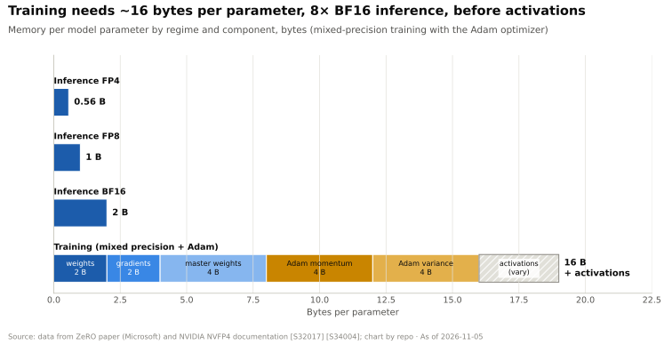

| 策略 | 拆分的对象 | 必须交换的内容 | 使用的集合通信 | 频率 | 通常运行在哪里 |
|---|---|---|---|---|---|
| **数据（DP）** | 训练样本批次 | 梯度 | 全规约（FSDP：规约散射 + 全收集） | 每步一次，可重叠 | 横向扩展网络 |
| **张量（TP）** | 每一层的权重矩阵 | 层的部分输出 | 全规约（或规约散射 + 全收集） | 每层前向 2 次、反向 2 次 [[S34001]](../../sources/bibliography.md#s34001) | NVLink 域内 |
| **流水线（PP）** | 层的堆叠，切分为若干阶段 | 阶段边界处的激活值 | 点对点发送 / 接收 | 每个微批次、每个边界 | 横向扩展网络即可 |
| **专家（EP）** | 混合专家层中的各个专家 | 发往专家的 token 及其返回结果 | 全交换 | 每个 MoE 层前向 2 次 [[S34017]](../../sources/bibliography.md#s34017) | 理想情况下在 NVLink 域内；在网络上需限制路由 [[S34007]](../../sources/bibliography.md#s34007) |
| **上下文（CP）** | 单条长序列中的 token | 注意力的键和值 | 环形发送 / 接收、全收集或全交换 | 每个注意力层 | NVLink 或网络 [[S34009]](../../sources/bibliography.md#s34009)[[S34010]](../../sources/bibliography.md#s34010) |

## 1. 数据并行，以及基于 ZeRO / FSDP 的分片

**工作原理。** 每块 GPU 都持有一份完整的模型副本，并处理批次中的不同切片。反向传播结束后，每块 GPU 都拥有根据自身切片计算出的梯度；这些梯度必须求平均，使每份副本应用相同的更新。这一求平均操作就是**全规约**。

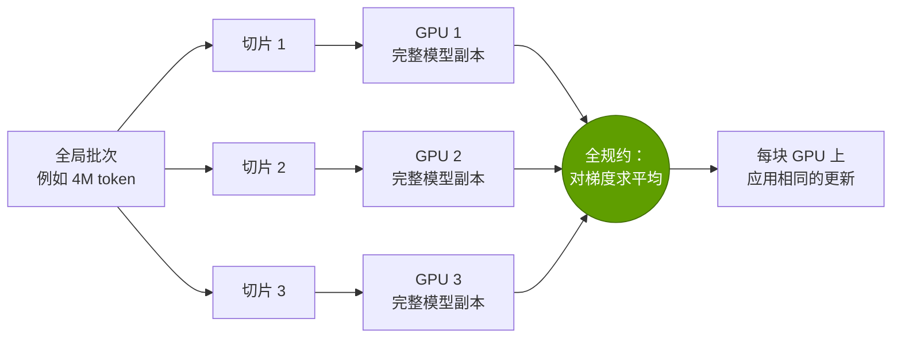

最著名的算法是**[环形全规约（ring all-reduce）](../glossary.md#ring-all-reduce)**，其中每块 GPU 发送和接收的数据量为 2 × (N − 1)/N 倍——约为梯度大小的两倍，与环中 GPU 的数量无关 [[S34011]](../../sources/bibliography.md#s34011)[[S34012]](../../sources/bibliography.md#s34012)。正是这种与 N 无关的特性使数据并行具有良好的扩展性；其代价是数据量大，且每块 GPU 都必须装得下完整模型。

> [!TIP]
> **算例 —— 在不同链路上同步一个 70B 模型的梯度。** 在 BF16 下，梯度为 70B × 2 字节 = 140 GB。在 64 块 GPU 间执行环形全规约，每块 GPU 发送 2 × 63/64 × 140 ≈ **276 GB** [[S34011]](../../sources/bibliography.md#s34011)。再除以各链路的单向带宽：400 Gb/s 的 InfiniBand 网卡传输速度为 50 GB/s → **~5.5 s**；800 Gb/s 网卡 → ~2.8 s [[S34015]](../../sources/bibliography.md#s34015)；H100 上的 NVLink 4（每个方向 450 GB/s）→ ~0.61 s；B200 上的 NVLink 5（900 GB/s）→ **~0.31 s** [[S34014]](../../sources/bibliography.md#s34014)；Rubin 上按当前标称 3.0 TB/s 计的 NVLink 6 → ~0.18 s [[S33007]](../../sources/bibliography.md#s33007)；即便是 Rubin 的 1.6 Tb/s ConnectX-9 网卡（每个方向 200 GB/s）也需要 ~1.4 s [[S33004]](../../sources/bibliography.md#s33004)。以上均为理想时间；实际的集合通信会略逊一筹，而各框架会在后面的层仍在计算时就开始对前面各层的梯度执行全规约，从而隐藏大部分开销。**解读：** NVLink 5 与 400G 网卡之间每 GPU ~18× 的差距，是英伟达销售 NVLink 域、而不仅仅是 GPU 的核心经济原因。

**分片解决了内存问题。** 微软（Microsoft）的 [ZeRO](../glossary.md#zero) 注意到，朴素的数据并行会把所有东西存储 64 份完全相同的副本。它把优化器状态（第 1 阶段）、梯度（第 2 阶段）乃至权重本身（第 3 阶段）依次分片到各数据并行 GPU 上，并在需要时即时收集各部分 [[S34004]](../../sources/bibliography.md#s34004)。PyTorch 的 [FSDP](../glossary.md#fsdp) 是内置于框架中的同一思路 [[S34005]](../../sources/bibliography.md#s34005)；Meta 在 Llama 3 中使用了它 [[S34006]](../../sources/bibliography.md#s34006)。

| 70B 模型，64 块数据并行 GPU | 每块 GPU 存储的内容 | 每 GPU 内存 | 相对朴素 DP 的通信量 |
|---|---|---|---|
| 朴素数据并行 | 全部内容（16 字节/参数） | ~1,120 GB | 1× |
| ZeRO-1：分片优化器状态 | 权重 + 梯度 + 1/64 的优化器状态 | ~293 GB | 1× |
| ZeRO-2：同时分片梯度 | 权重 + 1/64 的梯度和优化器状态 | ~155 GB | 1× |
| ZeRO-3 / FSDP：同时分片权重 | 全部内容的 1/64 | ~17.5 GB | ~1.5× |

*本资料库采用 ZeRO 的 2 + 2 + 12 字节/参数核算口径及其通信分析进行的测算 [[S34004]](../../sources/bibliography.md#s34004)。*

🔧 技术细节：为何全规约 = 规约散射 + 全收集

环形全规约分为两半运行。在**规约散射**阶段，每块 GPU 把数据分成 N 块，每一步把其中一块传给相邻 GPU，并把收到的数据累加；经过 N − 1 步后，每块 GPU 都拥有一个完全求和的数据块。在**全收集**阶段，求和后的数据块再沿环传递 N − 1 步，直到每块 GPU 都拥有全部数据块。每一半中每块 GPU 传输 (N − 1)/N 的数据，因此总计为 2(N − 1)/N；[NCCL](../glossary.md#nccl) 的基准测试把由此得出的每链路速率称为“总线带宽”（bus bandwidth）[[S34012]](../../sources/bibliography.md#s34012)。FSDP 只是在规约散射之后就停止（每块 GPU 只需要自己那一份梯度分片），并在每一层计算之前对*权重*执行全收集 [[S34005]](../../sources/bibliography.md#s34005)。网内规约（NVIDIA SHARP）在交换机内部完成累加，从而减少数据穿越网络的次数 [[S34024]](../../sources/bibliography.md#s34024)。

## 2. 张量并行：拆分每一层

**工作原理。** 不复制模型，而是把每一层的大型权重矩阵拆分到多块 GPU 上——例如，让 8 块 GPU 各持有八分之一的列。每块 GPU 用相同的输入乘以自己的那一片；然后通过全规约合并部分结果。英伟达的 Megatron-LM 对 Transformer 的矩阵做了巧妙安排，使每一层在前向传播中只需两次全规约，在反向传播中也只需两次 [[S34001]](../../sources/bibliography.md#s34001)。

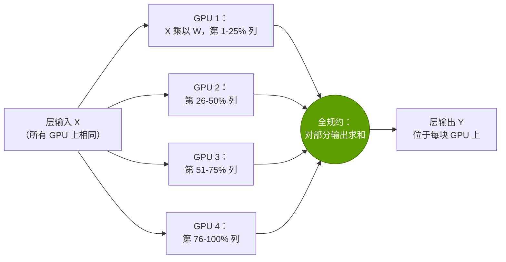

其吸引力在于：每块 GPU 只存储每一层的一部分，单层的计算也完成得更快——这对推理服务的延迟同样有帮助。问题在于：全规约发生在每一层*内部*，位于关键路径上，传输的是完整尺寸的激活值。

> [!TIP]
> **算例 —— 为何张量并行要留在 NVLink 域内。** 以一个 70B 稠密模型（80 层，隐藏维度 8,192）为例，使用 4,096 token 的序列以 BF16 训练，按 TP8 × PP4 × DP64 拆分到 2,048 块 GPU 上，全局批次为 4M token。单条序列在层边界处的激活值为 4,096 × 8,192 × 2 字节 ≈ 67 MB。每块 GPU 所在阶段有 20 层 × 4 次全规约 × 1.75（8 块 GPU 的环形系数）× 67 MB ≈ 每条序列 9.4 GB 的张量并行流量，每步处理 16 条序列 → **每 GPU 每步 ~150 GB** [[S34001]](../../sources/bibliography.md#s34001)[[S34012]](../../sources/bibliography.md#s34012)。同一块 GPU 上 2.2B 参数分片的数据并行梯度同步仅为 ~8.6 GB，流水线发送量为 ~2.1 GB。该步的计算量为 6 × 70B × 4.2M token ÷ 2,048 块 GPU ≈ 每 GPU 8.6 × 10¹⁴ FLOPs——假设每块 B200 实际达到 1 [PFLOPS](../glossary.md#flops)（约为 BF16 峰值的 ~44% [[S33003]](../../sources/bibliography.md#s33003)），耗时 ~0.86 s。通过 NVLink 5 传输这 150 GB 需要 ~0.17 s（可以承受，且部分可重叠）；通过 400G 网卡则需要 ~3.0 s，**是计算本身耗时的 3.5 倍**。**解读：** 张量并行只有在纵向扩展链路上才划算，因此 NVLink 域的规模限制了模型能以这种方式拆分到什么程度。

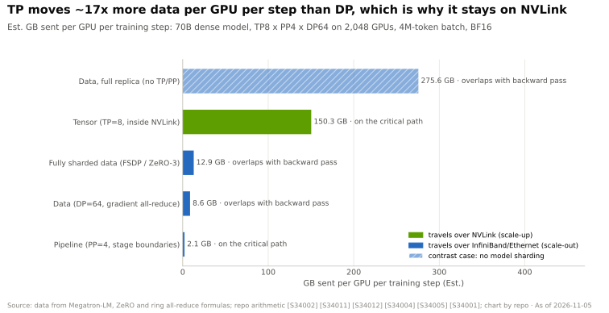

既然一个 [NVL72](../glossary.md#nvl72) 机架已经能以全速 NVLink 连接 72 块 GPU [[S34014]](../../sources/bibliography.md#s34014)，为什么不采用 72 路张量并行？因为把一个矩阵切成 72 份，每块 GPU 只剩下薄薄的一片，而小矩阵乘法的运行效率远低于峰值（参见 [P3](P3-the-four-bottlenecks.md) 中的 roofline）。Megatron 的作者建议把张量并行限制在一台服务器内，超出部分则使用流水线并行 [[S34002]](../../sources/bibliography.md#s34002)。在实践中，大型 NVLink 域被用于专家并行和推理服务，而不是更宽的张量拆分。

🔧 技术细节：序列并行——配套技巧

某些层操作（LayerNorm、dropout）不会被张量并行拆分，因此每块 GPU 都会重复计算和存储它们。英伟达的**[序列并行](../glossary.md#sequence-parallelism)**改为沿序列维度拆分这些操作，并把每次全规约替换为总量相同的一次规约散射加一次全收集——从而在不增加通信成本的情况下节省激活值内存 [[S34008]](../../sources/bibliography.md#s34008)。不要与*上下文*并行（第 5 节）混淆，后者是把注意力计算本身拆分到多块 GPU 上。

## 3. 流水线并行与气泡

**工作原理。** 把模型的层切分为连续的**阶段**——第 1–20 层放在 GPU 组 A，第 21–40 层放在 B，依此类推——并像流水线一样把激活值从一个阶段传到下一个阶段。只有点对点发送会跨越边界，而且数据量很小，因此各流水线阶段可以位于不同机架，通过普通的[横向扩展](../glossary.md#scale-out)网络连接 [[S34002]](../../sources/bibliography.md#s34002)。

问题在于**[流水线气泡](../glossary.md#pipeline-bubble)**：在每一步开始时，后面的阶段要等待工作到达；而在结束时，前面的阶段要等待反向传播返回。GPipe 的解决办法是把每个批次切成许多[微批次](../glossary.md#micro-batch)，让流水线迅速填满 [[S34003]](../../sources/bibliography.md#s34003)。

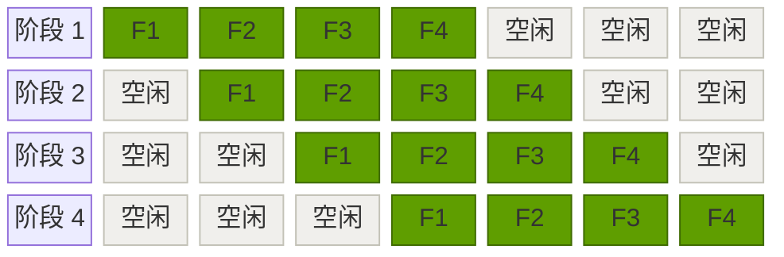

*4 个微批次（F1–F4）在 4 阶段流水线中的前向传播：每个阶段在 7 个时间槽中有 3 个处于空闲，即 (p − 1)/(m + p − 1) = 3/7 ≈ 43% 的气泡。反向传播还会增加一个镜像对称的气泡。*

对于 p 个阶段和 m 个微批次，每一步的空闲占比为 (p − 1)/(m + p − 1)；“一前向一反向”（1F1B）调度能控制内存占用，但不改变这一比例；而 Megatron 的**交错式**调度让每块 GPU 负责 v 个不连续的层块，可将气泡缩小约 v 倍 [[S34002]](../../sources/bibliography.md#s34002)[[S34003]](../../sources/bibliography.md#s34003)。

> [!TIP]
> **算例 —— 一个 16 阶段流水线需要多少微批次？** 当 p = 16 个阶段时，空闲占比为 15 ÷ (m + 15)。m = 16 个微批次时，GPU 有 **48%** 的时间处于空闲；m = 64 时 ~19%；m = 128 时 ~10%。采用 v = 4 个层块的交错调度，可把 m = 16 时的空闲占比降至 ~19% [[S34002]](../../sources/bibliography.md#s34002)。但微批次并非没有代价：全局批次大小受优化器所能容忍的范围限制（Llama 3 每步 ~16M token [[S34006]](../../sources/bibliography.md#s34006)），因此每条流水线的微批次越多，就意味着数据并行副本越少或微批次越小——而这会损害矩阵乘法效率。**解读：** 流水线深度、微批次数量和数据并行宽度三者之间相互权衡；更快的纵向扩展域让你可以使用更少的流水线阶段，从而获得更小的气泡。

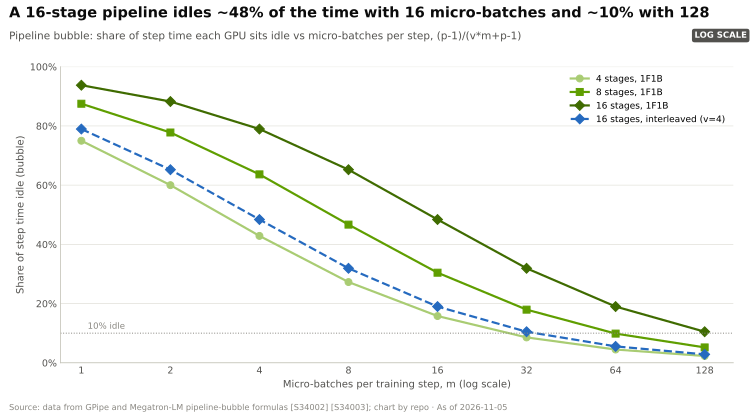

## 4. 面向混合专家模型的专家并行

**工作原理。** **[混合专家模型](../glossary.md#mixture-of-experts)**（MoE）把每个稠密前馈模块替换为许多较小的“专家”模块，外加一个**[路由器](../glossary.md#moe-router)**，把每个 token 只发送给其中少数几个专家。DeepSeek-V3 总共有 671B 参数，但每个 token 只激活 37B；每个 MoE 层有 1 个共享专家和 256 个路由专家，每个 token 从中选出 8 个 [[S34007]](../../sources/bibliography.md#s34007)。每 token 的计算量大致按激活参数的比例下降——这正是其吸引力所在。**专家并行**把不同的专家放在不同的 GPU 上，因此每个 MoE 层都必须把每个 token 发送到持有其所选专家的 GPU 上，再把结果取回：每层两次**全交换** [[S34017]](../../sources/bibliography.md#s34017)[[S34023]](../../sources/bibliography.md#s34023)。

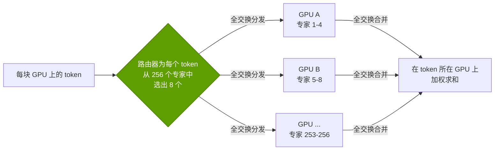

对网络而言，全交换是最难的集合通信：每块 GPU 同时与其他所有 GPU 通信，流量分布不均（热门专家收到更多 token），而且它位于每个 MoE 层的关键路径上。一个让每块 GPU 都能以全速访问其他所有 GPU 的交换式互连域——这正是 NVLink/NVSwitch 机架所提供的——是它天然的归宿。

> [!TIP]
> **算例 —— DeepSeek-V3 级模型的全交换流量。** 隐藏维度为 7,168 [[S34007]](../../sources/bibliography.md#s34007)，以 [FP8](../glossary.md#fp8)（每个数值 1 字节）把一个 token 发送给 8 个专家需要 8 × 7,168 ≈ **57 KB**，以 BF16 返回 8 个结果需要 ≈ **115 KB**——每个 token 每个 MoE 层 ~172 KB。共有 58 个 MoE 层（61 层中除前 3 层外的全部）[[S34007]](../../sources/bibliography.md#s34007)，因此一次前向传播约为**每 token ~10 MB**；一块处理 4,096 token 微批次的 GPU 必须收发 ~41 GB 的数据。以 InfiniBand 的 50 GB/s 计算约需 ~0.8 s；以 NVLink 5 的 900 GB/s 计算约需 ~0.05 s [[S34014]](../../sources/bibliography.md#s34014)[[S34015]](../../sources/bibliography.md#s34015)。DeepSeek 在受出口管制限制的 H800 上（其实测 NVLink ~160 GB/s，InfiniBand ~50 GB/s）给出的答案是软硬件协同设计：每个 token 最多只能访问 4 个节点上的专家，并且每个节点只穿越一次 InfiniBand，再在节点内部通过 NVLink 扇出，因此跨网络传输的副本最多为 4 份，而非最多 8 份；每块 GPU 的 132 个 SM 中有 20 个专门用于通信；并采用“DualPipe”调度使通信与计算重叠 [[S34007]](../../sources/bibliography.md#s34007)。**解读：** MoE 用网络流量换取 FLOPs，因此价值从原始算力转向纵向扩展带宽和精巧的软件。

推理服务把这一点体现得更加明显。DeepSeek 的[解码](../glossary.md#decode)部署把每个模型副本分布在 40 个节点的 320 块 GPU 上，每块 GPU 放一个路由专家，另有若干 GPU 用于冗余专家和共享专家 [[S34007]](../../sources/bibliography.md#s34007)。如此规模的模型服务本质上是一个集群设计问题，这就是英伟达针对 MoE 推理主推机架级 NVL72 系统及其 [Dynamo](../glossary.md#dynamo) 推理服务软件的原因（参见[第 11 层](../layers/11-inference-and-ai-software/index.md)）。

## 5. 面向长上下文的上下文并行

**工作原理。** 注意力机制要把每个 token 与之前的每个 token 进行比较，因此其计算量和激活值内存随序列长度的平方增长。在 128K token 时，单条序列已无法轻松装入一块 GPU。**[上下文并行](../glossary.md#context-parallelism)**把一条序列的 *token* 拆分到多块 GPU 上。每块 GPU 为自己那一段查询计算注意力，但需要之前每一段的**键和值**，因此 GPU 之间要交换这些数据——可以在计算的同时沿环传递数据块（Ring Attention [[S34009]](../../sources/bibliography.md#s34009)），可以对其执行全收集（Llama 3 的做法 [[S34006]](../../sources/bibliography.md#s34006)），也可以通过全交换把划分方式从按 token 改为按注意力头（DeepSpeed-Ulysses [[S34010]](../../sources/bibliography.md#s34010)）。

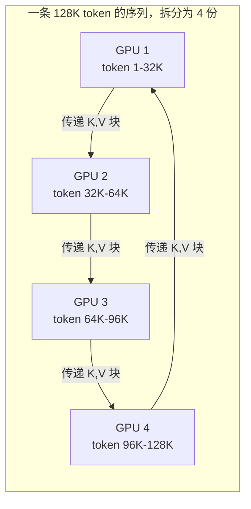

> [!TIP]
> **算例 —— 为何 Llama 3 在 128K token 时需要 16 路上下文并行。** Llama 3 405B 有 126 层，以及 8 个维度为 128 的键/值头 [[S32008]](../../sources/bibliography.md#s32008)。其键和值占用 2 × 126 × 8 × 128 × 2 字节 ≈ **每 token 0.52 MB**，因此一条 131,072 token 的序列仅键和值就有 ~68 GB——这还不算规模大得多的激活值。在该阶段，Meta 从 TP8 × PP16 × DP128 切换为 TP8 × **CP16** × PP16 × DP8，GPU 数量保持在 16,384 块，批次保持在 ~16M token，仍实现了 38% 的 MFU，而 8K 上下文时为 41% [[S34006]](../../sources/bibliography.md#s34006)。**解读：** 长上下文训练是以数据并行宽度换取上下文并行宽度；额外的键/值流量之所以可以承受，是因为每块 GPU 在每条序列上的注意力计算量减少了 16 倍。

## 综合起来：3D、4D 和 5D 并行

实际训练会把这些策略组合成嵌套的维度：GPU 数量 = TP × CP × PP × DP，专家并行通常复用数据并行的 GPU 来承载 MoE 层。规则是把流量最大的维度放在最内层、最快的链路上。Meta 将 Llama 3 的维度排序为 [TP, CP, PP, DP]，从通信需求最大到最小 [[S34006]](../../sources/bibliography.md#s34006)。

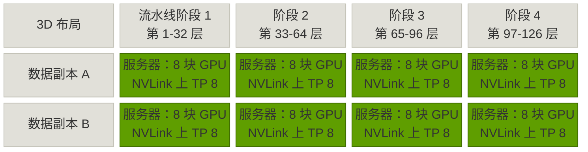

*一个示意性的 3D 布局：张量并行位于每台 8 GPU 服务器内部（NVLink），流水线阶段沿同一行跨越多台服务器，数据并行副本则跨越各行（两者均通过横向扩展网络）。Llama 3 405B 的真实布局为 8 × 16 × 128 = 16,384 块 GPU。*

Meta 最大规模训练的公开配置展示了这些维度如何随作业变化而重新调配：

| Llama 3 405B 阶段 | GPU 数 | TP | CP | PP | DP | 序列长度 | 每批 token 数 | 每 GPU 实际 TFLOPS | BF16 MFU |
|---|---|---|---|---|---|---|---|---|---|
| 早期预训练 | 8,192 | 8 | 1 | 16 | 64 | 8,192 | ~16M | 430 | 43% |
| 主体预训练 | 16,384 | 8 | 1 | 16 | 128 | 8,192 | ~16M | 400 | 41% |
| 长上下文扩展 | 16,384 | 8 | 16 | 16 | 8 | 131,072 | ~16M | 380 | 38% |

*来源：Llama 3 论文，表 4 [[S34006]](../../sources/bibliography.md#s34006)。集群从 8,192 块 GPU 翻倍至 16,384 块，MFU 下降 ~2 个百分点——这正是阿姆达尔定律在起作用（参见 [P3](P3-the-four-bottlenecks.md)）。*

> [!WARNING]
> **误区与事实：**“只要有足够多的 GPU 和足够快的网络，任何模型都能以接近峰值的速度训练。”每一种拆分都会增加通信或空闲时间：Llama 3 405B 在每 GPU 400 Gb/s 的 RoCE 网络 [[S34022]](../../sources/bibliography.md#s34022)上、服务器内部采用 NVLink 的条件下，只达到了峰值的 38–43% [[S34006]](../../sources/bibliography.md#s34006)；英伟达自己的 1T 参数 Megatron 基准测试在 A100 上达到了 52% [[S34002]](../../sources/bibliography.md#s34002)。剩下的一半 FLOPS 就是并行的代价——也是留给能够降低这一代价者的奖赏。

## 集合通信操作图解

| 集合通信 | 每块 GPU 起始持有 | 每块 GPU 最终持有 | 每 GPU 发送数据量（环形，N 块 GPU） | 用途 |
|---|---|---|---|---|
| **全规约** | 自己的完整向量 | 所有 GPU 向量之和（或平均） | 2(N − 1)/N × 数据量 | 数据并行梯度；张量并行输出 |
| **规约散射** | 自己的完整向量 | 求和结果的 1/N 切片 | (N − 1)/N × 数据量 | FSDP / ZeRO 梯度；序列并行 |
| **全收集** | 一个 1/N 切片 | 所有 GPU 切片的拼接 | (N − 1)/N × 数据量 | FSDP 权重；上下文并行的键/值 |
| **全交换** | N 个不同的片段，每个目的地一个 | 来自每个来源的一个片段 | (N − 1)/N × 数据量 | MoE 分发/合并；Ulysses 注意力 |
| **广播（broadcast）** | 一块 GPU 持有数据 | 所有 GPU 都持有 | ≈ 数据量 | 初始权重、检查点 |

*定义及每 GPU 数据量来自 NCCL 文档和基准测试 [[S34013]](../../sources/bibliography.md#s34013)[[S34012]](../../sources/bibliography.md#s34012)；环形算法 [[S34011]](../../sources/bibliography.md#s34011)。*

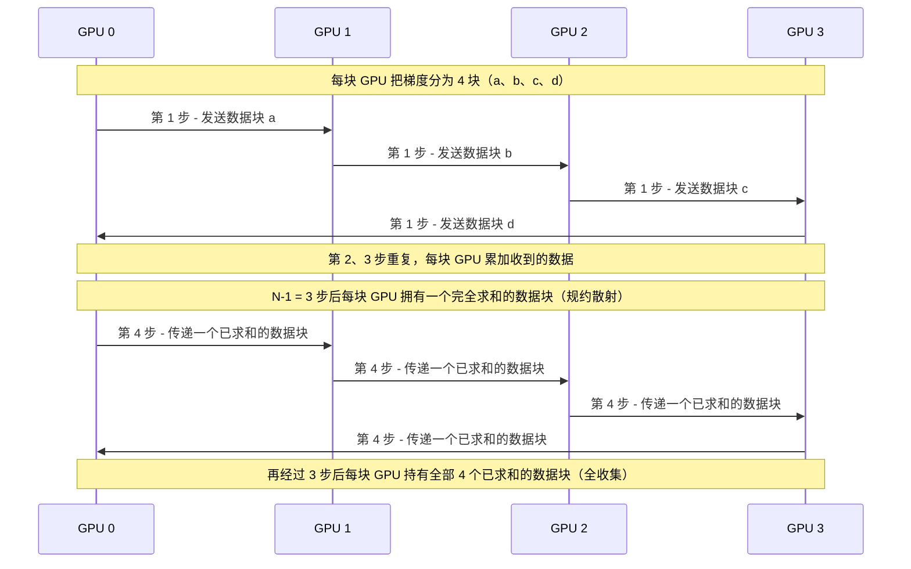

*4 块 GPU 的环形全规约：共 6 步，每步每块 GPU 传输 1/4 的数据，因此每块 GPU 发送的数据量为梯度大小的 6/4 = 2 × (4 − 1)/4 [[S34011]](../../sources/bibliography.md#s34011)。*

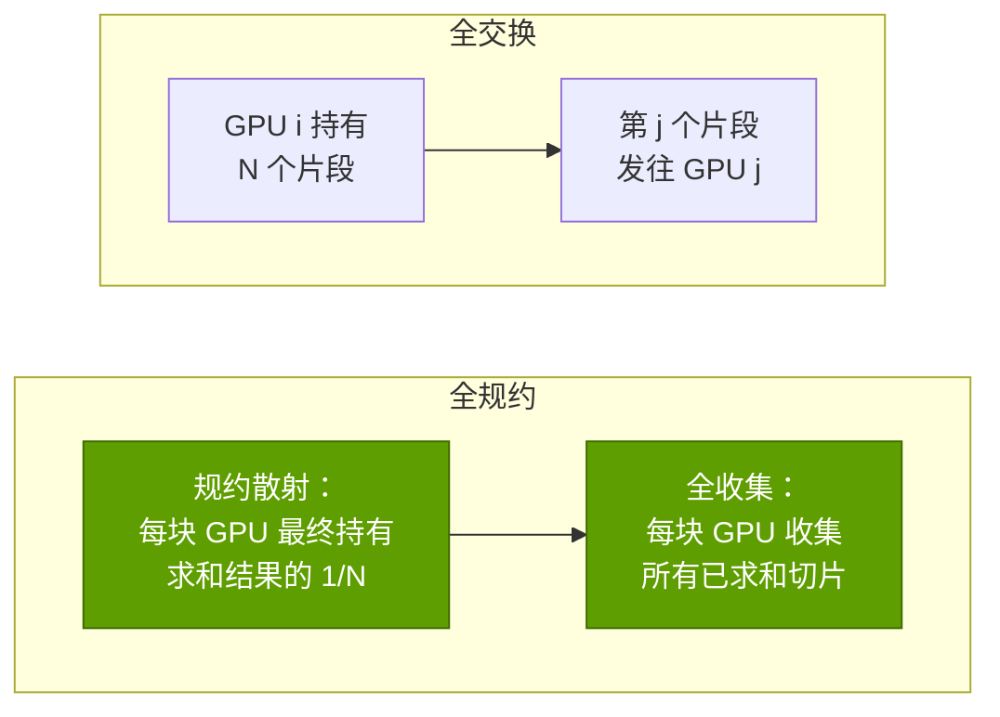

🔧 技术细节：为何 NCCL 是英伟达护城河的一部分

NCCL 是英伟达的集合通信库，它负责选择算法（环形、树形或交换机辅助），把消息拆分成多个通道分布到 NVLink 和网卡上，并让一切与计算重叠——针对其检测到的任何拓扑自动完成 [[S34013]](../../sources/bibliography.md#s34013)。PyTorch 等框架在上述每一种集合通信中都会调用它，因此为 8 GPU 服务器编写的训练脚本无需修改即可在 16,384 块 GPU 的集群上运行。AMD（RCCL）、谷歌（基于 ICI 的 [XLA](../glossary.md#xla) 集合通信）等都有对应方案；差别在于英伟达针对自家 NVLink、[NVSwitch](../glossary.md#nvswitch)、InfiniBand 和 [Spectrum-X](../glossary.md#spectrum-x) 硬件（包括交换机内规约）进行的多年调优 [[S34024]](../../sources/bibliography.md#s34024)。详见[第 10 层 · 软件库](../layers/10-libraries-cuda-x/index.md)。

> [!NOTE]
> **🐂 看多观点：** 随着模型转向 MoE、长上下文和推理，通信需求最大的维度（专家并行和上下文并行）增长最快，而它们需要规模最大、速度最快的纵向扩展域。英伟达今天的 NVL72、路线图上更大的 NVLink 域，以及针对它们调优的 NCCL 和 Dynamo，恰好位于流量的去向之处 [[S34014]](../../sources/bibliography.md#s34014)[[S34007]](../../sources/bibliography.md#s34007)。

> [!WARNING]
> **🐻 看空观点：** 并行本质上是算法，而算法是可以迁移的。DeepSeek 通过重新设计路由和调度，在带宽受限的 H800 上不使用张量并行就训练出了前沿级 MoE 模型 [[S34007]](../../sources/bibliography.md#s34007)；谷歌在 TPU 环面链路上训练 PaLM 时完全没有使用流水线并行 [[S34021]](../../sources/bibliography.md#s34021)；而本页的每一项技术都已存在于开源框架中 [[S34004]](../../sources/bibliography.md#s34004)[[S34005]](../../sources/bibliography.md#s34005)[[S34010]](../../sources/bibliography.md#s34010)。并且从纸面数据看，英伟达已不再拥有规模最大或速度最快的纵向扩展域：AMD 的 Helios 机架通过 UALink-over-Ethernet 连接 72 块 MI455X GPU，每块最高 3.6 TB/s [[S226]](../../sources/bibliography.md#s226)，高于 NVLink 6 当前标称的 3.0 TB/s [[S33007]](../../sources/bibliography.md#s33007)；AWS 的 Trn3 UltraServer 连接 144 颗芯片 [[S242]](../../sources/bibliography.md#s242)；谷歌的 Ironwood pod 规模达到 9,216 颗芯片，尽管采用的是多跳环面结构而非单跳交换 [[S232]](../../sources/bibliography.md#s232)。如果开放的纵向扩展标准能提供相当的互连域带宽，那么在把工作映射到硬件方面的软件优势就会收窄。

## 与各层的关联

| 本页主题 | 本资料库的深入章节 |
|---|---|
| 张量并行和专家并行需要高速纵向扩展域 | [第 05 层 · 纵向扩展（NVLink、NVSwitch）](../layers/05-scale-up-nvlink-nvswitch/index.md) |
| 数据并行和流水线并行运行在集群网络上；集合通信、SHARP、轨道优化（rail-optimized）网络 | [第 06 层 · 横向扩展与跨数据中心网络](../layers/06-scale-out-scale-across-networking/index.md) |
| HBM 容量决定需要拆分到什么程度 | [第 03 层 · 内存与封装](../layers/03-memory-packaging-supply-chain/index.md) · [P3 · 四大瓶颈](P3-the-four-bottlenecks.md) |
| 各种拆分必须让 GPU 算力保持满载 | [第 02 层 · GPU 芯片](../layers/02-gpu-silicon/index.md) |
| NVL72 机架、集群建设及其电力 | [第 08 层 · 系统、机架与 AI 工厂](../layers/08-systems-racks-ai-factories/index.md) |
| NCCL、Megatron 以及实现上述一切的软件库 | [第 10 层 · 软件库（CUDA-X）](../layers/10-libraries-cuda-x/index.md) · [第 09 层 · CUDA](../layers/09-cuda-and-system-software/index.md) |
| MoE 服务、分离式推理、Dynamo | [第 11 层 · 推理与 AI 软件](../layers/11-inference-and-ai-software/index.md) · [P2 · 推理](P2-how-ai-inference-works.md) |
| 算力与 FLOPs 预算为何如此 | [P1 · AI 训练原理](P1-how-ai-training-works.md) |
| DeepSeek 协同设计带来的效率冲击 | [CS5 · DeepSeek 时刻](../case-studies/CS5-deepseek-moment-and-efficiency-shock.md) |

## 需要记住的关键数字

| 指标 | 数值 | 为何重要 |
|---|---|---|
| 每参数训练内存（混合精度 Adam） | ~16 字节 → 70B 模型 ~1.12 TB [[S34004]](../../sources/bibliography.md#s34004) | 迫使进行模型拆分和分片 |
| 每 GPU 的环形全规约流量 | 2(N − 1)/N × 数据量 ≈ 2× [[S34011]](../../sources/bibliography.md#s34011)[[S34012]](../../sources/bibliography.md#s34012) | 与 GPU 数量无关 |
| 70B BF16 梯度同步（64 块 GPU） | 400G InfiniBand 上 ~5.5 s，NVLink 5 上 ~0.31 s [[S34015]](../../sources/bibliography.md#s34015)[[S34014]](../../sources/bibliography.md#s34014) | 每 GPU ~18× 的差距 |
| 张量并行全规约次数 | 每层前向 2 次 + 反向 2 次 [[S34001]](../../sources/bibliography.md#s34001) | TP 留在 NVLink 内的原因 |
| 流水线气泡 | (p − 1)/(m + p − 1)：16 阶段 × 16 个微批次 → ~48% 空闲 [[S34002]](../../sources/bibliography.md#s34002)[[S34003]](../../sources/bibliography.md#s34003) | 需要大量微批次或交错调度 |
| Llama 3 405B 布局 | TP8 × PP16 × DP128 = 16,384 块 H100，41% MFU；128K 上下文时采用 CP16 [[S34006]](../../sources/bibliography.md#s34006) | 4D 并行的参考配方 |
| DeepSeek-V3 | 总参数 671B / 激活 37B；256 个路由专家，激活 8 个；在 2,048 块 H800 上 PP16 × EP64，无 TP [[S34007]](../../sources/bibliography.md#s34007) | MoE 把瓶颈转移到全交换 |
| MoE 全交换，DeepSeek-V3 级 | 每 token 每 MoE 层 ~172 KB，每 token 每次前向传播 ~10 MB（本资料库基于 [[S34007]](../../sources/bibliography.md#s34007) 的估计） | 纵向扩展带宽成为约束 |
| 每 GPU 纵向扩展与横向扩展对比 | NVLink 5 1.8 TB/s 对 400–800 Gb/s 网卡；Rubin 3.0 TB/s 对 1.6 Tb/s [[S34014]](../../sources/bibliography.md#s34014)[[S34015]](../../sources/bibliography.md#s34015)[[S33004]](../../sources/bibliography.md#s33004)[[S33007]](../../sources/bibliography.md#s33007) | 决定每一种布局的 ~8–18× 落差 |

## 🎯 企业发展视角

1. **并行策略决定网络投资的去向。** 张量并行和专家并行购买的是纵向扩展带宽（NVLink 交换机、铜缆背板）；数据并行和流水线并行购买的是横向扩展（网卡、交换机、光模块）。随着 MoE 和长上下文的增长，集群网络支出中会有多大比例转向纵向扩展域——英伟达控制最严密的部分——而 [UALink](../glossary.md#ualink) 或以太网纵向扩展又能以多快的速度夺回这部分份额？
2. **映射方面的专有技术是一条有开源“影子”的软件护城河。** NCCL、Megatron-Core 和 Dynamo 凝聚了多年的调优积累 [[S34013]](../../sources/bibliography.md#s34013)[[S34002]](../../sources/bibliography.md#s34002)；PyTorch FSDP、DeepSpeed 和 JAX 则提供了可移植的对应方案 [[S34005]](../../sources/bibliography.md#s34005)[[S34004]](../../sources/bibliography.md#s34004)。对挑战者而言，“在我们的网络上实现出色的集合通信，并合入 PyTorch 上游”是一项可以自建的资产、可以收购的资产，还是需要与现有框架团队合作？
3. **算法与系统的协同设计可以替代硬件。** DeepSeek-V3 避免使用张量并行，并限制跨节点流量，以适配受出口管制限制的 GPU [[S34007]](../../sources/bibliography.md#s34007)。未来哪些模型层面的变化（每 token 激活更少专家、更小的隐藏维度、规避通信的注意力机制）会降低大型纵向扩展域的溢价——谁又会因此受益？
4. **推理也正在变成一个并行问题。** 跨数百块 GPU 的大规模专家并行服务 [[S34007]](../../sources/bibliography.md#s34007) 更有利于系统厂商而非芯片厂商。一款注重效率的推理产品能否在较小的互连域内服务前沿 MoE 模型，还是必须接入更大的网络（例如通过 [NVLink Fusion](../glossary.md#nvlink-fusion) 或 UALink）？这是[第 19 章](../cross-cutting/19-implications-for-qualcomm.md)要讨论的问题，以选项的形式呈现。
5. **集合通信是一个元器件层面的价值池。** 网内规约、全交换加速、拥塞控制和网卡卸载 [[S34024]](../../sources/bibliography.md#s34024) 位于芯片与软件之间。哪些供应商和初创公司掌握了其中的部分环节？对于一个进入数据中心市场的新玩家而言，哪些适合合作、哪些适合收购？

## 📚 来源（Sources）

<!-- Auto-generated from the [S…] citations on this page by `make build`. Edit sources/registry/*.csv, not this list. -->

- [**S226**](../../sources/bibliography.md#s226) AMD, *AMD Helios Rackscale Solution (product page)*, 2026. [Link](https://www.amd.com/en/products/rackscale-solutions/helios.html)
- [**S232**](../../sources/bibliography.md#s232) Google Cloud, *TPU7x (Ironwood) - Cloud TPU documentation*, 2025-11. [Link](https://docs.cloud.google.com/tpu/docs/tpu7x)
- [**S242**](../../sources/bibliography.md#s242) Amazon Web Services, *Amazon EC2 Trn3 instances (product page)*, 2025-12-02. [Link](https://aws.amazon.com/ec2/instance-types/trn3/)
- [**S32008**](../../sources/bibliography.md#s32008) Meta via Hugging Face, *Llama 3.1 405B configuration (config.json)*, 2024-07-23. [Link](https://huggingface.co/meta-llama/Llama-3.1-405B/blob/main/config.json)
- [**S33002**](../../sources/bibliography.md#s33002) NVIDIA, *NVIDIA H100 Tensor Core GPU (product page and datasheet)*, 2022-03-22. [Link](https://www.nvidia.com/en-us/data-center/h100/)
- [**S33003**](../../sources/bibliography.md#s33003) Lenovo Press, *ThinkSystem NVIDIA B200 180GB 1000W GPU product guide*, 2025. [Link](https://lenovopress.lenovo.com/lp2226-thinksystem-nvidia-b200-180gb-1000w-gpu)
- [**S33004**](../../sources/bibliography.md#s33004) NVIDIA Newsroom, *NVIDIA Kicks Off the Next Generation of AI With Rubin — Six New Chips; One Incredible AI Supercomputer*, 2026-01-05. [Link](https://nvidianews.nvidia.com/news/rubin-platform-ai-supercomputer)
- [**S33007**](../../sources/bibliography.md#s33007) Dataconomy, *Nvidia Quietly Cuts Vera Rubin HBM4 And NVLink Bandwidth Specs*, 2026-11-02. [Link](https://dataconomy.com/2026/11/02/nvidia-quietly-cuts-vera-rubin-hbm4-and-nvlink-bandwidth/)
- [**S34001**](../../sources/bibliography.md#s34001) arXiv:1909.08053 (Mohammad Shoeybi, Mostofa Patwary, Raul Puri et al. (NVIDIA)), *Megatron-LM: Training Multi-Billion Parameter Language Models Using Model Parallelism*, 2019-09-17. [Link](https://arxiv.org/abs/1909.08053)
- [**S34002**](../../sources/bibliography.md#s34002) arXiv:2104.04473 (SC21) (Deepak Narayanan, Mohammad Shoeybi, Jared Casper et al. (NVIDIA; Stanford; Microsoft)), *Efficient Large-Scale Language Model Training on GPU Clusters Using Megatron-LM*, 2021-04-09. [Link](https://arxiv.org/abs/2104.04473)
- [**S34003**](../../sources/bibliography.md#s34003) arXiv:1811.06965 (NeurIPS 2019) (Yanping Huang, Youlong Cheng, Ankur Bapna et al. (Google)), *GPipe: Efficient Training of Giant Neural Networks using Pipeline Parallelism*, 2018-11-16. [Link](https://arxiv.org/abs/1811.06965)
- [**S34004**](../../sources/bibliography.md#s34004) arXiv:1910.02054 (SC20) (Samyam Rajbhandari, Jeff Rasley, Olatunji Ruwase, Yuxiong He (Microsoft)), *ZeRO: Memory Optimizations Toward Training Trillion Parameter Models*, 2019-10-04. [Link](https://arxiv.org/abs/1910.02054)
- [**S34005**](../../sources/bibliography.md#s34005) arXiv:2304.11277 (VLDB 2023) (Yanli Zhao, Andrew Gu, Rohan Varma et al. (Meta)), *PyTorch FSDP: Experiences on Scaling Fully Sharded Data Parallel*, 2023-04-21. [Link](https://arxiv.org/abs/2304.11277)
- [**S34006**](../../sources/bibliography.md#s34006) arXiv:2407.21783 (Llama Team (AI @ Meta)), *The Llama 3 Herd of Models*, 2024-07-31. [Link](https://arxiv.org/abs/2407.21783)
- [**S34007**](../../sources/bibliography.md#s34007) arXiv:2412.19437 (DeepSeek-AI), *DeepSeek-V3 Technical Report*, 2024-12-27. [Link](https://arxiv.org/abs/2412.19437)
- [**S34008**](../../sources/bibliography.md#s34008) arXiv:2205.05198 (MLSys 2023) (Vijay Korthikanti, Jared Casper, Sangkug Lym et al. (NVIDIA)), *Reducing Activation Recomputation in Large Transformer Models*, 2022-05-10. [Link](https://arxiv.org/abs/2205.05198)
- [**S34009**](../../sources/bibliography.md#s34009) arXiv:2310.01889 (Hao Liu, Matei Zaharia, Pieter Abbeel), *Ring Attention with Blockwise Transformers for Near-Infinite Context*, 2023-10-03. [Link](https://arxiv.org/abs/2310.01889)
- [**S34010**](../../sources/bibliography.md#s34010) arXiv:2309.14509 (Sam Ade Jacobs, Masahiro Tanaka, Chengming Zhang et al. (Microsoft)), *DeepSpeed Ulysses: System Optimizations for Enabling Training of Extreme Long Sequence Transformer Models*, 2023-09-25. [Link](https://arxiv.org/abs/2309.14509)
- [**S34011**](../../sources/bibliography.md#s34011) Journal of Parallel and Distributed Computing (Pitch Patarasuk, Xin Yuan), *Bandwidth optimal all-reduce algorithms for clusters of workstations*, 2009-02. [Link](https://doi.org/10.1016/j.jpdc.2008.09.002)
- [**S34012**](../../sources/bibliography.md#s34012) NVIDIA (GitHub), *NCCL Tests — Performance reported (algbw vs busbw)*, 2024. [Link](https://github.com/NVIDIA/nccl-tests/blob/master/doc/PERFORMANCE.md)
- [**S34013**](../../sources/bibliography.md#s34013) NVIDIA Docs, *NCCL User Guide — Collective Operations*, 2025. [Link](https://docs.nvidia.com/deeplearning/nccl/user-guide/docs/usage/collectives.html)
- [**S34014**](../../sources/bibliography.md#s34014) NVIDIA, *NVIDIA NVLink and NVLink Switch*, 2025. [Link](https://www.nvidia.com/en-us/data-center/nvlink/)
- [**S34015**](../../sources/bibliography.md#s34015) NVIDIA, *NVIDIA InfiniBand adapters (ConnectX-7 NDR 400Gb/s; ConnectX-8 XDR 800Gb/s)*, 2025. [Link](https://www.nvidia.com/en-us/networking/infiniband-adapters/)
- [**S34017**](../../sources/bibliography.md#s34017) arXiv:2006.16668 (Dmitry Lepikhin, HyoukJoong Lee, Yuanzhong Xu et al. (Google)), *GShard: Scaling Giant Models with Conditional Computation and Automatic Sharding*, 2020-06-30. [Link](https://arxiv.org/abs/2006.16668)
- [**S34021**](../../sources/bibliography.md#s34021) arXiv:2204.02311 (Aakanksha Chowdhery, Sharan Narang, Jacob Devlin et al. (Google)), *PaLM: Scaling Language Modeling with Pathways*, 2022-04-05. [Link](https://arxiv.org/abs/2204.02311)
- [**S34022**](../../sources/bibliography.md#s34022) ACM SIGCOMM 2024 (Adithya Gangidi, Rui Miao, Shengbao Zheng et al. (Meta)), *RDMA over Ethernet for Distributed AI Training at Meta Scale*, 2024-08. [Link](https://doi.org/10.1145/3651890.3672233)
- [**S34023**](../../sources/bibliography.md#s34023) arXiv:2101.03961 (JMLR) (William Fedus, Barret Zoph, Noam Shazeer (Google)), *Switch Transformers: Scaling to Trillion Parameter Models with Simple and Efficient Sparsity*, 2021-01-11. [Link](https://arxiv.org/abs/2101.03961)
- [**S34024**](../../sources/bibliography.md#s34024) NVIDIA Docs, *NVIDIA Scalable Hierarchical Aggregation and Reduction Protocol (SHARP) documentation*, 2024. [Link](https://docs.nvidia.com/networking/display/sharpv3)
