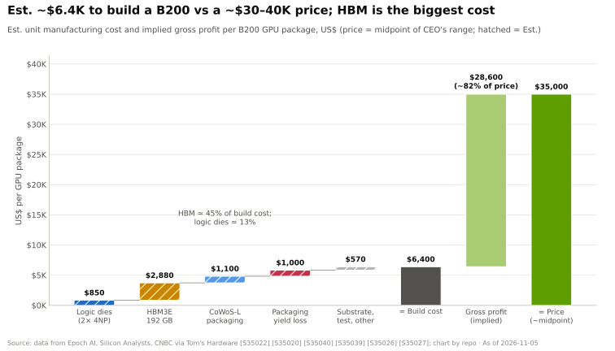
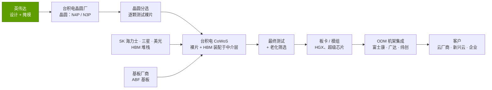
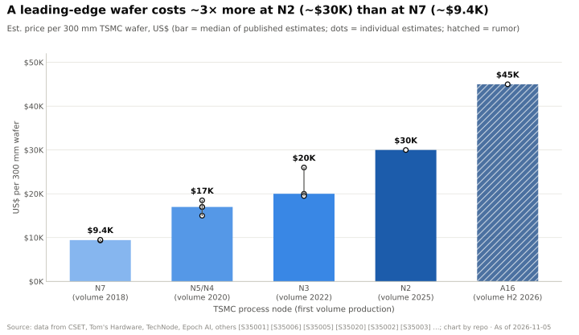
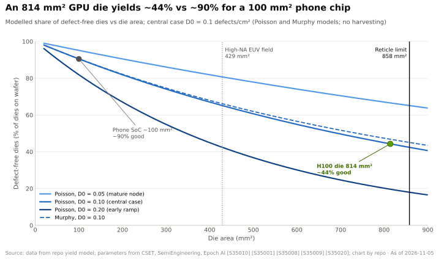
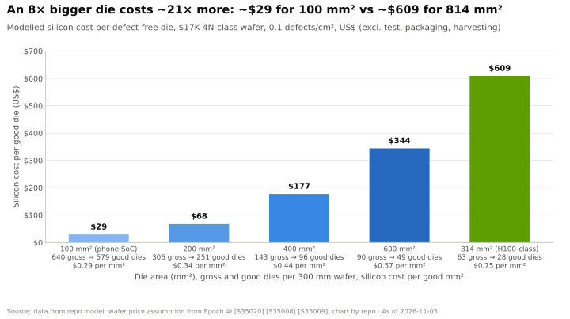
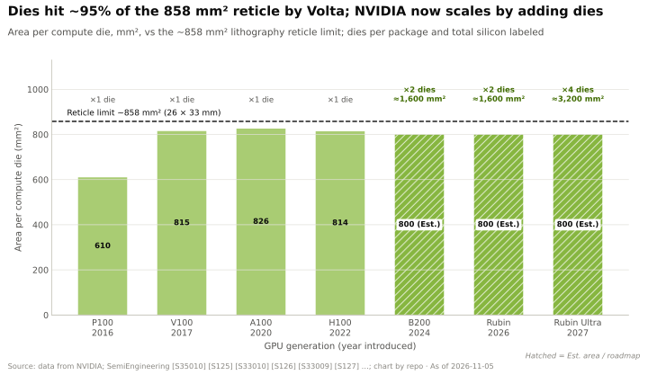
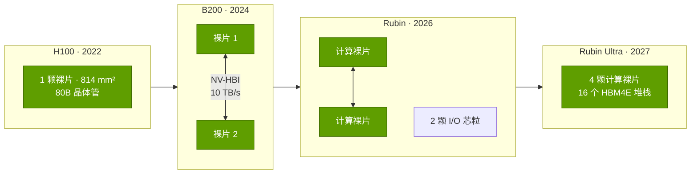
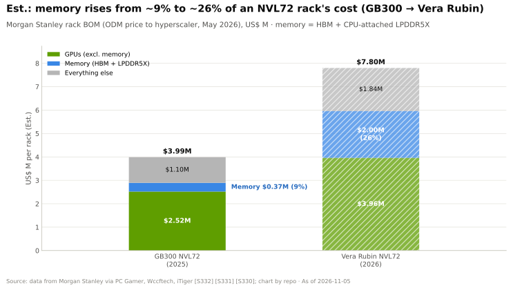
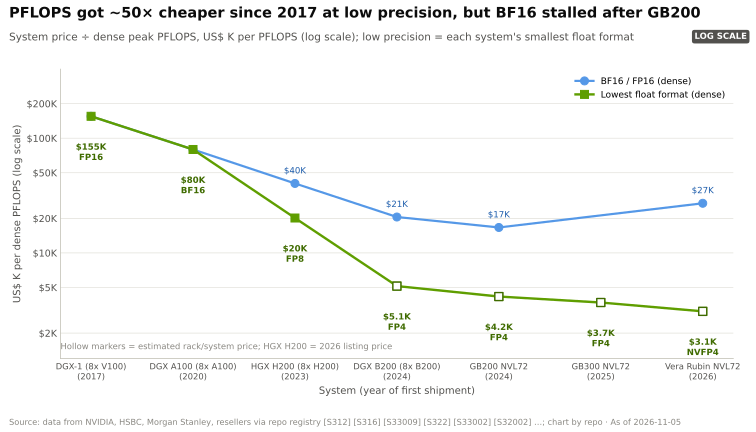
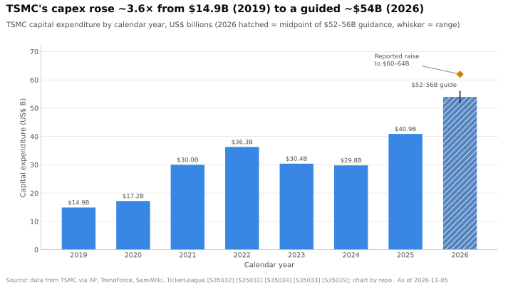

# P5 · 芯片经济学入门

> [!NOTE]
> 本页为英文原文的简体中文参考译文，仅供参考；如有出入，以[英文原文](../../primers/P5-chip-economics-101.md "English original")为准。

入门篇 P5 · 晶圆、良率、光罩尺寸极限、芯粒、封装、HBM 与每 FLOP 成本 · 约 22 分钟阅读 · 最近核实：2026-11-05

> [!NOTE]
> **如果你熟悉电子表格和财务、但不熟悉芯片，请从这里开始。** 本篇把一块 GPU 拆解成一个
> 成本模型：一片晶圆要多少钱、能切出多少颗可销售的裸片、封装和内存又会增加多少成本，
> 以及为何最终结果能够支撑英伟达的利润率。每个数字都附有出处；估计值标注“估计”
> 并注明估计方，因为产业链上没有任何一方公布这些价格。

## ⚡ 要点速览

- **一片先进制程晶圆的价格如今约为三个节点之前（N7 → N2）的 3 倍。** 已公开的估计显示，一片
  300 mm 台积电（TSMC）晶圆在 N7 上 ~$9.4K [[S35001]](../../sources/bibliography.md#s35001)[[S35006]](../../sources/bibliography.md#s35006)，在 N5/N4 上 ~$17K [[S35001]](../../sources/bibliography.md#s35001)[[S35020]](../../sources/bibliography.md#s35020)，
  在 N2 上 ~$30K [[S35003]](../../sources/bibliography.md#s35003)；A16 据传最高可达 $45K [[S35004]](../../sources/bibliography.md#s35004)（🔴 传闻）。台积电并不公布价格。
- **大裸片的成本高得不成比例。** 在标准良率模型中，当缺陷密度为 0.1 个/cm² 时，一颗 814 mm² 的 H100 级
  裸片无缺陷的概率只有 ~44%，而 100 mm² 的手机芯片约为 ~90%，因此面积是 8 倍，每颗良品裸片的成本却高出 ~21 倍（本资料库模型；输入数据 [[S35020]](../../sources/bibliography.md#s35020)[[S35008]](../../sources/bibliography.md#s35008)）。
- **[光罩尺寸极限](../glossary.md#reticle-limit)（~858 mm²）迫使英伟达转向多裸片 GPU。**
  H100 裸片（814 mm²）已用掉其中的 ~95% [[S35013]](../../sources/bibliography.md#s35013)[[S35010]](../../sources/bibliography.md#s35010)；B200 将两颗达到光罩尺寸极限的
  裸片连接在一起（208B 晶体管）[[S35014]](../../sources/bibliography.md#s35014)；🟢 Rubin Ultra（2027 年下半年）发布时宣布采用四颗裸片 [[S35018]](../../sources/bibliography.md#s35018)，但 🟡 有报道称已改为双裸片版本 [[S509]](../../sources/bibliography.md#s509)。
- **主导制造成本的是内存和封装，而非 GPU 裸片。** Epoch AI 估计一颗 B200
  的制造成本 ~$6,400（区间 $5.7–7.3K），其中[高带宽内存（HBM）](../glossary.md#hbm)约占 45%，而两颗逻辑
  裸片在计入封装损耗之前仅占 ~13%（估计，Epoch AI；Silicon Analysts）[[S35020]](../../sources/bibliography.md#s35020)[[S35022]](../../sources/bibliography.md#s35022)。
- **成本只占售价的一小部分。** 相对于 $30–40K 的 B200 售价 [[S35026]](../../sources/bibliography.md#s35026)，制造成本约为
  ~16–21%，即芯片层面的毛利率接近 80%（估计）[[S35020]](../../sources/bibliography.md#s35020)；英伟达公布的公司整体毛利率
  更低，因为它销售的是整套系统，并会计提存货减值（见第 7 节）。
- **目前只有台积电能够大规模制造这些产品。** 2026 年 Q2，台积电在全球前十大晶圆代工厂收入中占 72.5%
  （三星 5.9%）[[S35035]](../../sources/bibliography.md#s35035)，并给出 2026 年 $52–56B 的资本开支指引 [[S35029]](../../sources/bibliography.md#s35029)，约为其 2019 年
  水平的 ~3.6 倍 [[S35032]](../../sources/bibliography.md#s35032)——这一规模无任何对手能够企及。
- **每 FLOP 成本持续下降，但主要靠更低精度的运算**，而非更便宜的芯片：
  每稠密 [PFLOPS](../glossary.md#flops) 的系统价格从 2017 年 DGX-1 的 FP16（~$155K）降至 Vera Rubin [NVL72](../glossary.md#nvl72)
  的 [NVFP4](../glossary.md#nvfp4)（~$3.1K，估计），下降 ~50×；而在 [BF16](../glossary.md#bf16) 口径下，最低点出现在 GB200 NVL72， ~$17K
  [[S312]](../../sources/bibliography.md#s312)[[S326]](../../sources/bibliography.md#s326)[[S330]](../../sources/bibliography.md#s330)[[S33005]](../../sources/bibliography.md#s33005)。

## 1. 从沙子到 GPU：制造链条

可以把芯片制造想象成**在一只餐盘上一层又一层地印制城市地图，重复 80–100
次**。这只餐盘就是[晶圆](../glossary.md#wafer)：一片直径 300 mm 的超高纯度硅圆片 [[S35001]](../../sources/bibliography.md#s35001)。
[光刻](../glossary.md#lithography)机让光线穿过[光掩模](../glossary.md#photomask)
（电路某一层的模板），将图案印到晶圆上；随后通过化学工序进行刻蚀、
沉积和离子注入，每一层都重复这一循环。完成的晶圆上布满
相同的矩形，每一个都是一颗[裸片（die）](../glossary.md#die)。裸片在晶圆上完成测试后被切割下来，
良品再与内存一起装配进[先进封装](../glossary.md#advanced-packaging)中。
到这一步，GPU 才真正诞生。

每一块英伟达数据中心 GPU 在到达客户手中之前，都要经过四类公司或群体之手：

[晶圆代工厂](../glossary.md#foundry)（台积电）负责“印制”；存储厂商供应 HBM；基板
厂商供应封装所依托的底层基板；[ODM](../glossary.md#odm)（原始设计
制造商）则负责组装板卡、托盘和机架。英伟达不拥有任何一座工厂。它拥有的是
设计、每一道工序的规格，以及越来越多地在每个环节预付锁定的产能（参见
[第 03 层](../layers/03-memory-packaging-supply-chain/index.md)）。

### 一张表看懂工艺节点

[工艺节点](../glossary.md#process-node)是一代制造技术。节点名称
（“N3”“2 nm”）是营销标签，并不对应实际物理尺寸；重要的是，每个节点都能在同样面积内
容纳更多晶体管，而每片晶圆的价格也更高。

| 台积电节点 | 首次量产 | 晶体管 / 设备变化 | 采用该节点的英伟达数据中心 GPU | 估计晶圆价格 |
|---|---|---|---|---|
| N7 | 2018 [[S35001]](../../sources/bibliography.md#s35001) | FinFET；首次混用 DUV/EUV | A100（826 mm² 裸片）[[S35042]](../../sources/bibliography.md#s35042) | ~$9.4K [[S35001]](../../sources/bibliography.md#s35001)[[S35006]](../../sources/bibliography.md#s35006) |
| N5 / N4 系列 | 2020 [[S35008]](../../sources/bibliography.md#s35008) | FinFET，更多 EUV 层 | H100 采用定制 4N [[S35011]](../../sources/bibliography.md#s35011)；B200 采用 4NP [[S35014]](../../sources/bibliography.md#s35014) | ~$15–18.5K [[S35005]](../../sources/bibliography.md#s35005)[[S35006]](../../sources/bibliography.md#s35006) |
| N3 系列 | 2022 [[S35002]](../../sources/bibliography.md#s35002) | 最后一代 FinFET 节点 | 🟢 Rubin（N3 级）[[S35015]](../../sources/bibliography.md#s35015) | ~$20–26K [[S35002]](../../sources/bibliography.md#s35002)[[S35003]](../../sources/bibliography.md#s35003) |
| N2 | 2025 [[S35009]](../../sources/bibliography.md#s35009) | 首个[全环绕栅极（GAA）](../glossary.md#gate-all-around)纳米片节点 | — | ~$30K [[S35003]](../../sources/bibliography.md#s35003) |
| A16 | 2026 年下半年 [[S35004]](../../sources/bibliography.md#s35004) | 新增[背面供电](../glossary.md#backside-power-delivery) | 🟡 有报道称 Feynman（2028）将采用，英伟达未确认 [[S119]](../../sources/bibliography.md#s119) | 最高 $45K（传闻）[[S35004]](../../sources/bibliography.md#s35004) |

> [!TIP]
> **算例 ——“一片晶圆”能买到什么。** 一片 300 mm 晶圆的面积为
> π × 150² ≈ 70,700 mm²。扣除圆形边缘处不完整的裸片后，一颗 814 mm² 的 H100 裸片
> 约可放下 ~63 颗（公式见第 3 节）。按估计每片 4N 级晶圆 $17,000 计算 [[S35020]](../../sources/bibliography.md#s35020)，每颗*印制出来的*裸片
> 背后的硅成本约为 ~$270，这还没有计入任何缺陷。本篇余下的内容将解释
> 为何每块可销售 GPU 的真实成本约为这一数字的 ~25 倍。

🔧 技术细节：节点之间发生了哪些变化

- **EUV。** [极紫外光刻](../glossary.md#euv-lithography)使用 13.5 nm 波长的光，一次曝光即可印制
  最精细的层，而使用较老的深紫外光则需要三到四次。每个节点的 EUV 层数越多，工序就越少，
  但设备也贵得多，这一点会体现在晶圆价格上。
- **全环绕栅极（N2）。** 晶体管的栅极从四个侧面包裹沟道（纳米片），
  而非三个侧面（FinFET），从而降低漏电。台积电报告称，N2 在同一研发阶段的缺陷密度*低于*
  N3 [[S35009]](../../sources/bibliography.md#s35009)。
- **背面供电（A16）。** 把供电线路移到晶体管下方，可以把上层布线资源留给
  信号；这对 AI 加速器这类高功耗芯片最为重要。
- **高数值孔径（High-NA）EUV。** 下一代光刻机能印制更精细的图形，但单次曝光面积只有原来的一半
  （26 × 16.5 mm = 429 mm²）[[S35010]](../../sources/bibliography.md#s35010)——这将更有力地推动多裸片设计（见第 4 节）。

## 2. 各节点的晶圆价格：为何每一代都更贵

每个节点都需要更多的工艺步骤、更多次 EUV 曝光，以及一座耗资数十亿美元的新晶圆厂，而
台积电的定价就是为了收回这些投资。结果是一道陡峭的阶梯：

关于这些数字，有三点需要了解。第一，它们是**估计值和报道中的报价**，而非
挂牌价格：CSET 的 N7/N5 数字来自一个资本成本模型 [[S35001]](../../sources/bibliography.md#s35001)；N3 和 N2 的数字
来自媒体报道的台积电报价 [[S35002]](../../sources/bibliography.md#s35002)[[S35003]](../../sources/bibliography.md#s35003)；A16 的 $45K 是传闻 [[S35004]](../../sources/bibliography.md#s35004)。第二，
估计区间很宽——N3 的估计从 ~$19.5K [[S35006]](../../sources/bibliography.md#s35006) 到 $25–27K [[S35003]](../../sources/bibliography.md#s35003) 不等——因为价格
因客户、采购量和合同年份而异 [[S35005]](../../sources/bibliography.md#s35005)。第三，在需求紧张时，价格**会在节点的生命周期内上涨**：
台积电每片 300 mm 晶圆的综合平均价格在一年内上涨了 22%，从
2022 年 Q4 的 $5,384 升至 2023 年 Q4 的 $6,611（估计，Dan Nystedt）[[S35007]](../../sources/bibliography.md#s35007)；另据报道，N3P 价格在
2025 年上调了 ~20%，挤压了高通（Qualcomm）和联发科等智能手机芯片设计公司 [[S35037]](../../sources/bibliography.md#s35037)。

> [!TIP]
> **算例 —— 制程微缩必须能覆盖晶圆涨价。** 假设在一片 $17K 的 4N 级晶圆上，一颗 GPU 裸片的良品
> 硅成本约为 ~$609（第 3 节的模型）。把同一设计迁移到每片 ~$30K 的 N2 上
> [[S35003]](../../sources/bibliography.md#s35003)，如果裸片面积没有缩小，每颗良品裸片的成本将是 $609 × 30/17 ≈ $1,075。仅仅为了
> 打平成本，裸片面积就必须缩小 ~43%（且良率也要相当）。如此幅度的密度提升已不再
> 是理所当然的事，因此在先进制程上，**每个晶体管的成本如今下降缓慢，甚至不再下降**。
> 这就是英伟达连续三代产品（H100、B200、
> B300）都停留在 4N/4NP 级工艺上、直到 Rubin 才转向 N3 的原因 [[S35011]](../../sources/bibliography.md#s35011)[[S35014]](../../sources/bibliography.md#s35014)[[S35015]](../../sources/bibliography.md#s35015)。

> [!WARNING]
> **误区与事实：“摩尔定律让芯片每年都更便宜。”** 晶体管仍在变小，
> 但承载它们的晶圆价格几乎以同样快的速度上涨。如今每美元性能的提升
> 主要来自架构（更低精度的运算、更大的封装、更快的内存和互连），而非
> 更便宜的芯片。

## 3. 每片晶圆的裸片数与良率：为何大裸片昂贵

**类比。** 想象雨水落在铺了瓷砖的地面上。雨滴（随机的制造缺陷）以大致固定的
单位面积密度落下。小瓷砖大多保持干燥；大瓷砖则很可能至少被一滴雨打中。裸片上任何位置
出现一个致命缺陷都可能使其报废，因此**良率随裸片面积呈指数下降**。

有两个数字起决定作用。[每片晶圆裸片数](../glossary.md#dies-per-wafer)纯粹是几何问题。[缺陷
密度](../glossary.md#defect-density)（D0，每 cm² 的缺陷数）代表晶圆厂的质量水平；台积电只以
相对曲线的形式展示它（同一阶段 N5 低于 N7 [[S35008]](../../sources/bibliography.md#s35008)[[S35036]](../../sources/bibliography.md#s35036)；N2 低于 N3 [[S35009]](../../sources/bibliography.md#s35009)），因此本篇
采用 0.05–0.20 的示意区间，并以 0.10 作为基准情形。

> [!TIP]
> **算例 —— 300 mm 晶圆上一颗 ~800 mm² 的裸片。** 以 814 mm² 的 H100 裸片为例 [[S35013]](../../sources/bibliography.md#s35013)。
> 1. *每片晶圆毛裸片数* ≈ π·150²/814 − π·300/√(2·814) = 86.8 − 23.4 ≈ **63**。
> 2. *良率*（泊松模型，D0 = 0.10/cm²，面积 8.14 cm²）：e^(−0.814) ≈ **44%** → ~28 颗良品裸片。
> 3. *每颗良品裸片成本*，按每片晶圆 $17,000 计 [[S35020]](../../sources/bibliography.md#s35020)：$17,000 / 28 ≈ **$609**。
> 4. *同一片晶圆，100 mm² 的手机芯片：* 640 颗毛裸片 × 90% 良率 ≈ 579 颗良品 → **每颗 ~$29**。
>
> GPU 裸片面积大 8 倍，成本却高出 ~21 倍：**每 mm² 良品面积 $0.75 对 $0.29**。Epoch AI 的
> B200 模型假设裸片良率为 40–70%（中值 60%）[[S35020]](../../sources/bibliography.md#s35020)，在本模型中对应 D0 ≈ 0.05–0.11——
> 处于同一量级。

业界有两种惯常做法可以缓和这条曲线。**[裸片降级利用（die harvesting）](../glossary.md#die-harvesting)**：GPU 由许多
相同的模块构成，因此某个模块存在缺陷的裸片，仍可在关闭该模块后出售。完整的 GH100 裸片
在 144 个流式多处理器中拥有 18,432 个 FP32 核心
[[S35042]](../../sources/bibliography.md#s35042)，而 H100 SXM5 出货时只启用其中 132 个 [[S33024]](../../sources/bibliography.md#s33024)——这是内置的良率缓冲。**冗余设计**：测试后用备用的存储行和
列进行替换。两者都使实际良率高于简单模型的结果，这正是
大裸片 GPU 得以可行的原因。

🔧 技术细节：公式及其局限

- **每片晶圆毛裸片数：** DPW = π·(d/2)²/S − π·d/√(2S)，其中 d = 晶圆直径（mm），S = 裸片
  面积（mm²）。第二项近似表示边缘处损失的不完整裸片。实际数量会低几个
  百分点，原因是存在划片道（裸片之间的切割通道）和边缘排除区。
- **泊松良率：** Y = e^(−A·D0)。假设缺陷相互独立且均匀分布；对大裸片而言
  偏于悲观。
- **Murphy 良率：** Y = [(1 − e^(−A·D0)) / (A·D0)]²。假设缺陷呈聚集分布，这会使大裸片的
  良率略高（图中虚线：814 mm² 时约为 ~47%，而泊松模型为 ~44%）。
- **模型未考虑的因素：** 参数良率（能工作但未达到速度或功耗目标的裸片）、
  裸片降级利用以及测试成本。应将输出视为数量级参考，而非晶圆厂报价。
  模型代码位于 `scripts/charts/ch_primer_p5.py`，输入数据位于 `data/P5_wafer_economics.csv`。

## 4. 光罩尺寸极限与向多裸片 GPU 的转变

光刻机无法印制任意大的裸片：一次曝光最多覆盖 26 × 33 mm 的区域，
即 ~858 mm² 的**[光罩尺寸极限](../glossary.md#reticle-limit)** [[S35010]](../../sources/bibliography.md#s35010)。英伟达的数据中心 GPU 连续三代
撞上这堵墙——V100 为 815 mm² [[S126]](../../sources/bibliography.md#s126)，A100 为 826 mm² [[S127]](../../sources/bibliography.md#s127)，H100 为
814 mm² [[S35013]](../../sources/bibliography.md#s35013)——因此此后每增加一个晶体管，要么来自更先进的节点，要么来自
**每个封装中更多的裸片**。

| GPU 封装 | 计算裸片 | 晶体管数 | 每封装 HBM | 状态 |
|---|---|---|---|---|
| H100（Hopper） | 1 × 814 mm²，台积电 4N | 80B [[S35011]](../../sources/bibliography.md#s35011) | 80 GB HBM3 [[S33002]](../../sources/bibliography.md#s33002) | 🟢 2022 年起出货 |
| B200（Blackwell） | 2 颗达到光罩尺寸极限的裸片，台积电 4NP，10 TB/s 裸片间互连 | 208B [[S35014]](../../sources/bibliography.md#s35014) | 物理容量 192 GB（HGX 中启用 180 GB）[[S35020]](../../sources/bibliography.md#s35020)[[S33003]](../../sources/bibliography.md#s33003) | 🟢 出货中 |
| Rubin | 2 颗光罩尺寸的计算裸片 + 2 颗 I/O 芯粒，N3 级 | 336B [[S35015]](../../sources/bibliography.md#s35015) | 288 GB HBM4，8 个堆栈 [[S33006]](../../sources/bibliography.md#s33006) | 🟢 量产中；合作伙伴系统 2026 年下半年 [[S35016]](../../sources/bibliography.md#s35016) |
| Rubin Ultra | 4 颗光罩尺寸的计算裸片 [[S107]](../../sources/bibliography.md#s107) | 不适用 | 1 TB HBM4E，16 个堆栈 [[S35018]](../../sources/bibliography.md#s35018)；🟡 一则报道称已削减至 768 GB [[S111]](../../sources/bibliography.md#s111) | 🟢 路线图 2027 年下半年 [[S35018]](../../sources/bibliography.md#s35018)[[S33020]](../../sources/bibliography.md#s33020)；🟡 有报道称将推出双裸片版本 [[S509]](../../sources/bibliography.md#s509) |

工程上的诀窍在于[裸片间互连](../glossary.md#die-to-die-interconnect)：如果两颗裸片
之间交换数据足够快（英伟达公布 Blackwell 为 10 TB/s [[S35014]](../../sources/bibliography.md#s35014)），软件看到的就是一块 GPU。
经济上的诀窍在于，每颗裸片都**在封装之前完成测试**（即[已知良品
裸片（known good die）](../glossary.md#known-good-die)），因此一个缺陷只会报废一颗小裸片，而不是一颗巨型裸片。这就是
[芯粒（chiplet）](../glossary.md#chiplet)的逻辑，AMD 在自家加速器中更早、更激进地采用了这一思路
（参见 [AMD 竞争](../cross-cutting/15-competitive-landscape/index.md)）。

> [!TIP]
> **算例 —— 为何两颗 800 mm² 裸片胜过一颗 1,600 mm² 裸片。** 使用第 3 节的模型，取
> D0 = 0.10、每片晶圆 $17K：两颗经过测试的 814 mm² 裸片的硅成本为 2 × $609 ≈ **$1,220**。一颗
> 假想的 1,628 mm² 单裸片（无论如何都无法制造，因为它约为光罩尺寸的 ~1.9 倍）每片晶圆
> 约可放下 ~27 颗，良率 ~20% → ~5 颗良品 → **每颗 ~$3,100**。拆分裸片可使
> 硅成本降低 ~60%；代价是需要裸片间互连，以及一个更复杂、更昂贵的封装。

> [!IMPORTANT]
> **最需要记住的一点：** 光罩尺寸极限把一个*芯片设计*问题转化成了一个
> *封装*问题。一旦 GPU 变为多裸片结构，稀缺资源就从晶圆转向了连接裸片与内存的
> 先进封装——而这正是 2023–2025 年供应瓶颈出现的地方。

## 5. 先进封装：CoWoS 及其为何成为瓶颈

一块现代 AI GPU 不是一颗芯片，而是一座小城市：计算裸片和 8–16 个 HBM 堆栈并排放置在
[中介层](../glossary.md#interposer)上——中介层是一块薄硅片（或嵌入有机层中的
硅桥），在它们之间承载着数以万计的微细导线。正是这种布线密度
让 HBM 能够提供每秒数 TB 的带宽。台积电的方案是 [CoWoS](../glossary.md#cowos)
（Chip-on-Wafer-on-Substrate，晶圆上芯片再上基板），共有三种类型：

| 类型 | 承载布线的结构 | 典型用途 | 估计每 GPU 封装成本 |
|---|---|---|---|
| CoWoS-S | 一整块单片硅中介层 | A100、H100、H200 | ~$750（H100）[[S35040]](../../sources/bibliography.md#s35040) |
| CoWoS-L | 嵌入较大重布线层中的小型硅桥（局部互连） | B200、B300、Rubin | ~$1,100（B200）[[S35040]](../../sources/bibliography.md#s35040) |
| CoWoS-R | 有机重布线层中介层，不含硅 | 成本更低、密度更低的设计 | 不适用 |

为何采用 CoWoS-L？单片硅中介层本身也受光刻限制——CoWoS-S 最大约为光罩尺寸的
3.3 倍——因此难以从容容纳两颗光罩尺寸的裸片外加八个 HBM 堆栈；
硅桥让封装得以继续变大（台积电路线图显示，2026 年约为光罩尺寸的 ~5.5 倍，2027 年约为 ~9.5 倍），同时
只在裸片相接处保留精细布线 [[S380]](../../sources/bibliography.md#s380)。代价是复杂度：更多部件必须完美键合，
而且**一个未通过最终测试的封装，会把其中已经付过钱的裸片和 HBM 一并报废** [[S35020]](../../sources/bibliography.md#s35020)。

> [!TIP]
> **算例 —— Epoch 的“封装良率损失”意味着什么。** Epoch AI 的 B200 模型在 ~$850 的逻辑裸片、
> ~$2,880 的 HBM 和 ~$1,100 的封装之外，还计入了 ~$1,000 的封装良率损失
> （估计）[[S35020]](../../sources/bibliography.md#s35020)[[S35022]](../../sources/bibliography.md#s35022)[[S35039]](../../sources/bibliography.md#s35039)。如果投入一个封装的部件成本 ~$4,830，而每个良品单元分摊的良率损失
> 约为 ~$1,000，那么 4,830 × f / (1 − f) = 1,000 → f ≈ 17%，即**大约每六个封装
> 就有一个失败**（🔴 本资料库推断）。Epoch 指出，Blackwell 封装良率在早期较低，此后
> 有所改善，但很可能仍落后于 Hopper [[S35020]](../../sources/bibliography.md#s35020)。封装良率每提高几个百分点，就价值
> 每块 GPU 数百美元——以及大量稀缺的 HBM。

**封装为何成为瓶颈。** CoWoS 产能原本是为小众的 HPC 市场设计的，而一旦每一款 AI 加速器都需要它，
产能就必须成倍扩张：台积电表示，2024 年产能增长一倍以上，
2025 年还将再翻一番左右 [[S378]](../../sources/bibliography.md#s378)。据报道，英伟达占据了 2026 年 CoWoS
配额的 ~60%（~595K 片晶圆），领先于博通（Broadcom，~150K）和 AMD（~105K）（🟡 媒体估计）[[S379]](../../sources/bibliography.md#s379)。
HBM 供应也面临同样的问题（详见[第 03 层](../layers/03-memory-packaging-supply-chain/index.md)）。

台积电如今将 2026 年 $52–56B 资本开支预算中的 10–20% 划拨给先进封装、测试和光掩模
[[S35029]](../../sources/bibliography.md#s35029)——一年之内约为 $5–11B 量级。

🔧 技术细节：已知良品裸片、基板与外包后道工序

- **已知良品裸片（KGD）。** 每颗计算裸片和每个 HBM 堆栈都在组装前完成测试；封装一旦键合
  便无法返工，因此键合前的测试覆盖率是一项经济决策。
- **基板。** 中介层安装在有机封装基板（ABF 积层膜）之上，由基板把信号和电源
  扇出到电路板。大型 AI 封装使用的是量产中尺寸最大的一批基板，
  这也是偶尔出现的另一个约束。
- **OSAT。** 外包半导体封装测试公司（[OSAT](../glossary.md#osat)），如
  日月光/矽品和 Amkor，承担部分后道工序；台积电则把最先进的
  “晶圆上芯片”（chip-on-wafer）工序基本保留在内部，这也是其牢牢掌控 AI 加速器的原因之一。

## 6. HBM：成本已超过 GPU 裸片的内存

[HBM](../glossary.md#hbm) 是把 8–16 颗 DRAM 裸片堆叠起来、并直接垂直贯穿堆栈布线的内存。一颗
B200 物理上搭载 192 GB [HBM3E](../glossary.md#hbm3e) [[S35020]](../../sources/bibliography.md#s35020)（在 [HGX](../glossary.md#hgx) 系统中启用 180 GB [[S33003]](../../sources/bibliography.md#s33003)）；Rubin
在八个堆栈中搭载 288 GB [HBM4](../glossary.md#hbm4) [[S33006]](../../sources/bibliography.md#s33006)，每 GPU 带宽最初公布为 22 TB/s
[[S33006]](../../sources/bibliography.md#s33006)，如今英伟达产品页上列为 19.2 TB/s [[S33007]](../../sources/bibliography.md#s33007)（🟢 英伟达规格页，于
2026 年 9–10 月修订；原因未作说明 [[S90006]](../../sources/bibliography.md#s90006)）。存储厂商对 HBM 的每 GB 定价是普通 DRAM 的数倍，而每块
GPU 搭载的 HBM 容量每一代都在增加——因此 HBM 在物料成本中的占比持续攀升。

> [!TIP]
> **算例 —— 以美元计的 HBM。** 按 Epoch 的 HBM3E 中值价格每 GB ~$15 计算 [[S35020]](../../sources/bibliography.md#s35020)，一颗
> B200 的 192 GB 成本 ~$2,880，约占其 ~$6,400 制造成本的 ~45%。如果 Rubin 的 288 GB HBM4 按
> *同样*的 $15/GB 计价，成本约为 ~$4,320；若 HBM4 溢价 30%，则约为 ~$5,600（🔴 示意性
> 假设）。无论哪种情况，**仅内存一项的成本就会超过一整颗 B200 的逻辑裸片、封装和
> 测试成本之和**，这就是 HBM 供应商（SK 海力士、三星、美光（Micron））已成为重要价值
> 池的原因，也是 Rubin 的带宽规格取决于存储厂商交付能力的原因。

在机架层面同样可以看到这一转变：摩根士丹利的拆解显示，内存在
GB300 NVL72 成本中的占比约为 ~9%，而在 Vera Rubin NVL72 中升至 ~26%（估计）[[S332]](../../sources/bibliography.md#s332)。

## 7. 综合起来：物料清单与售价

一块 GPU 的[物料清单](../glossary.md#bill-of-materials)（BOM）由四个层次相加而成：良品逻辑裸片、
HBM、封装（含良率损失）以及基板/测试。没有任何厂商公布它；两份独立的
分析师估计给出了其大致范围。

| 项目（估计） | H100（2023） | B200（2025） | 来源 |
|---|---|---|---|
| 计入良率后的逻辑裸片 | ~$1,200，含其他（倒挤） | ~$850（两颗裸片） | [[S35023]](../../sources/bibliography.md#s35023)[[S35022]](../../sources/bibliography.md#s35022) |
| HBM | ~$1,350（80 GB） | ~$2,880（192 GB） | [[S35023]](../../sources/bibliography.md#s35023)[[S35020]](../../sources/bibliography.md#s35020) |
| 先进封装 | ~$750（CoWoS-S） | ~$1,100（CoWoS-L） | [[S35040]](../../sources/bibliography.md#s35040) |
| 封装良率损失 | 已含于上方 | ~$1,000 | [[S35020]](../../sources/bibliography.md#s35020)[[S35039]](../../sources/bibliography.md#s35039) |
| 基板、测试及其他 | 已含于上方 | ~$570（倒挤） | [[S35020]](../../sources/bibliography.md#s35020) |
| **制造成本合计** | **~$3,320**（Raymond James） | **~$6,400**（Epoch AI；$5.7–7.3K） | [[S35024]](../../sources/bibliography.md#s35024)[[S35020]](../../sources/bibliography.md#s35020) |
| Epoch 自己的 B200 拆分 | — | 逻辑（含损失）~$1.7–2.2K；HBM ~$2.7–3.3K；CoWoS-L ~$1.1–1.5K；其他 ~$0.2–0.3K | [[S355]](../../sources/bibliography.md#s355) |
| 报道的售价 | ~$25–30K | ~$30–40K | [[S35024]](../../sources/bibliography.md#s35024)[[S35026]](../../sources/bibliography.md#s35026) |
| **制造成本占售价比例** | **~11–13%** | **~16–21%** | 本资料库测算 |

> [!TIP]
> **算例 —— 从 1,000% 的“加价”到 ~75% 的毛利率。** 2023 年那条著名的标题——
> 英伟达在每块 H100 上赚取 ~1,000%——不过是 $25–30K ÷ ~$3,320 [[S35025]](../../sources/bibliography.md#s35025)。换算成毛利率，
> 芯片层面为 (27,500 − 3,320) / 27,500 ≈ **88%**；B200 则为
> (35,000 − 6,400) / 35,000 ≈ **82%**（估计）[[S35020]](../../sources/bibliography.md#s35020)[[S35026]](../../sources/bibliography.md#s35026)。英伟达*公布*的公司整体毛利率
> 更低——FY2025 为 75.0%，FY2026 在计提 $4.5B H20 出口相关费用后为 71.1%，Q2 FY2027 约为 ~75% [[S416]](../../sources/bibliography.md#s416)[[S402]](../../sources/bibliography.md#s402)[[S444]](../../sources/bibliography.md#s444)[[S405]](../../sources/bibliography.md#s405)——原因有四：（1）大部分收入来自整板、[NVLink](../glossary.md#nvlink)
> 交换托盘、Grace/Vera CPU、网络及机架组件，其利润率低于裸
> GPU；（2）存货及采购承诺相关费用计入营业成本；（3）保修、运费
> 以及测试设备折旧；（4）新产品爬坡期间良率较低。研发费用则*完全*不计入毛利
> 率：黄仁勋称 Blackwell 的研发成本约为 ~$10B [[S35028]](../../sources/bibliography.md#s35028)。若分摊到比如
> 500 万块 GPU 上，每块 ~$2,000（🔴 示意性的出货量）。

> [!NOTE]
> **🐂 看多观点。** BOM 表明，英伟达的护城河并非便宜的芯片——它向台积电和
> HBM 厂商支付的价格与其他所有人相同——而是能够以制造成本 5–6 倍的价格出售产品，因为 GPU 交付时
> 附带了 [CUDA](../glossary.md#cuda)、NVLink 以及围绕它的整套系统。使用同一供应链的竞争对手面临同样的
> ~$6K+ 成本下限，而且必须定价低于英伟达才能赢得订单。

> [!WARNING]
> **🐻 看空观点。** ~80% 的芯片层面利润率本身就是一种邀请。定制 [ASIC](../glossary.md#asic) 买家（谷歌、AWS、Meta）
> 支付的台积电/HBM/CoWoS 成本大致相同，外加一笔设计合作伙伴费用，却完全绕开了英伟达的利润；
> 随着内存成本占比上升，HBM 厂商也可能分走更大一块蛋糕。参见
> [看空情景](../cross-cutting/18-vulnerabilities-and-bear-case.md)和
> [训练与推理经济学](../cross-cutting/14-training-vs-inference-economics.md)。

## 8. 每 FLOP 成本的历史演变

买家最终购买的是算术运算：每单位算力的美元成本。有三个杠杆可以影响它——每个封装中
更多的晶体管、每个晶体管更好的架构，以及**更小的数值
格式**（数值格式每减半一次，张量核心每个周期执行的运算量大约翻倍，
从 BF16 到 [FP8](../glossary.md#fp8) 再到 [FP4](../glossary.md#fp4)）。英伟达每一代旗舰 GPU 的稠密峰值算力都在陡峭攀升：

| GPU（年份） | 稠密峰值，原生 AI 格式 | 稠密 BF16/FP16 | 来源 |
|---|---|---|---|
| V100（2017） | 125 TFLOPS FP16 | 125 TFLOPS | [[S33010]](../../sources/bibliography.md#s33010) |
| A100（2020） | 312 TFLOPS BF16 | 312 TFLOPS | [[S33009]](../../sources/bibliography.md#s33009) |
| H100（2022） | 1,979 TFLOPS FP8 | 989 TFLOPS | [[S33002]](../../sources/bibliography.md#s33002) |
| B200（2024） | 9,000 TFLOPS FP4 | 2,250 TFLOPS | [[S33003]](../../sources/bibliography.md#s33003) |
| Rubin（2026） | 稠密 FP8 17,500 TFLOPS；NVFP4 推理 50,000 | 4,000 TFLOPS | [[S33005]](../../sources/bibliography.md#s33005)[[S33004]](../../sources/bibliography.md#s33004) |

价格的披露频率远低于 FLOPS，因此最一致的长期序列采用的是整套
系统：早期各代采用英伟达的 DGX 挂牌价 [[S312]](../../sources/bibliography.md#s312)[[S316]](../../sources/bibliography.md#s316)，HGX
H200 采用 2026 年的一则挂牌信息 [[S322]](../../sources/bibliography.md#s322)，Blackwell 和 Rubin 则采用分析师的机架估计（汇丰、摩根士丹利）[[S326]](../../sources/bibliography.md#s326)[[S332]](../../sources/bibliography.md#s332)[[S330]](../../sources/bibliography.md#s330)。
用价格除以稠密峰值 PFLOPS，就得到下图。系统价格包含 CPU、网络、
内存和组装，因此绝对水平高于只计算裸 GPU 的结果，但关键在于趋势。

> [!TIP]
> **算例 —— 每 FLOP 成本下降 7× 从何而来（单块 GPU，跨两代）。** H100：
> $27,500 ÷ 0.989 稠密 BF16 PFLOPS ≈ **每 PFLOPS $27.8K** [[S33002]](../../sources/bibliography.md#s33002)[[S35024]](../../sources/bibliography.md#s35024)。B200：$35,000 ÷ 2.25
> ≈ 同等精度下 **$15.6K**，而 $35,000 ÷ 9.0 ≈ 每稠密 FP4 PFLOPS **$3.9K**
> [[S33003]](../../sources/bibliography.md#s33003)[[S35026]](../../sources/bibliography.md#s35026)。因此，27.8 / 15.6 ≈ **1.8×** 来自更好的双裸片 GPU，而 15.6 / 3.9 =
> **4×** 来自从 BF16 降到 FP4。制造成本的变化要小得多：H100 每稠密 FP8 PFLOPS 约为 ~$3,320 ÷ 1.98 ≈ $1.7K，
> 而 B200 约为 ~$6,400 ÷ 4.5 ≈ $1.4K（估计）[[S35024]](../../sources/bibliography.md#s35024)[[S35020]](../../sources/bibliography.md#s35020)——便宜约 15%——
> 而每 FP8 PFLOPS 的售价下降了 ~44%。根据这些估计，英伟达让渡给买家的代际收益，
> 多于其供应商让渡给英伟达的部分（🔴 本资料库基于两份分析师估计的推断）。
> 系统层面的图表显示了下一步：一台 Vera Rubin NVL72 估计 ~$7.8M，其中 ~$2.0M
> 是内存 [[S330]](../../sources/bibliography.md#s330)，因此其 BF16 每 PFLOPS 价格（~$27K）*反而高于* GB200（~$17K），而其
> NVFP4 数字（~$3.1K）则是迄今最优 [[S33005]](../../sources/bibliography.md#s33005)[[S102]](../../sources/bibliography.md#s102)。

有两点提醒可以让这一分析保持客观。第一，**峰值 FLOPS 并非实际交付的 FLOPS**：真实负载
常常受限于内存带宽或网络（参见 [P3 —— 四大瓶颈](P3-the-four-bottlenecks.md)），
而 FP4 只在模型质量能够经受 4 位运算的场景下才有帮助。第二，**FLOPS 并不等于 token**：
对买家真正重要的数字是每百万 token 的美元成本，它还取决于电力、
利用率和软件（参见 [14 —— 训练与推理经济学](../cross-cutting/14-training-vs-inference-economics.md)）。
Rubin 把每 GPU 的稠密 FP8 提升到 17.5 PFLOPS [[S33005]](../../sources/bibliography.md#s33005)；其价格未公开，而其 HBM4
带宽规格在 2026 年末从 22 TB/s 下调至 19.2 TB/s [[S33007]](../../sources/bibliography.md#s33007)（🟡），这提醒我们
路线图上的数字是会变的。

## 9. 晶圆厂资本开支，以及为何只有台积电能制造这些产品

先进制程制造是一场规模游戏。台积电 2019 年的资本开支为 $14.9B [[S35032]](../../sources/bibliography.md#s35032)，2022 年创下
$36.3B 的纪录 [[S35033]](../../sources/bibliography.md#s35033)，2025 年为 $40.9B，并给出 2026 年 $52–56B 的指引 [[S35029]](../../sources/bibliography.md#s35029)；稍后的一则报道
称，管理层先是指向该区间的上限，随后又将其上调至 $60–64B（🟡
单一来源）[[S35030]](../../sources/bibliography.md#s35030)。

为什么这些投入会转化为对 AI 加速器制造的近乎垄断？

1. **规模为下一个节点提供资金。** 2026 年 Q2，台积电占据全球前十大晶圆代工厂收入的 72.5%（当季 ~$40.2B）；
   三星晶圆代工占 5.9%，中芯国际占 5.4% [[S35035]](../../sources/bibliography.md#s35035)。只有领先者的收入足以
   支撑每年 $50B+ 的资本开支。
2. **良率学习效应不断累积。** 每一批晶圆都让晶圆厂更清楚缺陷从何而来；
   领先者的 D0 曲线下降得更快（见第 3 节），这对 800 mm² 的裸片比对手机芯片更有价值。
3. **封装是捆绑在一起的。** CoWoS 紧邻晶圆厂；一个希望在同一流程中获得 N4P 裸片、
   HBM 集成和 CoWoS-L 的客户，实际上只有一家供应商可选。
4. **信任与协同优化。** 英伟达的定制 4N/4NP 工艺 [[S35011]](../../sources/bibliography.md#s35011)[[S35014]](../../sources/bibliography.md#s35014) 是与
   台积电经过多年共同调优的——更换代工厂就意味着重新设计芯片。

> [!TIP]
> **算例 —— 护城河外的护城河有多宽。** 在一个 ~$53.5B 的季度中 [[S35035]](../../sources/bibliography.md#s35035)，三星晶圆代工 5.9% 的份额
> 对应 ~$3.2B 的季度收入，即每年 ~$12.6B。因此，台积电 2026 年 ~$54B 的资本开支
> 中值 [[S35029]](../../sources/bibliography.md#s35029) 约为**三星晶圆代工全年总收入的 ~4 倍**。一个
> 挑战者若没有国家支持或一个绑定的锚定客户，就不可能在投资上胜过它。

> [!WARNING]
> **集中度风险是一把双刃剑。** 同一个事实——所有人都必须在台积电排队——在保护英伟达免受潜在 GPU
> 对手冲击的同时，也让英伟达、AMD、谷歌和 AWS 同样暴露于一家公司和一座岛屿的风险之下。
> 参见[弱点与看空情景](../cross-cutting/18-vulnerabilities-and-bear-case.md)。

## 与各层的关联

| 本篇中的概念 | 最重要的影响领域 | 延伸阅读 |
|---|---|---|
| 光罩尺寸极限、多裸片 GPU、工艺节点 | 裸片设计与年度迭代节奏 | [第 02 层 —— GPU 芯片](../layers/02-gpu-silicon/index.md) |
| CoWoS、HBM、良率、供应承诺 | 物理瓶颈以及谁获取利润 | [第 03 层 —— 内存、封装与供应链](../layers/03-memory-packaging-supply-chain/index.md) · [价值链](../layers/03-memory-packaging-supply-chain/value-chain-and-corp-dev.md) |
| 裸片间互连 → 芯片间互连 | 同样的物理原理，更长的距离 | [第 05 层 —— 纵向扩展（NVLink）](../layers/05-scale-up-nvlink-nvswitch/index.md) |
| BOM 与售价、系统层面利润率 | 为何英伟达卖的是机架而非芯片 | [第 08 层 —— 系统与机架](../layers/08-systems-racks-ai-factories/index.md) |
| 每 FLOP 成本、每 token 美元成本 | 买家真正为之付费的东西 | [14 —— 训练与推理经济学](../cross-cutting/14-training-vs-inference-economics.md) |
| 台积电集中度、ASIC 成本对等 | 看空情景 | [18 —— 弱点](../cross-cutting/18-vulnerabilities-and-bear-case.md) · [15 —— 竞争格局](../cross-cutting/15-competitive-landscape/index.md) |
| 利润为研发和供应提供资金 | 自我强化的循环 | [01 —— 英伟达的飞轮](../01-the-nvidia-flywheel.md) |

## 需要记住的关键数字

| 指标 | 数值 | 来源 |
|---|---|---|
| 光罩尺寸极限（单次曝光） | ~858 mm²（26 × 33 mm）；High-NA EUV 为 429 mm² | [[S35010]](../../sources/bibliography.md#s35010) |
| H100 裸片 | 814 mm²，80B 晶体管，台积电 4N | [[S35013]](../../sources/bibliography.md#s35013)[[S35011]](../../sources/bibliography.md#s35011) |
| B200 封装 | 2 颗裸片，208B 晶体管，10 TB/s 裸片间互连 | [[S35014]](../../sources/bibliography.md#s35014) |
| 晶圆价格，N7 → N2 | ~$9.4K → ~$30K（估计） | [[S35001]](../../sources/bibliography.md#s35001)[[S35003]](../../sources/bibliography.md#s35003) |
| 814 mm² 裸片在 0.1 缺陷/cm² 下的模型良率 | ~44%（100 mm² 时 ~90%） | 本资料库模型 |
| B200 制造成本 | ~$6,400（估计，区间 $5.7–7.3K） | [[S35020]](../../sources/bibliography.md#s35020) |
| HBM 占 B200 制造成本的比例 | ~45%（估计） | [[S35020]](../../sources/bibliography.md#s35020) |
| B200 售价 | ~$30–40K | [[S35026]](../../sources/bibliography.md#s35026) |
| 台积电占前十大晶圆代工厂收入份额，2026 年 Q2 | 72.5% | [[S35035]](../../sources/bibliography.md#s35035) |
| 台积电 2026 年资本开支指引 | $52–56B | [[S35029]](../../sources/bibliography.md#s35029) |

## 🎯 企业发展视角

1. **随着 HBM 在成本中的占比从 ~14%（A100）升至 ~45%
   （B200）[[S35023]](../../sources/bibliography.md#s35023)[[S35020]](../../sources/bibliography.md#s35020)，利润池将如何转移？** 存储厂商和封装厂正在攫取每颗加速器物料成本中
   越来越大的一块；哪些合作关系（HBM 供应、封装产能）能确保获得供应，而不仅仅是
   获得价格？
2. **封装如今已是战略性产能。** 如果封装良率每提高几个百分点就价值每块 GPU 数百
   美元（见第 5 节），那么是否存在一些封装、测试或裸片间互连 IP 资产——无论是上市
   公司还是私营专业公司——它们对一个进入数据中心市场的新玩家的价值，超过其独立
   价值？
3. **据报道，N3P 涨价给高通和联发科带来了压力 [[S35037]](../../sources/bibliography.md#s35037)。** 一个
   数据中心加速器项目该如何与同一代工厂的移动业务分享（或争夺）先进制程晶圆和 CoWoS 配额？
4. **芯粒降低了入场门槛。** 由较小的已知良品裸片构成的设计，可以避开
   光罩尺寸与良率之墙（见第 4 节）。“芯粒 + 标准互连”的策略能否让挑战者在不具备
   英伟达出货规模的情况下达到有竞争力的芯片成本——又要在封装复杂度上付出什么
   代价？
5. **成本下限是共享的，价格上限却不是。** 任何使用台积电、HBM 和 CoWoS 的对手，其每颗旗舰加速器的
   制造成本都从类似的 ~$6K 以上起步 [[S35020]](../../sources/bibliography.md#s35020)。对新进入者而言，问题
   不是“我们能否造得更便宜？”，而是“哪位客户会在没有 CUDA 的情况下，
   支付一个高于这一成本下限的价格？”

## 📚 来源（Sources）

<!-- Auto-generated from the [S…] citations on this page by `make build`. Edit sources/registry/*.csv, not this list. -->

- [**S102**](../../sources/bibliography.md#s102) NVIDIA, *NVIDIA DGX Vera Rubin NVL72*, 2026. [Link](https://www.nvidia.com/en-us/data-center/dgx-vera-rubin-nvl72/)
- [**S107**](../../sources/bibliography.md#s107) Tom's Hardware, *Nvidia's Vera Rubin platform in depth - Inside Nvidia's most complex AI and HPC platform to date*, 2026. [Link](https://www.tomshardware.com/pc-components/gpus/nvidias-vera-rubin-platform-in-depth-inside-nvidias-most-complex-ai-and-hpc-platform-to-date)
- [**S111**](../../sources/bibliography.md#s111) Crypto Briefing, *Nvidia's Rubin Ultra targets 768GB of HBM4E as Kyber platform stays on schedule*, 2026. [Link](https://cryptobriefing.com/nvidia-rubin-ultra-hbm4e-kyber-2027/)
- [**S119**](../../sources/bibliography.md#s119) XenoSpectrum, *NVIDIA's Feynman May Combine TSMC A16 and N3P, Reports Say*, 2026. [Link](https://xenospectrum.com/en/nvidia-feynman-tsmc-a16-report/)
- [**S126**](../../sources/bibliography.md#s126) NVIDIA, *NVIDIA Tesla V100 GPU Architecture Whitepaper*, 2017-08. [Link](https://images.nvidia.com/content/volta-architecture/pdf/volta-architecture-whitepaper.pdf)
- [**S127**](../../sources/bibliography.md#s127) NVIDIA Technical Blog, *NVIDIA Ampere Architecture In-Depth*, 2020-05-14. [Link](https://developer.nvidia.com/blog/nvidia-ampere-architecture-in-depth/)
- [**S312**](../../sources/bibliography.md#s312) AnandTech, *NVIDIA ships first Volta-based DGX systems*, 2017-09-07. [Link](https://anandtech.com/show/11824)
- [**S316**](../../sources/bibliography.md#s316) Tom's Hardware, *AMD unveils Nvidia DGX A100 specs in formal announcement*, 2020-05-14. [Link](https://www.tomshardware.com/news/amd-unveils-nvidia-dgx-a100-specs)
- [**S322**](../../sources/bibliography.md#s322) GPUPerHour, *NVIDIA GPU prices (H100/H200 and DGX/HGX system listings)*, 2026-09. [Link](https://gpuperhour.com/blog/nvidia-gpu-prices)
- [**S326**](../../sources/bibliography.md#s326) TweakTown, *NVIDIA's new GB200 Superchip costs up to $70,000: full B200 NVL72 AI server costs $3 million*, 2024-05. [Link](https://www.tweaktown.com/news/98292/nvidias-new-gb200-superchip-costs-up-to-70-000-full-b200-nvl72-ai-server-3-million/index.html)
- [**S330**](../../sources/bibliography.md#s330) PC Gamer, *A single Nvidia Vera Rubin rack is estimated to cost $7,803,148 with over $2 million of that figure spent on memory alone*, 2026-05. [Link](https://pcgamer.com/hardware/a-single-nvidia-vera-rubin-rack-is-estimated-to-cost-usd7-803-148-with-over-usd2-million-of-that-figure-spent-on-memory-alone)
- [**S332**](../../sources/bibliography.md#s332) Tiger Brokers (iTiger), *Morgan Stanley's BOM analysis of NVIDIA's Rubin: GPU share declines; PCB, MLCC and ABF substrate values soar*, 2026-05-20. [Link](https://www.itiger.com/news/1188068712)
- [**S355**](../../sources/bibliography.md#s355) Epoch AI, *NVIDIA's B200 costs around $6,400 to produce, with memory accounting for half*, 2025-12. [Link](https://epoch.ai/data-insights/b200-cost-breakdown)
- [**S378**](../../sources/bibliography.md#s378) TSMC Investor Relations, *TSMC quarterly earnings conference calls (CoWoS capacity commentary)*, 2025. [Link](https://investor.tsmc.com/english/quarterly-results)
- [**S379**](../../sources/bibliography.md#s379) TrendForce News, *TSMC CoWoS capacity and customer allocation estimates (TrendForce / Morgan Stanley, as reported)*, 2025. [Link](https://www.trendforce.com/news/)
- [**S380**](../../sources/bibliography.md#s380) TSMC, *TSMC 3DFabric: CoWoS-S, CoWoS-R and CoWoS-L technology overview and roadmap*, 2025. [Link](https://3dfabric.tsmc.com/english/dedicatedFoundry/technology/cowos.htm)
- [**S402**](../../sources/bibliography.md#s402) NVIDIA Corporation via SEC EDGAR (Colette Kress), *CFO Commentary on Fourth Quarter and Fiscal 2026 Results (Form 8-K exhibit 99.2)*, 2026-02-25. [Link](https://www.sec.gov/Archives/edgar/data/1045810/000104581026000019/q4fy26cfocommentary.htm)
- [**S405**](../../sources/bibliography.md#s405) NVIDIA Corporation via SEC EDGAR, *NVIDIA Announces Financial Results for Second Quarter Fiscal 2027 (Form 8-K exhibit 99.1)*, 2026-08-26. [Link](https://www.sec.gov/Archives/edgar/data/0001045810/000104581026000073/q2fy27pr.htm)
- [**S416**](../../sources/bibliography.md#s416) NVIDIA Corporation via SEC EDGAR, *NVIDIA Corporation Form 10-K for fiscal year ended January 26, 2025*, 2025-02-26. [Link](https://www.sec.gov/Archives/edgar/data/1045810/000104581025000023/nvda-20250126.htm)
- [**S444**](../../sources/bibliography.md#s444) NVIDIA Corporation, *NVIDIA Announces Financial Results for First Quarter Fiscal 2026 (press release with CFO commentary)*, 2025-05-28. [Link](https://nvidianews.nvidia.com/news/nvidia-announces-financial-results-for-first-quarter-fiscal-2026)
- [**S509**](../../sources/bibliography.md#s509) TrendForce, *NVIDIA Rubin Ultra four-die single-package design not adopted amid advanced-packaging constraints*, 2026-04-01. [Link](https://www.trendforce.com/news/?p=55442)
- [**S33002**](../../sources/bibliography.md#s33002) NVIDIA, *NVIDIA H100 Tensor Core GPU (product page and datasheet)*, 2022-03-22. [Link](https://www.nvidia.com/en-us/data-center/h100/)
- [**S33003**](../../sources/bibliography.md#s33003) Lenovo Press, *ThinkSystem NVIDIA B200 180GB 1000W GPU product guide*, 2025. [Link](https://lenovopress.lenovo.com/lp2226-thinksystem-nvidia-b200-180gb-1000w-gpu)
- [**S33004**](../../sources/bibliography.md#s33004) NVIDIA Newsroom, *NVIDIA Kicks Off the Next Generation of AI With Rubin — Six New Chips; One Incredible AI Supercomputer*, 2026-01-05. [Link](https://nvidianews.nvidia.com/news/rubin-platform-ai-supercomputer)
- [**S33005**](../../sources/bibliography.md#s33005) NVIDIA, *NVIDIA Vera Rubin NVL72 (product page and specifications)*, 2026. [Link](https://www.nvidia.com/en-us/data-center/vera-rubin-nvl72/)
- [**S33006**](../../sources/bibliography.md#s33006) Tom's Hardware, *Nvidia launches Vera Rubin NVL72 AI supercomputer at CES*, 2026-01-05. [Link](https://www.tomshardware.com/pc-components/gpus/nvidia-launches-vera-rubin-nvl72-ai-supercomputer-at-ces-promises-up-to-5x-greater-inference-performance-and-10x-lower-cost-per-token-than-blackwell-coming-2h-2026)
- [**S33007**](../../sources/bibliography.md#s33007) Dataconomy, *Nvidia Quietly Cuts Vera Rubin HBM4 And NVLink Bandwidth Specs*, 2026-11-02. [Link](https://dataconomy.com/2026/11/02/nvidia-quietly-cuts-vera-rubin-hbm4-and-nvlink-bandwidth/)
- [**S33009**](../../sources/bibliography.md#s33009) NVIDIA, *NVIDIA A100 Tensor Core GPU datasheet*, 2021. [Link](https://www.nvidia.com/content/dam/en-zz/Solutions/Data-Center/a100/pdf/nvidia-a100-datasheet-us-nvidia-1758950-r4-web.pdf)
- [**S33010**](../../sources/bibliography.md#s33010) NVIDIA, *NVIDIA V100 Tensor Core GPU datasheet*, 2018. [Link](https://images.nvidia.com/content/technologies/volta/pdf/volta-v100-datasheet-update-us-1165301-r5.pdf)
- [**S33020**](../../sources/bibliography.md#s33020) NVIDIA (Jensen Huang), *NVIDIA GTC 2025 keynote (Jensen Huang)*, 2025-03-18. [Link](https://www.nvidia.com/gtc/keynote/)
- [**S33024**](../../sources/bibliography.md#s33024) NVIDIA, *NVIDIA H100 Tensor Core GPU Architecture (whitepaper)*, 2022. [Link](https://resources.nvidia.com/en-us-tensor-core)
- [**S35001**](../../sources/bibliography.md#s35001) Center for Security and Emerging Technology (CSET) (Saif M. Khan; Alexander Mann), *AI Chips: What They Are and Why They Matter*, 2020-04. [Link](https://cset.georgetown.edu/wp-content/uploads/AI-Chips—What-They-Are-and-Why-They-Matter.pdf)
- [**S35002**](../../sources/bibliography.md#s35002) Tom's Hardware (Anton Shilov), *TSMC Will Reportedly Charge $20,000 Per 3nm Wafer*, 2022-12. [Link](https://www.tomshardware.com/news/tsmc-will-charge-20000-per-3nm-wafer)
- [**S35003**](../../sources/bibliography.md#s35003) TechNode, *TSMC sets 2nm wafer price at $30,000, far below earlier 50% increase speculation*, 2025-10-09. [Link](https://technode.com/2025/10/09/tsmc-sets-2nm-wafer-price-at-30000-far-below-earlier-50-increase-speculation/)
- [**S35004**](../../sources/bibliography.md#s35004) Tom's Hardware (Anton Shilov), *TSMC could charge up to $45,000 for 1.6nm wafers — rumors allege a 50% increase in pricing over prior-gen wafers*, 2025. [Link](https://www.tomshardware.com/tech-industry/semiconductors/tsmc-could-charge-up-to-usd45-000-for-1-6nm-wafers-rumors-allege-a-50-percent-increase-in-pricing-over-prior-gen-wafers)
- [**S35005**](../../sources/bibliography.md#s35005) Tom's Hardware (Anton Shilov), *TSMC's 2nm process will reportedly get another price hike — $30,000 per wafer for latest cutting-edge tech*, 2025. [Link](https://www.tomshardware.com/tech-industry/tsmcs-2nm-will-reportedly-receive-a-price-hike-once-again-usd30-000-per-wafer)
- [**S35006**](../../sources/bibliography.md#s35006) Silicon Analysts, *Semiconductor Wafer Pricing by Process Node (2026)*, 2026. [Link](https://siliconanalysts.com/data/wafer-pricing)
- [**S35007**](../../sources/bibliography.md#s35007) Tom's Hardware (Anton Shilov), *Newer chips are rapidly becoming far more expensive: TSMC's average wafer price jumped 22% in one year*, 2024-01. [Link](https://www.tomshardware.com/tech-industry/newer-chips-are-rapidly-becoming-far-more-expensive-tsmcs-average-wafer-price-jumped-22-in-one-year-and-nearly-all-semiconductor-industry-growth-now-comes-from-more-expensive-products)
- [**S35008**](../../sources/bibliography.md#s35008) AnandTech (Ian Cutress), *'Better Yield on 5nm than 7nm': TSMC Update on Defect Rates for N5*, 2020-08-25. [Link](https://www.anandtech.com/show/16028)
- [**S35009**](../../sources/bibliography.md#s35009) Tom's Hardware (Anton Shilov), *TSMC discloses N2 defect density — lower than N3 at the same stage of development*, 2025-04. [Link](https://www.tomshardware.com/tech-industry/tsmc-discloses-n2-defect-density-lower-than-n3-at-the-same-stage-of-development)
- [**S35010**](../../sources/bibliography.md#s35010) Semiconductor Engineering, *Are Larger Reticle Sizes On The Horizon?*, 2024. [Link](https://semiengineering.com/are-larger-reticle-sizes-on-the-horizon)
- [**S35011**](../../sources/bibliography.md#s35011) NVIDIA, *NVIDIA Hopper Architecture*, 2022-03. [Link](https://www.nvidia.com/en-in/data-center/technologies/hopper-architecture/)
- [**S35013**](../../sources/bibliography.md#s35013) ComputerBase, *Nvidia Hopper: So schnell ist die neue Architektur für Supercomputer*, 2022-05. [Link](https://www.computerbase.de/2022-05/nvidia-hoppher-gh100-whitepaper/)
- [**S35014**](../../sources/bibliography.md#s35014) NVIDIA, *NVIDIA Blackwell Architecture*, 2024-03. [Link](https://www.nvidia.com/en-us/data-center/technologies/blackwell-architecture/)
- [**S35015**](../../sources/bibliography.md#s35015) Introl, *NVIDIA Rubin Enters Full Production: The 336 Billion Transistor GPU Reshaping AI Infrastructure*, 2026-01. [Link](https://introl.com/blog/nvidia-rubin-full-production-ces-2026-ai-infrastructure)
- [**S35016**](../../sources/bibliography.md#s35016) Bloomberg, *Nvidia CEO Says Rubin Chips Are on Track, Demand Is Strong*, 2026-01-05. [Link](https://www.bloomberg.com/news/articles/2026-01-05/nvidia-ceo-says-new-rubin-chips-are-on-track-helping-speed-ai)
- [**S35018**](../../sources/bibliography.md#s35018) Tom's Hardware, *Nvidia announces Rubin GPUs in 2026, Rubin Ultra in 2027, Feynman also added to roadmap*, 2025-03-18. [Link](https://www.tomshardware.com/pc-components/gpus/nvidia-announces-rubin-gpus-in-2026-rubin-ultra-in-2027-feynam-after)
- [**S35020**](../../sources/bibliography.md#s35020) Epoch AI, *NVIDIA's B200 costs around $6,400 to produce, with memory accounting for half*, 2025-12. [Link](https://epoch.ai/data-insights/b200-cost-breakdown)
- [**S35022**](../../sources/bibliography.md#s35022) Silicon Analysts, *NVIDIA B200 (Blackwell) cost breakdown*, 2026. [Link](https://siliconanalysts.com/analysis/nvidia-b200-blackwell-cost-breakdown)
- [**S35023**](../../sources/bibliography.md#s35023) Silicon Analysts, *AI Accelerator Manufacturing Cost (COGS) — Historical Time Series Data*, 2026. [Link](https://siliconanalysts.com/market-data/ai-chip-bom)
- [**S35024**](../../sources/bibliography.md#s35024) The Decoder, *Nvidia's H100 GPU sells like hot cakes with high profit margins*, 2023-08. [Link](https://the-decoder.com/nvidias-h100-gpu-sells-like-hot-cakes-with-high-profit-margins/)
- [**S35025**](../../sources/bibliography.md#s35025) TechSpot, *Nvidia garners reported 1000% profit on each H100 GPU*, 2023-08. [Link](https://www.techspot.com/news/99839-nvidia-garners-reported-1000-profit-each-h100-gpu.html)
- [**S35026**](../../sources/bibliography.md#s35026) Tom's Hardware, *Nvidia's Jensen Huang says Blackwell GPU to cost $30,000-$40,000, later clarifies that pricing will vary as they won't sell just the chip*, 2024-03-19. [Link](https://www.tomshardware.com/pc-components/gpus/nvidias-jensen-huang-says-blackwell-gpu-to-cost-dollar30000-dollar40000-later-clarifies-that-pricing-will-vary-as-they-wont-sell-just-the-chip)
- [**S35028**](../../sources/bibliography.md#s35028) TweakTown, *NVIDIA spent $10 billion on developing its next-generation Blackwell GPU*, 2024-03. [Link](https://www.tweaktown.com/news/96987/nvidia-spent-10-billion-on-developing-its-next-generation-blackwell-gpu/index.html)
- [**S35029**](../../sources/bibliography.md#s35029) Star Tribune (Associated Press), *Taiwan computer chip maker TSMC to expand investment as profit jumps 35%*, 2026-01-15. [Link](https://www.startribune.com/taiwan-computer-chip-maker-tsmcs-to-expand-investment-as-profit-jumps-35/601564518)
- [**S35030**](../../sources/bibliography.md#s35030) Nasdaq (Zacks), *TSMC Commits Higher CapEx in 2026 While Raising Dividend Payouts*, 2026. [Link](https://www.nasdaq.com/articles/tsmc-commits-higher-capex-2026-while-raising-dividend-payouts)
- [**S35032**](../../sources/bibliography.md#s35032) SemiWiki, *How to spend 100 billion dollars in three years*, 2021-04. [Link](https://semiwiki.com/semiconductor-manufacturers/tsmc/298361-how-to-spend-100-billion-dollars-in-three-years)
- [**S35033**](../../sources/bibliography.md#s35033) TrendForce, *TSMC's capital expenditure expected to remain unchanged this year ahead of earnings call*, 2024-10-14. [Link](https://www.trendforce.com/news/2024/10/14/news-tsmcs-capital-expenditure-expected-to-remain-unchanged-this-year-ahead-of-earnings-call/)
- [**S35035**](../../sources/bibliography.md#s35035) TrendForce, *TrendForce: global top-10 foundry revenue and ranking 2Q26*, 2026-09-09. [Link](https://www.trendforce.com/presscenter/news/20260909-13225.html)
- [**S35036**](../../sources/bibliography.md#s35036) TSMC, *TSMC Showcases Leading Technologies at Online Technology Symposium and OIP Ecosystem Forum*, 2020-08-25. [Link](https://pr.tsmc.com/english/news/2729)
- [**S35037**](../../sources/bibliography.md#s35037) TrendForce, *TSMC reportedly raising N3P prices 20% ahead of 2nm era; pressuring Qualcomm and MediaTek*, 2025-09-23. [Link](https://www.trendforce.com/news/2025/09/23/news-tsmc-reportedly-raising-n3p-prices-20-ahead-of-2nm-era-pressuring-qualcomm-and-mediatek/)
- [**S35039**](../../sources/bibliography.md#s35039) FourWeekMBA, *The 14% Paradox: Why Nvidia's GPU Silicon Costs Less Than Its Packaging*, 2026. [Link](https://fourweekmba.com/the-14-paradox-why-nvidias-gpu-silicon-costs-less-than-its-packaging)
- [**S35040**](../../sources/bibliography.md#s35040) Silicon Analysts, *CoWoS packaging cost: chiplet vs monolithic (2026)*, 2026. [Link](https://siliconanalysts.com/analysis/cowos-packaging-cost-chiplet-vs-monolithic-2026)
- [**S35042**](../../sources/bibliography.md#s35042) HWCooling, *Nvidia Hopper GPU architecture revealed. 4nm die & 18432 shaders*, 2022-03. [Link](https://www.hwcooling.net/en/nvidia-hopper-gpu-architecture-revealed-4nm-die-18432-shaders/)
- [**S90006**](../../sources/bibliography.md#s90006) TweakTown, *Nvidia cuts Vera Rubin's memory bandwidth by up to 26% and AMD's Helios now leads in memory bandwidth*, 2026-10. [Link](https://www.tweaktown.com/news/114304/nvidia-cuts-vera-rubins-memory-bandwidth-by-up-to-26-percent-and-amds-helios-now-leads-in-memory-bandwidth/index.html)
